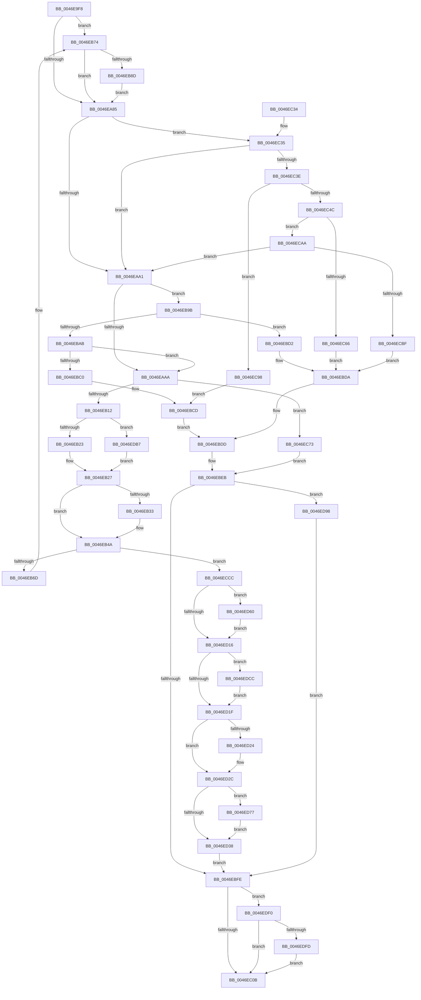

# CmpLoadKeyCommon

- RVA: `0x0046E9F8`–`0x0046EE0E` (길이 `1,046` bytes)
- VA: `0x000000014046E9F8`
- 실행 섹션: `.text`
- PDB 이름 있음: `예`; PDB Function 태그: `아니요`
- unwind 정보 RVA: `0x000ABBAC`
- 디코드: `243`개 명령, `1,046/1,046` bytes 표시
- 미해석 바이트: `0` (있으면 어셈블리에 `.byte`로 보존)

> 이 문서는 커널 이미지의 기계어와 PDB 기호를 분석해 생성했습니다. 4번과 5번은 함수 원형과 자료형을 바이너리 사용 방식에서 추정한 C 해석이며 원본 소스 복구 결과는 아닙니다.

## 1. Dependencies

- 직접 호출 지점: **39**; 고유 호출 대상: **26**
- 직접 호출자로 확인된 함수: **2**
- RIP 상대 이미지 참조: **8**

### Outgoing calls
- `0x0046EA8C` → [LOCK_HIVE_LOAD](../../page/9B/LOCK_HIVE_LOAD_function_009B2300.md) (function, `0x009B2300`)
- `0x0046EA93` → [CmpLockRegistryFreezeAware](../../page/9B/CmpLockRegistryFreezeAware_function_009B4AE4.md) (function, `0x009B4AE4`)
- `0x0046EAAA` → [CmpUnlockRegistry](../../pagecmrc/BC/CmpUnlockRegistry_function_00BC9A84.md) (function, `0x00BC9A84`)
- `0x0046EB03` → [CmpLinkHiveToMaster](../../page/87/CmpLinkHiveToMaster_function_00877D6C.md) (function, `0x00877D6C`)
- `0x0046EB29` → [CmpLockRegistryFreezeAware](../../page/9B/CmpLockRegistryFreezeAware_function_009B4AE4.md) (function, `0x009B4AE4`)
- `0x0046EB3A` → [CmpReferenceKeyControlBlockUnsafe](../../page/87/CmpReferenceKeyControlBlockUnsafe_function_00874DA0.md) (function, `0x00874DA0`)
- `0x0046EB4A` → [CmpLockHiveListExclusive](../../page/A7/CmpLockHiveListExclusive_function_00A72240.md) (function, `0x00A72240`)
- `0x0046EBA0` → [CmpPerformKeyBodyDeletionCheck](../../pagecmrc/BC/CmpPerformKeyBodyDeletionCheck_function_00BC97D0.md) (function, `0x00BC97D0`)
- `0x0046EBE6` → [SetFailureLocation](SetFailureLocation_function_0046EF54.md) (function, `0x0046EF54`)
- `0x0046EBEB` → [CmpUnlockRegistry](../../pagecmrc/BC/CmpUnlockRegistry_function_00BC9A84.md) (function, `0x00BC9A84`)
- `0x0046EBF0` → [UNLOCK_HIVE_LOAD](../../page/9B/UNLOCK_HIVE_LOAD_function_009B2EBC.md) (function, `0x009B2EBC`)
- `0x0046EC14` → [_security_check_cookie](../6A/_security_check_cookie_function_006AC640.md) (function, `0x006AC640`)
- `0x0046EC43` → [CmpIsKeyDeletedForKeyBody](../../pagecmrc/BC/CmpIsKeyDeletedForKeyBody_function_00BC9480.md) (function, `0x00BC9480`)
- `0x0046EC5B` → [CmpJoinClassOfTrust](CmpJoinClassOfTrust_function_0046EEB4.md) (function, `0x0046EEB4`)
- `0x0046EC87` → [SetFailureLocation](SetFailureLocation_function_0046EF54.md) (function, `0x0046EF54`)
- `0x0046EC8E` → [CmpLockRegistryFreezeAware](../../page/9B/CmpLockRegistryFreezeAware_function_009B4AE4.md) (function, `0x009B4AE4`)
- `0x0046ECB0` → [CmpVEAddHiveToSIDMappingTable](../../page/AA/CmpVEAddHiveToSIDMappingTable_function_00AA2190.md) (function, `0x00AA2190`)
- `0x0046ECDD` → [CmpUnlockHiveList](../../page/84/CmpUnlockHiveList_function_0084E424.md) (function, `0x0084E424`)
- `0x0046ECE2` → [CmpUnlockRegistry](../../pagecmrc/BC/CmpUnlockRegistry_function_00BC9A84.md) (function, `0x00BC9A84`)
- `0x0046ECEB` → [CmpAttachToRegistryProcess](../../pagecmrc/BC/CmpAttachToRegistryProcess_function_00BC98E0.md) (function, `0x00BC98E0`)
- `0x0046ECF3` → [CmpRecheckHiveVolumePolicy](CmpRecheckHiveVolumePolicy_function_0046EE14.md) (function, `0x0046EE14`)
- `0x0046ECFC` → [CmpDetachFromRegistryProcess](../../pagecmrc/BC/CmpDetachFromRegistryProcess_function_00BC9920.md) (function, `0x00BC9920`)
- `0x0046ED04` → [CmpDereferenceKeyControlBlockUnsafe](../../page/99/CmpDereferenceKeyControlBlockUnsafe_function_0099F960.md) (function, `0x0099F960`)
- `0x0046ED09` → [UNLOCK_HIVE_LOAD](../../page/9B/UNLOCK_HIVE_LOAD_function_009B2EBC.md) (function, `0x009B2EBC`)
- `0x0046ED27` → [CmpAddToHiveFileList](../../page/A8/CmpAddToHiveFileList_function_00A81914.md) (function, `0x00A81914`)
- `0x0046ED3B` → [CmpTrimHive](../../page/A4/CmpTrimHive_function_00A4F2FC.md) (function, `0x00A4F2FC`)
- `0x0046ED40` → [LOCK_HIVE_LOAD](../../page/9B/LOCK_HIVE_LOAD_function_009B2300.md) (function, `0x009B2300`)
- `0x0046ED54` → [UNLOCK_HIVE_LOAD](../../page/9B/UNLOCK_HIVE_LOAD_function_009B2EBC.md) (function, `0x009B2EBC`)
- `0x0046ED69` → [CmpInitCmRM](../../page/87/CmpInitCmRM_function_0087C700.md) (function, `0x0087C700`)
- `0x0046ED85` → [TmEnableCallbacks](../4F/TmEnableCallbacks_function_004FE0E0.md) (function, `0x004FE0E0`)
- `0x0046ED91` → [CmRmFinalizeRecovery](../../page/AB/CmRmFinalizeRecovery_function_00ABEB68.md) (function, `0x00ABEB68`)
- `0x0046ED9C` → [CmpAttachToRegistryProcess](../../pagecmrc/BC/CmpAttachToRegistryProcess_function_00BC98E0.md) (function, `0x00BC98E0`)
- `0x0046EDA4` → [CmpDestroyHive](../../page/9B/CmpDestroyHive_function_009B1708.md) (function, `0x009B1708`)
- `0x0046EDAD` → [CmpDetachFromRegistryProcess](../../pagecmrc/BC/CmpDetachFromRegistryProcess_function_00BC9920.md) (function, `0x00BC9920`)
- `0x0046EDBA` → [CmpReferenceKeyControlBlockUnsafe](../../page/87/CmpReferenceKeyControlBlockUnsafe_function_00874DA0.md) (function, `0x00874DA0`)
- `0x0046EDD0` → [CmpAttachToRegistryProcess](../../pagecmrc/BC/CmpAttachToRegistryProcess_function_00BC98E0.md) (function, `0x00BC98E0`)
- `0x0046EDDD` → [CmpFlushHive](../../page/9B/CmpFlushHive_function_009B3DC0.md) (function, `0x009B3DC0`)
- `0x0046EDE6` → [CmpDetachFromRegistryProcess](../../pagecmrc/BC/CmpDetachFromRegistryProcess_function_00BC9920.md) (function, `0x00BC9920`)
- `0x0046EE04` → [CmpSetGlobalQuotaAllowed](../../page/7E/CmpSetGlobalQuotaAllowed_function_007E23A0.md) (function, `0x007E23A0`)

### Direct callers
- [CmLoadAppKey](../../page/87/CmLoadAppKey_function_00876FFC.md) at `0x0087797B`
- [CmLoadKey](../../page/87/CmLoadKey_function_008787CC.md) at `0x00878A16`

### Static image references
- `0x0046EA14` → RVA `0x00E0A740` (`.data`; read)
- `0x0046EB4F` → RVA `0x00FD9D20` (`PAGEDATA`; read)
- `0x0046EB56` → RVA `0x00FD9D18` (`PAGEDATA`; read)
- `0x0046EBFE` → RVA `0x00FD9A62` (`PAGEDATA`; read)
- `0x0046ECD6` → RVA `0x00FD9D20` (`PAGEDATA`; write)
- `0x0046ED7A` → RVA `0x009B1950` (`CmKtmNotification`; read)
- `0x0046EDF0` → RVA `0x00EF7C58` (`.data`; read)
- `0x0046EDFD` → RVA `0x00FD9A62` (`PAGEDATA`; write)

## 2. Other-region calls and transfers

- 다른 실행 섹션으로 향하는 call: **33**
  - `0x0046EA8C` → [LOCK_HIVE_LOAD](../../page/9B/LOCK_HIVE_LOAD_function_009B2300.md) (`.text` → `PAGE`)
  - `0x0046EA93` → [CmpLockRegistryFreezeAware](../../page/9B/CmpLockRegistryFreezeAware_function_009B4AE4.md) (`.text` → `PAGE`)
  - `0x0046EAAA` → [CmpUnlockRegistry](../../pagecmrc/BC/CmpUnlockRegistry_function_00BC9A84.md) (`.text` → `PAGECMRC`)
  - `0x0046EB03` → [CmpLinkHiveToMaster](../../page/87/CmpLinkHiveToMaster_function_00877D6C.md) (`.text` → `PAGE`)
  - `0x0046EB29` → [CmpLockRegistryFreezeAware](../../page/9B/CmpLockRegistryFreezeAware_function_009B4AE4.md) (`.text` → `PAGE`)
  - `0x0046EB3A` → [CmpReferenceKeyControlBlockUnsafe](../../page/87/CmpReferenceKeyControlBlockUnsafe_function_00874DA0.md) (`.text` → `PAGE`)
  - `0x0046EB4A` → [CmpLockHiveListExclusive](../../page/A7/CmpLockHiveListExclusive_function_00A72240.md) (`.text` → `PAGE`)
  - `0x0046EBA0` → [CmpPerformKeyBodyDeletionCheck](../../pagecmrc/BC/CmpPerformKeyBodyDeletionCheck_function_00BC97D0.md) (`.text` → `PAGECMRC`)
  - `0x0046EBEB` → [CmpUnlockRegistry](../../pagecmrc/BC/CmpUnlockRegistry_function_00BC9A84.md) (`.text` → `PAGECMRC`)
  - `0x0046EBF0` → [UNLOCK_HIVE_LOAD](../../page/9B/UNLOCK_HIVE_LOAD_function_009B2EBC.md) (`.text` → `PAGE`)
  - `0x0046EC43` → [CmpIsKeyDeletedForKeyBody](../../pagecmrc/BC/CmpIsKeyDeletedForKeyBody_function_00BC9480.md) (`.text` → `PAGECMRC`)
  - `0x0046EC8E` → [CmpLockRegistryFreezeAware](../../page/9B/CmpLockRegistryFreezeAware_function_009B4AE4.md) (`.text` → `PAGE`)
  - `0x0046ECB0` → [CmpVEAddHiveToSIDMappingTable](../../page/AA/CmpVEAddHiveToSIDMappingTable_function_00AA2190.md) (`.text` → `PAGE`)
  - `0x0046ECDD` → [CmpUnlockHiveList](../../page/84/CmpUnlockHiveList_function_0084E424.md) (`.text` → `PAGE`)
  - `0x0046ECE2` → [CmpUnlockRegistry](../../pagecmrc/BC/CmpUnlockRegistry_function_00BC9A84.md) (`.text` → `PAGECMRC`)
  - `0x0046ECEB` → [CmpAttachToRegistryProcess](../../pagecmrc/BC/CmpAttachToRegistryProcess_function_00BC98E0.md) (`.text` → `PAGECMRC`)
  - `0x0046ECFC` → [CmpDetachFromRegistryProcess](../../pagecmrc/BC/CmpDetachFromRegistryProcess_function_00BC9920.md) (`.text` → `PAGECMRC`)
  - `0x0046ED04` → [CmpDereferenceKeyControlBlockUnsafe](../../page/99/CmpDereferenceKeyControlBlockUnsafe_function_0099F960.md) (`.text` → `PAGE`)
  - `0x0046ED09` → [UNLOCK_HIVE_LOAD](../../page/9B/UNLOCK_HIVE_LOAD_function_009B2EBC.md) (`.text` → `PAGE`)
  - `0x0046ED27` → [CmpAddToHiveFileList](../../page/A8/CmpAddToHiveFileList_function_00A81914.md) (`.text` → `PAGE`)
  - `0x0046ED3B` → [CmpTrimHive](../../page/A4/CmpTrimHive_function_00A4F2FC.md) (`.text` → `PAGE`)
  - `0x0046ED40` → [LOCK_HIVE_LOAD](../../page/9B/LOCK_HIVE_LOAD_function_009B2300.md) (`.text` → `PAGE`)
  - `0x0046ED54` → [UNLOCK_HIVE_LOAD](../../page/9B/UNLOCK_HIVE_LOAD_function_009B2EBC.md) (`.text` → `PAGE`)
  - `0x0046ED69` → [CmpInitCmRM](../../page/87/CmpInitCmRM_function_0087C700.md) (`.text` → `PAGE`)
  - `0x0046ED91` → [CmRmFinalizeRecovery](../../page/AB/CmRmFinalizeRecovery_function_00ABEB68.md) (`.text` → `PAGE`)
  - `0x0046ED9C` → [CmpAttachToRegistryProcess](../../pagecmrc/BC/CmpAttachToRegistryProcess_function_00BC98E0.md) (`.text` → `PAGECMRC`)
  - `0x0046EDA4` → [CmpDestroyHive](../../page/9B/CmpDestroyHive_function_009B1708.md) (`.text` → `PAGE`)
  - `0x0046EDAD` → [CmpDetachFromRegistryProcess](../../pagecmrc/BC/CmpDetachFromRegistryProcess_function_00BC9920.md) (`.text` → `PAGECMRC`)
  - `0x0046EDBA` → [CmpReferenceKeyControlBlockUnsafe](../../page/87/CmpReferenceKeyControlBlockUnsafe_function_00874DA0.md) (`.text` → `PAGE`)
  - `0x0046EDD0` → [CmpAttachToRegistryProcess](../../pagecmrc/BC/CmpAttachToRegistryProcess_function_00BC98E0.md) (`.text` → `PAGECMRC`)
  - `0x0046EDDD` → [CmpFlushHive](../../page/9B/CmpFlushHive_function_009B3DC0.md) (`.text` → `PAGE`)
  - `0x0046EDE6` → [CmpDetachFromRegistryProcess](../../pagecmrc/BC/CmpDetachFromRegistryProcess_function_00BC9920.md) (`.text` → `PAGECMRC`)
  - `0x0046EE04` → [CmpSetGlobalQuotaAllowed](../../page/7E/CmpSetGlobalQuotaAllowed_function_007E23A0.md) (`.text` → `PAGE`)
- 별도 외부 분기/꼬리 이동을 확인하지 못했습니다.

## 3. Assembly (complete function range)

```asm
0046E9F8  48 89 5C 24 18                  mov qword ptr [rsp + 0x18], rbx
0046E9FD  55                              push rbp
0046E9FE  56                              push rsi
0046E9FF  57                              push rdi
0046EA00  41 54                           push r12
0046EA02  41 55                           push r13
0046EA04  41 56                           push r14
0046EA06  41 57                           push r15
0046EA08  48 8D 6C 24 F9                  lea rbp, [rsp - 7]
0046EA0D  48 81 EC C0 00 00 00            sub rsp, 0xc0
0046EA14  48 8B 05 25 BD 99 00            mov rax, qword ptr [rip + 0x99bd25]
0046EA1B  48 33 C4                        xor rax, rsp
0046EA1E  48 89 45 F7                     mov qword ptr [rbp - 9], rax
0046EA22  48 8B 45 6F                     mov rax, qword ptr [rbp + 0x6f]
0046EA26  0F 57 C0                        xorps xmm0, xmm0
0046EA29  83 89 A0 00 00 00 20            or dword ptr [rcx + 0xa0], 0x20
0046EA30  45 33 ED                        xor r13d, r13d
0046EA33  48 83 65 AF 00                  and qword ptr [rbp - 0x51], 0
0046EA38  45 8B F0                        mov r14d, r8d
0046EA3B  4C 8B 7D 67                     mov r15, qword ptr [rbp + 0x67]
0046EA3F  49 8B F9                        mov rdi, r9
0046EA42  48 8B B5 97 00 00 00            mov rsi, qword ptr [rbp + 0x97]
0046EA49  4C 8B E2                        mov r12, rdx
0046EA4C  48 89 45 BF                     mov qword ptr [rbp - 0x41], rax
0046EA50  48 8B D9                        mov rbx, rcx
0046EA53  48 8B 45 7F                     mov rax, qword ptr [rbp + 0x7f]
0046EA57  48 89 45 B7                     mov qword ptr [rbp - 0x49], rax
0046EA5B  44 89 45 A7                     mov dword ptr [rbp - 0x59], r8d
0046EA5F  0F 11 45 C7                     movups xmmword ptr [rbp - 0x39], xmm0
0046EA63  0F 11 45 D7                     movups xmmword ptr [rbp - 0x29], xmm0
0046EA67  0F 11 45 E7                     movups xmmword ptr [rbp - 0x19], xmm0
0046EA6B  65 48 8B 04 25 88 01 00 00      mov rax, qword ptr gs:[0x188]
0046EA74  48 89 81 48 10 00 00            mov qword ptr [rcx + 0x1048], rax
0046EA7B  41 83 E6 10                     and r14d, 0x10
0046EA7F  0F 85 EF 00 00 00               jne 0x14046eb74
0046EA85  83 89 10 10 00 00 01            or dword ptr [rcx + 0x1010], 1
0046EA8C  E8 6F 38 54 00                  call 0x1409b2300
0046EA91  B1 01                           mov cl, 1
0046EA93  E8 4C 60 54 00                  call 0x1409b4ae4
0046EA98  48 85 FF                        test rdi, rdi
0046EA9B  0F 85 94 01 00 00               jne 0x14046ec35
0046EAA1  4D 85 FF                        test r15, r15
0046EAA4  0F 85 F1 00 00 00               jne 0x14046eb9b
0046EAAA  E8 D5 AF 75 00                  call 0x140bc9a84
0046EAAF  44 8A BD 87 00 00 00            mov r15b, byte ptr [rbp + 0x87]
0046EAB6  48 8D 45 AF                     lea rax, [rbp - 0x51]
0046EABA  49 8B 4C 24 10                  mov rcx, qword ptr [r12 + 0x10]
0046EABF  45 85 F6                        test r14d, r14d
0046EAC2  48 89 74 24 58                  mov qword ptr [rsp + 0x58], rsi
0046EAC7  45 8A CF                        mov r9b, r15b
0046EACA  C6 44 24 50 00                  mov byte ptr [rsp + 0x50], 0
0046EACF  0F 95 C2                        setne dl
0046EAD2  48 89 44 24 48                  mov qword ptr [rsp + 0x48], rax
0046EAD7  4C 8B C3                        mov r8, rbx
0046EADA  49 8B 44 24 20                  mov rax, qword ptr [r12 + 0x20]
0046EADF  4C 89 6C 24 40                  mov qword ptr [rsp + 0x40], r13
0046EAE4  48 89 44 24 38                  mov qword ptr [rsp + 0x38], rax
0046EAE9  48 8B 45 BF                     mov rax, qword ptr [rbp - 0x41]
0046EAED  48 89 44 24 30                  mov qword ptr [rsp + 0x30], rax
0046EAF2  88 54 24 28                     mov byte ptr [rsp + 0x28], dl
0046EAF6  49 8B 54 24 08                  mov rdx, qword ptr [r12 + 8]
0046EAFB  C7 44 24 20 00 02 00 00         mov dword ptr [rsp + 0x20], 0x200
0046EB03  E8 64 92 40 00                  call 0x140877d6c
0046EB08  8B F8                           mov edi, eax
0046EB0A  85 C0                           test eax, eax
0046EB0C  0F 88 61 01 00 00               js 0x14046ec73
0046EB12  8B 75 A7                        mov esi, dword ptr [rbp - 0x59]
0046EB15  48 8B 7D AF                     mov rdi, qword ptr [rbp - 0x51]
0046EB19  0F BA E6 0B                     bt esi, 0xb
0046EB1D  0F 82 94 02 00 00               jb 0x14046edb7
0046EB23  4C 8B 65 B7                     mov r12, qword ptr [rbp - 0x49]
0046EB27  B1 01                           mov cl, 1
0046EB29  E8 B6 5F 54 00                  call 0x1409b4ae4
0046EB2E  45 85 F6                        test r14d, r14d
0046EB31  74 17                           je 0x14046eb4a
0046EB33  48 8B 8B 78 0B 00 00            mov rcx, qword ptr [rbx + 0xb78]
0046EB3A  E8 61 62 40 00                  call 0x140874da0
0046EB3F  48 8B 83 78 0B 00 00            mov rax, qword ptr [rbx + 0xb78]
0046EB46  49 89 04 24                     mov qword ptr [r12], rax
0046EB4A  E8 F1 36 60 00                  call 0x140a72240
0046EB4F  48 8B 0D CA B1 B6 00            mov rcx, qword ptr [rip + 0xb6b1ca]
0046EB56  48 8D 15 BB B1 B6 00            lea rdx, [rip + 0xb6b1bb]
0046EB5D  48 8D 83 48 06 00 00            lea rax, [rbx + 0x648]
0046EB64  48 39 11                        cmp qword ptr [rcx], rdx
0046EB67  0F 84 5F 01 00 00               je 0x14046eccc
0046EB6D  B9 03 00 00 00                  mov ecx, 3
0046EB72  CD 29                           int 0x29
0046EB74  8B 81 10 10 00 00               mov eax, dword ptr [rcx + 0x1010]
0046EB7A  83 C8 20                        or eax, 0x20
0046EB7D  89 81 10 10 00 00               mov dword ptr [rcx + 0x1010], eax
0046EB83  41 F6 C0 20                     test r8b, 0x20
0046EB87  0F 84 F8 FE FF FF               je 0x14046ea85
0046EB8D  83 C8 40                        or eax, 0x40
0046EB90  89 81 10 10 00 00               mov dword ptr [rcx + 0x1010], eax
0046EB96  E9 EA FE FF FF                  jmp 0x14046ea85
0046EB9B  33 D2                           xor edx, edx
0046EB9D  49 8B CF                        mov rcx, r15
0046EBA0  E8 2B AC 75 00                  call 0x140bc97d0
0046EBA5  8B F8                           mov edi, eax
0046EBA7  85 C0                           test eax, eax
0046EBA9  78 27                           js 0x14046ebd2
0046EBAB  4D 8B 6F 08                     mov r13, qword ptr [r15 + 8]
0046EBAF  41 F7 85 B8 00 00 00 00 00 04 00  test dword ptr [r13 + 0xb8], 0x40000
0046EBBA  0F 85 EA FE FF FF               jne 0x14046eaaa
0046EBC0  BF 0D 00 00 C0                  mov edi, 0xc000000d
0046EBC5  C7 44 24 20 50 00 00 00         mov dword ptr [rsp + 0x20], 0x50
0046EBCD  44 8B CF                        mov r9d, edi
0046EBD0  EB 0B                           jmp 0x14046ebdd
0046EBD2  C7 44 24 20 40 00 00 00         mov dword ptr [rsp + 0x20], 0x40
0046EBDA  44 8B C8                        mov r9d, eax
0046EBDD  33 D2                           xor edx, edx
0046EBDF  48 8B CE                        mov rcx, rsi
0046EBE2  44 8D 42 1D                     lea r8d, [rdx + 0x1d]
0046EBE6  E8 69 03 00 00                  call 0x14046ef54
0046EBEB  E8 94 AE 75 00                  call 0x140bc9a84
0046EBF0  E8 C7 42 54 00                  call 0x1409b2ebc
0046EBF5  48 85 DB                        test rbx, rbx
0046EBF8  0F 85 9A 01 00 00               jne 0x14046ed98
0046EBFE  80 3D 5D AE B6 00 00            cmp byte ptr [rip + 0xb6ae5d], 0
0046EC05  0F 84 E5 01 00 00               je 0x14046edf0
0046EC0B  8B C7                           mov eax, edi
0046EC0D  48 8B 4D F7                     mov rcx, qword ptr [rbp - 9]
0046EC11  48 33 CC                        xor rcx, rsp
0046EC14  E8 27 DA 23 00                  call 0x1406ac640
0046EC19  48 8B 9C 24 10 01 00 00         mov rbx, qword ptr [rsp + 0x110]
0046EC21  48 81 C4 C0 00 00 00            add rsp, 0xc0
0046EC28  41 5F                           pop r15
0046EC2A  41 5E                           pop r14
0046EC2C  41 5D                           pop r13
0046EC2E  41 5C                           pop r12
0046EC30  5F                              pop rdi
0046EC31  5E                              pop rsi
0046EC32  5D                              pop rbp
0046EC33  C3                              ret
0046EC34  CC                              int3
0046EC35  45 85 F6                        test r14d, r14d
0046EC38  0F 85 63 FE FF FF               jne 0x14046eaa1
0046EC3E  33 D2                           xor edx, edx
0046EC40  48 8B CF                        mov rcx, rdi
0046EC43  E8 38 A8 75 00                  call 0x140bc9480
0046EC48  84 C0                           test al, al
0046EC4A  75 4C                           jne 0x14046ec98
0046EC4C  48 8B 47 08                     mov rax, qword ptr [rdi + 8]
0046EC50  48 8B CB                        mov rcx, rbx
0046EC53  44 8A 45 77                     mov r8b, byte ptr [rbp + 0x77]
0046EC57  48 8B 50 20                     mov rdx, qword ptr [rax + 0x20]
0046EC5B  E8 54 02 00 00                  call 0x14046eeb4
0046EC60  8B F8                           mov edi, eax
0046EC62  85 C0                           test eax, eax
0046EC64  79 44                           jns 0x14046ecaa
0046EC66  C7 44 24 20 20 00 00 00         mov dword ptr [rsp + 0x20], 0x20
0046EC6E  E9 67 FF FF FF                  jmp 0x14046ebda
0046EC73  33 D2                           xor edx, edx
0046EC75  C7 44 24 20 60 00 00 00         mov dword ptr [rsp + 0x20], 0x60
0046EC7D  44 8B C8                        mov r9d, eax
0046EC80  48 8B CE                        mov rcx, rsi
0046EC83  44 8D 42 1D                     lea r8d, [rdx + 0x1d]
0046EC87  E8 C8 02 00 00                  call 0x14046ef54
0046EC8C  B1 01                           mov cl, 1
0046EC8E  E8 51 5E 54 00                  call 0x1409b4ae4
0046EC93  E9 53 FF FF FF                  jmp 0x14046ebeb
0046EC98  BF 7C 01 00 C0                  mov edi, 0xc000017c
0046EC9D  C7 44 24 20 10 00 00 00         mov dword ptr [rsp + 0x20], 0x10
0046ECA5  E9 23 FF FF FF                  jmp 0x14046ebcd
0046ECAA  49 8B D4                        mov rdx, r12
0046ECAD  48 8B CB                        mov rcx, rbx
0046ECB0  E8 DB 34 63 00                  call 0x140aa2190
0046ECB5  8B F8                           mov edi, eax
0046ECB7  85 C0                           test eax, eax
0046ECB9  0F 89 E2 FD FF FF               jns 0x14046eaa1
0046ECBF  C7 44 24 20 30 00 00 00         mov dword ptr [rsp + 0x20], 0x30
0046ECC7  E9 0E FF FF FF                  jmp 0x14046ebda
0046ECCC  48 89 10                        mov qword ptr [rax], rdx
0046ECCF  48 89 48 08                     mov qword ptr [rax + 8], rcx
0046ECD3  48 89 01                        mov qword ptr [rcx], rax
0046ECD6  48 89 05 43 B0 B6 00            mov qword ptr [rip + 0xb6b043], rax
0046ECDD  E8 42 F7 3D 00                  call 0x14084e424
0046ECE2  E8 9D AD 75 00                  call 0x140bc9a84
0046ECE7  48 8D 4D C7                     lea rcx, [rbp - 0x39]
0046ECEB  E8 F0 AB 75 00                  call 0x140bc98e0
0046ECF0  48 8B CB                        mov rcx, rbx
0046ECF3  E8 1C 01 00 00                  call 0x14046ee14
0046ECF8  48 8D 4D C7                     lea rcx, [rbp - 0x39]
0046ECFC  E8 1F AC 75 00                  call 0x140bc9920
0046ED01  48 8B CF                        mov rcx, rdi
0046ED04  E8 57 0C 53 00                  call 0x14099f960
0046ED09  E8 AE 41 54 00                  call 0x1409b2ebc
0046ED0E  F7 C6 10 01 00 00               test esi, 0x110
0046ED14  74 4A                           je 0x14046ed60
0046ED16  45 84 FF                        test r15b, r15b
0046ED19  0F 85 AD 00 00 00               jne 0x14046edcc
0046ED1F  45 85 F6                        test r14d, r14d
0046ED22  75 08                           jne 0x14046ed2c
0046ED24  48 8B CB                        mov rcx, rbx
0046ED27  E8 E8 2B 61 00                  call 0x140a81914
0046ED2C  48 8B 8B 38 10 00 00            mov rcx, qword ptr [rbx + 0x1038]
0046ED33  48 85 C9                        test rcx, rcx
0046ED36  75 3F                           jne 0x14046ed77
0046ED38  48 8B CB                        mov rcx, rbx
0046ED3B  E8 BC 05 5E 00                  call 0x140a4f2fc
0046ED40  E8 BB 35 54 00                  call 0x1409b2300
0046ED45  83 A3 A0 00 00 00 DF            and dword ptr [rbx + 0xa0], 0xffffffdf
0046ED4C  48 83 A3 48 10 00 00 00         and qword ptr [rbx + 0x1048], 0
0046ED54  E8 63 41 54 00                  call 0x1409b2ebc
0046ED59  33 FF                           xor edi, edi
0046ED5B  E9 9E FE FF FF                  jmp 0x14046ebfe
0046ED60  8A 95 8F 00 00 00               mov dl, byte ptr [rbp + 0x8f]
0046ED66  48 8B CB                        mov rcx, rbx
0046ED69  E8 92 D9 40 00                  call 0x14087c700
0046ED6E  83 8B 10 10 00 00 08            or dword ptr [rbx + 0x1010], 8
0046ED75  EB 9F                           jmp 0x14046ed16
0046ED77  4C 8B C1                        mov r8, rcx
0046ED7A  48 8D 15 CF 2B 54 00            lea rdx, [rip + 0x542bcf]
0046ED81  48 8B 49 38                     mov rcx, qword ptr [rcx + 0x38]
0046ED85  E8 56 F3 08 00                  call 0x1404fe0e0
0046ED8A  48 8B 8B 38 10 00 00            mov rcx, qword ptr [rbx + 0x1038]
0046ED91  E8 D2 FD 64 00                  call 0x140abeb68
0046ED96  EB A0                           jmp 0x14046ed38
0046ED98  48 8D 4D C7                     lea rcx, [rbp - 0x39]
0046ED9C  E8 3F AB 75 00                  call 0x140bc98e0
0046EDA1  48 8B CB                        mov rcx, rbx
0046EDA4  E8 5F 29 54 00                  call 0x1409b1708
0046EDA9  48 8D 4D C7                     lea rcx, [rbp - 0x39]
0046EDAD  E8 6E AB 75 00                  call 0x140bc9920
0046EDB2  E9 47 FE FF FF                  jmp 0x14046ebfe
0046EDB7  48 8B CF                        mov rcx, rdi
0046EDBA  E8 E1 5F 40 00                  call 0x140874da0
0046EDBF  4C 8B 65 B7                     mov r12, qword ptr [rbp - 0x49]
0046EDC3  49 89 3C 24                     mov qword ptr [r12], rdi
0046EDC7  E9 5B FD FF FF                  jmp 0x14046eb27
0046EDCC  48 8D 4D C7                     lea rcx, [rbp - 0x39]
0046EDD0  E8 0B AB 75 00                  call 0x140bc98e0
0046EDD5  BA 04 00 00 00                  mov edx, 4
0046EDDA  48 8B CB                        mov rcx, rbx
0046EDDD  E8 DE 4F 54 00                  call 0x1409b3dc0
0046EDE2  48 8D 4D C7                     lea rcx, [rbp - 0x39]
0046EDE6  E8 35 AB 75 00                  call 0x140bc9920
0046EDEB  E9 2F FF FF FF                  jmp 0x14046ed1f
0046EDF0  80 3D 61 8E A8 00 00            cmp byte ptr [rip + 0xa88e61], 0
0046EDF7  0F 85 0E FE FF FF               jne 0x14046ec0b
0046EDFD  C6 05 5E AC B6 00 01            mov byte ptr [rip + 0xb6ac5e], 1
0046EE04  E8 97 35 37 00                  call 0x1407e23a0
0046EE09  E9 FD FD FF FF                  jmp 0x14046ec0b
```

## 4. C-style interpretation (structured pseudocode)

```c
__int64 __fastcall CmpLoadKeyCommon(__int64 a1, __int64 a2, int a3, __int64 a4, __int64 a5, __int64 a6, unsigned __int8 a7, __int64 a8, unsigned __int8 a9, unsigned __int8 a10, __int64 a11)
{
    __int64 result;
    __int64 v_r13;
    __int64 v_r14;
    __int64 v_rdi;
    __int64 v_rsp;
    unsigned __int64 v_stack_m3F;
    unsigned __int64 v_stack_m48;
    unsigned __int64 v_stack_m58;
    unsigned __int64 v_stack_m68;
    unsigned __int64 v_stack_m78;
    unsigned __int64 v_stack_m80;
    unsigned __int64 v_stack_m88;
    unsigned __int64 v_stack_m90;
    unsigned int v_stack_m98;
    unsigned __int64 v_stack_mA0;
    unsigned __int8 v_stack_mA8;
    unsigned __int64 v_stack_mB0;
    unsigned __int64 v_stack_mB8;
    unsigned __int64 v_stack_mC0;
    unsigned __int64 v_stack_mC8;
    unsigned __int8 v_stack_mD0;
    unsigned int v_stack_mD8;
    unsigned __int64 v_stack_p18;
    unsigned int v_stack_p20;

    v_stack_p18 = v_rbx;
    v_rsp = (v_rsp) - (192);
    result = (*(unsigned __int64 *)(v_rip + 10075429)) ^ (v_rsp);
    v_stack_m48 = result;
    v_r13 = 0;
    v_stack_m80 = a6;
    v_stack_m88 = a8;
    v_stack_m98 = a3;
    v_stack_m78 = v_xmm0;
    v_stack_m68 = v_xmm0;
    v_stack_m58 = v_xmm0;
    *(unsigned __int64 *)(a1 + 4168) = *(unsigned __int64 *)(gs_base + (0 + 392));
    v_r14 = (unsigned int)(((unsigned int)(a3)) & (16));
    if (condition_is_not_equal) goto loc_0046EB74;
loc_0046EA85:
    result = LOCK_HIVE_LOAD(a1, a2, a3, a4);
    result = CmpLockRegistryFreezeAware(1, a2, a3, a4);
    if (a4 != 0) goto loc_0046EC35;
loc_0046EAA1:
    if (a5 != 0) goto loc_0046EB9B;
loc_0046EAAA:
    result = CmpUnlockRegistry(1, a2, a3, a4);
    v_stack_mA0 = a11;
    v_stack_mA8 = 0;
    a2 = ((unsigned int)(v_r14) != 0) ? 1 : 0;
    v_stack_mB0 = v_stack_m90;
    v_stack_mB8 = 0;
    v_stack_mC0 = *(unsigned __int64 *)(a2 + 32);
    v_stack_mC8 = v_stack_m80;
    v_stack_mD0 = (unsigned __int8)(a2);
    v_stack_mD8 = 512;
    result = CmpLinkHiveToMaster(*(unsigned __int64 *)(a2 + 16), *(unsigned __int64 *)(a2 + 8), a1, a9);
    if (sign_flag) goto loc_0046EC73;
    if (condition_is_below) goto loc_0046EDB7;
loc_0046EB27:
    result = CmpLockRegistryFreezeAware(1, *(unsigned __int64 *)(a2 + 8), a1, a9);
    if ((unsigned int)(v_r14) != 0) {
        a1 = *(unsigned __int64 *)(a1 + 2936);
        result = CmpReferenceKeyControlBlockUnsafe(a1, *(unsigned __int64 *)(a2 + 8), a1, a9);
        result = *(unsigned __int64 *)(a1 + 2936);
        *(unsigned __int64 *)(v_stack_m88) = result;
    }
    result = CmpLockHiveListExclusive(a1, *(unsigned __int64 *)(a2 + 8), a1, a9);
    if ((*(unsigned __int64 *)(*(unsigned __int64 *)(v_rip + 11973066))) == (v_rip + 11973051)) goto loc_0046ECCC;
loc_0046EB74:
    result = (unsigned int)(((unsigned int)(*(unsigned int *)(3 + 4112))) | (32));
    *(unsigned int *)(3 + 4112) = (unsigned int)(result);
    if ((((unsigned __int8)(a1)) & (32)) == 0) goto loc_0046EA85;
    result = (unsigned int)((result) | (64));
    *(unsigned int *)(3 + 4112) = (unsigned int)(result);
    goto loc_0046EA85;
loc_0046EB9B:
    a2 = 0;
    result = CmpPerformKeyBodyDeletionCheck(a9, a2, a1, a9);
    if (sign_flag) goto loc_0046EBD2;
    if (((*(unsigned int *)(*(unsigned __int64 *)(a9 + 8) + 184)) & (0x40000ULL)) != 0) goto loc_0046EAAA;
    v_stack_mD8 = 80;
loc_0046EBCD:
    goto loc_0046EBDD;
loc_0046EBD2:
    v_stack_mD8 = 64;
loc_0046EBDA:
loc_0046EBDD:
    a2 = 0;
    result = SetFailureLocation((unsigned int)(v_stack_m98), a2, a2 + 29, (unsigned int)((unsigned int)(result)));
loc_0046EBEB:
    result = CmpUnlockRegistry((unsigned int)(v_stack_m98), a2, a2 + 29, (unsigned int)((unsigned int)(result)));
    result = UNLOCK_HIVE_LOAD((unsigned int)(v_stack_m98), a2, a2 + 29, (unsigned int)((unsigned int)(result)));
    if (a1 != 0) goto loc_0046ED98;
loc_0046EBFE:
    if ((*(unsigned __int8 *)(v_rip + 11972189)) == 0) goto loc_0046EDF0;
loc_0046EC0B:
    a1 = (v_stack_m48) ^ (v_rsp);
    result = _security_check_cookie(a1, a2, a2 + 29, (unsigned int)((unsigned int)(result)));
    v_rsp = (v_rsp) + (192);
    return result;
loc_0046EC35:
    if ((unsigned int)(v_r14) != 0) goto loc_0046EAA1;
    a2 = 0;
    result = CmpIsKeyDeletedForKeyBody((unsigned int)(0xC000000DULL), a2, a2 + 29, (unsigned int)((unsigned int)(result)));
    if ((unsigned __int8)(result) != 0) goto loc_0046EC98;
    result = CmpJoinClassOfTrust(v_stack_p18, *(unsigned __int64 *)(*(unsigned __int64 *)((unsigned int)(0xC000000DULL) + 8) + 32), a7, (unsigned int)((unsigned int)(result)));
    if (!sign_flag) goto loc_0046ECAA;
    v_stack_p20 = 32;
    goto loc_0046EBDA;
loc_0046EC73:
    a2 = 0;
    v_stack_p20 = 96;
    result = SetFailureLocation((unsigned int)(v_stack_m98), a2, a2 + 29, (unsigned int)((unsigned int)(result)));
    result = CmpLockRegistryFreezeAware(1, a2, a2 + 29, (unsigned int)((unsigned int)(result)));
    goto loc_0046EBEB;
loc_0046EC98:
    v_stack_p20 = 16;
    goto loc_0046EBCD;
loc_0046ECAA:
    result = CmpVEAddHiveToSIDMappingTable(v_stack_p18, v_stack_m88, a2 + 29, (unsigned int)((unsigned int)(result)));
    if (!sign_flag) goto loc_0046EAA1;
    v_stack_p20 = 48;
    goto loc_0046EBDA;
loc_0046ECCC:
    *(unsigned __int64 *)(result) = v_stack_m88;
    *(unsigned __int64 *)(result + 8) = v_stack_p18;
    *(unsigned __int64 *)(v_stack_p18) = result;
    *(unsigned __int64 *)(v_rip + 11972675) = result;
    result = CmpUnlockHiveList(v_stack_p18, v_stack_m88, a2 + 29, (unsigned int)((unsigned int)(result)));
    result = CmpUnlockRegistry(v_stack_p18, v_stack_m88, a2 + 29, (unsigned int)((unsigned int)(result)));
    result = CmpAttachToRegistryProcess(v_stack_m78, v_stack_m88, a2 + 29, (unsigned int)((unsigned int)(result)));
    result = CmpRecheckHiveVolumePolicy(v_stack_p18, v_stack_m88, a2 + 29, (unsigned int)((unsigned int)(result)));
    result = CmpDetachFromRegistryProcess(v_stack_m78, v_stack_m88, a2 + 29, (unsigned int)((unsigned int)(result)));
    result = CmpDereferenceKeyControlBlockUnsafe((unsigned int)((unsigned int)(result)), v_stack_m88, a2 + 29, (unsigned int)((unsigned int)(result)));
    result = UNLOCK_HIVE_LOAD((unsigned int)((unsigned int)(result)), v_stack_m88, a2 + 29, (unsigned int)((unsigned int)(result)));
    if ((((unsigned int)((unsigned int)(v_stack_m98))) & (272)) == 0) goto loc_0046ED60;
loc_0046ED16:
    if (a9 != 0) goto loc_0046EDCC;
loc_0046ED1F:
    if ((unsigned int)(v_r14) == 0) {
        a1 = v_stack_p18;
        result = CmpAddToHiveFileList(a1, v_stack_m88, a2 + 29, (unsigned int)((unsigned int)(result)));
    }
    if (*(unsigned __int64 *)(v_stack_p18 + 4152) != 0) goto loc_0046ED77;
loc_0046ED38:
    result = CmpTrimHive(v_stack_p18, v_stack_m88, a2 + 29, (unsigned int)((unsigned int)(result)));
    result = LOCK_HIVE_LOAD(v_stack_p18, v_stack_m88, a2 + 29, (unsigned int)((unsigned int)(result)));
    result = UNLOCK_HIVE_LOAD(v_stack_p18, v_stack_m88, a2 + 29, (unsigned int)((unsigned int)(result)));
    v_rdi = 0;
    goto loc_0046EBFE;
loc_0046ED60:
    result = CmpInitCmRM(v_stack_p18, a10, a2 + 29, (unsigned int)((unsigned int)(result)));
    goto loc_0046ED16;
loc_0046ED77:
    result = TmEnableCallbacks(*(unsigned __int64 *)(v_stack_p18 + 56), v_rip + 5516239, v_stack_p18, (unsigned int)((unsigned int)(result)));
    result = CmRmFinalizeRecovery(*(unsigned __int64 *)(v_stack_p18 + 4152), v_rip + 5516239, v_stack_p18, (unsigned int)((unsigned int)(result)));
    goto loc_0046ED38;
loc_0046ED98:
    result = CmpAttachToRegistryProcess(v_stack_m78, v_rip + 5516239, v_stack_p18, (unsigned int)((unsigned int)(result)));
    result = CmpDestroyHive(v_stack_p18, v_rip + 5516239, v_stack_p18, (unsigned int)((unsigned int)(result)));
    result = CmpDetachFromRegistryProcess(v_stack_m78, v_rip + 5516239, v_stack_p18, (unsigned int)((unsigned int)(result)));
    goto loc_0046EBFE;
loc_0046EDB7:
    result = CmpReferenceKeyControlBlockUnsafe(0, v_rip + 5516239, v_stack_p18, (unsigned int)((unsigned int)(result)));
    *(unsigned __int64 *)(v_stack_m88) = 0;
    goto loc_0046EB27;
loc_0046EDCC:
    result = CmpAttachToRegistryProcess(v_stack_m78, v_rip + 5516239, v_stack_p18, (unsigned int)((unsigned int)(result)));
    result = CmpFlushHive(v_stack_p18, 4, v_stack_p18, (unsigned int)((unsigned int)(result)));
    result = CmpDetachFromRegistryProcess(v_stack_m78, 4, v_stack_p18, (unsigned int)((unsigned int)(result)));
    goto loc_0046ED1F;
loc_0046EDF0:
    if ((*(unsigned __int8 *)(v_rip + 11046497)) != 0) goto loc_0046EC0B;
    *(unsigned __int8 *)(v_rip + 11971678) = 1;
    result = CmpSetGlobalQuotaAllowed(v_stack_m78, 4, v_stack_p18, (unsigned int)((unsigned int)(result)));
    goto loc_0046EC0B;
}
```

## 5. (Beta) C Style

```c
int64_t CmpLoadKeyCommon(void *Arg1, int64_t Arg2, int32_t Arg3, int64_t Arg4, int64_t Arg5, int64_t Arg6, uint8_t Arg7, int64_t Arg8, uint8_t Arg9, uint8_t Arg10, int64_t Arg11)
{
    uint8_t *arg1 = (uint8_t *)Arg1;

    int64_t result;
    int64_t local_r13;
    int64_t local_r14;
    int64_t local_rdi;
    int64_t local_rsp;
    uint64_t v_stack_m3F;
    uint64_t v_stack_m48;
    uint64_t v_stack_m58;
    uint64_t v_stack_m68;
    uint64_t v_stack_m78;
    uint64_t v_stack_m80;
    uint64_t v_stack_m88;
    uint64_t v_stack_m90;
    uint32_t v_stack_m98;
    uint64_t v_stack_mA0;
    uint8_t v_stack_mA8;
    uint64_t v_stack_mB0;
    uint64_t v_stack_mB8;
    uint64_t v_stack_mC0;
    uint64_t v_stack_mC8;
    uint8_t v_stack_mD0;
    uint32_t v_stack_mD8;
    uint64_t v_stack_p18;
    uint32_t v_stack_p20;

    v_stack_p18 = local_rbx;
    local_rsp = (local_rsp) - (192);
    result = (*(uint64_t *)(v_rip + 0x99BD25)) ^ (local_rsp);
    v_stack_m48 = result;
    local_r13 = 0;
    v_stack_m80 = Arg6;
    v_stack_m88 = Arg8;
    v_stack_m98 = Arg3;
    v_stack_m78 = v_xmm0;
    v_stack_m68 = v_xmm0;
    v_stack_m58 = v_xmm0;
    *(uint64_t *)(arg1 + 0x1048) = *(uint64_t *)(gs_base + (0 + 0x188));
    local_r14 = (uint32_t)(((uint32_t)(Arg3)) & (16));
    if (condition_is_not_equal) goto loc_0046EB74;
loc_0046EA85:
    result = LOCK_HIVE_LOAD(Arg1, Arg2, Arg3, Arg4);
    result = CmpLockRegistryFreezeAware(1, Arg2, Arg3, Arg4);
    if (Arg4 != 0) goto loc_0046EC35;
loc_0046EAA1:
    if (Arg5 != 0) goto loc_0046EB9B;
loc_0046EAAA:
    result = CmpUnlockRegistry(1, Arg2, Arg3, Arg4);
    v_stack_mA0 = Arg11;
    v_stack_mA8 = 0;
    Arg2 = ((uint32_t)(local_r14) != 0) ? 1 : 0;
    v_stack_mB0 = v_stack_m90;
    v_stack_mB8 = 0;
    v_stack_mC0 = *(uint64_t *)(Arg2 + 0x20);
    v_stack_mC8 = v_stack_m80;
    v_stack_mD0 = (uint8_t)(Arg2);
    v_stack_mD8 = 512;
    result = CmpLinkHiveToMaster(*(uint64_t *)(Arg2 + 0x10), *(uint64_t *)(Arg2 + 0x8), Arg1, Arg9);
    if (sign_flag) goto loc_0046EC73;
    if (condition_is_below) goto loc_0046EDB7;
loc_0046EB27:
    result = CmpLockRegistryFreezeAware(1, *(uint64_t *)(Arg2 + 0x8), Arg1, Arg9);
    if ((uint32_t)(local_r14) != 0) {
        Arg1 = *(uint64_t *)(arg1 + 0xB78);
        result = CmpReferenceKeyControlBlockUnsafe(Arg1, *(uint64_t *)(Arg2 + 0x8), Arg1, Arg9);
        result = *(uint64_t *)(arg1 + 0xB78);
        *(uint64_t *)(v_stack_m88) = result;
    }
    result = CmpLockHiveListExclusive(Arg1, *(uint64_t *)(Arg2 + 0x8), Arg1, Arg9);
    if ((*(uint64_t *)(*(uint64_t *)(v_rip + 0xB6B1CA))) == (v_rip + 11973051)) goto loc_0046ECCC;
loc_0046EB74:
    result = (uint32_t)(((uint32_t)(*(uint32_t *)(3 + 0x1010))) | (32));
    *(uint32_t *)(3 + 0x1010) = (uint32_t)(result);
    if ((((uint8_t)(Arg1)) & (32)) == 0) goto loc_0046EA85;
    result = (uint32_t)((result) | (64));
    *(uint32_t *)(3 + 0x1010) = (uint32_t)(result);
    goto loc_0046EA85;
loc_0046EB9B:
    Arg2 = 0;
    result = CmpPerformKeyBodyDeletionCheck(Arg9, Arg2, Arg1, Arg9);
    if (sign_flag) goto loc_0046EBD2;
    if (((*(uint32_t *)(*(uint64_t *)(Arg9 + 0x8) + 0xB8)) & (0x40000ULL)) != 0) goto loc_0046EAAA;
    v_stack_mD8 = 80;
loc_0046EBCD:
    goto loc_0046EBDD;
loc_0046EBD2:
    v_stack_mD8 = 64;
loc_0046EBDA:
loc_0046EBDD:
    Arg2 = 0;
    result = SetFailureLocation((uint32_t)(v_stack_m98), Arg2, Arg2 + 29, (uint32_t)((uint32_t)(result)));
loc_0046EBEB:
    result = CmpUnlockRegistry((uint32_t)(v_stack_m98), Arg2, Arg2 + 29, (uint32_t)((uint32_t)(result)));
    result = UNLOCK_HIVE_LOAD((uint32_t)(v_stack_m98), Arg2, Arg2 + 29, (uint32_t)((uint32_t)(result)));
    if (Arg1 != NULL) goto loc_0046ED98;
loc_0046EBFE:
    if ((*(uint8_t *)(v_rip + 0xB6AE5D)) == 0) goto loc_0046EDF0;
loc_0046EC0B:
    Arg1 = (v_stack_m48) ^ (local_rsp);
    result = _security_check_cookie(Arg1, Arg2, Arg2 + 29, (uint32_t)((uint32_t)(result)));
    local_rsp = (local_rsp) + (192);
    return result;
loc_0046EC35:
    if ((uint32_t)(local_r14) != 0) goto loc_0046EAA1;
    Arg2 = 0;
    result = CmpIsKeyDeletedForKeyBody((uint32_t)(0xC000000DULL), Arg2, Arg2 + 29, (uint32_t)((uint32_t)(result)));
    if ((uint8_t)(result) != 0) goto loc_0046EC98;
    result = CmpJoinClassOfTrust(v_stack_p18, *(uint64_t *)(*(uint64_t *)((uint32_t)(0xC000000DULL) + 0x8) + 0x20), Arg7, (uint32_t)((uint32_t)(result)));
    if (!sign_flag) goto loc_0046ECAA;
    v_stack_p20 = 32;
    goto loc_0046EBDA;
loc_0046EC73:
    Arg2 = 0;
    v_stack_p20 = 96;
    result = SetFailureLocation((uint32_t)(v_stack_m98), Arg2, Arg2 + 29, (uint32_t)((uint32_t)(result)));
    result = CmpLockRegistryFreezeAware(1, Arg2, Arg2 + 29, (uint32_t)((uint32_t)(result)));
    goto loc_0046EBEB;
loc_0046EC98:
    v_stack_p20 = 16;
    goto loc_0046EBCD;
loc_0046ECAA:
    result = CmpVEAddHiveToSIDMappingTable(v_stack_p18, v_stack_m88, Arg2 + 29, (uint32_t)((uint32_t)(result)));
    if (!sign_flag) goto loc_0046EAA1;
    v_stack_p20 = 48;
    goto loc_0046EBDA;
loc_0046ECCC:
    *(uint64_t *)(result) = v_stack_m88;
    *(uint64_t *)(result + 0x8) = v_stack_p18;
    *(uint64_t *)(v_stack_p18) = result;
    *(uint64_t *)(v_rip + 0xB6B043) = result;
    result = CmpUnlockHiveList(v_stack_p18, v_stack_m88, Arg2 + 29, (uint32_t)((uint32_t)(result)));
    result = CmpUnlockRegistry(v_stack_p18, v_stack_m88, Arg2 + 29, (uint32_t)((uint32_t)(result)));
    result = CmpAttachToRegistryProcess(v_stack_m78, v_stack_m88, Arg2 + 29, (uint32_t)((uint32_t)(result)));
    result = CmpRecheckHiveVolumePolicy(v_stack_p18, v_stack_m88, Arg2 + 29, (uint32_t)((uint32_t)(result)));
    result = CmpDetachFromRegistryProcess(v_stack_m78, v_stack_m88, Arg2 + 29, (uint32_t)((uint32_t)(result)));
    result = CmpDereferenceKeyControlBlockUnsafe((uint32_t)((uint32_t)(result)), v_stack_m88, Arg2 + 29, (uint32_t)((uint32_t)(result)));
    result = UNLOCK_HIVE_LOAD((uint32_t)((uint32_t)(result)), v_stack_m88, Arg2 + 29, (uint32_t)((uint32_t)(result)));
    if ((((uint32_t)((uint32_t)(v_stack_m98))) & (272)) == 0) goto loc_0046ED60;
loc_0046ED16:
    if (Arg9 != 0) goto loc_0046EDCC;
loc_0046ED1F:
    if ((uint32_t)(local_r14) == 0) {
        Arg1 = v_stack_p18;
        result = CmpAddToHiveFileList(Arg1, v_stack_m88, Arg2 + 29, (uint32_t)((uint32_t)(result)));
    }
    if (*(uint64_t *)(v_stack_p18 + 0x1038) != 0) goto loc_0046ED77;
loc_0046ED38:
    result = CmpTrimHive(v_stack_p18, v_stack_m88, Arg2 + 29, (uint32_t)((uint32_t)(result)));
    result = LOCK_HIVE_LOAD(v_stack_p18, v_stack_m88, Arg2 + 29, (uint32_t)((uint32_t)(result)));
    result = UNLOCK_HIVE_LOAD(v_stack_p18, v_stack_m88, Arg2 + 29, (uint32_t)((uint32_t)(result)));
    local_rdi = 0;
    goto loc_0046EBFE;
loc_0046ED60:
    result = CmpInitCmRM(v_stack_p18, Arg10, Arg2 + 29, (uint32_t)((uint32_t)(result)));
    goto loc_0046ED16;
loc_0046ED77:
    result = TmEnableCallbacks(*(uint64_t *)(v_stack_p18 + 0x38), v_rip + 5516239, v_stack_p18, (uint32_t)((uint32_t)(result)));
    result = CmRmFinalizeRecovery(*(uint64_t *)(v_stack_p18 + 0x1038), v_rip + 5516239, v_stack_p18, (uint32_t)((uint32_t)(result)));
    goto loc_0046ED38;
loc_0046ED98:
    result = CmpAttachToRegistryProcess(v_stack_m78, v_rip + 5516239, v_stack_p18, (uint32_t)((uint32_t)(result)));
    result = CmpDestroyHive(v_stack_p18, v_rip + 5516239, v_stack_p18, (uint32_t)((uint32_t)(result)));
    result = CmpDetachFromRegistryProcess(v_stack_m78, v_rip + 5516239, v_stack_p18, (uint32_t)((uint32_t)(result)));
    goto loc_0046EBFE;
loc_0046EDB7:
    result = CmpReferenceKeyControlBlockUnsafe(0, v_rip + 5516239, v_stack_p18, (uint32_t)((uint32_t)(result)));
    *(uint64_t *)(v_stack_m88) = 0;
    goto loc_0046EB27;
loc_0046EDCC:
    result = CmpAttachToRegistryProcess(v_stack_m78, v_rip + 5516239, v_stack_p18, (uint32_t)((uint32_t)(result)));
    result = CmpFlushHive(v_stack_p18, 4, v_stack_p18, (uint32_t)((uint32_t)(result)));
    result = CmpDetachFromRegistryProcess(v_stack_m78, 4, v_stack_p18, (uint32_t)((uint32_t)(result)));
    goto loc_0046ED1F;
loc_0046EDF0:
    if ((*(uint8_t *)(v_rip + 0xA88E61)) != 0) goto loc_0046EC0B;
    *(uint8_t *)(v_rip + 0xB6AC5E) = 1;
    result = CmpSetGlobalQuotaAllowed(v_stack_m78, 4, v_stack_p18, (uint32_t)((uint32_t)(result)));
    goto loc_0046EC0B;
}
```

### 관측된 메모리 오프셋

구조체 형식이 확인되지 않은 접근은 인자 기준의 오프셋으로만 기록했습니다.

| 기준 인자 | 오프셋 표현 | 폭 (bit) | 접근 |
|---|---:|---:|---|
| `Arg1` | `+ 0x0` | `64` | `W` |
| `Arg1` | `+ 0x8` | `64` | `W` |
| `Arg1` | `+ 0xA0` | `32` | `R/W` |
| `Arg1` | `+ 0x648` | `64` | `R` |
| `Arg1` | `+ 0xB78` | `64` | `R` |
| `Arg1` | `+ 0x1010` | `32` | `R/W` |
| `Arg1` | `+ 0x1038` | `64` | `R` |
| `Arg1` | `+ 0x1048` | `64` | `R/W` |
| `Arg1` | `+ 0x1048` | `64` | `W` |

## 6. Execution-region graph

[열기: 2D/3D 그래프와 함수 탐색 컨트롤 패널](../../../control-panel.html?section=text&rva=0x0046E9F8&view=graph)

- 2D 그래프는 위에서 아래로 흐르고, 3D 그래프는 빈 공간을 드래그해 회전합니다. Shift+드래그는 이동, 휠은 확대·축소, 함수 노드 선택은 대상 보고서 이동입니다.

### Static fallback


