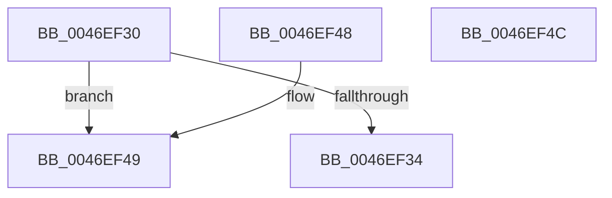

# CmpPerformTrustClassAccessCheck

- RVA: `0x0046EF30`–`0x0046EF4D` (길이 `29` bytes)
- VA: `0x000000014046EF30`
- 실행 섹션: `.text`
- PDB 이름 있음: `예`; PDB Function 태그: `아니요`
- unwind 정보 RVA: `0x000DB714`
- 디코드: `13`개 명령, `29/29` bytes 표시
- 미해석 바이트: `0` (있으면 어셈블리에 `.byte`로 보존)

> 이 문서는 커널 이미지의 기계어와 PDB 기호를 분석해 생성했습니다. 4번과 5번은 함수 원형과 자료형을 바이너리 사용 방식에서 추정한 C 해석이며 원본 소스 복구 결과는 아닙니다.

## 1. Dependencies

- 직접 호출 지점: **0**; 고유 호출 대상: **0**
- 직접 호출자로 확인된 함수: **2**
- RIP 상대 이미지 참조: **0**

### Outgoing calls
- 직접 디코드된 call 명령이 없습니다.

### Direct callers
- [CmpJoinClassOfTrust](CmpJoinClassOfTrust_function_0046EEB4.md) at `0x0046EECA`
- [sub_00B49062](../../page/B4/Unknown_function_00B49062.md) at `0x00B49074`

### Static image references
- 디코드된 RIP-relative 메모리 참조가 없습니다.

## 2. Other-region calls and transfers

- 다른 실행 섹션으로 향하는 call: **0**
- 별도 외부 분기/꼬리 이동을 확인하지 못했습니다.

## 3. Assembly (complete function range)

```asm
0046EF30  84 D2                           test dl, dl
0046EF32  74 15                           je 0x14046ef49
0046EF34  8B 81 10 10 00 00               mov eax, dword ptr [rcx + 0x1010]
0046EF3A  24 01                           and al, 1
0046EF3C  F6 D8                           neg al
0046EF3E  1B C0                           sbb eax, eax
0046EF40  F7 D0                           not eax
0046EF42  25 0D 00 00 C0                  and eax, 0xc000000d
0046EF47  C3                              ret
0046EF48  CC                              int3
0046EF49  33 C0                           xor eax, eax
0046EF4B  C3                              ret
0046EF4C  CC                              int3
```

## 4. C-style interpretation (structured pseudocode)

```c
__int64 __fastcall CmpPerformTrustClassAccessCheck(__int64 a1, unsigned __int8 a2)
{
    __int64 result;

    if (a2 == 0) goto loc_0046EF49;
    result = (unsigned __int8)(((unsigned int)(*(unsigned int *)(a1 + 4112))) & (1));
    result = (unsigned __int8)(-(result));
    result = (unsigned int)(~(result));
    result = (unsigned int)((result) & (0xC000000DULL));
    return result;
loc_0046EF49:
    result = 0;
    return result;
}
```

## 5. (Beta) C Style

```c
int64_t CmpPerformTrustClassAccessCheck(void *Arg1, uint8_t Arg2)
{
    uint8_t *arg1 = (uint8_t *)Arg1;

    int64_t result;

    if (Arg2 == 0) goto loc_0046EF49;
    result = (uint8_t)(((uint32_t)(*(uint32_t *)(arg1 + 0x1010))) & (1));
    result = (uint8_t)(-(result));
    result = (uint32_t)(~(result));
    result = (uint32_t)((result) & (0xC000000DULL));
    return result;
loc_0046EF49:
    result = 0;
    return result;
}
```

### 관측된 메모리 오프셋

구조체 형식이 확인되지 않은 접근은 인자 기준의 오프셋으로만 기록했습니다.

| 기준 인자 | 오프셋 표현 | 폭 (bit) | 접근 |
|---|---:|---:|---|
| `Arg1` | `+ 0x1010` | `32` | `R` |

## 6. Execution-region graph

[열기: 2D/3D 그래프와 함수 탐색 컨트롤 패널](../../../control-panel.html?section=text&rva=0x0046EF30&view=graph)

- 2D 그래프는 위에서 아래로 흐르고, 3D 그래프는 빈 공간을 드래그해 회전합니다. Shift+드래그는 이동, 휠은 확대·축소, 함수 노드 선택은 대상 보고서 이동입니다.

### Static fallback


