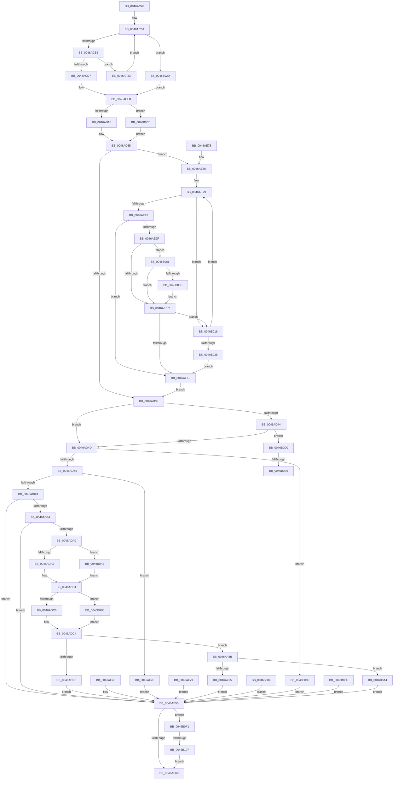

# CmpQueryKeyDataFromKeyNodeStack

- RVA: `0x0046AC40`–`0x0046B111` (길이 `1,233` bytes)
- VA: `0x000000014046AC40`
- 실행 섹션: `.text`
- PDB 이름 있음: `예`; PDB Function 태그: `예`
- unwind 정보 RVA: `0x000AB3BC`
- 디코드: `287`개 명령, `1,233/1,233` bytes 표시
- 미해석 바이트: `0` (있으면 어셈블리에 `.byte`로 보존)

> 이 문서는 커널 이미지의 기계어와 PDB 기호를 분석해 생성했습니다. 4번과 5번은 함수 원형과 자료형을 바이너리 사용 방식에서 추정한 C 해석이며 원본 소스 복구 결과는 아닙니다.

## 1. Dependencies

- 직접 호출 지점: **13**; 고유 호출 대상: **11**
- 직접 호출자로 확인된 함수: **2**
- RIP 상대 이미지 참조: **0**

### Outgoing calls
- `0x0046AC9A` → [HvpGetCellContextInitialize](../../page/85/HvpGetCellContextInitialize_function_00855F10.md) (function, `0x00855F10`)
- `0x0046ACC5` → [CmpKeyNodeStackGetEntryAtLayerHeight](../../page/94/CmpKeyNodeStackGetEntryAtLayerHeight_function_00946ABC.md) (function, `0x00946ABC`)
- `0x0046AD75` → [CmpGetSubKeyCountForKeyNodeStack](../../page/94/CmpGetSubKeyCountForKeyNodeStack_function_00945624.md) (function, `0x00945624`)
- `0x0046AD91` → [CmpGetValueCountForKeyNodeStack](CmpGetValueCountForKeyNodeStack_function_0046B118.md) (function, `0x0046B118`)
- `0x0046AE3B` → [CmpPopulateKeyCachedInformation](../../page/A8/CmpPopulateKeyCachedInformation_function_00A89594.md) (function, `0x00A89594`)
- `0x0046AE80` → [CmpKeyNodeStackGetEntryAtLayerHeight](../../page/94/CmpKeyNodeStackGetEntryAtLayerHeight_function_00946ABC.md) (function, `0x00946ABC`)
- `0x0046AE95` → [CmpGetEffectiveKeyNodeSemantics](../../page/94/CmpGetEffectiveKeyNodeSemantics_function_00946D18.md) (function, `0x00946D18`)
- `0x0046AEEC` → [CmpGetEffectiveKeyNodeSemantics](../../page/94/CmpGetEffectiveKeyNodeSemantics_function_00946D18.md) (function, `0x00946D18`)
- `0x0046AF69` → [CmpPopulateKeyNodeInformation](../../page/84/CmpPopulateKeyNodeInformation_function_0084DFB0.md) (function, `0x0084DFB0`)
- `0x0046AFF4` → [CmpPopulateKeyFullInformation](../../page/A3/CmpPopulateKeyFullInformation_function_00A3C0EC.md) (function, `0x00A3C0EC`)
- `0x0046B05F` → [CmpPopulateKeyBasicInformation](../../page/9A/CmpPopulateKeyBasicInformation_function_009A7AE0.md) (function, `0x009A7AE0`)
- `0x0046B0E6` → [HvpGetCellFlat](../../page/85/HvpGetCellFlat_function_00854C60.md) (function, `0x00854C60`)
- `0x0046B107` → [HvpReleaseCellFlat](../../page/85/HvpReleaseCellFlat_function_0085CC20.md) (function, `0x0085CC20`)

### Direct callers
- [CmQueryLayeredKey](CmQueryLayeredKey_function_0046A930.md) at `0x0046AB8E`
- [CmpEnumerateLayeredKey](../../page/94/CmpEnumerateLayeredKey_function_00945E58.md) at `0x0094617B`

### Static image references
- 디코드된 RIP-relative 메모리 참조가 없습니다.

## 2. Other-region calls and transfers

- 다른 실행 섹션으로 향하는 call: **12**
  - `0x0046AC9A` → [HvpGetCellContextInitialize](../../page/85/HvpGetCellContextInitialize_function_00855F10.md) (`.text` → `PAGE`)
  - `0x0046ACC5` → [CmpKeyNodeStackGetEntryAtLayerHeight](../../page/94/CmpKeyNodeStackGetEntryAtLayerHeight_function_00946ABC.md) (`.text` → `PAGE`)
  - `0x0046AD75` → [CmpGetSubKeyCountForKeyNodeStack](../../page/94/CmpGetSubKeyCountForKeyNodeStack_function_00945624.md) (`.text` → `PAGE`)
  - `0x0046AE3B` → [CmpPopulateKeyCachedInformation](../../page/A8/CmpPopulateKeyCachedInformation_function_00A89594.md) (`.text` → `PAGE`)
  - `0x0046AE80` → [CmpKeyNodeStackGetEntryAtLayerHeight](../../page/94/CmpKeyNodeStackGetEntryAtLayerHeight_function_00946ABC.md) (`.text` → `PAGE`)
  - `0x0046AE95` → [CmpGetEffectiveKeyNodeSemantics](../../page/94/CmpGetEffectiveKeyNodeSemantics_function_00946D18.md) (`.text` → `PAGE`)
  - `0x0046AEEC` → [CmpGetEffectiveKeyNodeSemantics](../../page/94/CmpGetEffectiveKeyNodeSemantics_function_00946D18.md) (`.text` → `PAGE`)
  - `0x0046AF69` → [CmpPopulateKeyNodeInformation](../../page/84/CmpPopulateKeyNodeInformation_function_0084DFB0.md) (`.text` → `PAGE`)
  - `0x0046AFF4` → [CmpPopulateKeyFullInformation](../../page/A3/CmpPopulateKeyFullInformation_function_00A3C0EC.md) (`.text` → `PAGE`)
  - `0x0046B05F` → [CmpPopulateKeyBasicInformation](../../page/9A/CmpPopulateKeyBasicInformation_function_009A7AE0.md) (`.text` → `PAGE`)
  - `0x0046B0E6` → [HvpGetCellFlat](../../page/85/HvpGetCellFlat_function_00854C60.md) (`.text` → `PAGE`)
  - `0x0046B107` → [HvpReleaseCellFlat](../../page/85/HvpReleaseCellFlat_function_0085CC20.md) (`.text` → `PAGE`)
- call이 아닌 외부 분기/꼬리 이동: **3**
  - `0x0046B0E0` → [sub_006F30FE](../6F/Unknown_function_006F30FE.md) (`tail-transfer`)
  - `0x0046B0EC` → [sub_006F30FE + 0x5](../6F/Unknown_function_006F30FE.md) (`tail-transfer`)
  - `0x0046B101` → [sub_006F30FE + 0xF](../6F/Unknown_function_006F30FE.md) (`tail-transfer`)

## 3. Assembly (complete function range)

```asm
0046AC40  48 8B C4                        mov rax, rsp
0046AC43  44 89 48 20                     mov dword ptr [rax + 0x20], r9d
0046AC47  4C 89 40 18                     mov qword ptr [rax + 0x18], r8
0046AC4B  89 50 10                        mov dword ptr [rax + 0x10], edx
0046AC4E  48 89 48 08                     mov qword ptr [rax + 8], rcx
0046AC52  53                              push rbx
0046AC53  56                              push rsi
0046AC54  57                              push rdi
0046AC55  41 54                           push r12
0046AC57  41 55                           push r13
0046AC59  41 56                           push r14
0046AC5B  41 57                           push r15
0046AC5D  48 81 EC B0 00 00 00            sub rsp, 0xb0
0046AC64  48 8B F1                        mov rsi, rcx
0046AC67  33 FF                           xor edi, edi
0046AC69  48 89 78 88                     mov qword ptr [rax - 0x78], rdi
0046AC6D  89 78 80                        mov dword ptr [rax - 0x80], edi
0046AC70  89 78 84                        mov dword ptr [rax - 0x7c], edi
0046AC73  0F 57 C0                        xorps xmm0, xmm0
0046AC76  0F 11 40 90                     movups xmmword ptr [rax - 0x70], xmm0
0046AC7A  0F 11 40 A0                     movups xmmword ptr [rax - 0x60], xmm0
0046AC7E  0F 11 40 B0                     movups xmmword ptr [rax - 0x50], xmm0
0046AC82  40 88 7C 24 40                  mov byte ptr [rsp + 0x40], dil
0046AC87  44 8B F7                        mov r14d, edi
0046AC8A  48 89 7C 24 60                  mov qword ptr [rsp + 0x60], rdi
0046AC8F  83 CA FF                        or edx, 0xffffffff
0046AC92  89 54 24 50                     mov dword ptr [rsp + 0x50], edx
0046AC96  48 8D 48 88                     lea rcx, [rax - 0x78]
0046AC9A  E8 71 B2 3E 00                  call 0x140855f10
0046AC9F  44 8B E7                        mov r12d, edi
0046ACA2  44 8B FF                        mov r15d, edi
0046ACA5  48 89 BC 24 A8 00 00 00         mov qword ptr [rsp + 0xa8], rdi
0046ACAD  44 0F B7 0E                     movzx r9d, word ptr [rsi]
0046ACB1  83 C9 FF                        or ecx, 0xffffffff
0046ACB4  66 45 85 C9                     test r9w, r9w
0046ACB8  0F 88 6F 03 00 00               js 0x14046b02d
0046ACBE  41 0F B7 D1                     movzx edx, r9w
0046ACC2  48 8B CE                        mov rcx, rsi
0046ACC5  E8 F2 BD 4D 00                  call 0x140946abc
0046ACCA  48 8B 48 10                     mov rcx, qword ptr [rax + 0x10]
0046ACCE  48 85 C9                        test rcx, rcx
0046ACD1  0F 84 4C 02 00 00               je 0x14046af23
0046ACD7  48 8B 10                        mov rdx, qword ptr [rax]
0046ACDA  4C 8B F9                        mov r15, rcx
0046ACDD  48 89 8C 24 A8 00 00 00         mov qword ptr [rsp + 0xa8], rcx
0046ACE5  83 C9 FF                        or ecx, 0xffffffff
0046ACE8  49 8B 5F 04                     mov rbx, qword ptr [r15 + 4]
0046ACEC  41 8B 47 34                     mov eax, dword ptr [r15 + 0x34]
0046ACF0  44 0F B7 E8                     movzx r13d, ax
0046ACF4  41 8B 47 38                     mov eax, dword ptr [r15 + 0x38]
0046ACF8  89 44 24 48                     mov dword ptr [rsp + 0x48], eax
0046ACFC  45 8B 57 3C                     mov r10d, dword ptr [r15 + 0x3c]
0046AD00  44 89 54 24 58                  mov dword ptr [rsp + 0x58], r10d
0046AD05  45 8B 5F 40                     mov r11d, dword ptr [r15 + 0x40]
0046AD09  44 89 5C 24 5C                  mov dword ptr [rsp + 0x5c], r11d
0046AD0E  41 38 7F 0D                     cmp byte ptr [r15 + 0xd], dil
0046AD12  0F 8C AD 03 00 00               jl 0x14046b0c5
0046AD18  41 B0 01                        mov r8b, 1
0046AD1B  44 88 44 24 40                  mov byte ptr [rsp + 0x40], r8b
0046AD20  4C 8B F2                        mov r14, rdx
0046AD23  48 89 54 24 60                  mov qword ptr [rsp + 0x60], rdx
0046AD28  41 8B 57 30                     mov edx, dword ptr [r15 + 0x30]
0046AD2C  89 54 24 50                     mov dword ptr [rsp + 0x50], edx
0046AD30  45 0F B7 67 4A                  movzx r12d, word ptr [r15 + 0x4a]
0046AD35  66 44 03 C9                     add r9w, cx
0046AD39  0F 89 37 01 00 00               jns 0x14046ae76
0046AD3F  45 84 C0                        test r8b, r8b
0046AD42  74 09                           je 0x14046ad4d
0046AD44  45 85 E4                        test r12d, r12d
0046AD47  0F 85 83 03 00 00               jne 0x14046b0d0
0046AD4D  48 89 7C 24 50                  mov qword ptr [rsp + 0x50], rdi
0046AD52  44 8B E7                        mov r12d, edi
0046AD55  8B 84 24 F8 00 00 00            mov eax, dword ptr [rsp + 0xf8]
0046AD5C  85 C0                           test eax, eax
0046AD5E  0F 84 D1 02 00 00               je 0x14046b035
0046AD64  83 F8 01                        cmp eax, 1
0046AD67  0F 84 C2 01 00 00               je 0x14046af2f
0046AD6D  48 8D 54 24 68                  lea rdx, [rsp + 0x68]
0046AD72  48 8B CE                        mov rcx, rsi
0046AD75  E8 AA A8 4D 00                  call 0x140945624
0046AD7A  8B F0                           mov esi, eax
0046AD7C  85 C0                           test eax, eax
0046AD7E  0F 88 D1 00 00 00               js 0x14046ae55
0046AD84  48 8D 54 24 6C                  lea rdx, [rsp + 0x6c]
0046AD89  48 8B 8C 24 F0 00 00 00         mov rcx, qword ptr [rsp + 0xf0]
0046AD91  E8 82 03 00 00                  call 0x14046b118
0046AD96  8B F0                           mov esi, eax
0046AD98  85 C0                           test eax, eax
0046AD9A  0F 88 B5 00 00 00               js 0x14046ae55
0046ADA0  44 8B 44 24 68                  mov r8d, dword ptr [rsp + 0x68]
0046ADA5  45 85 C0                        test r8d, r8d
0046ADA8  0F 85 00 03 00 00               jne 0x14046b0ae
0046ADAE  44 8B EF                        mov r13d, edi
0046ADB1  44 8B CF                        mov r9d, edi
0046ADB4  8B 44 24 6C                     mov eax, dword ptr [rsp + 0x6c]
0046ADB8  85 C0                           test eax, eax
0046ADBA  0F 85 F8 02 00 00               jne 0x14046b0b8
0046ADC0  8B CF                           mov ecx, edi
0046ADC2  8B D7                           mov edx, edi
0046ADC4  44 8B 94 24 F8 00 00 00         mov r10d, dword ptr [rsp + 0xf8]
0046ADCC  41 83 FA 04                     cmp r10d, 4
0046ADD0  0F 85 B5 01 00 00               jne 0x14046af8b
0046ADD6  48 89 5C 24 78                  mov qword ptr [rsp + 0x78], rbx
0046ADDB  44 89 84 24 84 00 00 00         mov dword ptr [rsp + 0x84], r8d
0046ADE3  44 89 AC 24 88 00 00 00         mov dword ptr [rsp + 0x88], r13d
0046ADEB  89 84 24 8C 00 00 00            mov dword ptr [rsp + 0x8c], eax
0046ADF2  89 8C 24 90 00 00 00            mov dword ptr [rsp + 0x90], ecx
0046ADF9  89 94 24 94 00 00 00            mov dword ptr [rsp + 0x94], edx
0046AE00  41 0F B7 57 48                  movzx edx, word ptr [r15 + 0x48]
0046AE05  0F B7 CA                        movzx ecx, dx
0046AE08  66 03 C9                        add cx, cx
0046AE0B  41 F6 47 02 20                  test byte ptr [r15 + 2], 0x20
0046AE10  66 0F 44 CA                     cmove cx, dx
0046AE14  0F B7 C1                        movzx eax, cx
0046AE17  89 84 24 98 00 00 00            mov dword ptr [rsp + 0x98], eax
0046AE1E  4C 8B 8C 24 10 01 00 00         mov r9, qword ptr [rsp + 0x110]
0046AE26  44 8B 84 24 08 01 00 00         mov r8d, dword ptr [rsp + 0x108]
0046AE2E  48 8B 94 24 00 01 00 00         mov rdx, qword ptr [rsp + 0x100]
0046AE36  48 8D 4C 24 78                  lea rcx, [rsp + 0x78]
0046AE3B  E8 54 E7 61 00                  call 0x140a89594
0046AE40  8B F0                           mov esi, eax
0046AE42  89 44 24 44                     mov dword ptr [rsp + 0x44], eax
0046AE46  EB 0D                           jmp 0x14046ae55
0046AE48  8B F0                           mov esi, eax
0046AE4A  89 44 24 44                     mov dword ptr [rsp + 0x44], eax
0046AE4E  33 FF                           xor edi, edi
0046AE50  4C 8B 74 24 60                  mov r14, qword ptr [rsp + 0x60]
0046AE55  48 39 7C 24 50                  cmp qword ptr [rsp + 0x50], rdi
0046AE5A  0F 85 91 02 00 00               jne 0x14046b0f1
0046AE60  8B C6                           mov eax, esi
0046AE62  48 81 C4 B0 00 00 00            add rsp, 0xb0
0046AE69  41 5F                           pop r15
0046AE6B  41 5E                           pop r14
0046AE6D  41 5D                           pop r13
0046AE6F  41 5C                           pop r12
0046AE71  5F                              pop rdi
0046AE72  5E                              pop rsi
0046AE73  5B                              pop rbx
0046AE74  C3                              ret
0046AE75  CC                              int3
0046AE76  44 8B F8                        mov r15d, eax
0046AE79  41 0F B7 D1                     movzx edx, r9w
0046AE7D  48 8B CE                        mov rcx, rsi
0046AE80  E8 37 BC 4D 00                  call 0x140946abc
0046AE85  48 8B 50 10                     mov rdx, qword ptr [rax + 0x10]
0046AE89  48 85 D2                        test rdx, rdx
0046AE8C  0F 84 84 01 00 00               je 0x14046b016
0046AE92  48 8B 08                        mov rcx, qword ptr [rax]
0046AE95  E8 7E BE 4D 00                  call 0x140946d18
0046AE9A  83 F8 01                        cmp eax, 1
0046AE9D  74 5A                           je 0x14046aef9
0046AE9F  48 8B 42 04                     mov rax, qword ptr [rdx + 4]
0046AEA3  48 3B D8                        cmp rbx, rax
0046AEA6  48 0F 4C D8                     cmovl rbx, rax
0046AEAA  8B 42 34                        mov eax, dword ptr [rdx + 0x34]
0046AEAD  0F B7 C0                        movzx eax, ax
0046AEB0  44 3B E8                        cmp r13d, eax
0046AEB3  41 0F 43 C5                     cmovae eax, r13d
0046AEB7  44 8B E8                        mov r13d, eax
0046AEBA  8B 42 38                        mov eax, dword ptr [rdx + 0x38]
0046AEBD  44 3B F8                        cmp r15d, eax
0046AEC0  41 0F 43 C7                     cmovae eax, r15d
0046AEC4  44 8B F8                        mov r15d, eax
0046AEC7  8B 42 3C                        mov eax, dword ptr [rdx + 0x3c]
0046AECA  44 3B D0                        cmp r10d, eax
0046AECD  41 0F 43 C2                     cmovae eax, r10d
0046AED1  44 8B D0                        mov r10d, eax
0046AED4  8B 42 40                        mov eax, dword ptr [rdx + 0x40]
0046AED7  44 3B D8                        cmp r11d, eax
0046AEDA  41 0F 43 C3                     cmovae eax, r11d
0046AEDE  44 8B D8                        mov r11d, eax
0046AEE1  40 38 7C 24 40                  cmp byte ptr [rsp + 0x40], dil
0046AEE6  0F 84 95 01 00 00               je 0x14046b081
0046AEEC  E8 27 BE 4D 00                  call 0x140946d18
0046AEF1  85 C0                           test eax, eax
0046AEF3  0F 84 1D 01 00 00               je 0x14046b016
0046AEF9  4C 89 74 24 60                  mov qword ptr [rsp + 0x60], r14
0046AEFE  44 89 7C 24 48                  mov dword ptr [rsp + 0x48], r15d
0046AF03  44 89 5C 24 5C                  mov dword ptr [rsp + 0x5c], r11d
0046AF08  44 89 54 24 58                  mov dword ptr [rsp + 0x58], r10d
0046AF0D  4C 8B BC 24 A8 00 00 00         mov r15, qword ptr [rsp + 0xa8]
0046AF15  8B 54 24 50                     mov edx, dword ptr [rsp + 0x50]
0046AF19  44 8A 44 24 40                  mov r8b, byte ptr [rsp + 0x40]
0046AF1E  E9 1C FE FF FF                  jmp 0x14046ad3f
0046AF23  83 C9 FF                        or ecx, 0xffffffff
0046AF26  66 44 03 C9                     add r9w, cx
0046AF2A  E9 85 FD FF FF                  jmp 0x14046acb4
0046AF2F  48 89 5C 24 78                  mov qword ptr [rsp + 0x78], rbx
0046AF34  48 8B 84 24 10 01 00 00         mov rax, qword ptr [rsp + 0x110]
0046AF3C  48 89 44 24 30                  mov qword ptr [rsp + 0x30], rax
0046AF41  8B 84 24 08 01 00 00            mov eax, dword ptr [rsp + 0x108]
0046AF48  89 44 24 28                     mov dword ptr [rsp + 0x28], eax
0046AF4C  48 8B 84 24 00 01 00 00         mov rax, qword ptr [rsp + 0x100]
0046AF54  48 89 44 24 20                  mov qword ptr [rsp + 0x20], rax
0046AF59  45 8B CC                        mov r9d, r12d
0046AF5C  4C 8B 44 24 50                  mov r8, qword ptr [rsp + 0x50]
0046AF61  49 8B D7                        mov rdx, r15
0046AF64  48 8D 4C 24 78                  lea rcx, [rsp + 0x78]
0046AF69  E8 42 30 3E 00                  call 0x14084dfb0
0046AF6E  8B F0                           mov esi, eax
0046AF70  89 44 24 44                     mov dword ptr [rsp + 0x44], eax
0046AF74  E9 DC FE FF FF                  jmp 0x14046ae55
0046AF79  8B F0                           mov esi, eax
0046AF7B  89 44 24 44                     mov dword ptr [rsp + 0x44], eax
0046AF7F  33 FF                           xor edi, edi
0046AF81  4C 8B 74 24 60                  mov r14, qword ptr [rsp + 0x60]
0046AF86  E9 CA FE FF FF                  jmp 0x14046ae55
0046AF8B  41 83 FA 02                     cmp r10d, 2
0046AF8F  0F 85 0F 01 00 00               jne 0x14046b0a4
0046AF95  48 89 5C 24 78                  mov qword ptr [rsp + 0x78], rbx
0046AF9A  44 89 84 24 8C 00 00 00         mov dword ptr [rsp + 0x8c], r8d
0046AFA2  44 89 AC 24 90 00 00 00         mov dword ptr [rsp + 0x90], r13d
0046AFAA  44 89 8C 24 94 00 00 00         mov dword ptr [rsp + 0x94], r9d
0046AFB2  89 84 24 98 00 00 00            mov dword ptr [rsp + 0x98], eax
0046AFB9  89 8C 24 9C 00 00 00            mov dword ptr [rsp + 0x9c], ecx
0046AFC0  89 94 24 A0 00 00 00            mov dword ptr [rsp + 0xa0], edx
0046AFC7  48 8B 84 24 10 01 00 00         mov rax, qword ptr [rsp + 0x110]
0046AFCF  48 89 44 24 28                  mov qword ptr [rsp + 0x28], rax
0046AFD4  8B 84 24 08 01 00 00            mov eax, dword ptr [rsp + 0x108]
0046AFDB  89 44 24 20                     mov dword ptr [rsp + 0x20], eax
0046AFDF  4C 8B 8C 24 00 01 00 00         mov r9, qword ptr [rsp + 0x100]
0046AFE7  45 8B C4                        mov r8d, r12d
0046AFEA  48 8B 54 24 50                  mov rdx, qword ptr [rsp + 0x50]
0046AFEF  48 8D 4C 24 78                  lea rcx, [rsp + 0x78]
0046AFF4  E8 F3 10 5D 00                  call 0x140a3c0ec
0046AFF9  8B F0                           mov esi, eax
0046AFFB  89 44 24 44                     mov dword ptr [rsp + 0x44], eax
0046AFFF  E9 51 FE FF FF                  jmp 0x14046ae55
0046B004  8B F0                           mov esi, eax
0046B006  89 44 24 44                     mov dword ptr [rsp + 0x44], eax
0046B00A  33 FF                           xor edi, edi
0046B00C  4C 8B 74 24 60                  mov r14, qword ptr [rsp + 0x60]
0046B011  E9 3F FE FF FF                  jmp 0x14046ae55
0046B016  41 0F B7 C1                     movzx eax, r9w
0046B01A  41 83 C9 FF                     or r9d, 0xffffffff
0046B01E  66 44 03 C8                     add r9w, ax
0046B022  0F 89 51 FE FF FF               jns 0x14046ae79
0046B028  E9 CC FE FF FF                  jmp 0x14046aef9
0046B02D  48 8B D7                        mov rdx, rdi
0046B030  E9 B3 FC FF FF                  jmp 0x14046ace8
0046B035  48 89 5C 24 78                  mov qword ptr [rsp + 0x78], rbx
0046B03A  48 8B 84 24 10 01 00 00         mov rax, qword ptr [rsp + 0x110]
0046B042  48 89 44 24 20                  mov qword ptr [rsp + 0x20], rax
0046B047  44 8B 8C 24 08 01 00 00         mov r9d, dword ptr [rsp + 0x108]
0046B04F  4C 8B 84 24 00 01 00 00         mov r8, qword ptr [rsp + 0x100]
0046B057  49 8B D7                        mov rdx, r15
0046B05A  48 8D 4C 24 78                  lea rcx, [rsp + 0x78]
0046B05F  E8 7C CA 53 00                  call 0x1409a7ae0
0046B064  8B F0                           mov esi, eax
0046B066  89 44 24 44                     mov dword ptr [rsp + 0x44], eax
0046B06A  E9 E6 FD FF FF                  jmp 0x14046ae55
0046B06F  8B F0                           mov esi, eax
0046B071  89 44 24 44                     mov dword ptr [rsp + 0x44], eax
0046B075  33 FF                           xor edi, edi
0046B077  4C 8B 74 24 60                  mov r14, qword ptr [rsp + 0x60]
0046B07C  E9 D4 FD FF FF                  jmp 0x14046ae55
0046B081  40 38 7A 0D                     cmp byte ptr [rdx + 0xd], dil
0046B085  0F 8C 61 FE FF FF               jl 0x14046aeec
0046B08B  C6 44 24 40 01                  mov byte ptr [rsp + 0x40], 1
0046B090  4C 8B F1                        mov r14, rcx
0046B093  8B 42 30                        mov eax, dword ptr [rdx + 0x30]
0046B096  89 44 24 50                     mov dword ptr [rsp + 0x50], eax
0046B09A  44 0F B7 62 4A                  movzx r12d, word ptr [rdx + 0x4a]
0046B09F  E9 48 FE FF FF                  jmp 0x14046aeec
0046B0A4  BE 0D 00 00 C0                  mov esi, 0xc000000d
0046B0A9  E9 A7 FD FF FF                  jmp 0x14046ae55
0046B0AE  44 8B 4C 24 48                  mov r9d, dword ptr [rsp + 0x48]
0046B0B3  E9 FC FC FF FF                  jmp 0x14046adb4
0046B0B8  8B 4C 24 58                     mov ecx, dword ptr [rsp + 0x58]
0046B0BC  8B 54 24 5C                     mov edx, dword ptr [rsp + 0x5c]
0046B0C0  E9 FF FC FF FF                  jmp 0x14046adc4
0046B0C5  83 CA FF                        or edx, 0xffffffff
0046B0C8  44 8A C7                        mov r8b, dil
0046B0CB  E9 65 FC FF FF                  jmp 0x14046ad35
0046B0D0  4C 8D 44 24 70                  lea r8, [rsp + 0x70]
0046B0D5  49 8B CE                        mov rcx, r14
0046B0D8  41 F6 86 8C 00 00 00 01         test byte ptr [r14 + 0x8c], 1
0046B0E0  0F 84 18 80 28 00               je 0x1406f30fe
0046B0E6  E8 75 9B 3E 00                  call 0x140854c60
0046B0EB  90                              nop
0046B0EC  E9 12 80 28 00                  jmp 0x1406f3103
0046B0F1  48 8D 54 24 70                  lea rdx, [rsp + 0x70]
0046B0F6  49 8B CE                        mov rcx, r14
0046B0F9  41 F6 86 8C 00 00 00 01         test byte ptr [r14 + 0x8c], 1
0046B101  0F 84 06 80 28 00               je 0x1406f310d
0046B107  E8 14 1B 3F 00                  call 0x14085cc20
0046B10C  E9 4F FD FF FF                  jmp 0x14046ae60
```

## 4. C-style interpretation (structured pseudocode)

```c
__int64 __fastcall CmpQueryKeyDataFromKeyNodeStack(__int64 a1, int a2, __int64 a3, int a4, __int64 a5)
{
    __int64 result;
    __int64 v_rbx;
    __int64 v_rdi;
    __int64 v_rsp;
    unsigned __int64 v_stack_m40;
    unsigned int v_stack_m50;
    unsigned int v_stack_m54;
    unsigned int v_stack_m58;
    unsigned int v_stack_m5C;
    unsigned int v_stack_m60;
    unsigned int v_stack_m64;
    unsigned __int64 v_stack_m70;
    unsigned __int64 v_stack_m7C;
    unsigned __int64 v_stack_m80;
    unsigned __int64 v_stack_m88;
    unsigned int v_stack_m8C;
    unsigned int v_stack_m90;
    unsigned int v_stack_m98;
    unsigned int v_stack_mA0;
    unsigned int v_stack_mA4;
    unsigned __int8 v_stack_mA8;
    unsigned int v_stack_p10;
    unsigned __int64 v_stack_p100;
    unsigned int v_stack_p108;
    unsigned __int64 v_stack_p18;
    unsigned int v_stack_p20;
    unsigned int v_stack_p28;
    unsigned __int64 v_stack_p30;
    unsigned __int8 v_stack_p40;
    unsigned int v_stack_p44;
    unsigned int v_stack_p48;
    unsigned int v_stack_p50;
    unsigned int v_stack_p58;
    unsigned int v_stack_p5C;
    unsigned __int64 v_stack_p60;
    unsigned __int64 v_stack_p70;
    unsigned __int64 v_stack_p78;
    unsigned __int64 v_stack_p8;
    unsigned int v_stack_p8C;
    unsigned int v_stack_p90;
    unsigned int v_stack_p94;
    unsigned int v_stack_p98;
    unsigned int v_stack_p9C;
    unsigned int v_stack_pA0;
    unsigned __int64 v_stack_pA8;

    *(unsigned int *)(v_rsp + 32) = a4;
    *(unsigned __int64 *)(v_rsp + 24) = a3;
    *(unsigned int *)(v_rsp + 16) = a2;
    *(unsigned __int64 *)(v_rsp + 8) = a1;
    v_rsp = (v_rsp) - (176);
    v_rdi = 0;
    *(unsigned __int64 *)(v_rsp - 120) = 0;
    *(unsigned int *)(v_rsp - 128) = 0;
    *(unsigned int *)(v_rsp - 124) = 0;
    *(unsigned __int64 *)(v_rsp - 112) = v_xmm0;
    *(unsigned __int64 *)(v_rsp - 96) = v_xmm0;
    *(unsigned __int64 *)(v_rsp - 80) = v_xmm0;
    v_stack_mA8 = 0;
    v_stack_m88 = 0;
    a2 = (unsigned int)((a2) | (0xFFFFFFFFULL));
    v_stack_m98 = a2;
    result = HvpGetCellContextInitialize(v_rsp - 120, a2, a3, a4);
    v_stack_m40 = 0;
    a1 = (unsigned int)((v_rsp - 120) | (0xFFFFFFFFULL));
loc_0046ACB4:
    if (sign_flag) goto loc_0046B02D;
    result = CmpKeyNodeStackGetEntryAtLayerHeight(a1, (unsigned __int16)(*(unsigned __int16 *)(a1)), a3, *(unsigned __int16 *)(a1));
    if (*(unsigned __int64 *)(result + 16) == 0) goto loc_0046AF23;
    v_stack_m40 = *(unsigned __int64 *)(result + 16);
    a1 = (unsigned int)((*(unsigned __int64 *)(result + 16)) | (0xFFFFFFFFULL));
loc_0046ACE8:
    v_stack_mA0 = (unsigned int)((unsigned int)(*(unsigned int *)(*(unsigned __int64 *)(result + 16) + 56)));
    v_stack_m90 = (unsigned int)((unsigned int)(*(unsigned int *)(*(unsigned __int64 *)(result + 16) + 60)));
    v_stack_m8C = (unsigned int)((unsigned int)(*(unsigned int *)(*(unsigned __int64 *)(result + 16) + 64)));
    if ((*(unsigned __int8 *)(*(unsigned __int64 *)(result + 16) + 13)) < 0) goto loc_0046B0C5;
    v_stack_mA8 = 1;
    v_stack_m88 = *(unsigned __int64 *)(result);
    v_stack_m98 = (unsigned int)((unsigned int)(*(unsigned int *)(*(unsigned __int64 *)(result + 16) + 48)));
loc_0046AD35:
    a4 = (unsigned __int16)((*(unsigned __int16 *)(a1)) + ((unsigned __int16)(a1)));
    if (!sign_flag) goto loc_0046AE76;
loc_0046AD3F:
    if (1 == 0) goto loc_0046AD4D;
    if ((unsigned int)(*(unsigned __int16 *)(*(unsigned __int64 *)(result + 16) + 74)) != 0) goto loc_0046B0D0;
loc_0046AD4D:
    v_stack_m98 = 0;
    if ((unsigned int)((unsigned int)(v_stack_p10)) == 0) goto loc_0046B035;
    if (((unsigned int)((unsigned int)(v_stack_p10))) == 1) goto loc_0046AF2F;
    result = CmpGetSubKeyCountForKeyNodeStack(a1, v_stack_m80, 1, a4);
    if (sign_flag) goto loc_0046AE55;
    result = CmpGetValueCountForKeyNodeStack(v_stack_p8, v_stack_m7C, 1, a4);
    if (sign_flag) goto loc_0046AE55;
    if ((unsigned int)((unsigned int)(v_stack_m80)) != 0) goto loc_0046B0AE;
loc_0046ADB4:
    if ((unsigned int)((unsigned int)(v_stack_m7C)) != 0) goto loc_0046B0B8;
loc_0046ADC4:
    if (((unsigned int)((unsigned int)(v_stack_p10))) != 4) goto loc_0046AF8B;
    v_stack_m70 = *(unsigned __int64 *)(*(unsigned __int64 *)(result + 16) + 4);
    v_stack_m64 = (unsigned int)((unsigned int)(v_stack_m80));
    v_stack_m60 = 0;
    v_stack_m5C = (unsigned int)((unsigned int)(v_stack_m7C));
    v_stack_m58 = 0;
    v_stack_m54 = 0;
    a1 = (unsigned __int16)(((unsigned __int16)(*(unsigned __int16 *)(*(unsigned __int64 *)(result + 16) + 72))) + ((unsigned __int16)((unsigned __int16)(*(unsigned __int16 *)(*(unsigned __int64 *)(result + 16) + 72)))));
    if (((*(unsigned __int8 *)(*(unsigned __int64 *)(result + 16) + 2)) & (32)) == 0) { a1 = (unsigned __int16)(*(unsigned __int16 *)(*(unsigned __int64 *)(result + 16) + 72)); }
    v_stack_m50 = (unsigned int)((unsigned __int16)(a1));
    result = CmpPopulateKeyCachedInformation(v_stack_m70, v_stack_p18, (unsigned int)(v_stack_p20), a5);
    v_stack_mA4 = (unsigned int)(result);
    goto loc_0046AE55;
loc_0046AE55:
    if (v_stack_m98 != 0) goto loc_0046B0F1;
loc_0046AE60:
    v_rsp = (v_rsp) + (176);
    return (unsigned int)((unsigned int)((unsigned int)((unsigned int)(result))));
loc_0046AE76:
loc_0046AE79:
    result = CmpKeyNodeStackGetEntryAtLayerHeight((unsigned int)((unsigned int)(result)), (unsigned __int16)(a5), (unsigned int)(v_stack_p20), a5);
    if (*(unsigned __int64 *)(result + 16) == 0) goto loc_0046B016;
    result = CmpGetEffectiveKeyNodeSemantics(*(unsigned __int64 *)(result), *(unsigned __int64 *)(result + 16), (unsigned int)(v_stack_p20), a5);
    if (((unsigned int)(result)) == 1) goto loc_0046AEF9;
    v_rbx = *(unsigned __int64 *)(*(unsigned __int64 *)(result + 16) + 4);
    if ((*(unsigned __int64 *)(*(unsigned __int64 *)(result + 16) + 4)) < (*(unsigned __int64 *)(*(unsigned __int64 *)(result + 16) + 4))) { v_rbx = *(unsigned __int64 *)(*(unsigned __int64 *)(result + 16) + 4); }
    result = (unsigned __int16)((unsigned int)(*(unsigned int *)(*(unsigned __int64 *)(result + 16) + 52)));
    if (0 >= ((unsigned int)((unsigned __int16)((unsigned int)(*(unsigned int *)(*(unsigned __int64 *)(result + 16) + 52)))))) { result = 0; }
    result = (unsigned int)(*(unsigned int *)(*(unsigned __int64 *)(result + 16) + 56));
    if (((unsigned int)((unsigned int)((unsigned int)((unsigned int)((unsigned int)((unsigned int)((unsigned int)(result)))))))) >= ((unsigned int)((unsigned int)(*(unsigned int *)(*(unsigned __int64 *)(result + 16) + 56))))) { result = (unsigned int)((unsigned int)((unsigned int)((unsigned int)((unsigned int)((unsigned int)((unsigned int)(result))))))); }
    result = (unsigned int)(*(unsigned int *)(*(unsigned __int64 *)(result + 16) + 60));
    if (((unsigned int)((unsigned int)(v_stack_p10))) >= ((unsigned int)((unsigned int)(*(unsigned int *)(*(unsigned __int64 *)(result + 16) + 60))))) { result = (unsigned int)((unsigned int)(v_stack_p10)); }
    result = (unsigned int)(*(unsigned int *)(*(unsigned __int64 *)(result + 16) + 64));
    if (((unsigned int)((unsigned int)(*(unsigned int *)(*(unsigned __int64 *)(result + 16) + 64)))) >= ((unsigned int)((unsigned int)(*(unsigned int *)(*(unsigned __int64 *)(result + 16) + 64))))) { result = (unsigned int)((unsigned int)(*(unsigned int *)(*(unsigned __int64 *)(result + 16) + 64))); }
    if (v_stack_p40 == 0) goto loc_0046B081;
loc_0046AEEC:
    result = CmpGetEffectiveKeyNodeSemantics(*(unsigned __int64 *)(result), *(unsigned __int64 *)(result + 16), (unsigned int)(v_stack_p20), a5);
    if ((unsigned int)(result) == 0) goto loc_0046B016;
loc_0046AEF9:
    v_stack_p60 = *(unsigned __int64 *)(result);
    v_stack_p48 = (unsigned int)((unsigned int)((unsigned int)(result)));
    v_stack_p5C = (unsigned int)((unsigned int)((unsigned int)(result)));
    v_stack_p58 = (unsigned int)((unsigned int)((unsigned int)(result)));
    goto loc_0046AD3F;
loc_0046AF23:
    a1 = (unsigned int)((*(unsigned __int64 *)(result)) | (0xFFFFFFFFULL));
    a4 = (unsigned __int16)((a5) + ((unsigned __int16)(a1)));
    goto loc_0046ACB4;
loc_0046AF2F:
    v_stack_p78 = v_rbx;
    v_stack_p30 = a5;
    v_stack_p28 = (unsigned int)((unsigned int)(v_stack_p108));
    v_stack_p20 = v_stack_p100;
    result = CmpPopulateKeyNodeInformation(v_stack_p78, v_stack_pA8, v_stack_p50, 0);
    v_stack_p44 = (unsigned int)(result);
    goto loc_0046AE55;
loc_0046AF8B:
    if (((unsigned int)((unsigned int)((unsigned int)(result)))) != 2) goto loc_0046B0A4;
    v_stack_p78 = v_rbx;
    v_stack_p8C = (unsigned int)(v_stack_p50);
    v_stack_p90 = (unsigned int)((unsigned int)((unsigned int)(result)));
    v_stack_p94 = 0;
    v_stack_p98 = (unsigned int)(result);
    v_stack_p9C = (unsigned int)(v_stack_p78);
    v_stack_pA0 = (unsigned int)(v_stack_pA8);
    v_stack_p28 = a5;
    v_stack_p20 = (unsigned int)((unsigned int)(v_stack_p108));
    result = CmpPopulateKeyFullInformation(v_stack_p78, v_stack_p50, 0, v_stack_p100);
    v_stack_p44 = (unsigned int)(result);
    goto loc_0046AE55;
loc_0046B016:
    a4 = (unsigned int)((v_stack_p100) | (0xFFFFFFFFULL));
    a4 = (unsigned __int16)((a4) + ((unsigned __int16)((unsigned __int16)(v_stack_p100))));
    if (!sign_flag) goto loc_0046AE79;
    goto loc_0046AEF9;
loc_0046B02D:
    goto loc_0046ACE8;
loc_0046B035:
    v_stack_p78 = v_rbx;
    v_stack_p20 = a5;
    result = CmpPopulateKeyBasicInformation(v_stack_p78, v_stack_pA8, v_stack_p100, (unsigned int)(v_stack_p108));
    v_stack_p44 = (unsigned int)(result);
    goto loc_0046AE55;
loc_0046B081:
    if ((*(unsigned __int8 *)(v_stack_pA8 + 13)) < 0) goto loc_0046AEEC;
    v_stack_p40 = 1;
    v_stack_p50 = (unsigned int)((unsigned int)(*(unsigned int *)(v_stack_pA8 + 48)));
    goto loc_0046AEEC;
loc_0046B0A4:
    goto loc_0046AE55;
loc_0046B0AE:
    goto loc_0046ADB4;
loc_0046B0B8:
    goto loc_0046ADC4;
loc_0046B0C5:
    a2 = (unsigned int)(((unsigned int)(v_stack_p5C)) | (0xFFFFFFFFULL));
    goto loc_0046AD35;
loc_0046B0D0:
    result = HvpGetCellFlat(v_stack_p78, a2, v_stack_p70, (unsigned int)(v_stack_p48));
loc_0046B0F1:
    result = HvpReleaseCellFlat(v_stack_p78, v_stack_p70, v_stack_p70, (unsigned int)(v_stack_p48));
    goto loc_0046AE60;
}
```

## 5. (Beta) C Style

```c
int64_t CmpQueryKeyDataFromKeyNodeStack(void *Arg1, int32_t Arg2, int64_t Arg3, int32_t Arg4, int64_t Arg5)
{
    uint8_t *arg1 = (uint8_t *)Arg1;

    int64_t result;
    int64_t local_rbx;
    int64_t local_rdi;
    int64_t local_rsp;
    uint64_t v_stack_m40;
    uint32_t v_stack_m50;
    uint32_t v_stack_m54;
    uint32_t v_stack_m58;
    uint32_t v_stack_m5C;
    uint32_t v_stack_m60;
    uint32_t v_stack_m64;
    uint64_t v_stack_m70;
    uint64_t v_stack_m7C;
    uint64_t v_stack_m80;
    uint64_t v_stack_m88;
    uint32_t v_stack_m8C;
    uint32_t v_stack_m90;
    uint32_t v_stack_m98;
    uint32_t v_stack_mA0;
    uint32_t v_stack_mA4;
    uint8_t v_stack_mA8;
    uint32_t v_stack_p10;
    uint64_t v_stack_p100;
    uint32_t v_stack_p108;
    uint64_t v_stack_p18;
    uint32_t v_stack_p20;
    uint32_t v_stack_p28;
    uint64_t v_stack_p30;
    uint8_t v_stack_p40;
    uint32_t v_stack_p44;
    uint32_t v_stack_p48;
    uint32_t v_stack_p50;
    uint32_t v_stack_p58;
    uint32_t v_stack_p5C;
    uint64_t v_stack_p60;
    uint64_t v_stack_p70;
    uint64_t v_stack_p78;
    uint64_t v_stack_p8;
    uint32_t v_stack_p8C;
    uint32_t v_stack_p90;
    uint32_t v_stack_p94;
    uint32_t v_stack_p98;
    uint32_t v_stack_p9C;
    uint32_t v_stack_pA0;
    uint64_t v_stack_pA8;

    *(uint32_t *)(local_rsp + 0x20) = Arg4;
    *(uint64_t *)(local_rsp + 0x18) = Arg3;
    *(uint32_t *)(local_rsp + 0x10) = Arg2;
    *(void **)(local_rsp + 0x8) = Arg1;
    local_rsp = (local_rsp) - (176);
    local_rdi = 0;
    *(uint64_t *)(local_rsp - 0x78) = 0;
    *(uint32_t *)(local_rsp - 0x80) = 0;
    *(uint32_t *)(local_rsp - 0x7C) = 0;
    *(uint64_t *)(local_rsp - 0x70) = v_xmm0;
    *(uint64_t *)(local_rsp - 0x60) = v_xmm0;
    *(uint64_t *)(local_rsp - 0x50) = v_xmm0;
    v_stack_mA8 = 0;
    v_stack_m88 = 0;
    Arg2 = (uint32_t)((Arg2) | (0xFFFFFFFFULL));
    v_stack_m98 = Arg2;
    result = HvpGetCellContextInitialize(local_rsp - 120, Arg2, Arg3, Arg4);
    v_stack_m40 = 0;
    Arg1 = (uint32_t)((local_rsp - 120) | (0xFFFFFFFFULL));
loc_0046ACB4:
    if (sign_flag) goto loc_0046B02D;
    result = CmpKeyNodeStackGetEntryAtLayerHeight(Arg1, (uint16_t)(*(uint16_t *)(arg1)), Arg3, *(uint16_t *)(arg1));
    if (*(uint64_t *)(result + 0x10) == 0) goto loc_0046AF23;
    v_stack_m40 = *(uint64_t *)(result + 0x10);
    Arg1 = (uint32_t)((*(uint64_t *)(result + 0x10)) | (0xFFFFFFFFULL));
loc_0046ACE8:
    v_stack_mA0 = (uint32_t)((uint32_t)(*(uint32_t *)(*(uint64_t *)(result + 0x10) + 0x38)));
    v_stack_m90 = (uint32_t)((uint32_t)(*(uint32_t *)(*(uint64_t *)(result + 0x10) + 0x3C)));
    v_stack_m8C = (uint32_t)((uint32_t)(*(uint32_t *)(*(uint64_t *)(result + 0x10) + 0x40)));
    if ((*(uint8_t *)(*(uint64_t *)(result + 0x10) + 0xD)) < 0) goto loc_0046B0C5;
    v_stack_mA8 = 1;
    v_stack_m88 = *(uint64_t *)(result);
    v_stack_m98 = (uint32_t)((uint32_t)(*(uint32_t *)(*(uint64_t *)(result + 0x10) + 0x30)));
loc_0046AD35:
    Arg4 = (uint16_t)((*(uint16_t *)(arg1)) + ((uint16_t)(Arg1)));
    if (!sign_flag) goto loc_0046AE76;
loc_0046AD3F:
    if (1 == 0) goto loc_0046AD4D;
    if ((uint32_t)(*(uint16_t *)(*(uint64_t *)(result + 0x10) + 0x4A)) != 0) goto loc_0046B0D0;
loc_0046AD4D:
    v_stack_m98 = 0;
    if ((uint32_t)((uint32_t)(v_stack_p10)) == 0) goto loc_0046B035;
    if (((uint32_t)((uint32_t)(v_stack_p10))) == 1) goto loc_0046AF2F;
    result = CmpGetSubKeyCountForKeyNodeStack(Arg1, v_stack_m80, 1, Arg4);
    if (sign_flag) goto loc_0046AE55;
    result = CmpGetValueCountForKeyNodeStack(v_stack_p8, v_stack_m7C, 1, Arg4);
    if (sign_flag) goto loc_0046AE55;
    if ((uint32_t)((uint32_t)(v_stack_m80)) != 0) goto loc_0046B0AE;
loc_0046ADB4:
    if ((uint32_t)((uint32_t)(v_stack_m7C)) != 0) goto loc_0046B0B8;
loc_0046ADC4:
    if (((uint32_t)((uint32_t)(v_stack_p10))) != 4) goto loc_0046AF8B;
    v_stack_m70 = *(uint64_t *)(*(uint64_t *)(result + 0x10) + 0x4);
    v_stack_m64 = (uint32_t)((uint32_t)(v_stack_m80));
    v_stack_m60 = 0;
    v_stack_m5C = (uint32_t)((uint32_t)(v_stack_m7C));
    v_stack_m58 = 0;
    v_stack_m54 = 0;
    Arg1 = (uint16_t)(((uint16_t)(*(uint16_t *)(*(uint64_t *)(result + 0x10) + 0x48))) + ((uint16_t)((uint16_t)(*(uint16_t *)(*(uint64_t *)(result + 0x10) + 0x48)))));
    if (((*(uint8_t *)(*(uint64_t *)(result + 0x10) + 0x2)) & (32)) == 0) { Arg1 = (uint16_t)(*(uint16_t *)(*(uint64_t *)(result + 0x10) + 0x48)); }
    v_stack_m50 = (uint32_t)((uint16_t)(Arg1));
    result = CmpPopulateKeyCachedInformation(v_stack_m70, v_stack_p18, (uint32_t)(v_stack_p20), Arg5);
    v_stack_mA4 = (uint32_t)(result);
    goto loc_0046AE55;
loc_0046AE55:
    if (v_stack_m98 != 0) goto loc_0046B0F1;
loc_0046AE60:
    local_rsp = (local_rsp) + (176);
    return (uint32_t)((uint32_t)((uint32_t)((uint32_t)(result))));
loc_0046AE76:
loc_0046AE79:
    result = CmpKeyNodeStackGetEntryAtLayerHeight((uint32_t)((uint32_t)(result)), (uint16_t)(Arg5), (uint32_t)(v_stack_p20), Arg5);
    if (*(uint64_t *)(result + 0x10) == 0) goto loc_0046B016;
    result = CmpGetEffectiveKeyNodeSemantics(*(uint64_t *)(result), *(uint64_t *)(result + 0x10), (uint32_t)(v_stack_p20), Arg5);
    if (((uint32_t)(result)) == 1) goto loc_0046AEF9;
    local_rbx = *(uint64_t *)(*(uint64_t *)(result + 0x10) + 0x4);
    if ((*(uint64_t *)(*(uint64_t *)(result + 0x10) + 0x4)) < (*(uint64_t *)(*(uint64_t *)(result + 0x10) + 0x4))) { local_rbx = *(uint64_t *)(*(uint64_t *)(result + 0x10) + 0x4); }
    result = (uint16_t)((uint32_t)(*(uint32_t *)(*(uint64_t *)(result + 0x10) + 0x34)));
    if (0 >= ((uint32_t)((uint16_t)((uint32_t)(*(uint32_t *)(*(uint64_t *)(result + 0x10) + 0x34)))))) { result = 0; }
    result = (uint32_t)(*(uint32_t *)(*(uint64_t *)(result + 0x10) + 0x38));
    if (((uint32_t)((uint32_t)((uint32_t)((uint32_t)((uint32_t)((uint32_t)((uint32_t)(result)))))))) >= ((uint32_t)((uint32_t)(*(uint32_t *)(*(uint64_t *)(result + 0x10) + 0x38))))) { result = (uint32_t)((uint32_t)((uint32_t)((uint32_t)((uint32_t)((uint32_t)((uint32_t)(result))))))); }
    result = (uint32_t)(*(uint32_t *)(*(uint64_t *)(result + 0x10) + 0x3C));
    if (((uint32_t)((uint32_t)(v_stack_p10))) >= ((uint32_t)((uint32_t)(*(uint32_t *)(*(uint64_t *)(result + 0x10) + 0x3C))))) { result = (uint32_t)((uint32_t)(v_stack_p10)); }
    result = (uint32_t)(*(uint32_t *)(*(uint64_t *)(result + 0x10) + 0x40));
    if (((uint32_t)((uint32_t)(*(uint32_t *)(*(uint64_t *)(result + 0x10) + 0x40)))) >= ((uint32_t)((uint32_t)(*(uint32_t *)(*(uint64_t *)(result + 0x10) + 0x40))))) { result = (uint32_t)((uint32_t)(*(uint32_t *)(*(uint64_t *)(result + 0x10) + 0x40))); }
    if (v_stack_p40 == 0) goto loc_0046B081;
loc_0046AEEC:
    result = CmpGetEffectiveKeyNodeSemantics(*(uint64_t *)(result), *(uint64_t *)(result + 0x10), (uint32_t)(v_stack_p20), Arg5);
    if ((uint32_t)(result) == 0) goto loc_0046B016;
loc_0046AEF9:
    v_stack_p60 = *(uint64_t *)(result);
    v_stack_p48 = (uint32_t)((uint32_t)((uint32_t)(result)));
    v_stack_p5C = (uint32_t)((uint32_t)((uint32_t)(result)));
    v_stack_p58 = (uint32_t)((uint32_t)((uint32_t)(result)));
    goto loc_0046AD3F;
loc_0046AF23:
    Arg1 = (uint32_t)((*(uint64_t *)(result)) | (0xFFFFFFFFULL));
    Arg4 = (uint16_t)((Arg5) + ((uint16_t)(Arg1)));
    goto loc_0046ACB4;
loc_0046AF2F:
    v_stack_p78 = local_rbx;
    v_stack_p30 = Arg5;
    v_stack_p28 = (uint32_t)((uint32_t)(v_stack_p108));
    v_stack_p20 = v_stack_p100;
    result = CmpPopulateKeyNodeInformation(v_stack_p78, v_stack_pA8, v_stack_p50, 0);
    v_stack_p44 = (uint32_t)(result);
    goto loc_0046AE55;
loc_0046AF8B:
    if (((uint32_t)((uint32_t)((uint32_t)(result)))) != 2) goto loc_0046B0A4;
    v_stack_p78 = local_rbx;
    v_stack_p8C = (uint32_t)(v_stack_p50);
    v_stack_p90 = (uint32_t)((uint32_t)((uint32_t)(result)));
    v_stack_p94 = 0;
    v_stack_p98 = (uint32_t)(result);
    v_stack_p9C = (uint32_t)(v_stack_p78);
    v_stack_pA0 = (uint32_t)(v_stack_pA8);
    v_stack_p28 = Arg5;
    v_stack_p20 = (uint32_t)((uint32_t)(v_stack_p108));
    result = CmpPopulateKeyFullInformation(v_stack_p78, v_stack_p50, 0, v_stack_p100);
    v_stack_p44 = (uint32_t)(result);
    goto loc_0046AE55;
loc_0046B016:
    Arg4 = (uint32_t)((v_stack_p100) | (0xFFFFFFFFULL));
    Arg4 = (uint16_t)((Arg4) + ((uint16_t)((uint16_t)(v_stack_p100))));
    if (!sign_flag) goto loc_0046AE79;
    goto loc_0046AEF9;
loc_0046B02D:
    goto loc_0046ACE8;
loc_0046B035:
    v_stack_p78 = local_rbx;
    v_stack_p20 = Arg5;
    result = CmpPopulateKeyBasicInformation(v_stack_p78, v_stack_pA8, v_stack_p100, (uint32_t)(v_stack_p108));
    v_stack_p44 = (uint32_t)(result);
    goto loc_0046AE55;
loc_0046B081:
    if ((*(uint8_t *)(v_stack_pA8 + 0xD)) < 0) goto loc_0046AEEC;
    v_stack_p40 = 1;
    v_stack_p50 = (uint32_t)((uint32_t)(*(uint32_t *)(v_stack_pA8 + 0x30)));
    goto loc_0046AEEC;
loc_0046B0A4:
    goto loc_0046AE55;
loc_0046B0AE:
    goto loc_0046ADB4;
loc_0046B0B8:
    goto loc_0046ADC4;
loc_0046B0C5:
    Arg2 = (uint32_t)(((uint32_t)(v_stack_p5C)) | (0xFFFFFFFFULL));
    goto loc_0046AD35;
loc_0046B0D0:
    result = HvpGetCellFlat(v_stack_p78, Arg2, v_stack_p70, (uint32_t)(v_stack_p48));
loc_0046B0F1:
    result = HvpReleaseCellFlat(v_stack_p78, v_stack_p70, v_stack_p70, (uint32_t)(v_stack_p48));
    goto loc_0046AE60;
}
```

### 관측된 메모리 오프셋

구조체 형식이 확인되지 않은 접근은 인자 기준의 오프셋으로만 기록했습니다.

| 기준 인자 | 오프셋 표현 | 폭 (bit) | 접근 |
|---|---:|---:|---|
| `Arg1` | `+ 0x0` | `16` | `R` |

## 6. Execution-region graph

[열기: 2D/3D 그래프와 함수 탐색 컨트롤 패널](../../../control-panel.html?section=text&rva=0x0046AC40&view=graph)

- 2D 그래프는 위에서 아래로 흐르고, 3D 그래프는 빈 공간을 드래그해 회전합니다. Shift+드래그는 이동, 휠은 확대·축소, 함수 노드 선택은 대상 보고서 이동입니다.

### Static fallback


