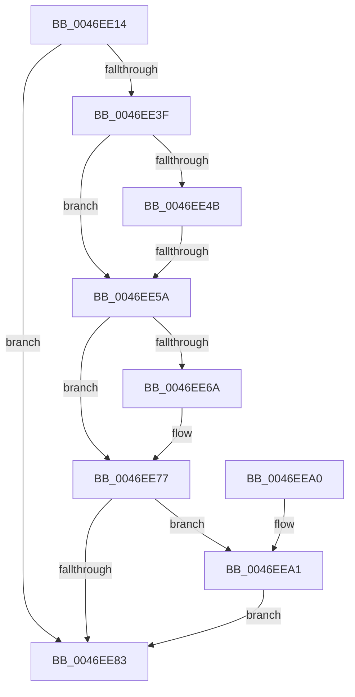

# CmpRecheckHiveVolumePolicy

- RVA: `0x0046EE14`–`0x0046EEAB` (길이 `151` bytes)
- VA: `0x000000014046EE14`
- 실행 섹션: `.text`
- PDB 이름 있음: `예`; PDB Function 태그: `예`
- unwind 정보 RVA: `0x0005C748`
- 디코드: `42`개 명령, `151/151` bytes 표시
- 미해석 바이트: `0` (있으면 어셈블리에 `.byte`로 보존)

> 이 문서는 커널 이미지의 기계어와 PDB 기호를 분석해 생성했습니다. 4번과 5번은 함수 원형과 자료형을 바이너리 사용 방식에서 추정한 C 해석이며 원본 소스 복구 결과는 아닙니다.

## 1. Dependencies

- 직접 호출 지점: **9**; 고유 호출 대상: **9**
- 직접 호출자로 확인된 함수: **4**
- RIP 상대 이미지 참조: **0**

### Outgoing calls
- `0x0046EE26` → [CmpLockRegistry](../../pagecmrc/BC/CmpLockRegistry_function_00BC9B34.md) (function, `0x00BC9B34`)
- `0x0046EE2E` → [HvLockHiveFlusherExclusive](../../pagecmrc/BC/HvLockHiveFlusherExclusive_function_00BC9C50.md) (function, `0x00BC9C50`)
- `0x0046EE42` → [CmpVolumeContextMustHiveFilePagesBeKeptLocal](../../page/87/CmpVolumeContextMustHiveFilePagesBeKeptLocal_function_0087BDC4.md) (function, `0x0087BDC4`)
- `0x0046EE61` → [HvViewMapContainsLockedPages](../../page/A7/HvViewMapContainsLockedPages_function_00A7CCD4.md) (function, `0x00A7CCD4`)
- `0x0046EE72` → [CmpArmLazyWriter](../20/CmpArmLazyWriter_function_00204770.md) (function, `0x00204770`)
- `0x0046EE7A` → [CmpVolumeContextCanHiveSectionBeExtended](../../page/87/CmpVolumeContextCanHiveSectionBeExtended_function_0087BD78.md) (function, `0x0087BD78`)
- `0x0046EE86` → [HvUnlockHiveFlusherExclusive](../../pagecmrc/BC/HvUnlockHiveFlusherExclusive_function_00BC9C34.md) (function, `0x00BC9C34`)
- `0x0046EE8B` → [CmpUnlockRegistry](../../pagecmrc/BC/CmpUnlockRegistry_function_00BC9A84.md) (function, `0x00BC9A84`)
- `0x0046EEA4` → [HvMarkHiveWithNoSectionExtend](../../page/70/HvMarkHiveWithNoSectionExtend_function_00705B70.md) (function, `0x00705B70`)

### Direct callers
- [CmpLoadKeyCommon](CmpLoadKeyCommon_function_0046E9F8.md) at `0x0046ECF3`
- [CmpFinishSystemHivesLoad](../../page/7D/CmpFinishSystemHivesLoad_function_007DA210.md) at `0x007DA56C`
- [CmpHandlePageFileOpenNotification](../../page/7D/CmpHandlePageFileOpenNotification_function_007DF640.md) at `0x007DF6DB`
- [sub_00B1802A](../../page/B1/Unknown_function_00B1802A.md) at `0x00B18332`

### Static image references
- 디코드된 RIP-relative 메모리 참조가 없습니다.

## 2. Other-region calls and transfers

- 다른 실행 섹션으로 향하는 call: **8**
  - `0x0046EE26` → [CmpLockRegistry](../../pagecmrc/BC/CmpLockRegistry_function_00BC9B34.md) (`.text` → `PAGECMRC`)
  - `0x0046EE2E` → [HvLockHiveFlusherExclusive](../../pagecmrc/BC/HvLockHiveFlusherExclusive_function_00BC9C50.md) (`.text` → `PAGECMRC`)
  - `0x0046EE42` → [CmpVolumeContextMustHiveFilePagesBeKeptLocal](../../page/87/CmpVolumeContextMustHiveFilePagesBeKeptLocal_function_0087BDC4.md) (`.text` → `PAGE`)
  - `0x0046EE61` → [HvViewMapContainsLockedPages](../../page/A7/HvViewMapContainsLockedPages_function_00A7CCD4.md) (`.text` → `PAGE`)
  - `0x0046EE7A` → [CmpVolumeContextCanHiveSectionBeExtended](../../page/87/CmpVolumeContextCanHiveSectionBeExtended_function_0087BD78.md) (`.text` → `PAGE`)
  - `0x0046EE86` → [HvUnlockHiveFlusherExclusive](../../pagecmrc/BC/HvUnlockHiveFlusherExclusive_function_00BC9C34.md) (`.text` → `PAGECMRC`)
  - `0x0046EE8B` → [CmpUnlockRegistry](../../pagecmrc/BC/CmpUnlockRegistry_function_00BC9A84.md) (`.text` → `PAGECMRC`)
  - `0x0046EEA4` → [HvMarkHiveWithNoSectionExtend](../../page/70/HvMarkHiveWithNoSectionExtend_function_00705B70.md) (`.text` → `PAGE`)
- call이 아닌 외부 분기/꼬리 이동: **1**
  - `0x0046EE54` → [sub_006F34C4](../6F/Unknown_function_006F34C4.md) (`tail-transfer`)

## 3. Assembly (complete function range)

```asm
0046EE14  48 89 5C 24 08                  mov qword ptr [rsp + 8], rbx
0046EE19  48 89 74 24 10                  mov qword ptr [rsp + 0x10], rsi
0046EE1E  57                              push rdi
0046EE1F  48 83 EC 20                     sub rsp, 0x20
0046EE23  48 8B F9                        mov rdi, rcx
0046EE26  E8 09 AD 75 00                  call 0x140bc9b34
0046EE2B  48 8B CF                        mov rcx, rdi
0046EE2E  E8 1D AE 75 00                  call 0x140bc9c50
0046EE33  48 8B B7 B8 12 00 00            mov rsi, qword ptr [rdi + 0x12b8]
0046EE3A  48 85 F6                        test rsi, rsi
0046EE3D  74 44                           je 0x14046ee83
0046EE3F  48 8B CE                        mov rcx, rsi
0046EE42  E8 7D CF 40 00                  call 0x14087bdc4
0046EE47  84 C0                           test al, al
0046EE49  75 0F                           jne 0x14046ee5a
0046EE4B  8B 8F 10 10 00 00               mov ecx, dword ptr [rdi + 0x1010]
0046EE51  F6 C1 20                        test cl, 0x20
0046EE54  0F 84 6A 46 28 00               je 0x1406f34c4
0046EE5A  48 8D 8F E0 00 00 00            lea rcx, [rdi + 0xe0]
0046EE61  E8 6E DE 60 00                  call 0x140a7ccd4
0046EE66  84 C0                           test al, al
0046EE68  74 0D                           je 0x14046ee77
0046EE6A  33 D2                           xor edx, edx
0046EE6C  45 33 C0                        xor r8d, r8d
0046EE6F  8D 4A 02                        lea ecx, [rdx + 2]
0046EE72  E8 F9 58 D9 FF                  call 0x140204770
0046EE77  48 8B CE                        mov rcx, rsi
0046EE7A  E8 F9 CE 40 00                  call 0x14087bd78
0046EE7F  84 C0                           test al, al
0046EE81  74 1E                           je 0x14046eea1
0046EE83  48 8B CF                        mov rcx, rdi
0046EE86  E8 A9 AD 75 00                  call 0x140bc9c34
0046EE8B  E8 F4 AB 75 00                  call 0x140bc9a84
0046EE90  48 8B 5C 24 30                  mov rbx, qword ptr [rsp + 0x30]
0046EE95  48 8B 74 24 38                  mov rsi, qword ptr [rsp + 0x38]
0046EE9A  48 83 C4 20                     add rsp, 0x20
0046EE9E  5F                              pop rdi
0046EE9F  C3                              ret
0046EEA0  CC                              int3
0046EEA1  48 8B CF                        mov rcx, rdi
0046EEA4  E8 C7 6C 29 00                  call 0x140705b70
0046EEA9  EB D8                           jmp 0x14046ee83
```

## 4. C-style interpretation (structured pseudocode)

```c
__int64 __fastcall CmpRecheckHiveVolumePolicy(__int64 a1, int a2, int a3)
{
    __int64 result;
    __int64 v_rsp;
    unsigned __int64 v_stack_p10;
    unsigned __int64 v_stack_p8;

    v_stack_p8 = v_rbx;
    v_stack_p10 = v_rsi;
    v_rsp = (v_rsp) - (32);
    result = CmpLockRegistry(a1, a2, a3, a4);
    result = HvLockHiveFlusherExclusive(a1, a2, a3, a4);
    if (*(unsigned __int64 *)(a1 + 4792) == 0) goto loc_0046EE83;
    result = CmpVolumeContextMustHiveFilePagesBeKeptLocal(*(unsigned __int64 *)(a1 + 4792), a2, a3, a4);
    if ((unsigned __int8)(result) != 0) goto loc_0046EE5A;
loc_0046EE5A:
    result = HvViewMapContainsLockedPages(a1 + 224, a2, a3, a4);
    if ((unsigned __int8)(result) != 0) {
        a2 = 0;
        a3 = 0;
        a1 = a2 + 2;
        result = CmpArmLazyWriter(a1, a2, a3, a4);
    }
    result = CmpVolumeContextCanHiveSectionBeExtended(*(unsigned __int64 *)(a1 + 4792), a2, a3, a4);
    if ((unsigned __int8)(result) == 0) goto loc_0046EEA1;
loc_0046EE83:
    result = HvUnlockHiveFlusherExclusive(a1, a2, a3, a4);
    result = CmpUnlockRegistry(a1, a2, a3, a4);
    v_rsp = (v_rsp) + (32);
    return result;
loc_0046EEA1:
    result = HvMarkHiveWithNoSectionExtend(a1, a2, a3, a4);
    goto loc_0046EE83;
}
```

## 5. (Beta) C Style

```c
int64_t CmpRecheckHiveVolumePolicy(void *Arg1, int32_t Arg2, int32_t Arg3)
{
    uint8_t *arg1 = (uint8_t *)Arg1;

    int64_t result;
    int64_t local_rsp;
    uint64_t v_stack_p10;
    uint64_t v_stack_p8;

    v_stack_p8 = local_rbx;
    v_stack_p10 = local_rsi;
    local_rsp = (local_rsp) - (32);
    result = CmpLockRegistry(Arg1, Arg2, Arg3, a4);
    result = HvLockHiveFlusherExclusive(Arg1, Arg2, Arg3, a4);
    if (*(uint64_t *)(arg1 + 0x12B8) == 0) goto loc_0046EE83;
    result = CmpVolumeContextMustHiveFilePagesBeKeptLocal(*(uint64_t *)(arg1 + 0x12B8), Arg2, Arg3, a4);
    if ((uint8_t)(result) != 0) goto loc_0046EE5A;
loc_0046EE5A:
    result = HvViewMapContainsLockedPages(Arg1 + 224, Arg2, Arg3, a4);
    if ((uint8_t)(result) != 0) {
        Arg2 = 0;
        Arg3 = 0;
        Arg1 = Arg2 + 2;
        result = CmpArmLazyWriter(Arg1, Arg2, Arg3, a4);
    }
    result = CmpVolumeContextCanHiveSectionBeExtended(*(uint64_t *)(arg1 + 0x12B8), Arg2, Arg3, a4);
    if ((uint8_t)(result) == 0) goto loc_0046EEA1;
loc_0046EE83:
    result = HvUnlockHiveFlusherExclusive(Arg1, Arg2, Arg3, a4);
    result = CmpUnlockRegistry(Arg1, Arg2, Arg3, a4);
    local_rsp = (local_rsp) + (32);
    return result;
loc_0046EEA1:
    result = HvMarkHiveWithNoSectionExtend(Arg1, Arg2, Arg3, a4);
    goto loc_0046EE83;
}
```

### 관측된 메모리 오프셋

구조체 형식이 확인되지 않은 접근은 인자 기준의 오프셋으로만 기록했습니다.

| 기준 인자 | 오프셋 표현 | 폭 (bit) | 접근 |
|---|---:|---:|---|
| `Arg1` | `+ 0xE0` | `64` | `R` |
| `Arg1` | `+ 0x1010` | `32` | `R` |
| `Arg1` | `+ 0x12B8` | `64` | `R` |

## 6. Execution-region graph

[열기: 2D/3D 그래프와 함수 탐색 컨트롤 패널](../../../control-panel.html?section=text&rva=0x0046EE14&view=graph)

- 2D 그래프는 위에서 아래로 흐르고, 3D 그래프는 빈 공간을 드래그해 회전합니다. Shift+드래그는 이동, 휠은 확대·축소, 함수 노드 선택은 대상 보고서 이동입니다.

### Static fallback


