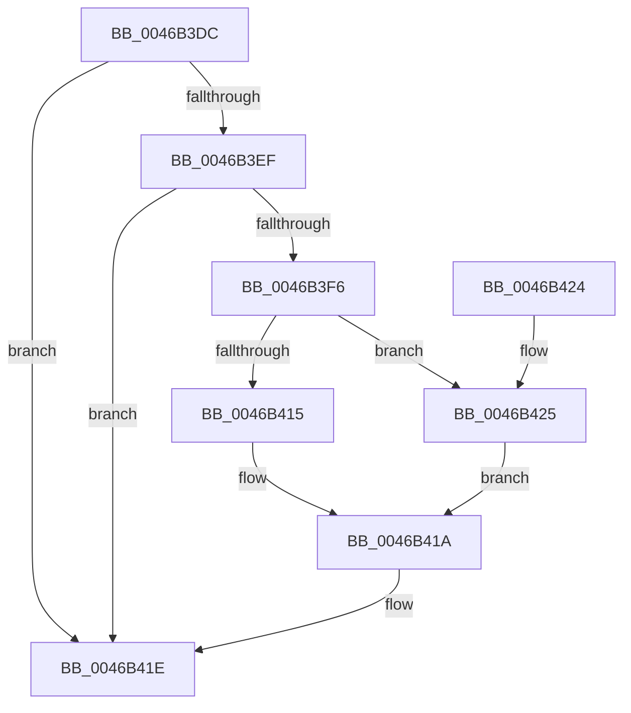

# CmpValueEnumStackEntryStart

- RVA: `0x0046B3DC`–`0x0046B42C` (길이 `80` bytes)
- VA: `0x000000014046B3DC`
- 실행 섹션: `.text`
- PDB 이름 있음: `예`; PDB Function 태그: `아니요`
- unwind 정보 RVA: `0x0005DAC8`
- 디코드: `24`개 명령, `80/80` bytes 표시
- 미해석 바이트: `0` (있으면 어셈블리에 `.byte`로 보존)

> 이 문서는 커널 이미지의 기계어와 PDB 기호를 분석해 생성했습니다. 4번과 5번은 함수 원형과 자료형을 바이너리 사용 방식에서 추정한 C 해석이며 원본 소스 복구 결과는 아닙니다.

## 1. Dependencies

- 직접 호출 지점: **2**; 고유 호출 대상: **2**
- 직접 호출자로 확인된 함수: **1**
- RIP 상대 이미지 참조: **0**

### Outgoing calls
- `0x0046B415` → [HvpGetCellFlat](../../page/85/HvpGetCellFlat_function_00854C60.md) (function, `0x00854C60`)
- `0x0046B425` → [HvpGetCellPaged](../../page/85/HvpGetCellPaged_function_00854CB0.md) (function, `0x00854CB0`)

### Direct callers
- [CmpValueEnumStackStartFromKeyNodeStack](CmpValueEnumStackStartFromKeyNodeStack_function_0046B2E0.md) at `0x0046B352`

### Static image references
- 디코드된 RIP-relative 메모리 참조가 없습니다.

## 2. Other-region calls and transfers

- 다른 실행 섹션으로 향하는 call: **2**
  - `0x0046B415` → [HvpGetCellFlat](../../page/85/HvpGetCellFlat_function_00854C60.md) (`.text` → `PAGE`)
  - `0x0046B425` → [HvpGetCellPaged](../../page/85/HvpGetCellPaged_function_00854CB0.md) (`.text` → `PAGE`)
- 별도 외부 분기/꼬리 이동을 확인하지 못했습니다.

## 3. Assembly (complete function range)

```asm
0046B3DC  40 53                           push rbx
0046B3DE  48 83 EC 20                     sub rsp, 0x20
0046B3E2  41 F6 40 02 40                  test byte ptr [r8 + 2], 0x40
0046B3E7  4C 8B CA                        mov r9, rdx
0046B3EA  48 8B D9                        mov rbx, rcx
0046B3ED  75 2F                           jne 0x14046b41e
0046B3EF  41 83 78 24 00                  cmp dword ptr [r8 + 0x24], 0
0046B3F4  74 28                           je 0x14046b41e
0046B3F6  48 89 11                        mov qword ptr [rcx], rdx
0046B3F9  41 8B 40 24                     mov eax, dword ptr [r8 + 0x24]
0046B3FD  89 41 18                        mov dword ptr [rcx + 0x18], eax
0046B400  41 F6 81 8C 00 00 00 01         test byte ptr [r9 + 0x8c], 1
0046B408  41 8B 50 28                     mov edx, dword ptr [r8 + 0x28]
0046B40C  4C 8D 41 10                     lea r8, [rcx + 0x10]
0046B410  49 8B C9                        mov rcx, r9
0046B413  74 10                           je 0x14046b425
0046B415  E8 46 98 3E 00                  call 0x140854c60
0046B41A  48 89 43 08                     mov qword ptr [rbx + 8], rax
0046B41E  48 83 C4 20                     add rsp, 0x20
0046B422  5B                              pop rbx
0046B423  C3                              ret
0046B424  CC                              int3
0046B425  E8 86 98 3E 00                  call 0x140854cb0
0046B42A  EB EE                           jmp 0x14046b41a
```

## 4. C-style interpretation (structured pseudocode)

```c
__int64 __fastcall CmpValueEnumStackEntryStart(__int64 a1, __int64 a2, __int64 a3)
{
    __int64 result;
    __int64 v_rsp;

    v_rsp = (v_rsp) - (32);
    if (((*(unsigned __int8 *)(a3 + 2)) & (64)) != 0) goto loc_0046B41E;
    if ((*(unsigned int *)(a3 + 36)) == 0) goto loc_0046B41E;
    *(unsigned __int64 *)(a1) = a2;
    *(unsigned int *)(a1 + 24) = (unsigned int)((unsigned int)(*(unsigned int *)(a3 + 36)));
    if (((*(unsigned __int8 *)(a2 + 140)) & (1)) == 0) goto loc_0046B425;
    result = HvpGetCellFlat(a2, (unsigned int)(*(unsigned int *)(a3 + 40)), a1 + 16, a2);
loc_0046B41A:
    *(unsigned __int64 *)(a1 + 8) = result;
loc_0046B41E:
    v_rsp = (v_rsp) + (32);
    return result;
loc_0046B425:
    result = HvpGetCellPaged(a2, (unsigned int)(*(unsigned int *)(a3 + 40)), a1 + 16, a2);
    goto loc_0046B41A;
}
```

## 5. (Beta) C Style

```c
int64_t CmpValueEnumStackEntryStart(void *Arg1, void *Arg2, void *Arg3)
{
    uint8_t *arg1 = (uint8_t *)Arg1;
    uint8_t *arg2 = (uint8_t *)Arg2;
    uint8_t *arg3 = (uint8_t *)Arg3;

    int64_t result;
    int64_t local_rsp;

    local_rsp = (local_rsp) - (32);
    if (((*(uint8_t *)(arg3 + 0x2)) & (64)) != 0) goto loc_0046B41E;
    if ((*(uint32_t *)(arg3 + 0x24)) == 0) goto loc_0046B41E;
    *(void **)(arg1) = Arg2;
    *(uint32_t *)(arg1 + 0x18) = (uint32_t)((uint32_t)(*(uint32_t *)(arg3 + 0x24)));
    if (((*(uint8_t *)(arg2 + 0x8C)) & (1)) == 0) goto loc_0046B425;
    result = HvpGetCellFlat(Arg2, (uint32_t)(*(uint32_t *)(arg3 + 0x28)), Arg1 + 16, Arg2);
loc_0046B41A:
    *(uint64_t *)(arg1 + 0x8) = result;
loc_0046B41E:
    local_rsp = (local_rsp) + (32);
    return result;
loc_0046B425:
    result = HvpGetCellPaged(Arg2, (uint32_t)(*(uint32_t *)(arg3 + 0x28)), Arg1 + 16, Arg2);
    goto loc_0046B41A;
}
```

### 관측된 메모리 오프셋

구조체 형식이 확인되지 않은 접근은 인자 기준의 오프셋으로만 기록했습니다.

| 기준 인자 | 오프셋 표현 | 폭 (bit) | 접근 |
|---|---:|---:|---|
| `Arg1` | `+ 0x0` | `64` | `W` |
| `Arg1` | `+ 0x8` | `64` | `W` |
| `Arg1` | `+ 0x10` | `64` | `R` |
| `Arg1` | `+ 0x18` | `32` | `W` |
| `Arg2` | `+ 0x8C` | `8` | `R` |
| `Arg3` | `+ 0x2` | `8` | `R` |
| `Arg3` | `+ 0x24` | `32` | `R` |
| `Arg3` | `+ 0x28` | `32` | `R` |

## 6. Execution-region graph

[열기: 2D/3D 그래프와 함수 탐색 컨트롤 패널](../../../control-panel.html?section=text&rva=0x0046B3DC&view=graph)

- 2D 그래프는 위에서 아래로 흐르고, 3D 그래프는 빈 공간을 드래그해 회전합니다. Shift+드래그는 이동, 휠은 확대·축소, 함수 노드 선택은 대상 보고서 이동입니다.

### Static fallback


