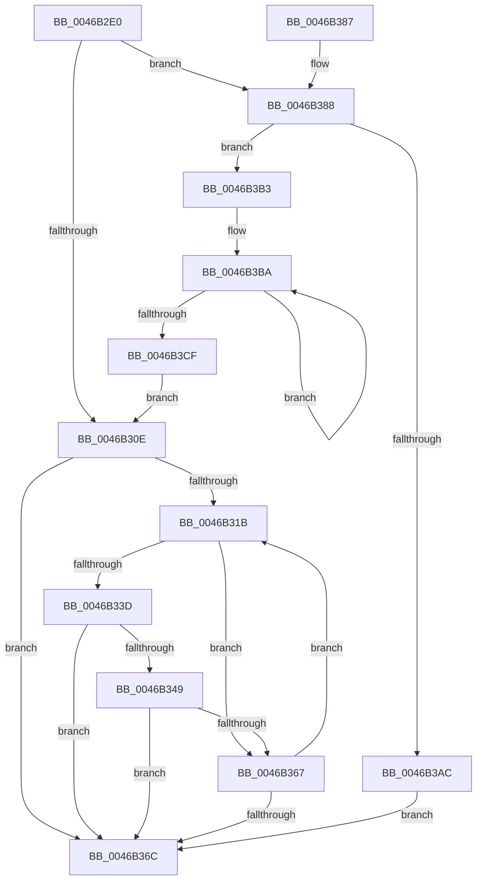

# CmpValueEnumStackStartFromKeyNodeStack

- RVA: `0x0046B2E0`–`0x0046B3D4` (길이 `244` bytes)
- VA: `0x000000014046B2E0`
- 실행 섹션: `.text`
- PDB 이름 있음: `예`; PDB Function 태그: `아니요`
- unwind 정보 RVA: `0x000AB454`
- 디코드: `73`개 명령, `244/244` bytes 표시
- 미해석 바이트: `0` (있으면 어셈블리에 `.byte`로 보존)

> 이 문서는 커널 이미지의 기계어와 PDB 기호를 분석해 생성했습니다. 4번과 5번은 함수 원형과 자료형을 바이너리 사용 방식에서 추정한 C 해석이며 원본 소스 복구 결과는 아닙니다.

## 1. Dependencies

- 직접 호출 지점: **7**; 고유 호출 대상: **6**
- 직접 호출자로 확인된 함수: **3**
- RIP 상대 이미지 참조: **0**

### Outgoing calls
- `0x0046B321` → [CmpSortedValueEnumStackGetEntryAtLayerHeight](../../page/8B/CmpSortedValueEnumStackGetEntryAtLayerHeight_function_008B27B8.md) (function, `0x008B27B8`)
- `0x0046B32C` → [CmpKeyNodeStackGetEntryAtLayerHeight](../../page/94/CmpKeyNodeStackGetEntryAtLayerHeight_function_00946ABC.md) (function, `0x00946ABC`)
- `0x0046B340` → [CmpGetEffectiveKeyNodeSemantics](../../page/94/CmpGetEffectiveKeyNodeSemantics_function_00946D18.md) (function, `0x00946D18`)
- `0x0046B352` → [CmpValueEnumStackEntryStart](CmpValueEnumStackEntryStart_function_0046B3DC.md) (function, `0x0046B3DC`)
- `0x0046B35E` → [CmpGetEffectiveKeyNodeSemantics](../../page/94/CmpGetEffectiveKeyNodeSemantics_function_00946D18.md) (function, `0x00946D18`)
- `0x0046B39E` → [ExAllocatePool2](../../poolcode/B8/ExAllocatePool2_function_00B820F0.md) (function, `0x00B820F0`)
- `0x0046B3C1` → [CmpValueEnumStackEntryInitialize](../49/CmpValueEnumStackEntryInitialize_function_0049D4C4.md) (function, `0x0049D4C4`)

### Direct callers
- [CmpGetValueCountForKeyNodeStack](CmpGetValueCountForKeyNodeStack_function_0046B118.md) at `0x0046B21B`
- [CmpFullPromoteSingleKeyFromKeyNodeStacks](../../page/8B/CmpFullPromoteSingleKeyFromKeyNodeStacks_function_008B1A40.md) at `0x008B1B52`
- [CmpValueEnumStackStartFromKcbStack](../../page/94/CmpValueEnumStackStartFromKcbStack_function_00944AA4.md) at `0x00944B2D`

### Static image references
- 디코드된 RIP-relative 메모리 참조가 없습니다.

## 2. Other-region calls and transfers

- 다른 실행 섹션으로 향하는 call: **5**
  - `0x0046B321` → [CmpSortedValueEnumStackGetEntryAtLayerHeight](../../page/8B/CmpSortedValueEnumStackGetEntryAtLayerHeight_function_008B27B8.md) (`.text` → `PAGE`)
  - `0x0046B32C` → [CmpKeyNodeStackGetEntryAtLayerHeight](../../page/94/CmpKeyNodeStackGetEntryAtLayerHeight_function_00946ABC.md) (`.text` → `PAGE`)
  - `0x0046B340` → [CmpGetEffectiveKeyNodeSemantics](../../page/94/CmpGetEffectiveKeyNodeSemantics_function_00946D18.md) (`.text` → `PAGE`)
  - `0x0046B35E` → [CmpGetEffectiveKeyNodeSemantics](../../page/94/CmpGetEffectiveKeyNodeSemantics_function_00946D18.md) (`.text` → `PAGE`)
  - `0x0046B39E` → [ExAllocatePool2](../../poolcode/B8/ExAllocatePool2_function_00B820F0.md) (`.text` → `POOLCODE`)
- 별도 외부 분기/꼬리 이동을 확인하지 못했습니다.

## 3. Assembly (complete function range)

```asm
0046B2E0  48 89 5C 24 08                  mov qword ptr [rsp + 8], rbx
0046B2E5  48 89 6C 24 10                  mov qword ptr [rsp + 0x10], rbp
0046B2EA  48 89 74 24 18                  mov qword ptr [rsp + 0x18], rsi
0046B2EF  57                              push rdi
0046B2F0  41 56                           push r14
0046B2F2  41 57                           push r15
0046B2F4  48 83 EC 20                     sub rsp, 0x20
0046B2F8  0F B7 3A                        movzx edi, word ptr [rdx]
0046B2FB  33 DB                           xor ebx, ebx
0046B2FD  4C 8B F2                        mov r14, rdx
0046B300  48 8B F1                        mov rsi, rcx
0046B303  BD 01 00 00 00                  mov ebp, 1
0046B308  66 83 FF 02                     cmp di, 2
0046B30C  7D 7A                           jge 0x14046b388
0046B30E  41 0F B7 3E                     movzx edi, word ptr [r14]
0046B312  66 89 7E 0C                     mov word ptr [rsi + 0xc], di
0046B316  66 85 FF                        test di, di
0046B319  78 51                           js 0x14046b36c
0046B31B  0F B7 D7                        movzx edx, di
0046B31E  48 8B CE                        mov rcx, rsi
0046B321  E8 92 74 44 00                  call 0x1408b27b8
0046B326  49 8B CE                        mov rcx, r14
0046B329  4C 8B C8                        mov r9, rax
0046B32C  E8 8B B7 4D 00                  call 0x140946abc
0046B331  4C 8B F8                        mov r15, rax
0046B334  48 8B 50 10                     mov rdx, qword ptr [rax + 0x10]
0046B338  48 85 D2                        test rdx, rdx
0046B33B  74 2A                           je 0x14046b367
0046B33D  48 8B 08                        mov rcx, qword ptr [rax]
0046B340  E8 D3 B9 4D 00                  call 0x140946d18
0046B345  3B C5                           cmp eax, ebp
0046B347  74 23                           je 0x14046b36c
0046B349  4C 8B C2                        mov r8, rdx
0046B34C  48 8B D1                        mov rdx, rcx
0046B34F  49 8B C9                        mov rcx, r9
0046B352  E8 85 00 00 00                  call 0x14046b3dc
0046B357  49 8B 57 10                     mov rdx, qword ptr [r15 + 0x10]
0046B35B  49 8B 0F                        mov rcx, qword ptr [r15]
0046B35E  E8 B5 B9 4D 00                  call 0x140946d18
0046B363  85 C0                           test eax, eax
0046B365  75 05                           jne 0x14046b36c
0046B367  66 2B FD                        sub di, bp
0046B36A  79 AF                           jns 0x14046b31b
0046B36C  48 8B 6C 24 48                  mov rbp, qword ptr [rsp + 0x48]
0046B371  8B C3                           mov eax, ebx
0046B373  48 8B 5C 24 40                  mov rbx, qword ptr [rsp + 0x40]
0046B378  48 8B 74 24 50                  mov rsi, qword ptr [rsp + 0x50]
0046B37D  48 83 C4 20                     add rsp, 0x20
0046B381  41 5F                           pop r15
0046B383  41 5E                           pop r14
0046B385  5F                              pop rdi
0046B386  C3                              ret
0046B387  CC                              int3
0046B388  66 2B FD                        sub di, bp
0046B38B  B9 00 01 00 00                  mov ecx, 0x100
0046B390  48 0F BF D7                     movsx rdx, di
0046B394  41 B8 43 4D 37 30               mov r8d, 0x30374d43
0046B39A  48 C1 E2 05                     shl rdx, 5
0046B39E  E8 4D 6D 71 00                  call 0x140b820f0
0046B3A3  48 89 46 50                     mov qword ptr [rsi + 0x50], rax
0046B3A7  48 85 C0                        test rax, rax
0046B3AA  75 07                           jne 0x14046b3b3
0046B3AC  BB 9A 00 00 C0                  mov ebx, 0xc000009a
0046B3B1  EB B9                           jmp 0x14046b36c
0046B3B3  48 8B D3                        mov rdx, rbx
0046B3B6  44 0F B7 C7                     movzx r8d, di
0046B3BA  48 8B 4E 50                     mov rcx, qword ptr [rsi + 0x50]
0046B3BE  48 03 CA                        add rcx, rdx
0046B3C1  E8 FE 20 03 00                  call 0x14049d4c4
0046B3C6  48 83 C2 20                     add rdx, 0x20
0046B3CA  4C 2B C5                        sub r8, rbp
0046B3CD  75 EB                           jne 0x14046b3ba
0046B3CF  E9 3A FF FF FF                  jmp 0x14046b30e
```

## 4. C-style interpretation (structured pseudocode)

```c
__int64 __fastcall CmpValueEnumStackStartFromKeyNodeStack(__int64 a1, __int64 a2)
{
    __int64 result;
    __int64 v_rbx;
    __int64 v_rdi;
    __int64 v_rsp;
    unsigned __int64 v_stack_p10;
    unsigned __int64 v_stack_p18;
    unsigned __int64 v_stack_p8;

    v_stack_p8 = v_rbx;
    v_stack_p10 = v_rbp;
    v_stack_p18 = v_rsi;
    v_rsp = (v_rsp) - (32);
    v_rbx = 0;
    if (((unsigned __int16)(*(unsigned __int16 *)(a2))) >= 2) goto loc_0046B388;
loc_0046B30E:
    *(unsigned __int16 *)(a1 + 12) = (unsigned __int16)(*(unsigned __int16 *)(a2));
    if (sign_flag) goto loc_0046B36C;
loc_0046B31B:
    result = CmpSortedValueEnumStackGetEntryAtLayerHeight(a1, (unsigned __int16)(*(unsigned __int16 *)(a2)), a3, a4);
    result = CmpKeyNodeStackGetEntryAtLayerHeight(a2, (unsigned __int16)(*(unsigned __int16 *)(a2)), a3, result);
    if (*(unsigned __int64 *)(result + 16) == 0) goto loc_0046B367;
    result = CmpGetEffectiveKeyNodeSemantics(*(unsigned __int64 *)(result), *(unsigned __int64 *)(result + 16), a3, result);
    if (((unsigned int)(result)) == 1) goto loc_0046B36C;
    result = CmpValueEnumStackEntryStart(result, *(unsigned __int64 *)(result), *(unsigned __int64 *)(result + 16), result);
    result = CmpGetEffectiveKeyNodeSemantics(*(unsigned __int64 *)(result), *(unsigned __int64 *)(result + 16), *(unsigned __int64 *)(result + 16), result);
    if ((unsigned int)(result) != 0) goto loc_0046B36C;
loc_0046B367:
    v_rdi = (unsigned __int16)((*(unsigned __int16 *)(a2)) - (1));
    if (!sign_flag) goto loc_0046B31B;
loc_0046B36C:
    v_rsp = (v_rsp) + (32);
    return 0;
loc_0046B388:
    v_rdi = (unsigned __int16)((v_rdi) - ((unsigned __int16)(v_stack_p10)));
    a2 = ((__int16)((unsigned __int16)(v_rdi))) << (5);
    result = ExAllocatePool2(256, a2, (unsigned int)(0x30374D43ULL), result);
    *(unsigned __int64 *)(v_stack_p18 + 80) = result;
    if (result != 0) goto loc_0046B3B3;
    goto loc_0046B36C;
loc_0046B3B3:
loc_0046B3BA:
    a1 = (*(unsigned __int64 *)(v_stack_p18 + 80)) + ((unsigned int)(0xC000009AULL));
    result = CmpValueEnumStackEntryInitialize(a1, (unsigned int)(0xC000009AULL), (unsigned __int16)(v_rdi), result);
    a2 = ((unsigned int)(0xC000009AULL)) + (32);
    a3 = ((unsigned __int16)(v_rdi)) - (v_stack_p10);
    if (condition_is_not_equal) goto loc_0046B3BA;
    goto loc_0046B30E;
}
```

## 5. (Beta) C Style

```c
int64_t CmpValueEnumStackStartFromKeyNodeStack(void *Arg1, void *Arg2)
{
    uint8_t *arg1 = (uint8_t *)Arg1;
    uint8_t *arg2 = (uint8_t *)Arg2;

    int64_t result;
    int64_t local_rbx;
    int64_t local_rdi;
    int64_t local_rsp;
    uint64_t v_stack_p10;
    uint64_t v_stack_p18;
    uint64_t v_stack_p8;

    v_stack_p8 = local_rbx;
    v_stack_p10 = local_rbp;
    v_stack_p18 = local_rsi;
    local_rsp = (local_rsp) - (32);
    local_rbx = 0;
    if (((uint16_t)(*(uint16_t *)(arg2))) >= 2) goto loc_0046B388;
loc_0046B30E:
    *(uint16_t *)(arg1 + 0xC) = (uint16_t)(*(uint16_t *)(arg2));
    if (sign_flag) goto loc_0046B36C;
loc_0046B31B:
    result = CmpSortedValueEnumStackGetEntryAtLayerHeight(Arg1, (uint16_t)(*(uint16_t *)(arg2)), a3, a4);
    result = CmpKeyNodeStackGetEntryAtLayerHeight(Arg2, (uint16_t)(*(uint16_t *)(arg2)), a3, result);
    if (*(uint64_t *)(result + 0x10) == 0) goto loc_0046B367;
    result = CmpGetEffectiveKeyNodeSemantics(*(uint64_t *)(result), *(uint64_t *)(result + 0x10), a3, result);
    if (((uint32_t)(result)) == 1) goto loc_0046B36C;
    result = CmpValueEnumStackEntryStart(result, *(uint64_t *)(result), *(uint64_t *)(result + 0x10), result);
    result = CmpGetEffectiveKeyNodeSemantics(*(uint64_t *)(result), *(uint64_t *)(result + 0x10), *(uint64_t *)(result + 0x10), result);
    if ((uint32_t)(result) != 0) goto loc_0046B36C;
loc_0046B367:
    local_rdi = (uint16_t)((*(uint16_t *)(arg2)) - (1));
    if (!sign_flag) goto loc_0046B31B;
loc_0046B36C:
    local_rsp = (local_rsp) + (32);
    return 0;
loc_0046B388:
    local_rdi = (uint16_t)((local_rdi) - ((uint16_t)(v_stack_p10)));
    Arg2 = ((int16_t)((uint16_t)(local_rdi))) << (5);
    result = ExAllocatePool2(256, Arg2, (uint32_t)(0x30374D43ULL), result);
    *(uint64_t *)(v_stack_p18 + 0x50) = result;
    if (result != 0) goto loc_0046B3B3;
    goto loc_0046B36C;
loc_0046B3B3:
loc_0046B3BA:
    Arg1 = (*(uint64_t *)(v_stack_p18 + 0x50)) + ((uint32_t)(0xC000009AULL));
    result = CmpValueEnumStackEntryInitialize(Arg1, (uint32_t)(0xC000009AULL), (uint16_t)(local_rdi), result);
    Arg2 = ((uint32_t)(0xC000009AULL)) + (32);
    a3 = ((uint16_t)(local_rdi)) - (v_stack_p10);
    if (condition_is_not_equal) goto loc_0046B3BA;
    goto loc_0046B30E;
}
```

### 관측된 메모리 오프셋

구조체 형식이 확인되지 않은 접근은 인자 기준의 오프셋으로만 기록했습니다.

| 기준 인자 | 오프셋 표현 | 폭 (bit) | 접근 |
|---|---:|---:|---|
| `Arg1` | `+ 0xC` | `16` | `W` |
| `Arg1` | `+ 0x50` | `64` | `R` |
| `Arg1` | `+ 0x50` | `64` | `W` |
| `Arg2` | `+ 0x0` | `16` | `R` |

## 6. Execution-region graph

[열기: 2D/3D 그래프와 함수 탐색 컨트롤 패널](../../../control-panel.html?section=text&rva=0x0046B2E0&view=graph)

- 2D 그래프는 위에서 아래로 흐르고, 3D 그래프는 빈 공간을 드래그해 회전합니다. Shift+드래그는 이동, 휠은 확대·축소, 함수 노드 선택은 대상 보고서 이동입니다.

### Static fallback


