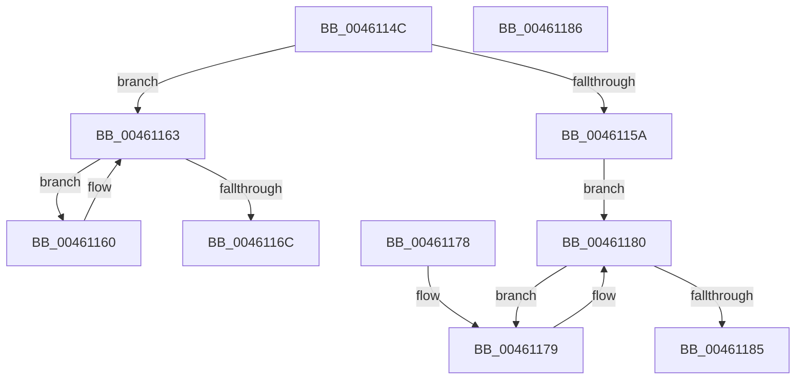

# DifAvlRealSuccessor

- RVA: `0x0046114C`–`0x00461187` (길이 `59` bytes)
- VA: `0x000000014046114C`
- 실행 섹션: `.text`
- PDB 이름 있음: `예`; PDB Function 태그: `아니요`
- unwind 정보 RVA: `0x000DB714`
- 디코드: `22`개 명령, `59/59` bytes 표시
- 미해석 바이트: `0` (있으면 어셈블리에 `.byte`로 보존)

> 이 문서는 커널 이미지의 기계어와 PDB 기호를 분석해 생성했습니다. 4번과 5번은 함수 원형과 자료형을 바이너리 사용 방식에서 추정한 C 해석이며 원본 소스 복구 결과는 아닙니다.

## 1. Dependencies

- 직접 호출 지점: **0**; 고유 호출 대상: **0**
- 직접 호출자로 확인된 함수: **1**
- RIP 상대 이미지 참조: **0**

### Outgoing calls
- 직접 디코드된 call 명령이 없습니다.

### Direct callers
- [DifObjTrkQeuryInvokeDeleteRange](../61/DifObjTrkQeuryInvokeDeleteRange_function_00619EA0.md) at `0x0061A022`

### Static image references
- 디코드된 RIP-relative 메모리 참조가 없습니다.

## 2. Other-region calls and transfers

- 다른 실행 섹션으로 향하는 call: **0**
- 별도 외부 분기/꼬리 이동을 확인하지 못했습니다.

## 3. Assembly (complete function range)

```asm
0046114C  48 8B 41 10                     mov rax, qword ptr [rcx + 0x10]
00461150  33 D2                           xor edx, edx
00461152  4C 8B C1                        mov r8, rcx
00461155  48 85 C0                        test rax, rax
00461158  74 09                           je 0x140461163
0046115A  48 8B 48 08                     mov rcx, qword ptr [rax + 8]
0046115E  EB 20                           jmp 0x140461180
00461160  4C 8B C1                        mov r8, rcx
00461163  48 8B 09                        mov rcx, qword ptr [rcx]
00461166  4C 39 41 10                     cmp qword ptr [rcx + 0x10], r8
0046116A  74 F4                           je 0x140461160
0046116C  4C 39 41 08                     cmp qword ptr [rcx + 8], r8
00461170  48 0F 44 D1                     cmove rdx, rcx
00461174  48 8B C2                        mov rax, rdx
00461177  C3                              ret
00461178  CC                              int3
00461179  48 8B C1                        mov rax, rcx
0046117C  48 8B 49 08                     mov rcx, qword ptr [rcx + 8]
00461180  48 85 C9                        test rcx, rcx
00461183  75 F4                           jne 0x140461179
00461185  C3                              ret
00461186  CC                              int3
```

## 4. C-style interpretation (structured pseudocode)

```c
__int64 __fastcall DifAvlRealSuccessor(__int64 a1, int a2)
{
    a2 = 0;
    if (*(unsigned __int64 *)(a1 + 16) == 0) goto loc_00461163;
    goto loc_00461180;
loc_00461160:
loc_00461163:
    if ((*(unsigned __int64 *)(*(unsigned __int64 *)(*(unsigned __int64 *)(*(unsigned __int64 *)(a1 + 16) + 8)) + 16)) == (*(unsigned __int64 *)(*(unsigned __int64 *)(a1 + 16) + 8))) goto loc_00461160;
    if ((*(unsigned __int64 *)(*(unsigned __int64 *)(*(unsigned __int64 *)(*(unsigned __int64 *)(a1 + 16) + 8)) + 8)) == (*(unsigned __int64 *)(*(unsigned __int64 *)(a1 + 16) + 8))) { a2 = *(unsigned __int64 *)(*(unsigned __int64 *)(*(unsigned __int64 *)(a1 + 16) + 8)); }
    return a2;
loc_00461179:
loc_00461180:
    if (*(unsigned __int64 *)(*(unsigned __int64 *)(*(unsigned __int64 *)(*(unsigned __int64 *)(a1 + 16) + 8)) + 8) != 0) goto loc_00461179;
    return *(unsigned __int64 *)(*(unsigned __int64 *)(*(unsigned __int64 *)(a1 + 16) + 8));
}
```

## 5. (Beta) C Style

```c
int64_t DifAvlRealSuccessor(void *Arg1, int32_t Arg2)
{
    uint8_t *arg1 = (uint8_t *)Arg1;

    Arg2 = 0;
    if (*(uint64_t *)(arg1 + 0x10) == 0) goto loc_00461163;
    goto loc_00461180;
loc_00461160:
loc_00461163:
    if ((*(uint64_t *)(*(uint64_t *)(*(uint64_t *)(*(uint64_t *)(arg1 + 0x10) + 0x8)) + 0x10)) == (*(uint64_t *)(*(uint64_t *)(arg1 + 0x10) + 0x8))) goto loc_00461160;
    if ((*(uint64_t *)(*(uint64_t *)(*(uint64_t *)(*(uint64_t *)(arg1 + 0x10) + 0x8)) + 0x8)) == (*(uint64_t *)(*(uint64_t *)(arg1 + 0x10) + 0x8))) { Arg2 = *(uint64_t *)(*(uint64_t *)(*(uint64_t *)(arg1 + 0x10) + 0x8)); }
    return Arg2;
loc_00461179:
loc_00461180:
    if (*(uint64_t *)(*(uint64_t *)(*(uint64_t *)(*(uint64_t *)(arg1 + 0x10) + 0x8)) + 0x8) != 0) goto loc_00461179;
    return *(uint64_t *)(*(uint64_t *)(*(uint64_t *)(arg1 + 0x10) + 0x8));
}
```

### 관측된 메모리 오프셋

구조체 형식이 확인되지 않은 접근은 인자 기준의 오프셋으로만 기록했습니다.

| 기준 인자 | 오프셋 표현 | 폭 (bit) | 접근 |
|---|---:|---:|---|
| `Arg1` | `+ 0x10` | `64` | `R` |

## 6. Execution-region graph

[열기: 2D/3D 그래프와 함수 탐색 컨트롤 패널](../../../control-panel.html?section=text&rva=0x0046114C&view=graph)

- 2D 그래프는 위에서 아래로 흐르고, 3D 그래프는 빈 공간을 드래그해 회전합니다. Shift+드래그는 이동, 휠은 확대·축소, 함수 노드 선택은 대상 보고서 이동입니다.

### Static fallback


