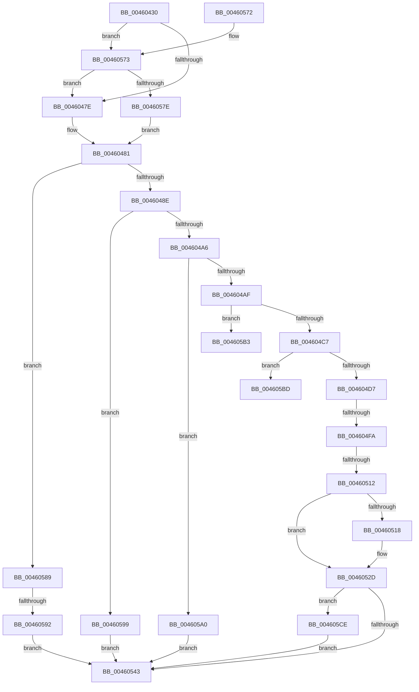

# EtwTelemetryCoverageReport

- RVA: `0x00460430`–`0x004605E0` (길이 `432` bytes)
- VA: `0x0000000140460430`
- 실행 섹션: `.text`
- PDB 이름 있음: `예`; PDB Function 태그: `예`
- unwind 정보 RVA: `0x000A9C74`
- 디코드: `110`개 명령, `432/432` bytes 표시
- 미해석 바이트: `0` (있으면 어셈블리에 `.byte`로 보존)

> 이 문서는 커널 이미지의 기계어와 PDB 기호를 분석해 생성했습니다. 4번과 5번은 함수 원형과 자료형을 바이너리 사용 방식에서 추정한 C 해석이며 원본 소스 복구 결과는 아닙니다.

## 1. Dependencies

- 직접 호출 지점: **9**; 고유 호출 대상: **9**
- 직접 호출자로 확인된 함수: **10**
- RIP 상대 이미지 참조: **3**

### Outgoing calls
- `0x00460471` → [KeGetEffectiveIrql](../2F/KeGetEffectiveIrql_function_002F8030.md) (function, `0x002F8030`)
- `0x004604B7` → [EtwpCoverageValidateCP](EtwpCoverageValidateCP_function_0046068C.md) (function, `0x0046068C`)
- `0x004604DD` → [KeAcquireSpinLockRaiseToDpc](../20/KeAcquireSpinLockRaiseToDpc_function_00208470.md) (function, `0x00208470`)
- `0x00460502` → [EtwpCoverageAddToStringBuffer](EtwpCoverageAddToStringBuffer_function_004605E8.md) (function, `0x004605E8`)
- `0x00460521` → [ExQueueWorkItem](../2F/ExQueueWorkItem_function_002F9520.md) (function, `0x002F9520`)
- `0x00460533` → [KeReleaseSpinLock](../39/KeReleaseSpinLock_function_00392BA0.md) (function, `0x00392BA0`)
- `0x0046054C` → [_security_check_cookie](../6A/_security_check_cookie_function_006AC640.md) (function, `0x006AC640`)
- `0x004605AA` → [EtwpCoverageRecord](../../page/98/EtwpCoverageRecord_function_009821BC.md) (function, `0x009821BC`)
- `0x004605D6` → [ExFreePoolWithTag](../../poolcode/B8/ExFreePoolWithTag_function_00B82870.md) (function, `0x00B82870`)

### Direct callers
- [EtwpCoverageRecordAtHighIrql](../65/EtwpCoverageRecordAtHighIrql_function_00651C70.md) at `0x00651D00`
- [EtwpCoverageEnsureContext](../../page/70/EtwpCoverageEnsureContext_function_007028E4.md) at `0x00702D0F`
- [EtwpCoverageEnsureContext](../../page/70/EtwpCoverageEnsureContext_function_007028E4.md) at `0x00702D59`
- [EtwpCoverageReset](../../page/7B/EtwpCoverageReset_function_007B9F4C.md) at `0x007B9FC1`
- [EtwpCoverageResetCP](../../page/7B/EtwpCoverageResetCP_function_007BA154.md) at `0x007BA1BB`
- [DbgkForwardException](../../page/8A/DbgkForwardException_function_008A2D60.md) at `0x008A30B7`
- [DbgkForwardException](../../page/8A/DbgkForwardException_function_008A2D60.md) at `0x008A3128`
- [PsSetProcessFaultInformation](../../page/A7/PsSetProcessFaultInformation_function_00A75400.md) at `0x00A75556`
- [PopTransitionTelemetryOsState](../../page/A9/PopTransitionTelemetryOsState_function_00A9DD40.md) at `0x00A9E055`
- [sub_00B19CFC](../../page/B1/Unknown_function_00B19CFC.md) at `0x00B19D03`
- [sub_00B4102A](../../page/B4/Unknown_function_00B4102A.md) at `0x00B41031`
- [sub_00B488B8](../../page/B4/Unknown_function_00B488B8.md) at `0x00B488BF`

### Static image references
- `0x00460453` → RVA `0x00E0A740` (`.data`; read)
- `0x00460481` → RVA `0x00E684F0` (`.data`; read)
- `0x004605A0` → RVA `0x00E684E8` (`.data`; read)

## 2. Other-region calls and transfers

- 다른 실행 섹션으로 향하는 call: **2**
  - `0x004605AA` → [EtwpCoverageRecord](../../page/98/EtwpCoverageRecord_function_009821BC.md) (`.text` → `PAGE`)
  - `0x004605D6` → [ExFreePoolWithTag](../../poolcode/B8/ExFreePoolWithTag_function_00B82870.md) (`.text` → `POOLCODE`)
- call이 아닌 외부 분기/꼬리 이동: **5**
  - `0x004604F4` → [sub_006F23BA + 0x14](../6F/Unknown_function_006F23BA.md) (`tail-transfer`)
  - `0x0046050C` → [sub_006F23BA + 0x14](../6F/Unknown_function_006F23BA.md) (`tail-transfer`)
  - `0x0046058C` → [sub_006F23BA](../6F/Unknown_function_006F23BA.md) (`tail-transfer`)
  - `0x004605B8` → [sub_006F23BA + 0xCF](../6F/Unknown_function_006F23BA.md) (`tail-transfer`)
  - `0x004605C9` → [sub_006F23BA + 0xCF](../6F/Unknown_function_006F23BA.md) (`tail-transfer`)

## 3. Assembly (complete function range)

```asm
00460430  48 8B C4                        mov rax, rsp
00460433  48 89 58 10                     mov qword ptr [rax + 0x10], rbx
00460437  48 89 70 18                     mov qword ptr [rax + 0x18], rsi
0046043B  48 89 78 20                     mov qword ptr [rax + 0x20], rdi
0046043F  55                              push rbp
00460440  41 54                           push r12
00460442  41 55                           push r13
00460444  41 56                           push r14
00460446  41 57                           push r15
00460448  48 8D 68 A1                     lea rbp, [rax - 0x5f]
0046044C  48 81 EC F0 00 00 00            sub rsp, 0xf0
00460453  48 8B 05 E6 A2 9A 00            mov rax, qword ptr [rip + 0x9aa2e6]
0046045A  48 33 C4                        xor rax, rsp
0046045D  48 89 45 27                     mov qword ptr [rbp + 0x27], rax
00460461  45 33 E4                        xor r12d, r12d
00460464  48 8B F1                        mov rsi, rcx
00460467  44 21 64 24 30                  and dword ptr [rsp + 0x30], r12d
0046046C  33 FF                           xor edi, edi
0046046E  45 33 ED                        xor r13d, r13d
00460471  E8 BA 7B E9 FF                  call 0x1402f8030
00460476  3C 02                           cmp al, 2
00460478  0F 82 F5 00 00 00               jb 0x140460573
0046047E  45 33 F6                        xor r14d, r14d
00460481  48 39 3D 68 80 A0 00            cmp qword ptr [rip + 0xa08068], rdi
00460488  0F 84 FB 00 00 00               je 0x140460589
0046048E  81 7E 0C 00 FF FF FF            cmp dword ptr [rsi + 0xc], 0xffffff00
00460495  4C 8B 3D 54 80 A0 00            mov r15, qword ptr [rip + 0xa08054]
0046049C  49 8D 5F 18                     lea rbx, [r15 + 0x18]
004604A0  0F 83 F3 00 00 00               jae 0x140460599
004604A6  45 85 F6                        test r14d, r14d
004604A9  0F 85 F1 00 00 00               jne 0x1404605a0
004604AF  48 8D 54 24 30                  lea rdx, [rsp + 0x30]
004604B4  48 8B CE                        mov rcx, rsi
004604B7  E8 D0 01 00 00                  call 0x14046068c
004604BC  45 33 F6                        xor r14d, r14d
004604BF  85 C0                           test eax, eax
004604C1  0F 84 EC 00 00 00               je 0x1404605b3
004604C7  44 8B 66 0C                     mov r12d, dword ptr [rsi + 0xc]
004604CB  41 8B 07                        mov eax, dword ptr [r15]
004604CE  44 3B E0                        cmp r12d, eax
004604D1  0F 83 E6 00 00 00               jae 0x1404605bd
004604D7  89 46 0C                        mov dword ptr [rsi + 0xc], eax
004604DA  48 8B CB                        mov rcx, rbx
004604DD  E8 8E 7F DA FF                  call 0x140208470
004604E2  48 8B 4B 08                     mov rcx, qword ptr [rbx + 8]
004604E6  44 8A F0                        mov r14b, al
004604E9  48 8B 43 40                     mov rax, qword ptr [rbx + 0x40]
004604ED  48 89 45 8F                     mov qword ptr [rbp - 0x71], rax
004604F1  48 85 C9                        test rcx, rcx
004604F4  0F 84 D4 1E 29 00               je 0x1406f23ce
004604FA  44 8B 44 24 30                  mov r8d, dword ptr [rsp + 0x30]
004604FF  48 8B 16                        mov rdx, qword ptr [rsi]
00460502  E8 E1 00 00 00                  call 0x1404605e8
00460507  44 8B E8                        mov r13d, eax
0046050A  85 C0                           test eax, eax
0046050C  0F 84 BC 1E 29 00               je 0x1406f23ce
00460512  83 7B 48 00                     cmp dword ptr [rbx + 0x48], 0
00460516  75 15                           jne 0x14046052d
00460518  48 8D 4B 20                     lea rcx, [rbx + 0x20]
0046051C  BA 01 00 00 00                  mov edx, 1
00460521  E8 FA 8F E9 FF                  call 0x1402f9520
00460526  C7 43 48 01 00 00 00            mov dword ptr [rbx + 0x48], 1
0046052D  41 8A D6                        mov dl, r14b
00460530  48 8B CB                        mov rcx, rbx
00460533  E8 68 26 F3 FF                  call 0x140392ba0
00460538  33 DB                           xor ebx, ebx
0046053A  48 85 FF                        test rdi, rdi
0046053D  0F 85 8B 00 00 00               jne 0x1404605ce
00460543  8B C3                           mov eax, ebx
00460545  48 8B 4D 27                     mov rcx, qword ptr [rbp + 0x27]
00460549  48 33 CC                        xor rcx, rsp
0046054C  E8 EF C0 24 00                  call 0x1406ac640
00460551  4C 8D 9C 24 F0 00 00 00         lea r11, [rsp + 0xf0]
00460559  49 8B 5B 38                     mov rbx, qword ptr [r11 + 0x38]
0046055D  49 8B 73 40                     mov rsi, qword ptr [r11 + 0x40]
00460561  49 8B 7B 48                     mov rdi, qword ptr [r11 + 0x48]
00460565  49 8B E3                        mov rsp, r11
00460568  41 5F                           pop r15
0046056A  41 5E                           pop r14
0046056C  41 5D                           pop r13
0046056E  41 5C                           pop r12
00460570  5D                              pop rbp
00460571  C3                              ret
00460572  CC                              int3
00460573  8B 46 10                        mov eax, dword ptr [rsi + 0x10]
00460576  A8 01                           test al, 1
00460578  0F 85 00 FF FF FF               jne 0x14046047e
0046057E  41 BE 01 00 00 00               mov r14d, 1
00460584  E9 F8 FE FF FF                  jmp 0x140460481
00460589  45 85 F6                        test r14d, r14d
0046058C  0F 85 28 1E 29 00               jne 0x1406f23ba
00460592  BB B7 00 00 C0                  mov ebx, 0xc00000b7
00460597  EB AA                           jmp 0x140460543
00460599  BB BB 00 00 C0                  mov ebx, 0xc00000bb
0046059E  EB A3                           jmp 0x140460543
004605A0  48 8B 0D 41 7F A0 00            mov rcx, qword ptr [rip + 0xa07f41]
004605A7  48 8B D6                        mov rdx, rsi
004605AA  E8 0D 1C 52 00                  call 0x1409821bc
004605AF  33 DB                           xor ebx, ebx
004605B1  EB 90                           jmp 0x140460543
004605B3  BB 0D 00 00 C0                  mov ebx, 0xc000000d
004605B8  E9 CC 1E 29 00                  jmp 0x1406f2489
004605BD  41 BD 01 00 00 00               mov r13d, 1
004605C3  41 8B DE                        mov ebx, r14d
004605C6  45 8B E5                        mov r12d, r13d
004605C9  E9 BB 1E 29 00                  jmp 0x1406f2489
004605CE  BA 45 74 77 56                  mov edx, 0x56777445
004605D3  48 8B CF                        mov rcx, rdi
004605D6  E8 95 22 72 00                  call 0x140b82870
004605DB  E9 63 FF FF FF                  jmp 0x140460543
```

## 4. C-style interpretation (structured pseudocode)

```c
__int64 __fastcall EtwTelemetryCoverageReport(__int64 a1)
{
    __int64 result;
    __int64 v_r12;
    __int64 v_r13;
    __int64 v_r14;
    __int64 v_rbx;
    __int64 v_rdi;
    __int64 v_rsp;
    unsigned __int64 v_stack_m28;
    unsigned int v_stack_mE8;

    *(unsigned __int64 *)(v_rsp + 16) = v_rbx;
    *(unsigned __int64 *)(v_rsp + 24) = v_rsi;
    *(unsigned __int64 *)(v_rsp + 32) = v_rdi;
    v_rsp = (v_rsp) - (240);
    result = (*(unsigned __int64 *)(v_rip + 10134246)) ^ (v_rsp);
    *(unsigned __int64 *)(v_rsp - 95 + 39) = result;
    v_r12 = 0;
    v_rdi = 0;
    v_r13 = 0;
    result = KeGetEffectiveIrql(a1, a2, a3, a4);
    if (((unsigned __int8)(result)) < 2) goto loc_00460573;
loc_0046047E:
    v_r14 = 0;
loc_00460481:
    if ((*(unsigned __int64 *)(v_rip + 10518632)) == 0) goto loc_00460589;
    if ((*(unsigned int *)(a1 + 12)) >= 0xFFFFFF00ULL) goto loc_00460599;
    if (0 != 0) goto loc_004605A0;
    result = EtwpCoverageValidateCP(a1, v_stack_mE8, a3, a4);
    v_r14 = 0;
    if ((unsigned int)(result) == 0) goto loc_004605B3;
    if (((unsigned int)((unsigned int)(*(unsigned int *)(a1 + 12)))) >= ((unsigned int)((unsigned int)(*(unsigned int *)(*(unsigned __int64 *)(v_rip + 10518612)))))) goto loc_004605BD;
    *(unsigned int *)(a1 + 12) = (unsigned int)((unsigned int)(*(unsigned int *)(*(unsigned __int64 *)(v_rip + 10518612))));
    result = KeAcquireSpinLockRaiseToDpc(*(unsigned __int64 *)(v_rip + 10518612) + 24, v_stack_mE8, a3, a4);
    *(unsigned __int64 *)(v_rsp - 95 - 113) = *(unsigned __int64 *)(*(unsigned __int64 *)(v_rip + 10518612) + 24 + 64);
    result = EtwpCoverageAddToStringBuffer(*(unsigned __int64 *)(*(unsigned __int64 *)(v_rip + 10518612) + 24 + 8), *(unsigned __int64 *)(a1), (unsigned int)(v_stack_mE8), a4);
    if ((*(unsigned int *)(*(unsigned __int64 *)(v_rip + 10518612) + 24 + 72)) == 0) {
        a1 = *(unsigned __int64 *)(v_rip + 10518612) + 24 + 32;
        a2 = 1;
        result = ExQueueWorkItem(a1, a2, (unsigned int)(v_stack_mE8), a4);
        *(unsigned int *)(*(unsigned __int64 *)(v_rip + 10518612) + 24 + 72) = 1;
    }
    result = KeReleaseSpinLock(*(unsigned __int64 *)(v_rip + 10518612) + 24, (unsigned __int8)((unsigned __int8)(result)), (unsigned int)(v_stack_mE8), a4);
    v_rbx = 0;
    if (0 != 0) goto loc_004605CE;
loc_00460543:
    a1 = (*(unsigned __int64 *)(v_rsp - 95 + 39)) ^ (v_rsp);
    result = _security_check_cookie(a1, (unsigned __int8)((unsigned __int8)(result)), (unsigned int)(v_stack_mE8), a4);
    return result;
loc_00460573:
    if ((((unsigned __int8)((unsigned int)(*(unsigned int *)(*(unsigned __int64 *)(v_stack_m28 + 64) + 16)))) & (1)) != 0) goto loc_0046047E;
    goto loc_00460481;
loc_00460589:
    goto loc_00460543;
loc_00460599:
    goto loc_00460543;
loc_004605A0:
    result = EtwpCoverageRecord(*(unsigned __int64 *)(v_rip + 10518337), *(unsigned __int64 *)(v_stack_m28 + 64), (unsigned int)(v_stack_mE8), a4);
    v_rbx = 0;
    goto loc_00460543;
loc_004605B3:
loc_004605BD:
loc_004605CE:
    result = ExFreePoolWithTag(*(unsigned __int64 *)(v_stack_m28 + 72), (unsigned int)(0x56777445ULL), (unsigned int)(v_stack_mE8), a4);
    goto loc_00460543;
}
```

## 5. (Beta) C Style

```c
int64_t EtwTelemetryCoverageReport(void *Arg1)
{
    uint8_t *arg1 = (uint8_t *)Arg1;

    int64_t result;
    int64_t local_r12;
    int64_t local_r13;
    int64_t local_r14;
    int64_t local_rbx;
    int64_t local_rdi;
    int64_t local_rsp;
    uint64_t v_stack_m28;
    uint32_t v_stack_mE8;

    *(uint64_t *)(local_rsp + 0x10) = local_rbx;
    *(uint64_t *)(local_rsp + 0x18) = local_rsi;
    *(uint64_t *)(local_rsp + 0x20) = local_rdi;
    local_rsp = (local_rsp) - (240);
    result = (*(uint64_t *)(v_rip + 0x9AA2E6)) ^ (local_rsp);
    *(uint64_t *)(local_rsp - 0x5F + 0x27) = result;
    local_r12 = 0;
    local_rdi = 0;
    local_r13 = 0;
    result = KeGetEffectiveIrql(Arg1, a2, a3, a4);
    if (((uint8_t)(result)) < 2) goto loc_00460573;
loc_0046047E:
    local_r14 = 0;
loc_00460481:
    if ((*(uint64_t *)(v_rip + 0xA08068)) == 0) goto loc_00460589;
    if ((*(uint32_t *)(arg1 + 0xC)) >= 0xFFFFFF00ULL) goto loc_00460599;
    if (0 != 0) goto loc_004605A0;
    result = EtwpCoverageValidateCP(Arg1, v_stack_mE8, a3, a4);
    local_r14 = 0;
    if ((uint32_t)(result) == 0) goto loc_004605B3;
    if (((uint32_t)((uint32_t)(*(uint32_t *)(arg1 + 0xC)))) >= ((uint32_t)((uint32_t)(*(uint32_t *)(*(uint64_t *)(v_rip + 0xA08054)))))) goto loc_004605BD;
    *(uint32_t *)(arg1 + 0xC) = (uint32_t)((uint32_t)(*(uint32_t *)(*(uint64_t *)(v_rip + 0xA08054))));
    result = KeAcquireSpinLockRaiseToDpc(*(uint64_t *)(v_rip + 0xA08054) + 24, v_stack_mE8, a3, a4);
    *(uint64_t *)(local_rsp - 0x5F - 0x71) = *(uint64_t *)(*(uint64_t *)(v_rip + 0xA08054) + 0x18 + 0x40);
    result = EtwpCoverageAddToStringBuffer(*(uint64_t *)(*(uint64_t *)(v_rip + 0xA08054) + 0x18 + 0x8), *(uint64_t *)(arg1), (uint32_t)(v_stack_mE8), a4);
    if ((*(uint32_t *)(*(uint64_t *)(v_rip + 0xA08054) + 0x18 + 0x48)) == 0) {
        Arg1 = *(uint64_t *)(v_rip + 0xA08054) + 24 + 32;
        a2 = 1;
        result = ExQueueWorkItem(Arg1, a2, (uint32_t)(v_stack_mE8), a4);
        *(uint32_t *)(*(uint64_t *)(v_rip + 0xA08054) + 0x18 + 0x48) = 1;
    }
    result = KeReleaseSpinLock(*(uint64_t *)(v_rip + 0xA08054) + 24, (uint8_t)((uint8_t)(result)), (uint32_t)(v_stack_mE8), a4);
    local_rbx = 0;
    if (0 != 0) goto loc_004605CE;
loc_00460543:
    Arg1 = (*(uint64_t *)(local_rsp - 0x5F + 0x27)) ^ (local_rsp);
    result = _security_check_cookie(Arg1, (uint8_t)((uint8_t)(result)), (uint32_t)(v_stack_mE8), a4);
    return result;
loc_00460573:
    if ((((uint8_t)((uint32_t)(*(uint32_t *)(*(uint64_t *)(v_stack_m28 + 0x40) + 0x10)))) & (1)) != 0) goto loc_0046047E;
    goto loc_00460481;
loc_00460589:
    goto loc_00460543;
loc_00460599:
    goto loc_00460543;
loc_004605A0:
    result = EtwpCoverageRecord(*(uint64_t *)(v_rip + 0xA07F41), *(uint64_t *)(v_stack_m28 + 0x40), (uint32_t)(v_stack_mE8), a4);
    local_rbx = 0;
    goto loc_00460543;
loc_004605B3:
loc_004605BD:
loc_004605CE:
    result = ExFreePoolWithTag(*(uint64_t *)(v_stack_m28 + 0x48), (uint32_t)(0x56777445ULL), (uint32_t)(v_stack_mE8), a4);
    goto loc_00460543;
}
```

### 관측된 메모리 오프셋

구조체 형식이 확인되지 않은 접근은 인자 기준의 오프셋으로만 기록했습니다.

| 기준 인자 | 오프셋 표현 | 폭 (bit) | 접근 |
|---|---:|---:|---|
| `Arg1` | `+ 0x0` | `64` | `R` |
| `Arg1` | `+ 0xC` | `32` | `R` |
| `Arg1` | `+ 0xC` | `32` | `W` |
| `Arg1` | `+ 0x10` | `32` | `R` |

## 6. Execution-region graph

[열기: 2D/3D 그래프와 함수 탐색 컨트롤 패널](../../../control-panel.html?section=text&rva=0x00460430&view=graph)

- 2D 그래프는 위에서 아래로 흐르고, 3D 그래프는 빈 공간을 드래그해 회전합니다. Shift+드래그는 이동, 휠은 확대·축소, 함수 노드 선택은 대상 보고서 이동입니다.

### Static fallback


