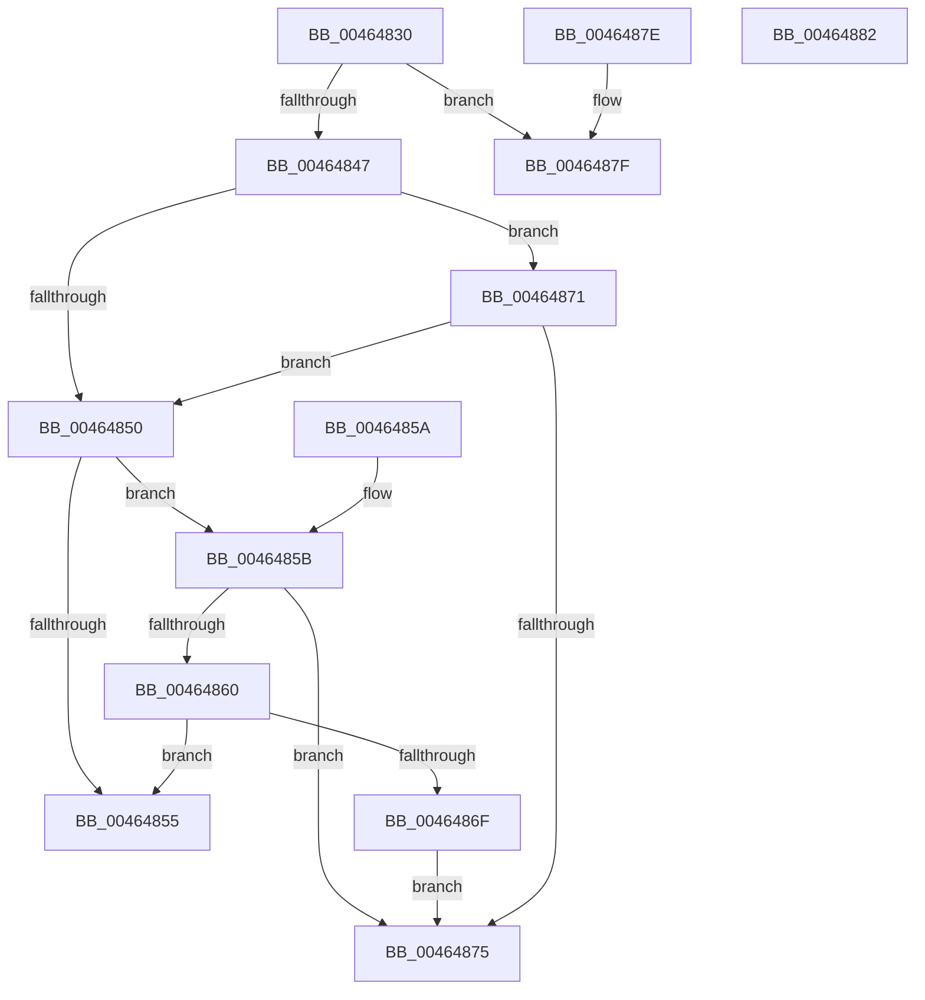

# EtwpApplyLevelKwFilterInner

- RVA: `0x00464830`–`0x00464883` (길이 `83` bytes)
- VA: `0x0000000140464830`
- 실행 섹션: `.text`
- PDB 이름 있음: `예`; PDB Function 태그: `아니요`
- unwind 정보 RVA: `0x000DB714`
- 디코드: `31`개 명령, `83/83` bytes 표시
- 미해석 바이트: `0` (있으면 어셈블리에 `.byte`로 보존)

> 이 문서는 커널 이미지의 기계어와 PDB 기호를 분석해 생성했습니다. 4번과 5번은 함수 원형과 자료형을 바이너리 사용 방식에서 추정한 C 해석이며 원본 소스 복구 결과는 아닙니다.

## 1. Dependencies

- 직접 호출 지점: **0**; 고유 호출 대상: **0**
- 직접 호출자로 확인된 함수: **1**
- RIP 상대 이미지 참조: **0**

### Outgoing calls
- 직접 디코드된 call 명령이 없습니다.

### Direct callers
- [EtwpApplyLevelKwFilter](EtwpApplyLevelKwFilter_function_00464740.md) at `0x0046481F`

### Static image references
- 디코드된 RIP-relative 메모리 참조가 없습니다.

## 2. Other-region calls and transfers

- 다른 실행 섹션으로 향하는 call: **0**
- 별도 외부 분기/꼬리 이동을 확인하지 못했습니다.

## 3. Assembly (complete function range)

```asm
00464830  8B C2                           mov eax, edx
00464832  48 6B D0 68                     imul rdx, rax, 0x68
00464836  48 8B 81 80 02 00 00            mov rax, qword ptr [rcx + 0x280]
0046483D  4C 8B 54 02 40                  mov r10, qword ptr [rdx + rax + 0x40]
00464842  4D 85 D2                        test r10, r10
00464845  74 38                           je 0x14046487f
00464847  41 8A 42 10                     mov al, byte ptr [r10 + 0x10]
0046484B  44 3A C0                        cmp r8b, al
0046484E  77 21                           ja 0x140464871
00464850  4D 85 C9                        test r9, r9
00464853  75 06                           jne 0x14046485b
00464855  41 8A 42 11                     mov al, byte ptr [r10 + 0x11]
00464859  C3                              ret
0046485A  CC                              int3
0046485B  4D 85 0A                        test qword ptr [r10], r9
0046485E  74 15                           je 0x140464875
00464860  49 8B 4A 08                     mov rcx, qword ptr [r10 + 8]
00464864  48 8B C1                        mov rax, rcx
00464867  49 23 C1                        and rax, r9
0046486A  48 3B C1                        cmp rax, rcx
0046486D  74 E6                           je 0x140464855
0046486F  EB 04                           jmp 0x140464875
00464871  84 C0                           test al, al
00464873  74 DB                           je 0x140464850
00464875  41 80 7A 11 00                  cmp byte ptr [r10 + 0x11], 0
0046487A  0F 94 C0                        sete al
0046487D  C3                              ret
0046487E  CC                              int3
0046487F  B0 01                           mov al, 1
00464881  C3                              ret
00464882  CC                              int3
```

## 4. C-style interpretation (structured pseudocode)

```c
__int64 __fastcall EtwpApplyLevelKwFilterInner(__int64 a1, int a2, unsigned __int8 a3, __int64 a4)
{
    __int64 result;

    a2 = (a2) * ((unsigned int)(a2));
    if (*(unsigned __int64 *)(a2 + *(unsigned __int64 *)(a1 + 640) * 1 + 64) == 0) goto loc_0046487F;
    if (a3 > ((unsigned __int8)(*(unsigned __int8 *)(*(unsigned __int64 *)(a2 + *(unsigned __int64 *)(a1 + 640) * 1 + 64) + 16)))) goto loc_00464871;
loc_00464850:
    if (a4 != 0) goto loc_0046485B;
loc_00464855:
    return *(unsigned __int8 *)(*(unsigned __int64 *)(a2 + *(unsigned __int64 *)(a1 + 640) * 1 + 64) + 17);
loc_0046485B:
    if (((*(unsigned __int64 *)(*(unsigned __int64 *)(a2 + *(unsigned __int64 *)(a1 + 640) * 1 + 64))) & (a4)) == 0) goto loc_00464875;
    result = (*(unsigned __int64 *)(*(unsigned __int64 *)(a2 + *(unsigned __int64 *)(a1 + 640) * 1 + 64) + 8)) & (a4);
    if (result == (*(unsigned __int64 *)(*(unsigned __int64 *)(a2 + *(unsigned __int64 *)(a1 + 640) * 1 + 64) + 8))) goto loc_00464855;
    goto loc_00464875;
loc_00464871:
    if ((unsigned __int8)(result) == 0) goto loc_00464850;
loc_00464875:
    result = ((*(unsigned __int8 *)(*(unsigned __int64 *)(a2 + *(unsigned __int64 *)(a1 + 640) * 1 + 64) + 17)) == 0) ? 1 : 0;
    return result;
loc_0046487F:
    return 1;
}
```

## 5. (Beta) C Style

```c
int64_t EtwpApplyLevelKwFilterInner(void *Arg1, void *Arg2, uint8_t Arg3, int64_t Arg4)
{
    uint8_t *arg1 = (uint8_t *)Arg1;
    uint8_t *arg2 = (uint8_t *)Arg2;

    int64_t result;

    Arg2 = (Arg2) * ((uint32_t)(Arg2));
    if (*(uint64_t *)(arg2 + *(uint64_t *)(arg1 + 0x280) * 1 + 0x40) == 0) goto loc_0046487F;
    if (Arg3 > ((uint8_t)(*(uint8_t *)(*(uint64_t *)(arg2 + *(uint64_t *)(arg1 + 0x280) * 1 + 0x40) + 0x10)))) goto loc_00464871;
loc_00464850:
    if (Arg4 != 0) goto loc_0046485B;
loc_00464855:
    return *(uint8_t *)(*(uint64_t *)(arg2 + *(uint64_t *)(arg1 + 0x280) * 1 + 0x40) + 0x11);
loc_0046485B:
    if (((*(uint64_t *)(*(uint64_t *)(arg2 + *(uint64_t *)(arg1 + 0x280) * 1 + 0x40))) & (Arg4)) == 0) goto loc_00464875;
    result = (*(uint64_t *)(*(uint64_t *)(arg2 + *(uint64_t *)(arg1 + 0x280) * 1 + 0x40) + 0x8)) & (Arg4);
    if (result == (*(uint64_t *)(*(uint64_t *)(arg2 + *(uint64_t *)(arg1 + 0x280) * 1 + 0x40) + 0x8))) goto loc_00464855;
    goto loc_00464875;
loc_00464871:
    if ((uint8_t)(result) == 0) goto loc_00464850;
loc_00464875:
    result = ((*(uint8_t *)(*(uint64_t *)(arg2 + *(uint64_t *)(arg1 + 0x280) * 1 + 0x40) + 0x11)) == 0) ? 1 : 0;
    return result;
loc_0046487F:
    return 1;
}
```

### 관측된 메모리 오프셋

구조체 형식이 확인되지 않은 접근은 인자 기준의 오프셋으로만 기록했습니다.

| 기준 인자 | 오프셋 표현 | 폭 (bit) | 접근 |
|---|---:|---:|---|
| `Arg1` | `+ 0x280` | `64` | `R` |
| `Arg2` | `+ 0x40 + rax*1` | `64` | `R` |

## 6. Execution-region graph

[열기: 2D/3D 그래프와 함수 탐색 컨트롤 패널](../../../control-panel.html?section=text&rva=0x00464830&view=graph)

- 2D 그래프는 위에서 아래로 흐르고, 3D 그래프는 빈 공간을 드래그해 회전합니다. Shift+드래그는 이동, 휠은 확대·축소, 함수 노드 선택은 대상 보고서 이동입니다.

### Static fallback


