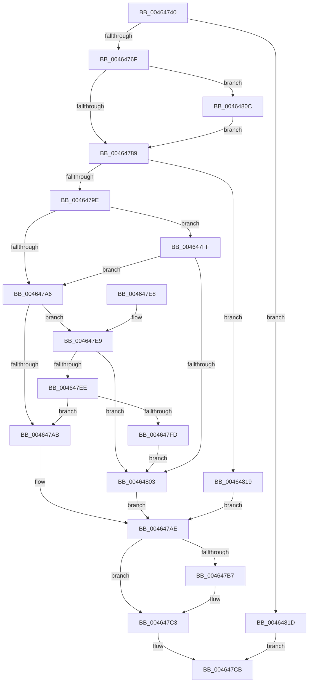

# EtwpApplyLevelKwFilter

- RVA: `0x00464740`–`0x00464828` (길이 `232` bytes)
- VA: `0x0000000140464740`
- 실행 섹션: `.text`
- PDB 이름 있음: `예`; PDB Function 태그: `아니요`
- unwind 정보 RVA: `0x000AA92C`
- 디코드: `67`개 명령, `232/232` bytes 표시
- 미해석 바이트: `0` (있으면 어셈블리에 `.byte`로 보존)

> 이 문서는 커널 이미지의 기계어와 PDB 기호를 분석해 생성했습니다. 4번과 5번은 함수 원형과 자료형을 바이너리 사용 방식에서 추정한 C 해석이며 원본 소스 복구 결과는 아닙니다.

## 1. Dependencies

- 직접 호출 지점: **3**; 고유 호출 대상: **3**
- 직접 호출자로 확인된 함수: **2**
- RIP 상대 이미지 참조: **1**

### Outgoing calls
- `0x004647BE` → [KiLowerIrqlProcessIrqlFlags](../4F/KiLowerIrqlProcessIrqlFlags_function_004F5698.md) (function, `0x004F5698`)
- `0x0046480F` → [KiRaiseIrqlProcessIrqlFlags](../4F/KiRaiseIrqlProcessIrqlFlags_function_004F56FC.md) (function, `0x004F56FC`)
- `0x0046481F` → [EtwpApplyLevelKwFilterInner](EtwpApplyLevelKwFilterInner_function_00464830.md) (function, `0x00464830`)

### Direct callers
- [EtwpEventWriteFull](../22/EtwpEventWriteFull_function_00225C10.md) at `0x002264F4`
- [EtwpWriteUserEvent](../../page/AF/EtwpWriteUserEvent_function_00AF2FEC.md) at `0x00AF35C3`

### Static image references
- `0x0046477C` → RVA `0x00FC6D20` (`ALMOSTRO`; read)

## 2. Other-region calls and transfers

- 다른 실행 섹션으로 향하는 call: **0**
- 별도 외부 분기/꼬리 이동을 확인하지 못했습니다.

## 3. Assembly (complete function range)

```asm
00464740  48 8B C4                        mov rax, rsp
00464743  48 89 58 08                     mov qword ptr [rax + 8], rbx
00464747  48 89 68 10                     mov qword ptr [rax + 0x10], rbp
0046474B  48 89 70 18                     mov qword ptr [rax + 0x18], rsi
0046474F  48 89 78 20                     mov qword ptr [rax + 0x20], rdi
00464753  41 56                           push r14
00464755  48 83 EC 20                     sub rsp, 0x20
00464759  80 7C 24 50 00                  cmp byte ptr [rsp + 0x50], 0
0046475E  49 8B D9                        mov rbx, r9
00464761  41 8A F0                        mov sil, r8b
00464764  8B EA                           mov ebp, edx
00464766  4C 8B F1                        mov r14, rcx
00464769  0F 84 AE 00 00 00               je 0x14046481d
0046476F  44 0F 20 C7                     mov rdi, cr8
00464773  BA 02 00 00 00                  mov edx, 2
00464778  44 0F 22 C2                     mov cr8, rdx
0046477C  83 3D 9D 25 B6 00 00            cmp dword ptr [rip + 0xb6259d], 0
00464783  0F 85 83 00 00 00               jne 0x14046480c
00464789  49 8B 86 80 02 00 00            mov rax, qword ptr [r14 + 0x280]
00464790  48 6B CD 68                     imul rcx, rbp, 0x68
00464794  48 8B 54 01 40                  mov rdx, qword ptr [rcx + rax + 0x40]
00464799  48 85 D2                        test rdx, rdx
0046479C  74 7B                           je 0x140464819
0046479E  8A 42 10                        mov al, byte ptr [rdx + 0x10]
004647A1  40 3A F0                        cmp sil, al
004647A4  77 59                           ja 0x1404647ff
004647A6  48 85 DB                        test rbx, rbx
004647A9  75 3E                           jne 0x1404647e9
004647AB  8A 5A 11                        mov bl, byte ptr [rdx + 0x11]
004647AE  83 3D 6B 25 B6 00 00            cmp dword ptr [rip + 0xb6256b], 0
004647B5  74 0C                           je 0x1404647c3
004647B7  44 0F 20 C1                     mov rcx, cr8
004647BB  40 8A D7                        mov dl, dil
004647BE  E8 D5 0E 09 00                  call 0x1404f5698
004647C3  40 0F B6 C7                     movzx eax, dil
004647C7  44 0F 22 C0                     mov cr8, rax
004647CB  48 8B 6C 24 38                  mov rbp, qword ptr [rsp + 0x38]
004647D0  8A C3                           mov al, bl
004647D2  48 8B 5C 24 30                  mov rbx, qword ptr [rsp + 0x30]
004647D7  48 8B 74 24 40                  mov rsi, qword ptr [rsp + 0x40]
004647DC  48 8B 7C 24 48                  mov rdi, qword ptr [rsp + 0x48]
004647E1  48 83 C4 20                     add rsp, 0x20
004647E5  41 5E                           pop r14
004647E7  C3                              ret
004647E8  CC                              int3
004647E9  48 85 1A                        test qword ptr [rdx], rbx
004647EC  74 15                           je 0x140464803
004647EE  48 8B 4A 08                     mov rcx, qword ptr [rdx + 8]
004647F2  48 8B C1                        mov rax, rcx
004647F5  48 23 C3                        and rax, rbx
004647F8  48 3B C1                        cmp rax, rcx
004647FB  74 AE                           je 0x1404647ab
004647FD  EB 04                           jmp 0x140464803
004647FF  84 C0                           test al, al
00464801  74 A3                           je 0x1404647a6
00464803  80 7A 11 00                     cmp byte ptr [rdx + 0x11], 0
00464807  0F 94 C3                        sete bl
0046480A  EB A2                           jmp 0x1404647ae
0046480C  40 8A CF                        mov cl, dil
0046480F  E8 E8 0E 09 00                  call 0x1404f56fc
00464814  E9 70 FF FF FF                  jmp 0x140464789
00464819  B3 01                           mov bl, 1
0046481B  EB 91                           jmp 0x1404647ae
0046481D  8B D5                           mov edx, ebp
0046481F  E8 0C 00 00 00                  call 0x140464830
00464824  8A D8                           mov bl, al
00464826  EB A3                           jmp 0x1404647cb
```

## 4. C-style interpretation (structured pseudocode)

```c
__int64 __fastcall EtwpApplyLevelKwFilter(__int64 a1, int a2, unsigned __int8 a3, __int64 a4, unsigned __int8 a5)
{
    __int64 result;
    __int64 v_rbx;
    __int64 v_rsp;
    unsigned __int64 v_stack_p10;
    unsigned __int64 v_stack_p18;
    unsigned __int64 v_stack_p20;
    unsigned __int64 v_stack_p8;

    *(unsigned __int64 *)(v_rsp + 8) = v_rbx;
    *(unsigned __int64 *)(v_rsp + 16) = v_rbp;
    *(unsigned __int64 *)(v_rsp + 24) = v_rsi;
    *(unsigned __int64 *)(v_rsp + 32) = v_rdi;
    v_rsp = (v_rsp) - (32);
    if (a5 == 0) goto loc_0046481D;
    if ((*(unsigned int *)(v_rip + 11937181)) != 0) goto loc_0046480C;
loc_00464789:
    a1 = (a1) * ((unsigned int)(a2));
    if (*(unsigned __int64 *)(a1 + *(unsigned __int64 *)(a1 + 640) * 1 + 64) == 0) goto loc_00464819;
    if (a3 > ((unsigned __int8)(*(unsigned __int8 *)(*(unsigned __int64 *)(a1 + *(unsigned __int64 *)(a1 + 640) * 1 + 64) + 16)))) goto loc_004647FF;
loc_004647A6:
    if (a4 != 0) goto loc_004647E9;
loc_004647AB:
loc_004647AE:
    result = *(unsigned __int8 *)(*(unsigned __int64 *)(a1 + *(unsigned __int64 *)(a1 + 640) * 1 + 64) + 16);
    if ((*(unsigned int *)(v_rip + 11937131)) != 0) {
        a1 = 2;
        a2 = (unsigned __int8)(v_cr8);
        result = KiLowerIrqlProcessIrqlFlags(a1, a2, a3, a4);
    }
loc_004647CB:
    v_rsp = (v_rsp) + (32);
    return (unsigned __int8)(*(unsigned __int8 *)(*(unsigned __int64 *)(a1 + *(unsigned __int64 *)(a1 + 640) * 1 + 64) + 17));
loc_004647E9:
    if (((*(unsigned __int64 *)(a2)) & (v_stack_p8)) == 0) goto loc_00464803;
    result = (*(unsigned __int64 *)(a2 + 8)) & (v_stack_p8);
    if (result == (*(unsigned __int64 *)(a2 + 8))) goto loc_004647AB;
    goto loc_00464803;
loc_004647FF:
    if ((unsigned __int8)(result) == 0) goto loc_004647A6;
loc_00464803:
    v_rbx = ((*(unsigned __int8 *)(a2 + 17)) == 0) ? 1 : 0;
    goto loc_004647AE;
loc_0046480C:
    result = KiRaiseIrqlProcessIrqlFlags((unsigned __int8)(v_stack_p20), a2, a3, a4);
    goto loc_00464789;
loc_00464819:
    goto loc_004647AE;
loc_0046481D:
    result = EtwpApplyLevelKwFilterInner((unsigned __int8)(v_stack_p20), (unsigned int)((unsigned int)(v_stack_p10)), a3, a4);
    goto loc_004647CB;
}
```

## 5. (Beta) C Style

```c
int64_t EtwpApplyLevelKwFilter(void *Arg1, int32_t Arg2, uint8_t Arg3, int64_t Arg4, uint8_t Arg5)
{
    uint8_t *arg1 = (uint8_t *)Arg1;

    int64_t result;
    int64_t local_rbx;
    int64_t local_rsp;
    uint64_t v_stack_p10;
    uint64_t v_stack_p18;
    uint64_t v_stack_p20;
    uint64_t v_stack_p8;

    *(uint64_t *)(local_rsp + 0x8) = local_rbx;
    *(uint64_t *)(local_rsp + 0x10) = local_rbp;
    *(uint64_t *)(local_rsp + 0x18) = local_rsi;
    *(uint64_t *)(local_rsp + 0x20) = local_rdi;
    local_rsp = (local_rsp) - (32);
    if (Arg5 == 0) goto loc_0046481D;
    if ((*(uint32_t *)(v_rip + 0xB6259D)) != 0) goto loc_0046480C;
loc_00464789:
    Arg1 = (Arg1) * ((uint32_t)(Arg2));
    if (*(uint64_t *)(arg1 + *(uint64_t *)(arg1 + 0x280) * 1 + 0x40) == 0) goto loc_00464819;
    if (Arg3 > ((uint8_t)(*(uint8_t *)(*(uint64_t *)(arg1 + *(uint64_t *)(arg1 + 0x280) * 1 + 0x40) + 0x10)))) goto loc_004647FF;
loc_004647A6:
    if (Arg4 != 0) goto loc_004647E9;
loc_004647AB:
loc_004647AE:
    result = *(uint8_t *)(*(uint64_t *)(arg1 + *(uint64_t *)(arg1 + 0x280) * 1 + 0x40) + 0x10);
    if ((*(uint32_t *)(v_rip + 0xB6256B)) != 0) {
        Arg1 = 2;
        Arg2 = (uint8_t)(v_cr8);
        result = KiLowerIrqlProcessIrqlFlags(Arg1, Arg2, Arg3, Arg4);
    }
loc_004647CB:
    local_rsp = (local_rsp) + (32);
    return (uint8_t)(*(uint8_t *)(*(uint64_t *)(arg1 + *(uint64_t *)(arg1 + 0x280) * 1 + 0x40) + 0x11));
loc_004647E9:
    if (((*(uint64_t *)(Arg2)) & (v_stack_p8)) == 0) goto loc_00464803;
    result = (*(uint64_t *)(Arg2 + 0x8)) & (v_stack_p8);
    if (result == (*(uint64_t *)(Arg2 + 0x8))) goto loc_004647AB;
    goto loc_00464803;
loc_004647FF:
    if ((uint8_t)(result) == 0) goto loc_004647A6;
loc_00464803:
    local_rbx = ((*(uint8_t *)(Arg2 + 0x11)) == 0) ? 1 : 0;
    goto loc_004647AE;
loc_0046480C:
    result = KiRaiseIrqlProcessIrqlFlags((uint8_t)(v_stack_p20), Arg2, Arg3, Arg4);
    goto loc_00464789;
loc_00464819:
    goto loc_004647AE;
loc_0046481D:
    result = EtwpApplyLevelKwFilterInner((uint8_t)(v_stack_p20), (uint32_t)((uint32_t)(v_stack_p10)), Arg3, Arg4);
    goto loc_004647CB;
}
```

### 관측된 메모리 오프셋

구조체 형식이 확인되지 않은 접근은 인자 기준의 오프셋으로만 기록했습니다.

| 기준 인자 | 오프셋 표현 | 폭 (bit) | 접근 |
|---|---:|---:|---|
| `Arg1` | `+ 0x280` | `64` | `R` |

## 6. Execution-region graph

[열기: 2D/3D 그래프와 함수 탐색 컨트롤 패널](../../../control-panel.html?section=text&rva=0x00464740&view=graph)

- 2D 그래프는 위에서 아래로 흐르고, 3D 그래프는 빈 공간을 드래그해 회전합니다. Shift+드래그는 이동, 휠은 확대·축소, 함수 노드 선택은 대상 보고서 이동입니다.

### Static fallback


