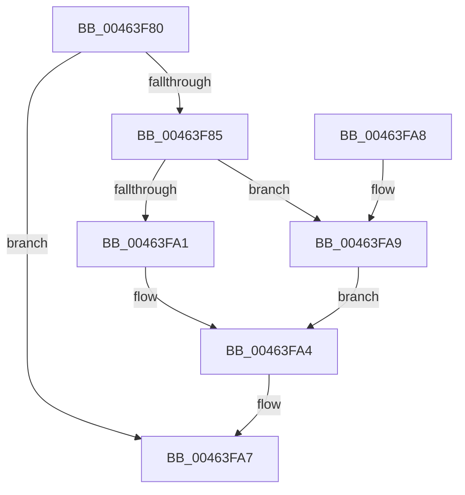

# EtwpCovSampCaptureBufferAddIP

- RVA: `0x00463F80`–`0x00463FAE` (길이 `46` bytes)
- VA: `0x0000000140463F80`
- 실행 섹션: `.text`
- PDB 이름 있음: `예`; PDB Function 태그: `아니요`
- unwind 정보 RVA: `0x000DB714`
- 디코드: `14`개 명령, `46/46` bytes 표시
- 미해석 바이트: `0` (있으면 어셈블리에 `.byte`로 보존)

> 이 문서는 커널 이미지의 기계어와 PDB 기호를 분석해 생성했습니다. 4번과 5번은 함수 원형과 자료형을 바이너리 사용 방식에서 추정한 C 해석이며 원본 소스 복구 결과는 아닙니다.

## 1. Dependencies

- 직접 호출 지점: **0**; 고유 호출 대상: **0**
- 직접 호출자로 확인된 함수: **2**
- RIP 상대 이미지 참조: **0**

### Outgoing calls
- 직접 디코드된 call 명령이 없습니다.

### Direct callers
- [EtwpCovSampCaptureSample](../65/EtwpCovSampCaptureSample_function_00653F24.md) at `0x00653FDC`
- [EtwpCovSampCaptureUserAddresses](../../page/8D/EtwpCovSampCaptureUserAddresses_function_008D73BC.md) at `0x008D73EB`

### Static image references
- 디코드된 RIP-relative 메모리 참조가 없습니다.

## 2. Other-region calls and transfers

- 다른 실행 섹션으로 향하는 call: **0**
- 별도 외부 분기/꼬리 이동을 확인하지 못했습니다.

## 3. Assembly (complete function range)

```asm
00463F80  48 85 D2                        test rdx, rdx
00463F83  74 22                           je 0x140463fa7
00463F85  8B 41 38                        mov eax, dword ptr [rcx + 0x38]
00463F88  49 B8 00 00 00 00 00 80 FF FF   movabs r8, 0xffff800000000000
00463F92  48 89 51 40                     mov qword ptr [rcx + 0x40], rdx
00463F96  66 C7 41 3E 01 00               mov word ptr [rcx + 0x3e], 1
00463F9C  49 3B D0                        cmp rdx, r8
00463F9F  73 08                           jae 0x140463fa9
00463FA1  83 C8 0A                        or eax, 0xa
00463FA4  89 41 38                        mov dword ptr [rcx + 0x38], eax
00463FA7  C3                              ret
00463FA8  CC                              int3
00463FA9  83 C8 09                        or eax, 9
00463FAC  EB F6                           jmp 0x140463fa4
```

## 4. C-style interpretation (structured pseudocode)

```c
__int64 __fastcall EtwpCovSampCaptureBufferAddIP(__int64 a1, __int64 a2)
{
    __int64 result;

    if (a2 == 0) goto loc_00463FA7;
    *(unsigned __int64 *)(a1 + 64) = a2;
    *(unsigned __int16 *)(a1 + 62) = 1;
    if (a2 >= a3) goto loc_00463FA9;
    result = (unsigned int)(((unsigned int)(*(unsigned int *)(a1 + 56))) | (10));
loc_00463FA4:
    *(unsigned int *)(a1 + 56) = (unsigned int)(result);
loc_00463FA7:
    return result;
loc_00463FA9:
    result = (unsigned int)((result) | (9));
    goto loc_00463FA4;
}
```

## 5. (Beta) C Style

```c
int64_t EtwpCovSampCaptureBufferAddIP(void *Arg1, int64_t Arg2)
{
    uint8_t *arg1 = (uint8_t *)Arg1;

    int64_t result;

    if (Arg2 == 0) goto loc_00463FA7;
    *(uint64_t *)(arg1 + 0x40) = Arg2;
    *(uint16_t *)(arg1 + 0x3E) = 1;
    if (Arg2 >= a3) goto loc_00463FA9;
    result = (uint32_t)(((uint32_t)(*(uint32_t *)(arg1 + 0x38))) | (10));
loc_00463FA4:
    *(uint32_t *)(arg1 + 0x38) = (uint32_t)(result);
loc_00463FA7:
    return result;
loc_00463FA9:
    result = (uint32_t)((result) | (9));
    goto loc_00463FA4;
}
```

### 관측된 메모리 오프셋

구조체 형식이 확인되지 않은 접근은 인자 기준의 오프셋으로만 기록했습니다.

| 기준 인자 | 오프셋 표현 | 폭 (bit) | 접근 |
|---|---:|---:|---|
| `Arg1` | `+ 0x38` | `32` | `R` |
| `Arg1` | `+ 0x38` | `32` | `W` |
| `Arg1` | `+ 0x3E` | `16` | `W` |
| `Arg1` | `+ 0x40` | `64` | `W` |

## 6. Execution-region graph

[열기: 2D/3D 그래프와 함수 탐색 컨트롤 패널](../../../control-panel.html?section=text&rva=0x00463F80&view=graph)

- 2D 그래프는 위에서 아래로 흐르고, 3D 그래프는 빈 공간을 드래그해 회전합니다. Shift+드래그는 이동, 휠은 확대·축소, 함수 노드 선택은 대상 보고서 이동입니다.

### Static fallback


