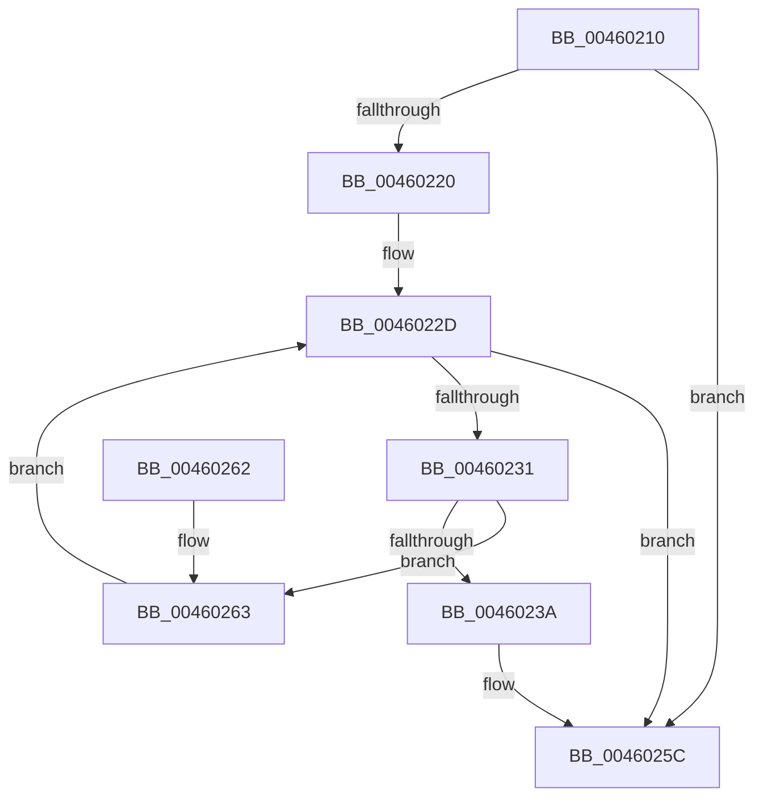

# EtwpCovSampCaptureBufferOptimizeIP

- RVA: `0x00460210`–`0x00460267` (길이 `87` bytes)
- VA: `0x0000000140460210`
- 실행 섹션: `.text`
- PDB 이름 있음: `예`; PDB Function 태그: `아니요`
- unwind 정보 RVA: `0x00065BAC`
- 디코드: `27`개 명령, `87/87` bytes 표시
- 미해석 바이트: `0` (있으면 어셈블리에 `.byte`로 보존)

> 이 문서는 커널 이미지의 기계어와 PDB 기호를 분석해 생성했습니다. 4번과 5번은 함수 원형과 자료형을 바이너리 사용 방식에서 추정한 C 해석이며 원본 소스 복구 결과는 아닙니다.

## 1. Dependencies

- 직접 호출 지점: **1**; 고유 호출 대상: **1**
- 직접 호출자로 확인된 함수: **2**
- RIP 상대 이미지 참조: **0**

### Outgoing calls
- `0x0046024A` → [memcpy](../6C/memcpy_function_006C6840.md) (function, `0x006C6840`)

### Direct callers
- [EtwpCovSampCaptureKernelStack](../65/EtwpCovSampCaptureKernelStack_function_00653C28.md) at `0x00653CCC`
- [EtwpCovSampCaptureUserStack](../../page/8D/EtwpCovSampCaptureUserStack_function_008D78A4.md) at `0x008D7912`

### Static image references
- 디코드된 RIP-relative 메모리 참조가 없습니다.

## 2. Other-region calls and transfers

- 다른 실행 섹션으로 향하는 call: **0**
- 별도 외부 분기/꼬리 이동을 확인하지 못했습니다.

## 3. Assembly (complete function range)

```asm
00460210  40 53                           push rbx
00460212  48 83 EC 20                     sub rsp, 0x20
00460216  8B 41 38                        mov eax, dword ptr [rcx + 0x38]
00460219  48 8B D9                        mov rbx, rcx
0046021C  A8 08                           test al, 8
0046021E  74 3C                           je 0x14046025c
00460220  4C 8B 41 40                     mov r8, qword ptr [rcx + 0x40]
00460224  B9 01 00 00 00                  mov ecx, 1
00460229  0F B7 53 3E                     movzx edx, word ptr [rbx + 0x3e]
0046022D  3B CA                           cmp ecx, edx
0046022F  73 2B                           jae 0x14046025c
00460231  8B C1                           mov eax, ecx
00460233  4C 3B 44 C3 40                  cmp r8, qword ptr [rbx + rax*8 + 0x40]
00460238  75 29                           jne 0x140460263
0046023A  4C 8D 04 D5 F8 FF FF FF         lea r8, [rdx*8 - 8]
00460242  48 8D 53 48                     lea rdx, [rbx + 0x48]
00460246  48 8D 4B 40                     lea rcx, [rbx + 0x40]
0046024A  E8 F1 65 26 00                  call 0x1406c6840
0046024F  B8 FF FF 00 00                  mov eax, 0xffff
00460254  66 01 43 3E                     add word ptr [rbx + 0x3e], ax
00460258  83 63 38 F7                     and dword ptr [rbx + 0x38], 0xfffffff7
0046025C  48 83 C4 20                     add rsp, 0x20
00460260  5B                              pop rbx
00460261  C3                              ret
00460262  CC                              int3
00460263  FF C1                           inc ecx
00460265  EB C6                           jmp 0x14046022d
```

## 4. C-style interpretation (structured pseudocode)

```c
__int64 __fastcall EtwpCovSampCaptureBufferOptimizeIP(__int64 a1)
{
    __int64 result;
    __int64 v_rsp;

    v_rsp = (v_rsp) - (32);
    if ((((unsigned __int8)((unsigned int)(*(unsigned int *)(a1 + 56)))) & (8)) == 0) goto loc_0046025C;
loc_0046022D:
    if (1 >= ((unsigned int)(*(unsigned __int16 *)(a1 + 62)))) goto loc_0046025C;
    if ((*(unsigned __int64 *)(a1 + 64)) != (*(unsigned __int64 *)(a1 + 1 * 8 + 64))) goto loc_00460263;
    result = memcpy(a1 + 64, a1 + 72, *(unsigned __int16 *)(a1 + 62) * 8 - 8, a4);
loc_0046025C:
    v_rsp = (v_rsp) + (32);
    return (unsigned int)(0xFFFFULL);
loc_00460263:
    a1 = (unsigned int)((a1 + 64) + 1);
    goto loc_0046022D;
}
```

## 5. (Beta) C Style

```c
int64_t EtwpCovSampCaptureBufferOptimizeIP(void *Arg1)
{
    uint8_t *arg1 = (uint8_t *)Arg1;

    int64_t result;
    int64_t local_rsp;

    local_rsp = (local_rsp) - (32);
    if ((((uint8_t)((uint32_t)(*(uint32_t *)(arg1 + 0x38)))) & (8)) == 0) goto loc_0046025C;
loc_0046022D:
    if (1 >= ((uint32_t)(*(uint16_t *)(arg1 + 0x3E)))) goto loc_0046025C;
    if ((*(uint64_t *)(arg1 + 0x40)) != (*(uint64_t *)(arg1 + 0x1 * 8 + 0x40))) goto loc_00460263;
    result = memcpy(Arg1 + 64, Arg1 + 72, *(uint16_t *)(arg1 + 0x3E) * 8 - 8, a4);
loc_0046025C:
    local_rsp = (local_rsp) + (32);
    return (uint32_t)(0xFFFFULL);
loc_00460263:
    Arg1 = (uint32_t)((Arg1 + 64) + 1);
    goto loc_0046022D;
}
```

### 관측된 메모리 오프셋

구조체 형식이 확인되지 않은 접근은 인자 기준의 오프셋으로만 기록했습니다.

| 기준 인자 | 오프셋 표현 | 폭 (bit) | 접근 |
|---|---:|---:|---|
| `Arg1` | `+ 0x38` | `32` | `R` |
| `Arg1` | `+ 0x38` | `32` | `R/W` |
| `Arg1` | `+ 0x3E` | `16` | `R` |
| `Arg1` | `+ 0x3E` | `16` | `R/W` |
| `Arg1` | `+ 0x40` | `64` | `R` |
| `Arg1` | `+ 0x40 + rax*8` | `64` | `R` |
| `Arg1` | `+ 0x48` | `64` | `R` |

## 6. Execution-region graph

[열기: 2D/3D 그래프와 함수 탐색 컨트롤 패널](../../../control-panel.html?section=text&rva=0x00460210&view=graph)

- 2D 그래프는 위에서 아래로 흐르고, 3D 그래프는 빈 공간을 드래그해 회전합니다. Shift+드래그는 이동, 휠은 확대·축소, 함수 노드 선택은 대상 보고서 이동입니다.

### Static fallback


