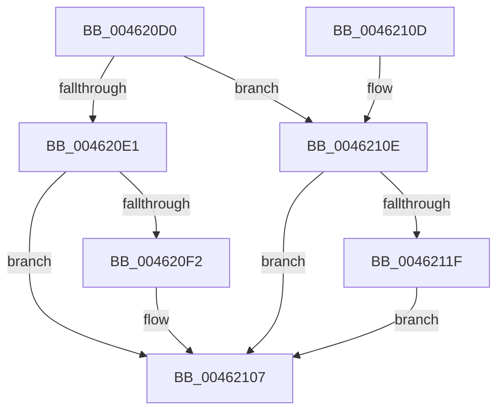

# EtwpCovSampCaptureQueueBuffer

- RVA: `0x004620D0`–`0x00462132` (길이 `98` bytes)
- VA: `0x00000001404620D0`
- 실행 섹션: `.text`
- PDB 이름 있음: `예`; PDB Function 태그: `아니요`
- unwind 정보 RVA: `0x0008C34C`
- 디코드: `27`개 명령, `98/98` bytes 표시
- 미해석 바이트: `0` (있으면 어셈블리에 `.byte`로 보존)

> 이 문서는 커널 이미지의 기계어와 PDB 기호를 분석해 생성했습니다. 4번과 5번은 함수 원형과 자료형을 바이너리 사용 방식에서 추정한 C 해석이며 원본 소스 복구 결과는 아닙니다.

## 1. Dependencies

- 직접 호출 지점: **4**; 고유 호출 대상: **3**
- 직접 호출자로 확인된 함수: **2**
- RIP 상대 이미지 참조: **0**

### Outgoing calls
- `0x004620E8` → [ExpInterlockedPushEntrySList](../6B/ExpInterlockedPushEntrySList_function_006BA5B0.md) (function, `0x006BA5B0`)
- `0x00462102` → [KeSetEvent](../33/KeSetEvent_function_0033F310.md) (function, `0x0033F310`)
- `0x00462115` → [ExpInterlockedPushEntrySList](../6B/ExpInterlockedPushEntrySList_function_006BA5B0.md) (function, `0x006BA5B0`)
- `0x0046212B` → [KeInsertQueueDpc](../20/KeInsertQueueDpc_function_00207C50.md) (function, `0x00207C50`)

### Direct callers
- [EtwpCovSampSampleBufferDecRef](../65/EtwpCovSampSampleBufferDecRef_function_006543B4.md) at `0x006543D6`
- [EtwpCoverageSamplerQuery](../../page/95/EtwpCoverageSamplerQuery_function_0095C4A0.md) at `0x0095C5B8`

### Static image references
- 디코드된 RIP-relative 메모리 참조가 없습니다.

## 2. Other-region calls and transfers

- 다른 실행 섹션으로 향하는 call: **0**
- 별도 외부 분기/꼬리 이동을 확인하지 못했습니다.

## 3. Assembly (complete function range)

```asm
004620D0  40 53                           push rbx
004620D2  48 83 EC 20                     sub rsp, 0x20
004620D6  48 8B D9                        mov rbx, rcx
004620D9  44 0F 20 C0                     mov rax, cr8
004620DD  3C 02                           cmp al, 2
004620DF  77 2D                           ja 0x14046210e
004620E1  48 81 C1 40 04 00 00            add rcx, 0x440
004620E8  E8 C3 84 25 00                  call 0x1406ba5b0
004620ED  48 85 C0                        test rax, rax
004620F0  75 15                           jne 0x140462107
004620F2  8B 93 18 05 00 00               mov edx, dword ptr [rbx + 0x518]
004620F8  48 8D 8B 50 04 00 00            lea rcx, [rbx + 0x450]
004620FF  45 33 C0                        xor r8d, r8d
00462102  E8 09 D2 ED FF                  call 0x14033f310
00462107  48 83 C4 20                     add rsp, 0x20
0046210B  5B                              pop rbx
0046210C  C3                              ret
0046210D  CC                              int3
0046210E  48 81 C1 30 04 00 00            add rcx, 0x430
00462115  E8 96 84 25 00                  call 0x1406ba5b0
0046211A  48 85 C0                        test rax, rax
0046211D  75 E8                           jne 0x140462107
0046211F  48 8D 8B 68 04 00 00            lea rcx, [rbx + 0x468]
00462126  45 33 C0                        xor r8d, r8d
00462129  33 D2                           xor edx, edx
0046212B  E8 20 5B DA FF                  call 0x140207c50
00462130  EB D5                           jmp 0x140462107
```

## 4. C-style interpretation (structured pseudocode)

```c
__int64 __fastcall EtwpCovSampCaptureQueueBuffer(__int64 a1, __int64 a2, int a3)
{
    __int64 result;
    __int64 v_rsp;

    v_rsp = (v_rsp) - (32);
    if (((unsigned __int8)(v_cr8)) > 2) goto loc_0046210E;
    a1 = (a1) + (0x440ULL);
    result = ExpInterlockedPushEntrySList(a1, a2, a3, a4);
    if (result == 0) {
        a2 = *(unsigned int *)(a1 + 1304);
        a1 = a1 + 1104;
        a3 = 0;
        result = KeSetEvent(a1, a2, a3, a4);
    }
    v_rsp = (v_rsp) + (32);
    return result;
loc_0046210E:
    a1 = (a1) + (0x430ULL);
    result = ExpInterlockedPushEntrySList(a1, a2, a3, a4);
    if (result != 0) goto loc_00462107;
    a3 = 0;
    a2 = 0;
    result = KeInsertQueueDpc(a1 + 1128, a2, a3, a4);
    goto loc_00462107;
}
```

## 5. (Beta) C Style

```c
int64_t EtwpCovSampCaptureQueueBuffer(void *Arg1, int64_t Arg2, int32_t Arg3)
{
    uint8_t *arg1 = (uint8_t *)Arg1;

    int64_t result;
    int64_t local_rsp;

    local_rsp = (local_rsp) - (32);
    if (((uint8_t)(v_cr8)) > 2) goto loc_0046210E;
    Arg1 = (Arg1) + (0x440ULL);
    result = ExpInterlockedPushEntrySList(Arg1, Arg2, Arg3, a4);
    if (result == 0) {
        Arg2 = *(uint32_t *)(arg1 + 0x518);
        Arg1 = Arg1 + 1104;
        Arg3 = 0;
        result = KeSetEvent(Arg1, Arg2, Arg3, a4);
    }
    local_rsp = (local_rsp) + (32);
    return result;
loc_0046210E:
    Arg1 = (Arg1) + (0x430ULL);
    result = ExpInterlockedPushEntrySList(Arg1, Arg2, Arg3, a4);
    if (result != 0) goto loc_00462107;
    Arg3 = 0;
    Arg2 = 0;
    result = KeInsertQueueDpc(Arg1 + 1128, Arg2, Arg3, a4);
    goto loc_00462107;
}
```

### 관측된 메모리 오프셋

구조체 형식이 확인되지 않은 접근은 인자 기준의 오프셋으로만 기록했습니다.

| 기준 인자 | 오프셋 표현 | 폭 (bit) | 접근 |
|---|---:|---:|---|
| `Arg1` | `+ 0x450` | `64` | `R` |
| `Arg1` | `+ 0x468` | `64` | `R` |
| `Arg1` | `+ 0x518` | `32` | `R` |

## 6. Execution-region graph

[열기: 2D/3D 그래프와 함수 탐색 컨트롤 패널](../../../control-panel.html?section=text&rva=0x004620D0&view=graph)

- 2D 그래프는 위에서 아래로 흐르고, 3D 그래프는 빈 공간을 드래그해 회전합니다. Shift+드래그는 이동, 휠은 확대·축소, 함수 노드 선택은 대상 보고서 이동입니다.

### Static fallback


