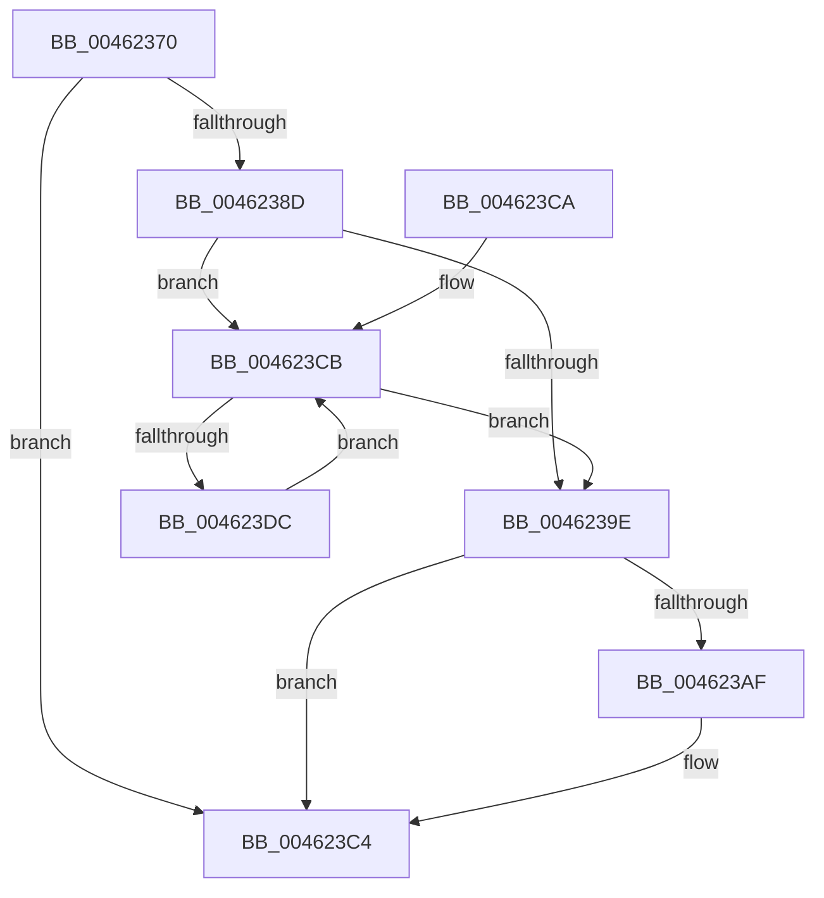

# EtwpCovSampCaptureQueueDpc

- RVA: `0x00462370`–`0x004623DE` (길이 `110` bytes)
- VA: `0x0000000140462370`
- 실행 섹션: `.text`
- PDB 이름 있음: `예`; PDB Function 태그: `아니요`
- unwind 정보 RVA: `0x0006EDB4`
- 디코드: `32`개 명령, `110/110` bytes 표시
- 미해석 바이트: `0` (있으면 어셈블리에 `.byte`로 보존)

> 이 문서는 커널 이미지의 기계어와 PDB 기호를 분석해 생성했습니다. 4번과 5번은 함수 원형과 자료형을 바이너리 사용 방식에서 추정한 C 해석이며 원본 소스 복구 결과는 아닙니다.

## 1. Dependencies

- 직접 호출 지점: **3**; 고유 호출 대상: **3**
- 직접 호출자로 확인된 함수: **0**
- RIP 상대 이미지 참조: **0**

### Outgoing calls
- `0x00462380` → [ExpInterlockedFlushSList](../6B/ExpInterlockedFlushSList_function_006BA5F0.md) (function, `0x006BA5F0`)
- `0x004623A5` → [InterlockedPushListSList](../6B/InterlockedPushListSList_function_006BA620.md) (function, `0x006BA620`)
- `0x004623BF` → [KeSetEvent](../33/KeSetEvent_function_0033F310.md) (function, `0x0033F310`)

### Direct callers
- 이 함수 시작 RVA로 연결되는 직접 call은 확인되지 않았습니다. 간접 호출은 완전히 역산할 수 없습니다.

### Static image references
- 디코드된 RIP-relative 메모리 참조가 없습니다.

## 2. Other-region calls and transfers

- 다른 실행 섹션으로 향하는 call: **0**
- 별도 외부 분기/꼬리 이동을 확인하지 못했습니다.

## 3. Assembly (complete function range)

```asm
00462370  40 53                           push rbx
00462372  48 83 EC 20                     sub rsp, 0x20
00462376  48 8D 8A 30 04 00 00            lea rcx, [rdx + 0x430]
0046237D  48 8B DA                        mov rbx, rdx
00462380  E8 6B 82 25 00                  call 0x1406ba5f0
00462385  48 8B D0                        mov rdx, rax
00462388  48 85 C0                        test rax, rax
0046238B  74 37                           je 0x1404623c4
0046238D  48 8B 08                        mov rcx, qword ptr [rax]
00462390  41 B9 01 00 00 00               mov r9d, 1
00462396  4C 8B C0                        mov r8, rax
00462399  48 85 C9                        test rcx, rcx
0046239C  75 2D                           jne 0x1404623cb
0046239E  48 8D 8B 40 04 00 00            lea rcx, [rbx + 0x440]
004623A5  E8 76 82 25 00                  call 0x1406ba620
004623AA  48 85 C0                        test rax, rax
004623AD  75 15                           jne 0x1404623c4
004623AF  8B 93 18 05 00 00               mov edx, dword ptr [rbx + 0x518]
004623B5  48 8D 8B 50 04 00 00            lea rcx, [rbx + 0x450]
004623BC  45 33 C0                        xor r8d, r8d
004623BF  E8 4C CF ED FF                  call 0x14033f310
004623C4  48 83 C4 20                     add rsp, 0x20
004623C8  5B                              pop rbx
004623C9  C3                              ret
004623CA  CC                              int3
004623CB  48 8B 01                        mov rax, qword ptr [rcx]
004623CE  41 FF C1                        inc r9d
004623D1  4C 8B C1                        mov r8, rcx
004623D4  48 8B C8                        mov rcx, rax
004623D7  48 85 C0                        test rax, rax
004623DA  74 C2                           je 0x14046239e
004623DC  EB ED                           jmp 0x1404623cb
```

## 4. C-style interpretation (structured pseudocode)

```c
__int64 __fastcall EtwpCovSampCaptureQueueDpc(__int64 a1, __int64 a2)
{
    __int64 result;
    __int64 v_rsp;

    v_rsp = (v_rsp) - (32);
    result = ExpInterlockedFlushSList(a2 + 1072, a2, a3, a4);
    if (result == 0) goto loc_004623C4;
    if (*(unsigned __int64 *)(result) != 0) goto loc_004623CB;
loc_0046239E:
    result = InterlockedPushListSList(a2 + 1088, result, result, 1);
    if (result == 0) {
        a2 = *(unsigned int *)(a2 + 1304);
        a1 = a2 + 1104;
        a3 = 0;
        result = KeSetEvent(a1, a2, a3, 1);
    }
    v_rsp = (v_rsp) + (32);
    return result;
loc_004623CB:
    a4 = (unsigned int)((1) + 1);
    if (*(unsigned __int64 *)(a1) == 0) goto loc_0046239E;
    goto loc_004623CB;
}
```

## 5. (Beta) C Style

```c
int64_t EtwpCovSampCaptureQueueDpc(int64_t Arg1, void *Arg2)
{
    uint8_t *arg2 = (uint8_t *)Arg2;

    int64_t result;
    int64_t local_rsp;

    local_rsp = (local_rsp) - (32);
    result = ExpInterlockedFlushSList(Arg2 + 1072, Arg2, a3, a4);
    if (result == 0) goto loc_004623C4;
    if (*(uint64_t *)(result) != 0) goto loc_004623CB;
loc_0046239E:
    result = InterlockedPushListSList(Arg2 + 1088, result, result, 1);
    if (result == 0) {
        Arg2 = *(uint32_t *)(arg2 + 0x518);
        Arg1 = Arg2 + 1104;
        a3 = 0;
        result = KeSetEvent(Arg1, Arg2, a3, 1);
    }
    local_rsp = (local_rsp) + (32);
    return result;
loc_004623CB:
    a4 = (uint32_t)((1) + 1);
    if (*(uint64_t *)(Arg1) == 0) goto loc_0046239E;
    goto loc_004623CB;
}
```

### 관측된 메모리 오프셋

구조체 형식이 확인되지 않은 접근은 인자 기준의 오프셋으로만 기록했습니다.

| 기준 인자 | 오프셋 표현 | 폭 (bit) | 접근 |
|---|---:|---:|---|
| `Arg2` | `+ 0x430` | `64` | `R` |
| `Arg2` | `+ 0x440` | `64` | `R` |
| `Arg2` | `+ 0x450` | `64` | `R` |
| `Arg2` | `+ 0x518` | `32` | `R` |

## 6. Execution-region graph

[열기: 2D/3D 그래프와 함수 탐색 컨트롤 패널](../../../control-panel.html?section=text&rva=0x00462370&view=graph)

- 2D 그래프는 위에서 아래로 흐르고, 3D 그래프는 빈 공간을 드래그해 회전합니다. Shift+드래그는 이동, 휠은 확대·축소, 함수 노드 선택은 대상 보고서 이동입니다.

### Static fallback


