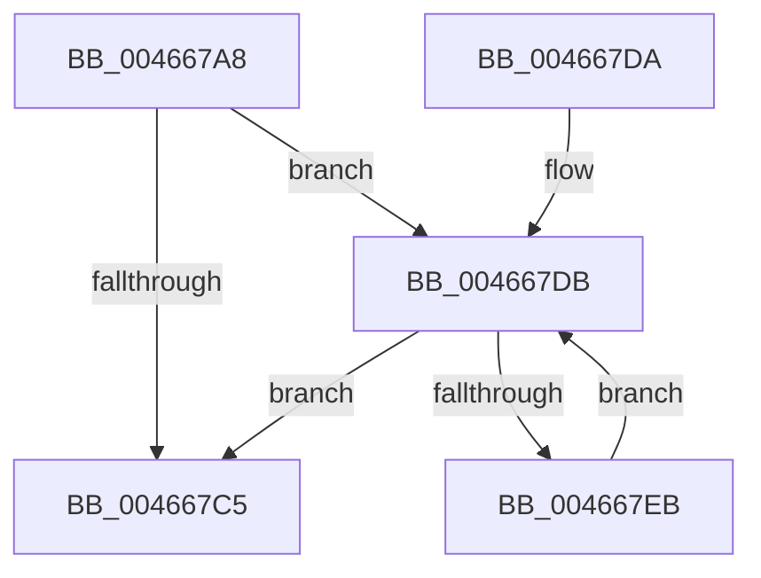

# EtwpCovSampPushListSList

- RVA: `0x004667A8`–`0x004667ED` (길이 `69` bytes)
- VA: `0x00000001404667A8`
- 실행 섹션: `.text`
- PDB 이름 있음: `예`; PDB Function 태그: `아니요`
- unwind 정보 RVA: `0x00093470`
- 디코드: `24`개 명령, `69/69` bytes 표시
- 미해석 바이트: `0` (있으면 어셈블리에 `.byte`로 보존)

> 이 문서는 커널 이미지의 기계어와 PDB 기호를 분석해 생성했습니다. 4번과 5번은 함수 원형과 자료형을 바이너리 사용 방식에서 추정한 C 해석이며 원본 소스 복구 결과는 아닙니다.

## 1. Dependencies

- 직접 호출 지점: **1**; 고유 호출 대상: **1**
- 직접 호출자로 확인된 함수: **1**
- RIP 상대 이미지 참조: **0**

### Outgoing calls
- `0x004667C8` → [InterlockedPushListSList](../6B/InterlockedPushListSList_function_006BA620.md) (function, `0x006BA620`)

### Direct callers
- [EtwpCovSampLookasideFlushFreeListToCleanupList](../65/EtwpCovSampLookasideFlushFreeListToCleanupList_function_006540BC.md) at `0x006540E5`

### Static image references
- 디코드된 RIP-relative 메모리 참조가 없습니다.

## 2. Other-region calls and transfers

- 다른 실행 섹션으로 향하는 call: **0**
- 별도 외부 분기/꼬리 이동을 확인하지 못했습니다.

## 3. Assembly (complete function range)

```asm
004667A8  48 89 5C 24 08                  mov qword ptr [rsp + 8], rbx
004667AD  57                              push rdi
004667AE  48 83 EC 20                     sub rsp, 0x20
004667B2  4C 8B 0A                        mov r9, qword ptr [rdx]
004667B5  49 8B F8                        mov rdi, r8
004667B8  BB 01 00 00 00                  mov ebx, 1
004667BD  4C 8B C2                        mov r8, rdx
004667C0  4D 85 C9                        test r9, r9
004667C3  75 16                           jne 0x1404667db
004667C5  44 8B CB                        mov r9d, ebx
004667C8  E8 53 3E 25 00                  call 0x1406ba620
004667CD  89 1F                           mov dword ptr [rdi], ebx
004667CF  48 8B 5C 24 30                  mov rbx, qword ptr [rsp + 0x30]
004667D4  48 83 C4 20                     add rsp, 0x20
004667D8  5F                              pop rdi
004667D9  C3                              ret
004667DA  CC                              int3
004667DB  49 8B 01                        mov rax, qword ptr [r9]
004667DE  FF C3                           inc ebx
004667E0  4D 8B C1                        mov r8, r9
004667E3  4C 8B C8                        mov r9, rax
004667E6  48 85 C0                        test rax, rax
004667E9  74 DA                           je 0x1404667c5
004667EB  EB EE                           jmp 0x1404667db
```

## 4. C-style interpretation (structured pseudocode)

```c
__int64 __fastcall EtwpCovSampPushListSList(__int64 a1, __int64 a2, __int64 a3)
{
    __int64 result;
    __int64 v_rbx;
    __int64 v_rsp;
    unsigned __int64 v_stack_p8;

    v_stack_p8 = v_rbx;
    v_rsp = (v_rsp) - (32);
    if (*(unsigned __int64 *)(a2) != 0) goto loc_004667DB;
loc_004667C5:
    result = InterlockedPushListSList(a1, a2, a2, 1);
    *(unsigned int *)(a3) = 1;
    v_rsp = (v_rsp) + (32);
    return result;
loc_004667DB:
    v_rbx = (unsigned int)((v_stack_p8) + 1);
    if (*(unsigned __int64 *)(1) == 0) goto loc_004667C5;
    goto loc_004667DB;
}
```

## 5. (Beta) C Style

```c
int64_t EtwpCovSampPushListSList(int64_t Arg1, void *Arg2, void *Arg3)
{
    uint8_t *arg2 = (uint8_t *)Arg2;
    uint8_t *arg3 = (uint8_t *)Arg3;

    int64_t result;
    int64_t local_rbx;
    int64_t local_rsp;
    uint64_t v_stack_p8;

    v_stack_p8 = local_rbx;
    local_rsp = (local_rsp) - (32);
    if (*(uint64_t *)(arg2) != 0) goto loc_004667DB;
loc_004667C5:
    result = InterlockedPushListSList(Arg1, Arg2, Arg2, 1);
    *(uint32_t *)(arg3) = 1;
    local_rsp = (local_rsp) + (32);
    return result;
loc_004667DB:
    local_rbx = (uint32_t)((v_stack_p8) + 1);
    if (*(uint64_t *)(1) == 0) goto loc_004667C5;
    goto loc_004667DB;
}
```

### 관측된 메모리 오프셋

구조체 형식이 확인되지 않은 접근은 인자 기준의 오프셋으로만 기록했습니다.

| 기준 인자 | 오프셋 표현 | 폭 (bit) | 접근 |
|---|---:|---:|---|
| `Arg2` | `+ 0x0` | `64` | `R` |
| `Arg3` | `+ 0x0` | `32` | `W` |

## 6. Execution-region graph

[열기: 2D/3D 그래프와 함수 탐색 컨트롤 패널](../../../control-panel.html?section=text&rva=0x004667A8&view=graph)

- 2D 그래프는 위에서 아래로 흐르고, 3D 그래프는 빈 공간을 드래그해 회전합니다. Shift+드래그는 이동, 휠은 확대·축소, 함수 노드 선택은 대상 보고서 이동입니다.

### Static fallback


