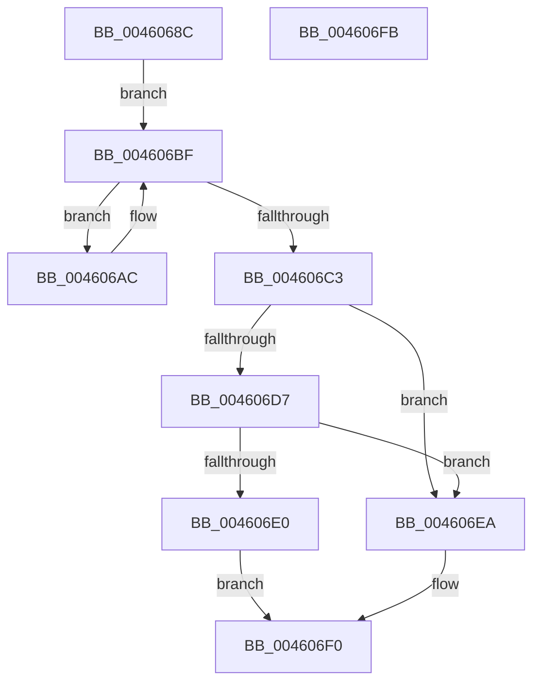

# EtwpCoverageValidateCP

- RVA: `0x0046068C`–`0x004606FC` (길이 `112` bytes)
- VA: `0x000000014046068C`
- 실행 섹션: `.text`
- PDB 이름 있음: `예`; PDB Function 태그: `아니요`
- unwind 정보 RVA: `0x0005CAAC`
- 디코드: `36`개 명령, `112/112` bytes 표시
- 미해석 바이트: `0` (있으면 어셈블리에 `.byte`로 보존)

> 이 문서는 커널 이미지의 기계어와 PDB 기호를 분석해 생성했습니다. 4번과 5번은 함수 원형과 자료형을 바이너리 사용 방식에서 추정한 C 해석이며 원본 소스 복구 결과는 아닙니다.

## 1. Dependencies

- 직접 호출 지점: **1**; 고유 호출 대상: **1**
- 직접 호출자로 확인된 함수: **5**
- RIP 상대 이미지 참조: **0**

### Outgoing calls
- `0x004606D7` → [TelemetryCoverageValidateName](../4B/TelemetryCoverageValidateName_function_004BD150.md) (function, `0x004BD150`)

### Direct callers
- [EtwTelemetryCoverageReport](EtwTelemetryCoverageReport_function_00460430.md) at `0x004604B7`
- [EtwpCoverageRecordAtHighIrql](../65/EtwpCoverageRecordAtHighIrql_function_00651C70.md) at `0x00651C9C`
- [EtwpCoverageCheckCP](../../page/7B/EtwpCoverageCheckCP_function_007B9BC4.md) at `0x007B9BEE`
- [EtwpCoverageResetCP](../../page/7B/EtwpCoverageResetCP_function_007BA154.md) at `0x007BA1C8`
- [EtwpCoverageRecord](../../page/98/EtwpCoverageRecord_function_009821BC.md) at `0x0098222E`

### Static image references
- 디코드된 RIP-relative 메모리 참조가 없습니다.

## 2. Other-region calls and transfers

- 다른 실행 섹션으로 향하는 call: **0**
- 별도 외부 분기/꼬리 이동을 확인하지 못했습니다.

## 3. Assembly (complete function range)

```asm
0046068C  48 89 5C 24 08                  mov qword ptr [rsp + 8], rbx
00460691  57                              push rdi
00460692  48 83 EC 20                     sub rsp, 0x20
00460696  48 8B D9                        mov rbx, rcx
00460699  48 8B FA                        mov rdi, rdx
0046069C  48 8B 09                        mov rcx, qword ptr [rcx]
0046069F  41 B8 C5 9D 1C 81               mov r8d, 0x811c9dc5
004606A5  4C 8B D9                        mov r11, rcx
004606A8  8A 01                           mov al, byte ptr [rcx]
004606AA  EB 13                           jmp 0x1404606bf
004606AC  45 69 C0 93 01 00 01            imul r8d, r8d, 0x1000193
004606B3  0F BE C0                        movsx eax, al
004606B6  44 03 C0                        add r8d, eax
004606B9  49 FF C3                        inc r11
004606BC  41 8A 03                        mov al, byte ptr [r11]
004606BF  84 C0                           test al, al
004606C1  75 E9                           jne 0x1404606ac
004606C3  44 2B D9                        sub r11d, ecx
004606C6  BA 01 00 00 00                  mov edx, 1
004606CB  45 85 C0                        test r8d, r8d
004606CE  41 0F 45 D0                     cmovne edx, r8d
004606D2  3B 53 08                        cmp edx, dword ptr [rbx + 8]
004606D5  75 13                           jne 0x1404606ea
004606D7  E8 74 CA 05 00                  call 0x1404bd150
004606DC  85 C0                           test eax, eax
004606DE  74 0A                           je 0x1404606ea
004606E0  44 89 1F                        mov dword ptr [rdi], r11d
004606E3  B8 01 00 00 00                  mov eax, 1
004606E8  EB 06                           jmp 0x1404606f0
004606EA  83 4B 0C FF                     or dword ptr [rbx + 0xc], 0xffffffff
004606EE  33 C0                           xor eax, eax
004606F0  48 8B 5C 24 30                  mov rbx, qword ptr [rsp + 0x30]
004606F5  48 83 C4 20                     add rsp, 0x20
004606F9  5F                              pop rdi
004606FA  C3                              ret
004606FB  CC                              int3
```

## 4. C-style interpretation (structured pseudocode)

```c
__int64 __fastcall EtwpCoverageValidateCP(__int64 a1, __int64 a2)
{
    __int64 result;
    __int64 v_r11;
    __int64 v_rsp;
    unsigned __int64 v_stack_p8;

    v_stack_p8 = v_rbx;
    v_rsp = (v_rsp) - (32);
    goto loc_004606BF;
loc_004606AC:
    a3 = (unsigned int)(((unsigned int)(0x811C9DC5ULL)) * ((unsigned int)((unsigned int)(0x811C9DC5ULL))));
    a3 = (unsigned int)((a3) + ((unsigned int)((__int8)((unsigned __int8)(*(unsigned __int8 *)(*(unsigned __int64 *)(a1)))))));
    v_r11 = (*(unsigned __int64 *)(a1)) + 1;
loc_004606BF:
    if ((unsigned __int8)(*(unsigned __int8 *)(v_r11)) != 0) goto loc_004606AC;
    v_r11 = (unsigned int)((v_r11) - ((unsigned int)(*(unsigned __int64 *)(a1))));
    a2 = 1;
    if ((unsigned int)(a3) != 0) { a2 = (unsigned int)(a3); }
    if (((unsigned int)(a2)) != (*(unsigned int *)(a1 + 8))) goto loc_004606EA;
    result = TelemetryCoverageValidateName(*(unsigned __int64 *)(a1), a2, a3, a4);
    if ((unsigned int)(result) == 0) goto loc_004606EA;
    *(unsigned int *)(a2) = (unsigned int)(v_r11);
    goto loc_004606F0;
loc_004606EA:
    result = 0;
loc_004606F0:
    v_rsp = (v_rsp) + (32);
    return result;
}
```

## 5. (Beta) C Style

```c
int64_t EtwpCoverageValidateCP(void *Arg1, void *Arg2)
{
    uint8_t *arg1 = (uint8_t *)Arg1;
    uint8_t *arg2 = (uint8_t *)Arg2;

    int64_t result;
    int64_t local_r11;
    int64_t local_rsp;
    uint64_t v_stack_p8;

    v_stack_p8 = local_rbx;
    local_rsp = (local_rsp) - (32);
    goto loc_004606BF;
loc_004606AC:
    a3 = (uint32_t)(((uint32_t)(0x811C9DC5ULL)) * ((uint32_t)((uint32_t)(0x811C9DC5ULL))));
    a3 = (uint32_t)((a3) + ((uint32_t)((int8_t)((uint8_t)(*(uint8_t *)(*(uint64_t *)(arg1)))))));
    local_r11 = (*(uint64_t *)(arg1)) + 1;
loc_004606BF:
    if ((uint8_t)(*(uint8_t *)(local_r11)) != 0) goto loc_004606AC;
    local_r11 = (uint32_t)((local_r11) - ((uint32_t)(*(uint64_t *)(arg1))));
    Arg2 = 1;
    if ((uint32_t)(a3) != 0) { Arg2 = (uint32_t)(a3); }
    if (((uint32_t)(Arg2)) != (*(uint32_t *)(arg1 + 0x8))) goto loc_004606EA;
    result = TelemetryCoverageValidateName(*(uint64_t *)(arg1), Arg2, a3, a4);
    if ((uint32_t)(result) == 0) goto loc_004606EA;
    *(uint32_t *)(arg2) = (uint32_t)(local_r11);
    goto loc_004606F0;
loc_004606EA:
    result = 0;
loc_004606F0:
    local_rsp = (local_rsp) + (32);
    return result;
}
```

### 관측된 메모리 오프셋

구조체 형식이 확인되지 않은 접근은 인자 기준의 오프셋으로만 기록했습니다.

| 기준 인자 | 오프셋 표현 | 폭 (bit) | 접근 |
|---|---:|---:|---|
| `Arg1` | `+ 0x0` | `64` | `R` |
| `Arg1` | `+ 0x8` | `32` | `R` |
| `Arg1` | `+ 0xC` | `32` | `R/W` |
| `Arg2` | `+ 0x0` | `32` | `W` |

## 6. Execution-region graph

[열기: 2D/3D 그래프와 함수 탐색 컨트롤 패널](../../../control-panel.html?section=text&rva=0x0046068C&view=graph)

- 2D 그래프는 위에서 아래로 흐르고, 3D 그래프는 빈 공간을 드래그해 회전합니다. Shift+드래그는 이동, 휠은 확대·축소, 함수 노드 선택은 대상 보고서 이동입니다.

### Static fallback


