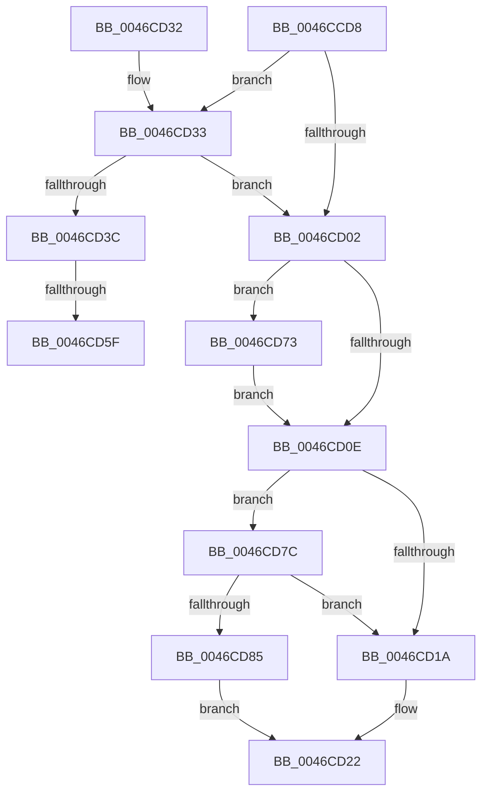

# EtwpFreeCompression

- RVA: `0x0046CCD8`–`0x0046CD8E` (길이 `182` bytes)
- VA: `0x000000014046CCD8`
- 실행 섹션: `.text`
- PDB 이름 있음: `예`; PDB Function 태그: `예`
- unwind 정보 RVA: `0x0005CAF4`
- 디코드: `49`개 명령, `182/182` bytes 표시
- 미해석 바이트: `0` (있으면 어셈블리에 `.byte`로 보존)

> 이 문서는 커널 이미지의 기계어와 PDB 기호를 분석해 생성했습니다. 4번과 5번은 함수 원형과 자료형을 바이너리 사용 방식에서 추정한 C 해석이며 원본 소스 복구 결과는 아닙니다.

## 1. Dependencies

- 직접 호출 지점: **6**; 고유 호출 대상: **5**
- 직접 호출자로 확인된 함수: **1**
- RIP 상대 이미지 참조: **0**

### Outgoing calls
- `0x0046CCF3` → [KeRemoveQueueDpcEx](KeRemoveQueueDpcEx_function_0046CDC0.md) (function, `0x0046CDC0`)
- `0x0046CD1D` → [EtwpFreePlaceholderList](EtwpFreePlaceholderList_function_0046CF3C.md) (function, `0x0046CF3C`)
- `0x0046CD4B` → [KeAbPreAcquire](../21/KeAbPreAcquire_function_00210230.md) (function, `0x00210230`)
- `0x0046CD68` → [ExfAcquirePushLockExclusiveEx](../20/ExfAcquirePushLockExclusiveEx_function_0020FC90.md) (function, `0x0020FC90`)
- `0x0046CD75` → [ExFreePoolWithTag](../../poolcode/B8/ExFreePoolWithTag_function_00B82870.md) (function, `0x00B82870`)
- `0x0046CD87` → [ExFreePoolWithTag](../../poolcode/B8/ExFreePoolWithTag_function_00B82870.md) (function, `0x00B82870`)

### Direct callers
- [EtwpFreeLoggerContext](../../page/9C/EtwpFreeLoggerContext_function_009C1688.md) at `0x009C1736`

### Static image references
- 디코드된 RIP-relative 메모리 참조가 없습니다.

## 2. Other-region calls and transfers

- 다른 실행 섹션으로 향하는 call: **2**
  - `0x0046CD75` → [ExFreePoolWithTag](../../poolcode/B8/ExFreePoolWithTag_function_00B82870.md) (`.text` → `POOLCODE`)
  - `0x0046CD87` → [ExFreePoolWithTag](../../poolcode/B8/ExFreePoolWithTag_function_00B82870.md) (`.text` → `POOLCODE`)
- call이 아닌 외부 분기/꼬리 이동: **2**
  - `0x0046CD59` → [sub_006F31F0](../6F/Unknown_function_006F31F0.md) (`tail-transfer`)
  - `0x0046CD6E` → [sub_006F31F0](../6F/Unknown_function_006F31F0.md) (`tail-transfer`)

## 3. Assembly (complete function range)

```asm
0046CCD8  48 89 5C 24 08                  mov qword ptr [rsp + 8], rbx
0046CCDD  48 89 74 24 10                  mov qword ptr [rsp + 0x10], rsi
0046CCE2  57                              push rdi
0046CCE3  48 83 EC 20                     sub rsp, 0x20
0046CCE7  48 8B D9                        mov rbx, rcx
0046CCEA  33 D2                           xor edx, edx
0046CCEC  48 81 C1 C0 05 00 00            add rcx, 0x5c0
0046CCF3  E8 C8 00 00 00                  call 0x14046cdc0
0046CCF8  8B 83 98 05 00 00               mov eax, dword ptr [rbx + 0x598]
0046CCFE  85 C0                           test eax, eax
0046CD00  75 31                           jne 0x14046cd33
0046CD02  48 8B 8B 90 05 00 00            mov rcx, qword ptr [rbx + 0x590]
0046CD09  48 85 C9                        test rcx, rcx
0046CD0C  75 65                           jne 0x14046cd73
0046CD0E  48 8B 8B 88 05 00 00            mov rcx, qword ptr [rbx + 0x588]
0046CD15  48 85 C9                        test rcx, rcx
0046CD18  75 62                           jne 0x14046cd7c
0046CD1A  48 8B CB                        mov rcx, rbx
0046CD1D  E8 1A 02 00 00                  call 0x14046cf3c
0046CD22  48 8B 5C 24 30                  mov rbx, qword ptr [rsp + 0x30]
0046CD27  48 8B 74 24 38                  mov rsi, qword ptr [rsp + 0x38]
0046CD2C  48 83 C4 20                     add rsp, 0x20
0046CD30  5F                              pop rdi
0046CD31  C3                              ret
0046CD32  CC                              int3
0046CD33  F7 43 0C 00 04 00 00            test dword ptr [rbx + 0xc], 0x400
0046CD3A  74 C6                           je 0x14046cd02
0046CD3C  48 8D BB 80 05 00 00            lea rdi, [rbx + 0x580]
0046CD43  45 33 C0                        xor r8d, r8d
0046CD46  48 8B CF                        mov rcx, rdi
0046CD49  33 D2                           xor edx, edx
0046CD4B  E8 E0 34 DA FF                  call 0x140210230
0046CD50  F0 48 0F BA 2F 00               lock bts qword ptr [rdi], 0
0046CD56  48 8B F0                        mov rsi, rax
0046CD59  0F 83 91 64 28 00               jae 0x1406f31f0
0046CD5F  4C 8B C7                        mov r8, rdi
0046CD62  48 8B D0                        mov rdx, rax
0046CD65  48 8B CF                        mov rcx, rdi
0046CD68  E8 23 2F DA FF                  call 0x14020fc90
0046CD6D  90                              nop
0046CD6E  E9 7D 64 28 00                  jmp 0x1406f31f0
0046CD73  33 D2                           xor edx, edx
0046CD75  E8 F6 5A 71 00                  call 0x140b82870
0046CD7A  EB 92                           jmp 0x14046cd0e
0046CD7C  F7 43 0C 00 04 00 00            test dword ptr [rbx + 0xc], 0x400
0046CD83  75 95                           jne 0x14046cd1a
0046CD85  33 D2                           xor edx, edx
0046CD87  E8 E4 5A 71 00                  call 0x140b82870
0046CD8C  EB 94                           jmp 0x14046cd22
```

## 4. C-style interpretation (structured pseudocode)

```c
__int64 __fastcall EtwpFreeCompression(__int64 a1, int a2, int a3)
{
    __int64 result;
    __int64 v_rsp;
    unsigned __int64 v_stack_p10;
    unsigned __int64 v_stack_p8;

    v_stack_p8 = v_rbx;
    v_stack_p10 = v_rsi;
    v_rsp = (v_rsp) - (32);
    a2 = 0;
    a1 = (a1) + (0x5C0ULL);
    result = KeRemoveQueueDpcEx(a1, a2, a3, a4);
    if ((unsigned int)((unsigned int)(*(unsigned int *)(a1 + 1432))) != 0) goto loc_0046CD33;
loc_0046CD02:
    if (*(unsigned __int64 *)(a1 + 1424) != 0) goto loc_0046CD73;
loc_0046CD0E:
    if (*(unsigned __int64 *)(a1 + 1416) != 0) goto loc_0046CD7C;
loc_0046CD1A:
    result = EtwpFreePlaceholderList(a1, a2, a3, a4);
loc_0046CD22:
    v_rsp = (v_rsp) + (32);
    return result;
loc_0046CD33:
    if (((*(unsigned int *)(v_stack_p8 + 12)) & (0x400ULL)) == 0) goto loc_0046CD02;
    a3 = 0;
    a2 = 0;
    result = KeAbPreAcquire(v_stack_p8 + 1408, a2, a3, a4);
    result = ExfAcquirePushLockExclusiveEx(v_stack_p8 + 1408, result, v_stack_p8 + 1408, a4);
loc_0046CD73:
    a2 = 0;
    result = ExFreePoolWithTag(v_stack_p8 + 1408, a2, v_stack_p8 + 1408, a4);
    goto loc_0046CD0E;
loc_0046CD7C:
    if (((*(unsigned int *)(v_stack_p8 + 12)) & (0x400ULL)) != 0) goto loc_0046CD1A;
    a2 = 0;
    result = ExFreePoolWithTag(v_stack_p8 + 1408, a2, v_stack_p8 + 1408, a4);
    goto loc_0046CD22;
}
```

## 5. (Beta) C Style

```c
int64_t EtwpFreeCompression(void *Arg1, int32_t Arg2, int32_t Arg3)
{
    uint8_t *arg1 = (uint8_t *)Arg1;

    int64_t result;
    int64_t local_rsp;
    uint64_t v_stack_p10;
    uint64_t v_stack_p8;

    v_stack_p8 = local_rbx;
    v_stack_p10 = local_rsi;
    local_rsp = (local_rsp) - (32);
    Arg2 = 0;
    Arg1 = (Arg1) + (0x5C0ULL);
    result = KeRemoveQueueDpcEx(Arg1, Arg2, Arg3, a4);
    if ((uint32_t)((uint32_t)(*(uint32_t *)(arg1 + 0x598))) != 0) goto loc_0046CD33;
loc_0046CD02:
    if (*(uint64_t *)(arg1 + 0x590) != 0) goto loc_0046CD73;
loc_0046CD0E:
    if (*(uint64_t *)(arg1 + 0x588) != 0) goto loc_0046CD7C;
loc_0046CD1A:
    result = EtwpFreePlaceholderList(Arg1, Arg2, Arg3, a4);
loc_0046CD22:
    local_rsp = (local_rsp) + (32);
    return result;
loc_0046CD33:
    if (((*(uint32_t *)(v_stack_p8 + 0xC)) & (0x400ULL)) == 0) goto loc_0046CD02;
    Arg3 = 0;
    Arg2 = 0;
    result = KeAbPreAcquire(v_stack_p8 + 1408, Arg2, Arg3, a4);
    result = ExfAcquirePushLockExclusiveEx(v_stack_p8 + 1408, result, v_stack_p8 + 1408, a4);
loc_0046CD73:
    Arg2 = 0;
    result = ExFreePoolWithTag(v_stack_p8 + 1408, Arg2, v_stack_p8 + 1408, a4);
    goto loc_0046CD0E;
loc_0046CD7C:
    if (((*(uint32_t *)(v_stack_p8 + 0xC)) & (0x400ULL)) != 0) goto loc_0046CD1A;
    Arg2 = 0;
    result = ExFreePoolWithTag(v_stack_p8 + 1408, Arg2, v_stack_p8 + 1408, a4);
    goto loc_0046CD22;
}
```

### 관측된 메모리 오프셋

구조체 형식이 확인되지 않은 접근은 인자 기준의 오프셋으로만 기록했습니다.

| 기준 인자 | 오프셋 표현 | 폭 (bit) | 접근 |
|---|---:|---:|---|
| `Arg1` | `+ 0x0` | `64` | `R/W` |
| `Arg1` | `+ 0xC` | `32` | `R` |
| `Arg1` | `+ 0x580` | `64` | `R` |
| `Arg1` | `+ 0x588` | `64` | `R` |
| `Arg1` | `+ 0x590` | `64` | `R` |
| `Arg1` | `+ 0x598` | `32` | `R` |

## 6. Execution-region graph

[열기: 2D/3D 그래프와 함수 탐색 컨트롤 패널](../../../control-panel.html?section=text&rva=0x0046CCD8&view=graph)

- 2D 그래프는 위에서 아래로 흐르고, 3D 그래프는 빈 공간을 드래그해 회전합니다. Shift+드래그는 이동, 휠은 확대·축소, 함수 노드 선택은 대상 보고서 이동입니다.

### Static fallback


