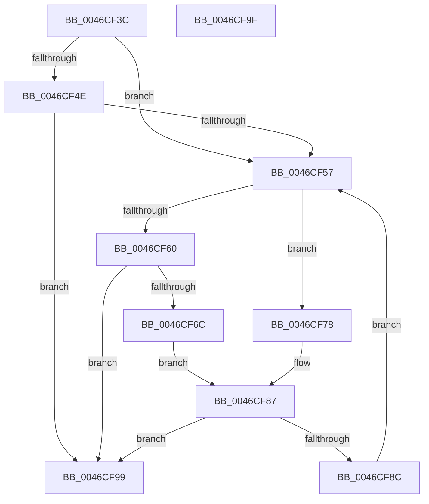

# EtwpFreePlaceholderList

- RVA: `0x0046CF3C`–`0x0046CFA0` (길이 `100` bytes)
- VA: `0x000000014046CF3C`
- 실행 섹션: `.text`
- PDB 이름 있음: `예`; PDB Function 태그: `아니요`
- unwind 정보 RVA: `0x0005CF00`
- 디코드: `30`개 명령, `100/100` bytes 표시
- 미해석 바이트: `0` (있으면 어셈블리에 `.byte`로 보존)

> 이 문서는 커널 이미지의 기계어와 PDB 기호를 분석해 생성했습니다. 4번과 5번은 함수 원형과 자료형을 바이너리 사용 방식에서 추정한 C 해석이며 원본 소스 복구 결과는 아닙니다.

## 1. Dependencies

- 직접 호출 지점: **4**; 고유 호출 대상: **3**
- 직접 호출자로 확인된 함수: **3**
- RIP 상대 이미지 참조: **0**

### Outgoing calls
- `0x0046CF45` → [Feature_218004792__private_IsEnabledDeviceUsageNoInline](../64/Feature_218004792__private_IsEnabledDeviceUsageNoInline_function_0064F3EC.md) (function, `0x0064F3EC`)
- `0x0046CF57` → [Feature_218004792__private_IsEnabledDeviceUsageNoInline](../64/Feature_218004792__private_IsEnabledDeviceUsageNoInline_function_0064F3EC.md) (function, `0x0064F3EC`)
- `0x0046CF7F` → [ExpInterlockedPopEntrySList](../6B/ExpInterlockedPopEntrySList_function_006BA570.md) (function, `0x006BA570`)
- `0x0046CF92` → [ExFreePoolWithTag](../../poolcode/B8/ExFreePoolWithTag_function_00B82870.md) (function, `0x00B82870`)

### Direct callers
- [EtwpFreeCompression](EtwpFreeCompression_function_0046CCD8.md) at `0x0046CD1D`
- [EtwpInitializeCompression](../4E/EtwpInitializeCompression_function_004EC774.md) at `0x004EC8ED`
- [EtwpFreeTraceBufferPool](../../page/9C/EtwpFreeTraceBufferPool_function_009C1A74.md) at `0x009C1C16`

### Static image references
- 디코드된 RIP-relative 메모리 참조가 없습니다.

## 2. Other-region calls and transfers

- 다른 실행 섹션으로 향하는 call: **1**
  - `0x0046CF92` → [ExFreePoolWithTag](../../poolcode/B8/ExFreePoolWithTag_function_00B82870.md) (`.text` → `POOLCODE`)
- 별도 외부 분기/꼬리 이동을 확인하지 못했습니다.

## 3. Assembly (complete function range)

```asm
0046CF3C  40 53                           push rbx
0046CF3E  48 83 EC 20                     sub rsp, 0x20
0046CF42  48 8B D9                        mov rbx, rcx
0046CF45  E8 A2 24 1E 00                  call 0x14064f3ec
0046CF4A  85 C0                           test eax, eax
0046CF4C  74 09                           je 0x14046cf57
0046CF4E  F7 43 0C 00 00 00 04            test dword ptr [rbx + 0xc], 0x4000000
0046CF55  74 42                           je 0x14046cf99
0046CF57  E8 90 24 1E 00                  call 0x14064f3ec
0046CF5C  85 C0                           test eax, eax
0046CF5E  75 18                           jne 0x14046cf78
0046CF60  48 8B 8B A8 05 00 00            mov rcx, qword ptr [rbx + 0x5a8]
0046CF67  48 85 C9                        test rcx, rcx
0046CF6A  74 2D                           je 0x14046cf99
0046CF6C  48 8B 01                        mov rax, qword ptr [rcx]
0046CF6F  48 89 83 A8 05 00 00            mov qword ptr [rbx + 0x5a8], rax
0046CF76  EB 0F                           jmp 0x14046cf87
0046CF78  48 8D 8B B0 05 00 00            lea rcx, [rbx + 0x5b0]
0046CF7F  E8 EC D5 24 00                  call 0x1406ba570
0046CF84  48 8B C8                        mov rcx, rax
0046CF87  48 85 C9                        test rcx, rcx
0046CF8A  74 0D                           je 0x14046cf99
0046CF8C  48 83 C1 E0                     add rcx, -0x20
0046CF90  33 D2                           xor edx, edx
0046CF92  E8 D9 58 71 00                  call 0x140b82870
0046CF97  EB BE                           jmp 0x14046cf57
0046CF99  48 83 C4 20                     add rsp, 0x20
0046CF9D  5B                              pop rbx
0046CF9E  C3                              ret
0046CF9F  CC                              int3
```

## 4. C-style interpretation (structured pseudocode)

```c
__int64 __fastcall EtwpFreePlaceholderList(__int64 a1, int a2)
{
    __int64 result;
    __int64 v_rsp;

    v_rsp = (v_rsp) - (32);
    result = Feature_218004792__private_IsEnabledDeviceUsageNoInline(a1, a2, a3, a4);
    if ((unsigned int)(result) == 0) goto loc_0046CF57;
    if (((*(unsigned int *)(a1 + 12)) & (0x4000000ULL)) == 0) goto loc_0046CF99;
loc_0046CF57:
    result = Feature_218004792__private_IsEnabledDeviceUsageNoInline(a1, a2, a3, a4);
    if ((unsigned int)(result) != 0) goto loc_0046CF78;
    if (*(unsigned __int64 *)(a1 + 1448) == 0) goto loc_0046CF99;
    *(unsigned __int64 *)(a1 + 1448) = *(unsigned __int64 *)(*(unsigned __int64 *)(a1 + 1448));
    goto loc_0046CF87;
loc_0046CF78:
    result = ExpInterlockedPopEntrySList(a1 + 1456, a2, a3, a4);
loc_0046CF87:
    if (result == 0) goto loc_0046CF99;
    a1 = (result) + (-32);
    a2 = 0;
    result = ExFreePoolWithTag(a1, a2, a3, a4);
    goto loc_0046CF57;
loc_0046CF99:
    v_rsp = (v_rsp) + (32);
    return result;
}
```

## 5. (Beta) C Style

```c
int64_t EtwpFreePlaceholderList(void *Arg1, int32_t Arg2)
{
    uint8_t *arg1 = (uint8_t *)Arg1;

    int64_t result;
    int64_t local_rsp;

    local_rsp = (local_rsp) - (32);
    result = Feature_218004792__private_IsEnabledDeviceUsageNoInline(Arg1, Arg2, a3, a4);
    if ((uint32_t)(result) == 0) goto loc_0046CF57;
    if (((*(uint32_t *)(arg1 + 0xC)) & (0x4000000ULL)) == 0) goto loc_0046CF99;
loc_0046CF57:
    result = Feature_218004792__private_IsEnabledDeviceUsageNoInline(Arg1, Arg2, a3, a4);
    if ((uint32_t)(result) != 0) goto loc_0046CF78;
    if (*(uint64_t *)(arg1 + 0x5A8) == 0) goto loc_0046CF99;
    *(uint64_t *)(arg1 + 0x5A8) = *(uint64_t *)(*(uint64_t *)(arg1 + 0x5A8));
    goto loc_0046CF87;
loc_0046CF78:
    result = ExpInterlockedPopEntrySList(Arg1 + 1456, Arg2, a3, a4);
loc_0046CF87:
    if (result == 0) goto loc_0046CF99;
    Arg1 = (result) + (-32);
    Arg2 = 0;
    result = ExFreePoolWithTag(Arg1, Arg2, a3, a4);
    goto loc_0046CF57;
loc_0046CF99:
    local_rsp = (local_rsp) + (32);
    return result;
}
```

### 관측된 메모리 오프셋

구조체 형식이 확인되지 않은 접근은 인자 기준의 오프셋으로만 기록했습니다.

| 기준 인자 | 오프셋 표현 | 폭 (bit) | 접근 |
|---|---:|---:|---|
| `Arg1` | `+ 0xC` | `32` | `R` |
| `Arg1` | `+ 0x5A8` | `64` | `R` |
| `Arg1` | `+ 0x5A8` | `64` | `W` |
| `Arg1` | `+ 0x5B0` | `64` | `R` |

## 6. Execution-region graph

[열기: 2D/3D 그래프와 함수 탐색 컨트롤 패널](../../../control-panel.html?section=text&rva=0x0046CF3C&view=graph)

- 2D 그래프는 위에서 아래로 흐르고, 3D 그래프는 빈 공간을 드래그해 회전합니다. Shift+드래그는 이동, 휠은 확대·축소, 함수 노드 선택은 대상 보고서 이동입니다.

### Static fallback


