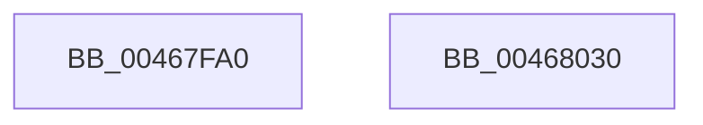

# EtwpInitializeApcPool

- RVA: `0x00467FA0`–`0x00468031` (길이 `145` bytes)
- VA: `0x0000000140467FA0`
- 실행 섹션: `.text`
- PDB 이름 있음: `예`; PDB Function 태그: `아니요`
- unwind 정보 RVA: `0x0005E6B4`
- 디코드: `35`개 명령, `145/145` bytes 표시
- 미해석 바이트: `0` (있으면 어셈블리에 `.byte`로 보존)

> 이 문서는 커널 이미지의 기계어와 PDB 기호를 분석해 생성했습니다. 4번과 5번은 함수 원형과 자료형을 바이너리 사용 방식에서 추정한 C 해석이며 원본 소스 복구 결과는 아닙니다.

## 1. Dependencies

- 직접 호출 지점: **2**; 고유 호출 대상: **1**
- 직접 호출자로 확인된 함수: **2**
- RIP 상대 이미지 참조: **1**

### Outgoing calls
- `0x00467FD0` → [InitializeSListHead](InitializeSListHead_function_00468A90.md) (function, `0x00468A90`)
- `0x00467FD9` → [InitializeSListHead](InitializeSListHead_function_00468A90.md) (function, `0x00468A90`)

### Direct callers
- [EtwpUpdateContextRegisterTraceEvents](../../page/7B/EtwpUpdateContextRegisterTraceEvents_function_007B7B98.md) at `0x007B7C25`
- [EtwpInitLoggerContext](../../page/A7/EtwpInitLoggerContext_function_00A7154C.md) at `0x00A7176E`

### Static image references
- `0x00467FE4` → RVA `0x004A2700` (`EtwpApcPoolDpc`; read)

## 2. Other-region calls and transfers

- 다른 실행 섹션으로 향하는 call: **0**
- 별도 외부 분기/꼬리 이동을 확인하지 못했습니다.

## 3. Assembly (complete function range)

```asm
00467FA0  48 8B C4                        mov rax, rsp
00467FA3  48 89 58 08                     mov qword ptr [rax + 8], rbx
00467FA7  48 89 68 10                     mov qword ptr [rax + 0x10], rbp
00467FAB  48 89 70 18                     mov qword ptr [rax + 0x18], rsi
00467FAF  48 89 78 20                     mov qword ptr [rax + 0x20], rdi
00467FB3  41 56                           push r14
00467FB5  48 83 EC 20                     sub rsp, 0x20
00467FB9  48 8B F1                        mov rsi, rcx
00467FBC  45 33 F6                        xor r14d, r14d
00467FBF  4C 89 71 08                     mov qword ptr [rcx + 8], r14
00467FC3  41 8B F9                        mov edi, r9d
00467FC6  48 83 C1 10                     add rcx, 0x10
00467FCA  41 8B D8                        mov ebx, r8d
00467FCD  48 8B EA                        mov rbp, rdx
00467FD0  E8 BB 0A 00 00                  call 0x140468a90
00467FD5  48 8D 4E 20                     lea rcx, [rsi + 0x20]
00467FD9  E8 B2 0A 00 00                  call 0x140468a90
00467FDE  89 9E A8 00 00 00               mov dword ptr [rsi + 0xa8], ebx
00467FE4  48 8D 05 15 A7 03 00            lea rax, [rip + 0x3a715]
00467FEB  48 8B 5C 24 30                  mov rbx, qword ptr [rsp + 0x30]
00467FF0  89 BE AC 00 00 00               mov dword ptr [rsi + 0xac], edi
00467FF6  48 8B 7C 24 48                  mov rdi, qword ptr [rsp + 0x48]
00467FFB  48 89 46 78                     mov qword ptr [rsi + 0x78], rax
00467FFF  C7 46 60 13 01 00 00            mov dword ptr [rsi + 0x60], 0x113
00468006  4C 89 B6 80 00 00 00            mov qword ptr [rsi + 0x80], r14
0046800D  4C 89 B6 98 00 00 00            mov qword ptr [rsi + 0x98], r14
00468014  4C 89 76 70                     mov qword ptr [rsi + 0x70], r14
00468018  48 89 2E                        mov qword ptr [rsi], rbp
0046801B  48 8B 6C 24 38                  mov rbp, qword ptr [rsp + 0x38]
00468020  C6 46 61 02                     mov byte ptr [rsi + 0x61], 2
00468024  48 8B 74 24 40                  mov rsi, qword ptr [rsp + 0x40]
00468029  48 83 C4 20                     add rsp, 0x20
0046802D  41 5E                           pop r14
0046802F  C3                              ret
00468030  CC                              int3
```

## 4. C-style interpretation (structured pseudocode)

```c
__int64 __fastcall EtwpInitializeApcPool(__int64 a1, __int64 a2, int a3, int a4)
{
    __int64 result;
    __int64 v_r14;
    __int64 v_rsp;
    unsigned __int64 v_stack_p10;
    unsigned __int64 v_stack_p18;
    unsigned __int64 v_stack_p20;
    unsigned __int64 v_stack_p8;

    *(unsigned __int64 *)(v_rsp + 8) = v_rbx;
    *(unsigned __int64 *)(v_rsp + 16) = v_rbp;
    *(unsigned __int64 *)(v_rsp + 24) = v_rsi;
    *(unsigned __int64 *)(v_rsp + 32) = v_rdi;
    v_rsp = (v_rsp) - (32);
    v_r14 = 0;
    *(unsigned __int64 *)(a1 + 8) = 0;
    a1 = (a1) + (16);
    result = InitializeSListHead(a1, a2, a3, a4);
    result = InitializeSListHead(a1 + 32, a2, a3, a4);
    *(unsigned int *)(a1 + 168) = (unsigned int)((unsigned int)(a3));
    *(unsigned int *)(a1 + 172) = (unsigned int)((unsigned int)(a4));
    *(unsigned __int64 *)(a1 + 120) = v_rip + 239381;
    *(unsigned int *)(a1 + 96) = 275;
    *(unsigned __int64 *)(a1 + 128) = 0;
    *(unsigned __int64 *)(a1 + 152) = 0;
    *(unsigned __int64 *)(a1 + 112) = 0;
    *(unsigned __int64 *)(a1) = a2;
    *(unsigned __int8 *)(a1 + 97) = 2;
    v_rsp = (v_rsp) + (32);
    return v_rip + 239381;
}
```

## 5. (Beta) C Style

```c
int64_t EtwpInitializeApcPool(void *Arg1, int64_t Arg2, int32_t Arg3, int32_t Arg4)
{
    uint8_t *arg1 = (uint8_t *)Arg1;

    int64_t result;
    int64_t local_r14;
    int64_t local_rsp;
    uint64_t v_stack_p10;
    uint64_t v_stack_p18;
    uint64_t v_stack_p20;
    uint64_t v_stack_p8;

    *(uint64_t *)(local_rsp + 0x8) = local_rbx;
    *(uint64_t *)(local_rsp + 0x10) = local_rbp;
    *(uint64_t *)(local_rsp + 0x18) = local_rsi;
    *(uint64_t *)(local_rsp + 0x20) = local_rdi;
    local_rsp = (local_rsp) - (32);
    local_r14 = 0;
    *(uint64_t *)(arg1 + 0x8) = 0;
    Arg1 = (Arg1) + (16);
    result = InitializeSListHead(Arg1, Arg2, Arg3, Arg4);
    result = InitializeSListHead(Arg1 + 32, Arg2, Arg3, Arg4);
    *(uint32_t *)(arg1 + 0xA8) = (uint32_t)((uint32_t)(Arg3));
    *(uint32_t *)(arg1 + 0xAC) = (uint32_t)((uint32_t)(Arg4));
    *(uint64_t *)(arg1 + 0x78) = v_rip + 239381;
    *(uint32_t *)(arg1 + 0x60) = 275;
    *(uint64_t *)(arg1 + 0x80) = 0;
    *(uint64_t *)(arg1 + 0x98) = 0;
    *(uint64_t *)(arg1 + 0x70) = 0;
    *(uint64_t *)(arg1) = Arg2;
    *(uint8_t *)(arg1 + 0x61) = 2;
    local_rsp = (local_rsp) + (32);
    return v_rip + 239381;
}
```

### 관측된 메모리 오프셋

구조체 형식이 확인되지 않은 접근은 인자 기준의 오프셋으로만 기록했습니다.

| 기준 인자 | 오프셋 표현 | 폭 (bit) | 접근 |
|---|---:|---:|---|
| `Arg1` | `+ 0x0` | `64` | `W` |
| `Arg1` | `+ 0x8` | `64` | `W` |
| `Arg1` | `+ 0x20` | `64` | `R` |
| `Arg1` | `+ 0x60` | `32` | `W` |
| `Arg1` | `+ 0x61` | `8` | `W` |
| `Arg1` | `+ 0x70` | `64` | `W` |
| `Arg1` | `+ 0x78` | `64` | `W` |
| `Arg1` | `+ 0x80` | `64` | `W` |
| `Arg1` | `+ 0x98` | `64` | `W` |
| `Arg1` | `+ 0xA8` | `32` | `W` |
| `Arg1` | `+ 0xAC` | `32` | `W` |

## 6. Execution-region graph

[열기: 2D/3D 그래프와 함수 탐색 컨트롤 패널](../../../control-panel.html?section=text&rva=0x00467FA0&view=graph)

- 2D 그래프는 위에서 아래로 흐르고, 3D 그래프는 빈 공간을 드래그해 회전합니다. Shift+드래그는 이동, 휠은 확대·축소, 함수 노드 선택은 대상 보고서 이동입니다.

### Static fallback


