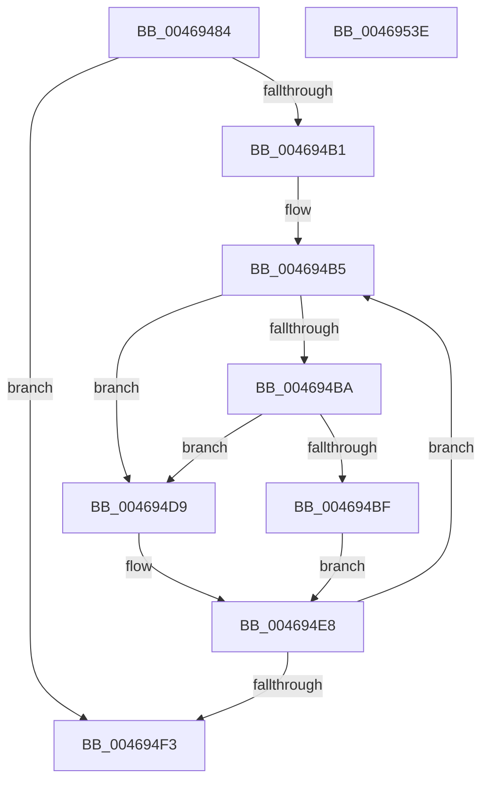

# EtwpTiFillVadEventWrite

- RVA: `0x00469484`–`0x0046953F` (길이 `187` bytes)
- VA: `0x0000000140469484`
- 실행 섹션: `.text`
- PDB 이름 있음: `예`; PDB Function 태그: `아니요`
- unwind 정보 RVA: `0x000AB154`
- 디코드: `52`개 명령, `187/187` bytes 표시
- 미해석 바이트: `0` (있으면 어셈블리에 `.byte`로 보존)

> 이 문서는 커널 이미지의 기계어와 PDB 기호를 분석해 생성했습니다. 4번과 5번은 함수 원형과 자료형을 바이너리 사용 방식에서 추정한 C 해석이며 원본 소스 복구 결과는 아닙니다.

## 1. Dependencies

- 직접 호출 지점: **3**; 고유 호출 대상: **3**
- 직접 호출자로 확인된 함수: **1**
- RIP 상대 이미지 참조: **1**

### Outgoing calls
- `0x004694D2` → [EtwpTiFillVad](EtwpTiFillVad_function_004695B0.md) (function, `0x004695B0`)
- `0x004694E3` → [EtwpTiFillZeroVad](EtwpTiFillZeroVad_function_00469548.md) (function, `0x00469548`)
- `0x0046951E` → [EtwWriteEx](../25/EtwWriteEx_function_0025F0D0.md) (function, `0x0025F0D0`)

### Direct callers
- [EtwpTiVadQueryEventWriteCallback](../../page/A0/EtwpTiVadQueryEventWriteCallback_function_00A03970.md) at `0x00A039F7`

### Static image references
- `0x004694FE` → RVA `0x00EFFA30` (`.data`; read)

## 2. Other-region calls and transfers

- 다른 실행 섹션으로 향하는 call: **0**
- 별도 외부 분기/꼬리 이동을 확인하지 못했습니다.

## 3. Assembly (complete function range)

```asm
00469484  48 8B C4                        mov rax, rsp
00469487  48 89 58 08                     mov qword ptr [rax + 8], rbx
0046948B  48 89 68 10                     mov qword ptr [rax + 0x10], rbp
0046948F  48 89 78 18                     mov qword ptr [rax + 0x18], rdi
00469493  4C 89 70 20                     mov qword ptr [rax + 0x20], r14
00469497  41 57                           push r15
00469499  48 83 EC 40                     sub rsp, 0x40
0046949D  33 DB                           xor ebx, ebx
0046949F  4D 8B F9                        mov r15, r9
004694A2  45 8A F0                        mov r14b, r8b
004694A5  44 8B DA                        mov r11d, edx
004694A8  48 8B F9                        mov rdi, rcx
004694AB  39 5C 24 78                     cmp dword ptr [rsp + 0x78], ebx
004694AF  76 42                           jbe 0x1404694f3
004694B1  8B 6C 24 70                     mov ebp, dword ptr [rsp + 0x70]
004694B5  45 84 F6                        test r14b, r14b
004694B8  74 1F                           je 0x1404694d9
004694BA  0F A3 DD                        bt ebp, ebx
004694BD  73 1A                           jae 0x1404694d9
004694BF  8B D3                           mov edx, ebx
004694C1  48 C1 E2 06                     shl rdx, 6
004694C5  41 8B CB                        mov ecx, r11d
004694C8  49 03 D7                        add rdx, r15
004694CB  48 C1 E1 04                     shl rcx, 4
004694CF  48 03 CF                        add rcx, rdi
004694D2  E8 D9 00 00 00                  call 0x1404695b0
004694D7  EB 0F                           jmp 0x1404694e8
004694D9  41 8B CB                        mov ecx, r11d
004694DC  48 C1 E1 04                     shl rcx, 4
004694E0  48 03 CF                        add rcx, rdi
004694E3  E8 60 00 00 00                  call 0x140469548
004694E8  44 03 D8                        add r11d, eax
004694EB  FF C3                           inc ebx
004694ED  3B 5C 24 78                     cmp ebx, dword ptr [rsp + 0x78]
004694F1  72 C2                           jb 0x1404694b5
004694F3  48 8B 94 24 80 00 00 00         mov rdx, qword ptr [rsp + 0x80]
004694FB  45 33 C9                        xor r9d, r9d
004694FE  48 8B 0D 2B 65 A9 00            mov rcx, qword ptr [rip + 0xa9652b]
00469505  45 33 C0                        xor r8d, r8d
00469508  48 89 7C 24 38                  mov qword ptr [rsp + 0x38], rdi
0046950D  44 89 5C 24 30                  mov dword ptr [rsp + 0x30], r11d
00469512  48 83 64 24 28 00               and qword ptr [rsp + 0x28], 0
00469518  48 83 64 24 20 00               and qword ptr [rsp + 0x20], 0
0046951E  E8 AD 5B DF FF                  call 0x14025f0d0
00469523  48 8B 5C 24 50                  mov rbx, qword ptr [rsp + 0x50]
00469528  48 8B 6C 24 58                  mov rbp, qword ptr [rsp + 0x58]
0046952D  48 8B 7C 24 60                  mov rdi, qword ptr [rsp + 0x60]
00469532  4C 8B 74 24 68                  mov r14, qword ptr [rsp + 0x68]
00469537  48 83 C4 40                     add rsp, 0x40
0046953B  41 5F                           pop r15
0046953D  C3                              ret
0046953E  CC                              int3
```

## 4. C-style interpretation (structured pseudocode)

```c
__int64 __fastcall EtwpTiFillVadEventWrite(__int64 a1, int a2, int a3, __int64 a4, unsigned int a5, unsigned int a6, __int64 a7)
{
    __int64 result;
    __int64 v_r11;
    __int64 v_rbx;
    __int64 v_rsp;
    unsigned __int64 v_stack_m10;
    unsigned int v_stack_m18;
    unsigned __int64 v_stack_m20;
    unsigned __int64 v_stack_m28;
    unsigned __int64 v_stack_p10;
    unsigned __int64 v_stack_p18;
    unsigned __int64 v_stack_p20;
    unsigned __int64 v_stack_p8;

    *(unsigned __int64 *)(v_rsp + 8) = v_rbx;
    *(unsigned __int64 *)(v_rsp + 16) = v_rbp;
    *(unsigned __int64 *)(v_rsp + 24) = v_rdi;
    *(unsigned __int64 *)(v_rsp + 32) = v_r14;
    v_rsp = (v_rsp) - (64);
    v_rbx = 0;
    if (a6 <= 0) goto loc_004694F3;
loc_004694B5:
    if ((unsigned __int8)((unsigned __int8)(a3)) == 0) goto loc_004694D9;
    if (condition_is_above_or_equal) goto loc_004694D9;
    a2 = (0) << (6);
    a2 = (a2) + (a4);
    a1 = ((unsigned int)((unsigned int)((unsigned int)(a2)))) << (4);
    a1 = (a1) + (a1);
    result = EtwpTiFillVad(a1, a2, a3, a4);
    goto loc_004694E8;
loc_004694D9:
    a1 = ((unsigned int)((unsigned int)((unsigned int)(a2)))) << (4);
    a1 = (a1) + (a1);
    result = EtwpTiFillZeroVad(a1, a2, a3, a4);
loc_004694E8:
    v_r11 = (unsigned int)(((unsigned int)(a2)) + ((unsigned int)(result)));
    v_rbx = (unsigned int)((v_rbx) + 1);
    if (((unsigned int)(v_rbx)) < a6) goto loc_004694B5;
loc_004694F3:
    a4 = 0;
    a3 = 0;
    v_stack_m10 = a1;
    v_stack_m18 = (unsigned int)(v_r11);
    result = EtwWriteEx(*(unsigned __int64 *)(v_rip + 11101483), a7, a3, a4);
    v_rsp = (v_rsp) + (64);
    return result;
}
```

## 5. (Beta) C Style

```c
int64_t EtwpTiFillVadEventWrite(int64_t Arg1, int32_t Arg2, int32_t Arg3, int64_t Arg4, uint32_t Arg5, uint32_t Arg6, int64_t Arg7)
{
    int64_t result;
    int64_t local_r11;
    int64_t local_rbx;
    int64_t local_rsp;
    uint64_t v_stack_m10;
    uint32_t v_stack_m18;
    uint64_t v_stack_m20;
    uint64_t v_stack_m28;
    uint64_t v_stack_p10;
    uint64_t v_stack_p18;
    uint64_t v_stack_p20;
    uint64_t v_stack_p8;

    *(uint64_t *)(local_rsp + 0x8) = local_rbx;
    *(uint64_t *)(local_rsp + 0x10) = local_rbp;
    *(uint64_t *)(local_rsp + 0x18) = local_rdi;
    *(uint64_t *)(local_rsp + 0x20) = local_r14;
    local_rsp = (local_rsp) - (64);
    local_rbx = 0;
    if (Arg6 <= 0) goto loc_004694F3;
loc_004694B5:
    if ((uint8_t)((uint8_t)(Arg3)) == 0) goto loc_004694D9;
    if (condition_is_above_or_equal) goto loc_004694D9;
    Arg2 = (0) << (6);
    Arg2 = (Arg2) + (Arg4);
    Arg1 = ((uint32_t)((uint32_t)((uint32_t)(Arg2)))) << (4);
    Arg1 = (Arg1) + (Arg1);
    result = EtwpTiFillVad(Arg1, Arg2, Arg3, Arg4);
    goto loc_004694E8;
loc_004694D9:
    Arg1 = ((uint32_t)((uint32_t)((uint32_t)(Arg2)))) << (4);
    Arg1 = (Arg1) + (Arg1);
    result = EtwpTiFillZeroVad(Arg1, Arg2, Arg3, Arg4);
loc_004694E8:
    local_r11 = (uint32_t)(((uint32_t)(Arg2)) + ((uint32_t)(result)));
    local_rbx = (uint32_t)((local_rbx) + 1);
    if (((uint32_t)(local_rbx)) < Arg6) goto loc_004694B5;
loc_004694F3:
    Arg4 = 0;
    Arg3 = 0;
    v_stack_m10 = Arg1;
    v_stack_m18 = (uint32_t)(local_r11);
    result = EtwWriteEx(*(uint64_t *)(v_rip + 0xA9652B), Arg7, Arg3, Arg4);
    local_rsp = (local_rsp) + (64);
    return result;
}
```

## 6. Execution-region graph

[열기: 2D/3D 그래프와 함수 탐색 컨트롤 패널](../../../control-panel.html?section=text&rva=0x00469484&view=graph)

- 2D 그래프는 위에서 아래로 흐르고, 3D 그래프는 빈 공간을 드래그해 회전합니다. Shift+드래그는 이동, 휠은 확대·축소, 함수 노드 선택은 대상 보고서 이동입니다.

### Static fallback


