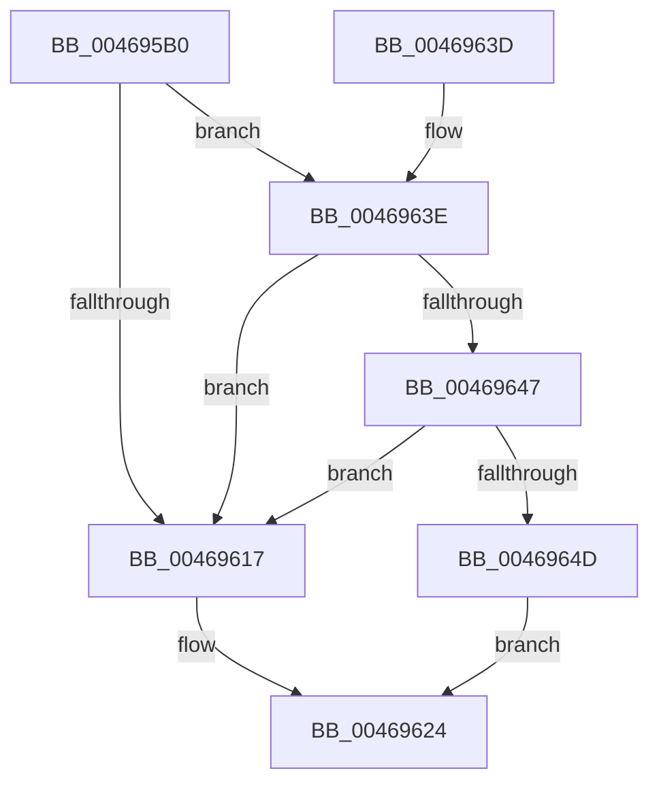

# EtwpTiFillVad

- RVA: `0x004695B0`–`0x00469654` (길이 `164` bytes)
- VA: `0x00000001404695B0`
- 실행 섹션: `.text`
- PDB 이름 있음: `예`; PDB Function 태그: `아니요`
- unwind 정보 RVA: `0x000DB714`
- 디코드: `37`개 명령, `164/164` bytes 표시
- 미해석 바이트: `0` (있으면 어셈블리에 `.byte`로 보존)

> 이 문서는 커널 이미지의 기계어와 PDB 기호를 분석해 생성했습니다. 4번과 5번은 함수 원형과 자료형을 바이너리 사용 방식에서 추정한 C 해석이며 원본 소스 복구 결과는 아닙니다.

## 1. Dependencies

- 직접 호출 지점: **0**; 고유 호출 대상: **0**
- 직접 호출자로 확인된 함수: **3**
- RIP 상대 이미지 참조: **1**

### Outgoing calls
- 직접 디코드된 call 명령이 없습니다.

### Direct callers
- [EtwpTiFillVadEventWrite](EtwpTiFillVadEventWrite_function_00469484.md) at `0x004694D2`
- [EtwTiLogProtectExecVm](../../page/88/EtwTiLogProtectExecVm_function_00881A48.md) at `0x00881D27`
- [EtwTiLogReadWriteVm](../../page/9B/EtwTiLogReadWriteVm_function_009BB7C8.md) at `0x009BBAD5`

### Static image references
- `0x0046961D` → RVA `0x00019EB8` (`.rdata`; read)

## 2. Other-region calls and transfers

- 다른 실행 섹션으로 향하는 call: **0**
- 별도 외부 분기/꼬리 이동을 확인하지 못했습니다.

## 3. Assembly (complete function range)

```asm
004695B0  48 89 11                        mov qword ptr [rcx], rdx
004695B3  48 8D 42 08                     lea rax, [rdx + 8]
004695B7  48 C7 41 08 04 00 00 00         mov qword ptr [rcx + 8], 4
004695BF  45 33 D2                        xor r10d, r10d
004695C2  48 89 41 10                     mov qword ptr [rcx + 0x10], rax
004695C6  48 8D 42 10                     lea rax, [rdx + 0x10]
004695CA  48 C7 41 18 08 00 00 00         mov qword ptr [rcx + 0x18], 8
004695D2  48 89 41 20                     mov qword ptr [rcx + 0x20], rax
004695D6  48 8D 42 14                     lea rax, [rdx + 0x14]
004695DA  48 C7 41 28 04 00 00 00         mov qword ptr [rcx + 0x28], 4
004695E2  48 89 41 30                     mov qword ptr [rcx + 0x30], rax
004695E6  48 8D 42 18                     lea rax, [rdx + 0x18]
004695EA  48 C7 41 38 04 00 00 00         mov qword ptr [rcx + 0x38], 4
004695F2  48 89 41 40                     mov qword ptr [rcx + 0x40], rax
004695F6  48 8D 42 20                     lea rax, [rdx + 0x20]
004695FA  48 C7 41 48 08 00 00 00         mov qword ptr [rcx + 0x48], 8
00469602  48 89 41 50                     mov qword ptr [rcx + 0x50], rax
00469606  48 C7 41 58 08 00 00 00         mov qword ptr [rcx + 0x58], 8
0046960E  48 8B 42 38                     mov rax, qword ptr [rdx + 0x38]
00469612  48 85 C0                        test rax, rax
00469615  75 27                           jne 0x14046963e
00469617  41 B8 02 00 00 00               mov r8d, 2
0046961D  48 8D 15 94 08 BB FF            lea rdx, [rip - 0x44f76c]
00469624  B8 60 00 00 00                  mov eax, 0x60
00469629  48 89 14 08                     mov qword ptr [rax + rcx], rdx
0046962D  44 89 44 08 08                  mov dword ptr [rax + rcx + 8], r8d
00469632  44 89 54 08 0C                  mov dword ptr [rax + rcx + 0xc], r10d
00469637  B8 07 00 00 00                  mov eax, 7
0046963C  C3                              ret
0046963D  CC                              int3
0046963E  48 8B 50 08                     mov rdx, qword ptr [rax + 8]
00469642  48 85 D2                        test rdx, rdx
00469645  74 D0                           je 0x140469617
00469647  66 44 39 10                     cmp word ptr [rax], r10w
0046964B  74 CA                           je 0x140469617
0046964D  44 0F B7 40 02                  movzx r8d, word ptr [rax + 2]
00469652  EB D0                           jmp 0x140469624
```

## 4. C-style interpretation (structured pseudocode)

```c
__int64 __fastcall EtwpTiFillVad(__int64 a1, __int64 a2)
{
    __int64 v_r10;

    *(unsigned __int64 *)(a1) = a2;
    *(unsigned __int64 *)(a1 + 8) = 4;
    v_r10 = 0;
    *(unsigned __int64 *)(a1 + 16) = a2 + 8;
    *(unsigned __int64 *)(a1 + 24) = 8;
    *(unsigned __int64 *)(a1 + 32) = a2 + 16;
    *(unsigned __int64 *)(a1 + 40) = 4;
    *(unsigned __int64 *)(a1 + 48) = a2 + 20;
    *(unsigned __int64 *)(a1 + 56) = 4;
    *(unsigned __int64 *)(a1 + 64) = a2 + 24;
    *(unsigned __int64 *)(a1 + 72) = 8;
    *(unsigned __int64 *)(a1 + 80) = a2 + 32;
    *(unsigned __int64 *)(a1 + 88) = 8;
    if (*(unsigned __int64 *)(a2 + 56) != 0) goto loc_0046963E;
loc_00469617:
loc_00469624:
    *(unsigned __int64 *)(96 + a1 * 1) = v_rip - 4519788;
    *(unsigned int *)(96 + a1 * 1 + 8) = 2;
    *(unsigned int *)(96 + a1 * 1 + 12) = 0;
    return 7;
loc_0046963E:
    if (*(unsigned __int64 *)(7 + 8) == 0) goto loc_00469617;
    if ((*(unsigned __int16 *)(7)) == 0) goto loc_00469617;
    goto loc_00469624;
}
```

## 5. (Beta) C Style

```c
int64_t EtwpTiFillVad(void *Arg1, void *Arg2)
{
    uint8_t *arg1 = (uint8_t *)Arg1;
    uint8_t *arg2 = (uint8_t *)Arg2;

    int64_t local_r10;

    *(void **)(arg1) = Arg2;
    *(uint64_t *)(arg1 + 0x8) = 4;
    local_r10 = 0;
    *(void **)(arg1 + 0x10) = Arg2 + 8;
    *(uint64_t *)(arg1 + 0x18) = 8;
    *(void **)(arg1 + 0x20) = Arg2 + 16;
    *(uint64_t *)(arg1 + 0x28) = 4;
    *(void **)(arg1 + 0x30) = Arg2 + 20;
    *(uint64_t *)(arg1 + 0x38) = 4;
    *(void **)(arg1 + 0x40) = Arg2 + 24;
    *(uint64_t *)(arg1 + 0x48) = 8;
    *(void **)(arg1 + 0x50) = Arg2 + 32;
    *(uint64_t *)(arg1 + 0x58) = 8;
    if (*(uint64_t *)(arg2 + 0x38) != 0) goto loc_0046963E;
loc_00469617:
loc_00469624:
    *(uint64_t *)(96 + arg1 * 1) = v_rip - 4519788;
    *(uint32_t *)(96 + arg1 * 1 + 0x8) = 2;
    *(uint32_t *)(96 + arg1 * 1 + 0xC) = 0;
    return 7;
loc_0046963E:
    if (*(uint64_t *)(7 + 0x8) == 0) goto loc_00469617;
    if ((*(uint16_t *)(7)) == 0) goto loc_00469617;
    goto loc_00469624;
}
```

### 관측된 메모리 오프셋

구조체 형식이 확인되지 않은 접근은 인자 기준의 오프셋으로만 기록했습니다.

| 기준 인자 | 오프셋 표현 | 폭 (bit) | 접근 |
|---|---:|---:|---|
| `Arg1` | `+ 0x0` | `64` | `W` |
| `Arg1` | `+ 0x8` | `64` | `W` |
| `Arg1` | `+ 0x10` | `64` | `W` |
| `Arg1` | `+ 0x18` | `64` | `W` |
| `Arg1` | `+ 0x20` | `64` | `W` |
| `Arg1` | `+ 0x28` | `64` | `W` |
| `Arg1` | `+ 0x30` | `64` | `W` |
| `Arg1` | `+ 0x38` | `64` | `W` |
| `Arg1` | `+ 0x40` | `64` | `W` |
| `Arg1` | `+ 0x48` | `64` | `W` |
| `Arg1` | `+ 0x50` | `64` | `W` |
| `Arg1` | `+ 0x58` | `64` | `W` |
| `Arg2` | `+ 0x8` | `64` | `R` |
| `Arg2` | `+ 0x10` | `64` | `R` |
| `Arg2` | `+ 0x14` | `64` | `R` |
| `Arg2` | `+ 0x18` | `64` | `R` |
| `Arg2` | `+ 0x20` | `64` | `R` |
| `Arg2` | `+ 0x38` | `64` | `R` |

## 6. Execution-region graph

[열기: 2D/3D 그래프와 함수 탐색 컨트롤 패널](../../../control-panel.html?section=text&rva=0x004695B0&view=graph)

- 2D 그래프는 위에서 아래로 흐르고, 3D 그래프는 빈 공간을 드래그해 회전합니다. Shift+드래그는 이동, 휠은 확대·축소, 함수 노드 선택은 대상 보고서 이동입니다.

### Static fallback


