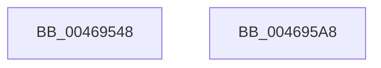

# EtwpTiFillZeroVad

- RVA: `0x00469548`–`0x004695A9` (길이 `97` bytes)
- VA: `0x0000000140469548`
- 실행 섹션: `.text`
- PDB 이름 있음: `예`; PDB Function 태그: `아니요`
- unwind 정보 RVA: `0x000DB714`
- 디코드: `18`개 명령, `97/97` bytes 표시
- 미해석 바이트: `0` (있으면 어셈블리에 `.byte`로 보존)

> 이 문서는 커널 이미지의 기계어와 PDB 기호를 분석해 생성했습니다. 4번과 5번은 함수 원형과 자료형을 바이너리 사용 방식에서 추정한 C 해석이며 원본 소스 복구 결과는 아닙니다.

## 1. Dependencies

- 직접 호출 지점: **0**; 고유 호출 대상: **0**
- 직접 호출자로 확인된 함수: **4**
- RIP 상대 이미지 참조: **1**

### Outgoing calls
- 직접 디코드된 call 명령이 없습니다.

### Direct callers
- [EtwpTiVadQueryEventWrite](../3B/EtwpTiVadQueryEventWrite_function_003B9360.md) at `0x003B93E2`
- [EtwpTiFillVadEventWrite](EtwpTiFillVadEventWrite_function_00469484.md) at `0x004694E3`
- [EtwTiLogProtectExecVm](../../page/88/EtwTiLogProtectExecVm_function_00881A48.md) at `0x00881DD6`
- [EtwTiLogReadWriteVm](../../page/9B/EtwTiLogReadWriteVm_function_009BB7C8.md) at `0x009BBA40`

### Static image references
- `0x00469550` → RVA `0x00019EB0` (`.rdata`; read)

## 2. Other-region calls and transfers

- 다른 실행 섹션으로 향하는 call: **0**
- 별도 외부 분기/꼬리 이동을 확인하지 못했습니다.

## 3. Assembly (complete function range)

```asm
00469548  48 C7 41 08 04 00 00 00         mov qword ptr [rcx + 8], 4
00469550  4C 8D 0D 59 09 BB FF            lea r9, [rip - 0x44f6a7]
00469557  4C 89 09                        mov qword ptr [rcx], r9
0046955A  B8 07 00 00 00                  mov eax, 7
0046955F  4C 89 49 10                     mov qword ptr [rcx + 0x10], r9
00469563  48 C7 41 18 08 00 00 00         mov qword ptr [rcx + 0x18], 8
0046956B  4C 89 49 20                     mov qword ptr [rcx + 0x20], r9
0046956F  48 C7 41 28 04 00 00 00         mov qword ptr [rcx + 0x28], 4
00469577  4C 89 49 30                     mov qword ptr [rcx + 0x30], r9
0046957B  48 C7 41 38 04 00 00 00         mov qword ptr [rcx + 0x38], 4
00469583  4C 89 49 40                     mov qword ptr [rcx + 0x40], r9
00469587  48 C7 41 48 08 00 00 00         mov qword ptr [rcx + 0x48], 8
0046958F  4C 89 49 50                     mov qword ptr [rcx + 0x50], r9
00469593  48 C7 41 58 08 00 00 00         mov qword ptr [rcx + 0x58], 8
0046959B  4C 89 49 60                     mov qword ptr [rcx + 0x60], r9
0046959F  48 C7 41 68 02 00 00 00         mov qword ptr [rcx + 0x68], 2
004695A7  C3                              ret
004695A8  CC                              int3
```

## 4. C-style interpretation (structured pseudocode)

```c
__int64 __fastcall EtwpTiFillZeroVad(__int64 a1)
{
    *(unsigned __int64 *)(a1 + 8) = 4;
    *(unsigned __int64 *)(a1) = v_rip - 4519591;
    *(unsigned __int64 *)(a1 + 16) = v_rip - 4519591;
    *(unsigned __int64 *)(a1 + 24) = 8;
    *(unsigned __int64 *)(a1 + 32) = v_rip - 4519591;
    *(unsigned __int64 *)(a1 + 40) = 4;
    *(unsigned __int64 *)(a1 + 48) = v_rip - 4519591;
    *(unsigned __int64 *)(a1 + 56) = 4;
    *(unsigned __int64 *)(a1 + 64) = v_rip - 4519591;
    *(unsigned __int64 *)(a1 + 72) = 8;
    *(unsigned __int64 *)(a1 + 80) = v_rip - 4519591;
    *(unsigned __int64 *)(a1 + 88) = 8;
    *(unsigned __int64 *)(a1 + 96) = v_rip - 4519591;
    *(unsigned __int64 *)(a1 + 104) = 2;
    return 7;
}
```

## 5. (Beta) C Style

```c
int64_t EtwpTiFillZeroVad(void *Arg1)
{
    uint8_t *arg1 = (uint8_t *)Arg1;

    *(uint64_t *)(arg1 + 0x8) = 4;
    *(uint64_t *)(arg1) = v_rip - 4519591;
    *(uint64_t *)(arg1 + 0x10) = v_rip - 4519591;
    *(uint64_t *)(arg1 + 0x18) = 8;
    *(uint64_t *)(arg1 + 0x20) = v_rip - 4519591;
    *(uint64_t *)(arg1 + 0x28) = 4;
    *(uint64_t *)(arg1 + 0x30) = v_rip - 4519591;
    *(uint64_t *)(arg1 + 0x38) = 4;
    *(uint64_t *)(arg1 + 0x40) = v_rip - 4519591;
    *(uint64_t *)(arg1 + 0x48) = 8;
    *(uint64_t *)(arg1 + 0x50) = v_rip - 4519591;
    *(uint64_t *)(arg1 + 0x58) = 8;
    *(uint64_t *)(arg1 + 0x60) = v_rip - 4519591;
    *(uint64_t *)(arg1 + 0x68) = 2;
    return 7;
}
```

### 관측된 메모리 오프셋

구조체 형식이 확인되지 않은 접근은 인자 기준의 오프셋으로만 기록했습니다.

| 기준 인자 | 오프셋 표현 | 폭 (bit) | 접근 |
|---|---:|---:|---|
| `Arg1` | `+ 0x0` | `64` | `W` |
| `Arg1` | `+ 0x8` | `64` | `W` |
| `Arg1` | `+ 0x10` | `64` | `W` |
| `Arg1` | `+ 0x18` | `64` | `W` |
| `Arg1` | `+ 0x20` | `64` | `W` |
| `Arg1` | `+ 0x28` | `64` | `W` |
| `Arg1` | `+ 0x30` | `64` | `W` |
| `Arg1` | `+ 0x38` | `64` | `W` |
| `Arg1` | `+ 0x40` | `64` | `W` |
| `Arg1` | `+ 0x48` | `64` | `W` |
| `Arg1` | `+ 0x50` | `64` | `W` |
| `Arg1` | `+ 0x58` | `64` | `W` |
| `Arg1` | `+ 0x60` | `64` | `W` |
| `Arg1` | `+ 0x68` | `64` | `W` |

## 6. Execution-region graph

[열기: 2D/3D 그래프와 함수 탐색 컨트롤 패널](../../../control-panel.html?section=text&rva=0x00469548&view=graph)

- 2D 그래프는 위에서 아래로 흐르고, 3D 그래프는 빈 공간을 드래그해 회전합니다. Shift+드래그는 이동, 휠은 확대·축소, 함수 노드 선택은 대상 보고서 이동입니다.

### Static fallback


