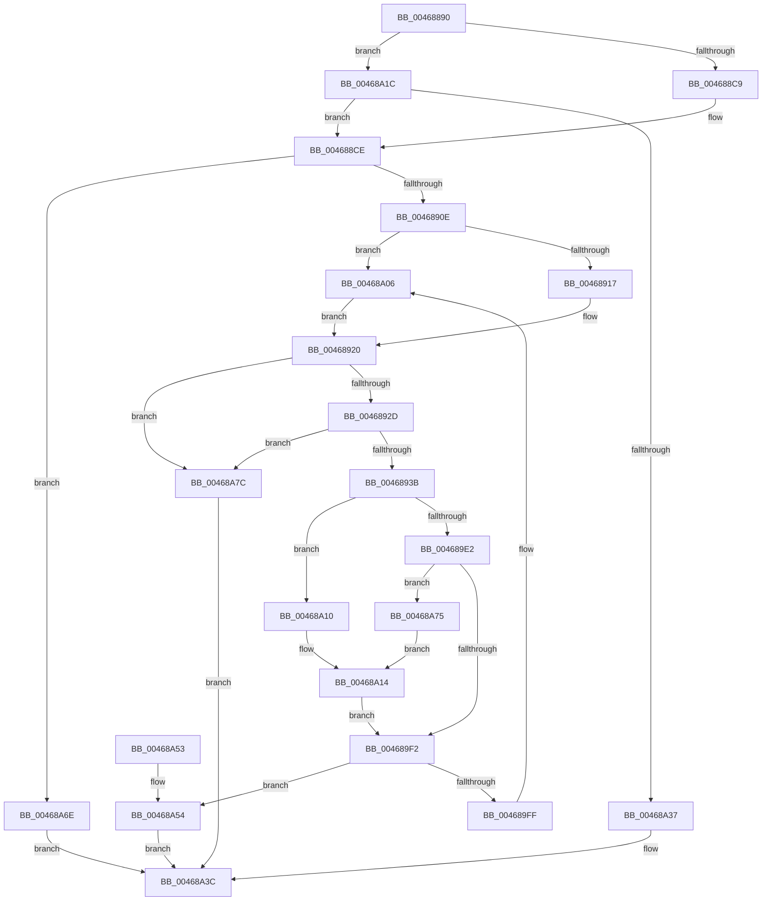

# ExInitializeLookasideListExInternal

- RVA: `0x00468890`–`0x00468A83` (길이 `499` bytes)
- VA: `0x0000000140468890`
- 실행 섹션: `.text`
- PDB 이름 있음: `예`; PDB Function 태그: `아니요`
- unwind 정보 RVA: `0x000AB080`
- 디코드: `126`개 명령, `499/499` bytes 표시
- 미해석 바이트: `0` (있으면 어셈블리에 `.byte`로 보존)

> 이 문서는 커널 이미지의 기계어와 PDB 기호를 분석해 생성했습니다. 4번과 5번은 함수 원형과 자료형을 바이너리 사용 방식에서 추정한 C 해석이며 원본 소스 복구 결과는 아닙니다.

## 1. Dependencies

- 직접 호출 지점: **3**; 고유 호출 대상: **3**
- 직접 호출자로 확인된 함수: **4**
- RIP 상대 이미지 참조: **7**

### Outgoing calls
- `0x00468967` → [InitializeSListHead](InitializeSListHead_function_00468A90.md) (function, `0x00468A90`)
- `0x004689CE` → [KeAcquireSpinLockRaiseToDpc](../20/KeAcquireSpinLockRaiseToDpc_function_00208470.md) (function, `0x00208470`)
- `0x00468A65` → [KeReleaseSpinLock](../39/KeReleaseSpinLock_function_00392BA0.md) (function, `0x00392BA0`)

### Direct callers
- [ExInitializeLookasideListEx](ExInitializeLookasideListEx_function_00468840.md) at `0x00468879`
- [CcInitializeCacheManager](../../init/BE/CcInitializeCacheManager_function_00BEE2E8.md) at `0x00BEE6DF`
- [CcInitializeCacheManager](../../init/BE/CcInitializeCacheManager_function_00BEE2E8.md) at `0x00BEE711`
- [VmInitSystem](../../init/BE/VmInitSystem_function_00BEEEB8.md) at `0x00BEEF68`
- [CmInitSystem1](../../init/C5/CmInitSystem1_function_00C559CC.md) at `0x00C55C2A`

### Static image references
- `0x00468940` → RVA `0x00EFABB0` (`.data`; read)
- `0x00468947` → RVA `0x00EFABF0` (`.data`; read)
- `0x00468952` → RVA `0x00EFABC0` (`.data`; read)
- `0x00468959` → RVA `0x00EFABE0` (`.data`; read)
- `0x0046896C` → RVA `0x00E0EBA8` (`.data`; read)
- `0x0046898E` → RVA `0x0043F0D0` (`ExAllocatePoolEx`; read)
- `0x004689B0` → RVA `0x00475D80` (`CmSiFreeMemory`; read)

## 2. Other-region calls and transfers

- 다른 실행 섹션으로 향하는 call: **0**
- 별도 외부 분기/꼬리 이동을 확인하지 못했습니다.

## 3. Assembly (complete function range)

```asm
00468890  48 8B C4                        mov rax, rsp
00468893  48 89 58 08                     mov qword ptr [rax + 8], rbx
00468897  48 89 68 20                     mov qword ptr [rax + 0x20], rbp
0046889B  4C 89 40 18                     mov qword ptr [rax + 0x18], r8
0046889F  48 89 50 10                     mov qword ptr [rax + 0x10], rdx
004688A3  56                              push rsi
004688A4  57                              push rdi
004688A5  41 54                           push r12
004688A7  41 56                           push r14
004688A9  41 57                           push r15
004688AB  48 83 EC 20                     sub rsp, 0x20
004688AF  48 8B D9                        mov rbx, rcx
004688B2  45 33 C0                        xor r8d, r8d
004688B5  0F B7 8C 24 88 00 00 00         movzx ecx, word ptr [rsp + 0x88]
004688BD  45 8B F1                        mov r14d, r9d
004688C0  66 85 C9                        test cx, cx
004688C3  0F 85 53 01 00 00               jne 0x140468a1c
004688C9  B9 00 01 00 00                  mov ecx, 0x100
004688CE  44 39 84 24 90 00 00 00         cmp dword ptr [rsp + 0x90], r8d
004688D6  41 B9 08 00 00 00               mov r9d, 8
004688DC  8B 54 24 70                     mov edx, dword ptr [rsp + 0x70]
004688E0  41 8B E8                        mov ebp, r8d
004688E3  66 0F 44 E9                     cmove bp, cx
004688E7  45 8B F9                        mov r15d, r9d
004688EA  4C 39 4C 24 78                  cmp qword ptr [rsp + 0x78], r9
004688EF  4C 0F 47 7C 24 78               cmova r15, qword ptr [rsp + 0x78]
004688F5  8D 42 FF                        lea eax, [rdx - 1]
004688F8  85 C2                           test edx, eax
004688FA  0F 94 C1                        sete cl
004688FD  F7 C2 FC FF FF FF               test edx, 0xfffffffc
00468903  0F 94 C0                        sete al
00468906  84 C8                           test al, cl
00468908  0F 84 60 01 00 00               je 0x140468a6e
0046890E  F6 C2 01                        test dl, 1
00468911  0F 85 EF 00 00 00               jne 0x140468a06
00468917  85 D2                           test edx, edx
00468919  41 8B F0                        mov esi, r8d
0046891C  41 0F 45 F1                     cmovne esi, r9d
00468920  41 F7 C6 18 FC FF FF            test r14d, 0xfffffc18
00468927  0F 85 4F 01 00 00               jne 0x140468a7c
0046892D  41 8B C6                        mov eax, r14d
00468930  83 E0 03                        and eax, 3
00468933  3C 03                           cmp al, 3
00468935  0F 84 41 01 00 00               je 0x140468a7c
0046893B  41 0F BA E6 00                  bt r14d, 0
00468940  48 8D 0D 69 22 A9 00            lea rcx, [rip + 0xa92269]
00468947  48 8D 3D A2 22 A9 00            lea rdi, [rip + 0xa922a2]
0046894E  48 0F 42 F9                     cmovb rdi, rcx
00468952  4C 8D 25 67 22 A9 00            lea r12, [rip + 0xa92267]
00468959  48 8D 0D 80 22 A9 00            lea rcx, [rip + 0xa92280]
00468960  4C 0F 42 E1                     cmovb r12, rcx
00468964  48 8B CB                        mov rcx, rbx
00468967  E8 24 01 00 00                  call 0x140468a90
0046896C  0F B7 05 35 62 9A 00            movzx eax, word ptr [rip + 0x9a6235]
00468973  33 D2                           xor edx, edx
00468975  48 8B 4C 24 58                  mov rcx, qword ptr [rsp + 0x58]
0046897A  41 0B F6                        or esi, r14d
0046897D  66 89 43 10                     mov word ptr [rbx + 0x10], ax
00468981  48 85 C9                        test rcx, rcx
00468984  8B 84 24 80 00 00 00            mov eax, dword ptr [rsp + 0x80]
0046898B  89 43 28                        mov dword ptr [rbx + 0x28], eax
0046898E  48 8D 05 3B 67 FD FF            lea rax, [rip - 0x298c5]
00468995  48 0F 45 C1                     cmovne rax, rcx
00468999  66 89 6B 12                     mov word ptr [rbx + 0x12], bp
0046899D  48 89 53 14                     mov qword ptr [rbx + 0x14], rdx
004689A1  48 89 53 1C                     mov qword ptr [rbx + 0x1c], rdx
004689A5  89 73 24                        mov dword ptr [rbx + 0x24], esi
004689A8  44 89 7B 2C                     mov dword ptr [rbx + 0x2c], r15d
004689AC  48 89 43 30                     mov qword ptr [rbx + 0x30], rax
004689B0  48 8D 05 C9 D3 00 00            lea rax, [rip + 0xd3c9]
004689B7  48 8B 4C 24 60                  mov rcx, qword ptr [rsp + 0x60]
004689BC  48 85 C9                        test rcx, rcx
004689BF  48 0F 45 C1                     cmovne rax, rcx
004689C3  49 8B CC                        mov rcx, r12
004689C6  48 89 43 38                     mov qword ptr [rbx + 0x38], rax
004689CA  48 89 53 50                     mov qword ptr [rbx + 0x50], rdx
004689CE  E8 9D FA D9 FF                  call 0x140208470
004689D3  45 33 C0                        xor r8d, r8d
004689D6  8A D0                           mov dl, al
004689D8  44 39 84 24 90 00 00 00         cmp dword ptr [rsp + 0x90], r8d
004689E0  75 2E                           jne 0x140468a10
004689E2  0F B7 05 BF 61 9A 00            movzx eax, word ptr [rip + 0x9a61bf]
004689E9  66 85 C0                        test ax, ax
004689EC  0F 84 83 00 00 00               je 0x140468a75
004689F2  48 8B 47 08                     mov rax, qword ptr [rdi + 8]
004689F6  48 83 C3 40                     add rbx, 0x40
004689FA  48 39 38                        cmp qword ptr [rax], rdi
004689FD  74 55                           je 0x140468a54
004689FF  B9 03 00 00 00                  mov ecx, 3
00468A04  CD 29                           int 0x29
00468A06  BE 10 00 00 00                  mov esi, 0x10
00468A0B  E9 10 FF FF FF                  jmp 0x140468920
00468A10  66 89 6B 10                     mov word ptr [rbx + 0x10], bp
00468A14  66 81 4B 12 FF FF               or word ptr [rbx + 0x12], 0xffff
00468A1A  EB D6                           jmp 0x1404689f2
00468A1C  41 BA 00 01 00 00               mov r10d, 0x100
00468A22  0F B7 C1                        movzx eax, cx
00468A25  66 41 2B C2                     sub ax, r10w
00468A29  BA 00 03 00 00                  mov edx, 0x300
00468A2E  66 3B C2                        cmp ax, dx
00468A31  0F 86 97 FE FF FF               jbe 0x1404688ce
00468A37  B8 F6 00 00 C0                  mov eax, 0xc00000f6
00468A3C  48 8B 5C 24 50                  mov rbx, qword ptr [rsp + 0x50]
00468A41  48 8B 6C 24 68                  mov rbp, qword ptr [rsp + 0x68]
00468A46  48 83 C4 20                     add rsp, 0x20
00468A4A  41 5F                           pop r15
00468A4C  41 5E                           pop r14
00468A4E  41 5C                           pop r12
00468A50  5F                              pop rdi
00468A51  5E                              pop rsi
00468A52  C3                              ret
00468A53  CC                              int3
00468A54  48 89 3B                        mov qword ptr [rbx], rdi
00468A57  49 8B CC                        mov rcx, r12
00468A5A  48 89 43 08                     mov qword ptr [rbx + 8], rax
00468A5E  48 89 18                        mov qword ptr [rax], rbx
00468A61  48 89 5F 08                     mov qword ptr [rdi + 8], rbx
00468A65  E8 36 A1 F2 FF                  call 0x140392ba0
00468A6A  33 C0                           xor eax, eax
00468A6C  EB CE                           jmp 0x140468a3c
00468A6E  B8 F3 00 00 C0                  mov eax, 0xc00000f3
00468A73  EB C7                           jmp 0x140468a3c
00468A75  66 44 89 43 10                  mov word ptr [rbx + 0x10], r8w
00468A7A  EB 98                           jmp 0x140468a14
00468A7C  B8 F2 00 00 C0                  mov eax, 0xc00000f2
00468A81  EB B9                           jmp 0x140468a3c
```

## 4. C-style interpretation (structured pseudocode)

```c
__int64 __fastcall ExInitializeLookasideListExInternal(__int64 a1, __int64 a2, __int64 a3, int a4, unsigned int a5, __int64 a6, unsigned int a7, unsigned __int16 a8, unsigned int a9)
{
    __int64 result;
    __int64 v_r12;
    __int64 v_r15;
    __int64 v_rbp;
    __int64 v_rbx;
    __int64 v_rdi;
    __int64 v_rsi;
    __int64 v_rsp;
    unsigned __int64 v_stack_p10;
    unsigned __int64 v_stack_p18;
    unsigned __int64 v_stack_p20;
    unsigned __int64 v_stack_p8;

    *(unsigned __int64 *)(v_rsp + 8) = v_rbx;
    *(unsigned __int64 *)(v_rsp + 32) = v_rbp;
    *(unsigned __int64 *)(v_rsp + 24) = a3;
    *(unsigned __int64 *)(v_rsp + 16) = a2;
    v_rsp = (v_rsp) - (32);
    a3 = 0;
    if (a8 != 0) goto loc_00468A1C;
loc_004688CE:
    v_rbp = 0;
    if (a9 == 0) { v_rbp = 256; }
    v_r15 = 8;
    if (a6 > 8) { v_r15 = a6; }
    a1 = ((((unsigned int)((unsigned int)(a5))) & ((unsigned int)((unsigned int)(a5) - 1))) == 0) ? 1 : 0;
    result = ((((unsigned int)((unsigned int)(a5))) & (0xFFFFFFFCULL)) == 0) ? 1 : 0;
    if ((((unsigned __int8)(result)) & ((unsigned __int8)(a1))) == 0) goto loc_00468A6E;
    if ((((unsigned __int8)((unsigned int)(a5))) & (1)) != 0) goto loc_00468A06;
    v_rsi = 0;
    if ((unsigned int)((unsigned int)(a5)) != 0) { v_rsi = 8; }
loc_00468920:
    if ((((unsigned int)((unsigned int)(a4))) & (0xFFFFFC18ULL)) != 0) goto loc_00468A7C;
    result = (unsigned int)(((unsigned int)((unsigned int)((unsigned int)(a4)))) & (3));
    if (((unsigned __int8)(result)) == 3) goto loc_00468A7C;
    v_rdi = v_rip + 11084450;
    if (((unsigned __int8)(result)) < 3) { v_rdi = v_rip + 11084393; }
    v_r12 = v_rip + 11084391;
    if (((unsigned __int8)(result)) < 3) { v_r12 = v_rip + 11084416; }
    result = InitializeSListHead(a1, (unsigned int)(a5), a3, 8);
    a2 = 0;
    v_rsi = (unsigned int)((v_rsi) | ((unsigned int)((unsigned int)(a4))));
    *(unsigned __int16 *)(a1 + 16) = (unsigned __int16)(*(unsigned __int16 *)(v_rip + 10117685));
    *(unsigned int *)(a1 + 40) = (unsigned int)((unsigned int)(a7));
    result = v_rip - 170181;
    if (v_stack_p10 != 0) { result = v_stack_p10; }
    *(unsigned __int16 *)(a1 + 18) = (unsigned __int16)(v_rbp);
    *(unsigned __int64 *)(a1 + 20) = 0;
    *(unsigned __int64 *)(a1 + 28) = 0;
    *(unsigned int *)(a1 + 36) = (unsigned int)(v_rsi);
    *(unsigned int *)(a1 + 44) = (unsigned int)(v_r15);
    *(unsigned __int64 *)(a1 + 48) = result;
    result = v_rip + 54217;
    if (v_stack_p18 != 0) { result = v_stack_p18; }
    *(unsigned __int64 *)(a1 + 56) = result;
    *(unsigned __int64 *)(a1 + 80) = 0;
    result = KeAcquireSpinLockRaiseToDpc(v_r12, a2, a3, 8);
    a3 = 0;
    if (a9 != 0) goto loc_00468A10;
    if ((unsigned __int16)(*(unsigned __int16 *)(v_rip + 10117567)) == 0) goto loc_00468A75;
loc_004689F2:
    v_rbx = (a1) + (64);
    if ((*(unsigned __int64 *)(*(unsigned __int64 *)(v_rdi + 8))) == v_rdi) goto loc_00468A54;
loc_00468A06:
    goto loc_00468920;
loc_00468A10:
    *(unsigned __int16 *)(v_rbx + 16) = (unsigned __int16)(v_rbp);
loc_00468A14:
    goto loc_004689F2;
loc_00468A1C:
    result = (unsigned __int16)((3) - (256));
    if (((unsigned __int16)(result)) <= 768) goto loc_004688CE;
loc_00468A3C:
    v_rsp = (v_rsp) + (32);
    return (unsigned int)(0xC00000F6ULL);
loc_00468A54:
    *(unsigned __int64 *)(v_stack_p8) = v_rdi;
    *(unsigned __int64 *)(v_stack_p8 + 8) = (unsigned int)(0xC00000F6ULL);
    *(unsigned __int64 *)((unsigned int)(0xC00000F6ULL)) = v_stack_p8;
    *(unsigned __int64 *)(v_rdi + 8) = v_stack_p8;
    result = KeReleaseSpinLock(v_r12, 768, a3, 8);
    result = 0;
    goto loc_00468A3C;
loc_00468A6E:
    goto loc_00468A3C;
loc_00468A75:
    *(unsigned __int16 *)(v_stack_p8 + 16) = 0;
    goto loc_00468A14;
loc_00468A7C:
    goto loc_00468A3C;
}
```

## 5. (Beta) C Style

```c
int64_t ExInitializeLookasideListExInternal(void *LookasideListExInternal, int64_t Arg2, int64_t Arg3, int32_t Arg4, void *Arg5, int64_t Arg6, uint32_t Arg7, uint16_t Arg8, uint32_t Arg9)
{
    uint8_t *lookasideListExInternal = (uint8_t *)LookasideListExInternal;
    uint8_t *arg5 = (uint8_t *)Arg5;

    int64_t result;
    int64_t local_r12;
    int64_t local_r15;
    int64_t local_rbp;
    int64_t local_rbx;
    int64_t local_rdi;
    int64_t local_rsi;
    int64_t local_rsp;
    uint64_t v_stack_p10;
    uint64_t v_stack_p18;
    uint64_t v_stack_p20;
    uint64_t v_stack_p8;

    *(uint64_t *)(local_rsp + 0x8) = local_rbx;
    *(uint64_t *)(local_rsp + 0x20) = local_rbp;
    *(uint64_t *)(local_rsp + 0x18) = Arg3;
    *(uint64_t *)(local_rsp + 0x10) = Arg2;
    local_rsp = (local_rsp) - (32);
    Arg3 = 0;
    if (Arg8 != 0) goto loc_00468A1C;
loc_004688CE:
    local_rbp = 0;
    if (Arg9 == 0) { local_rbp = 256; }
    local_r15 = 8;
    if (Arg6 > 8) { local_r15 = Arg6; }
    LookasideListExInternal = ((((uint32_t)((uint32_t)(Arg5))) & ((uint32_t)((uint32_t)(Arg5) - 1))) == 0) ? 1 : 0;
    result = ((((uint32_t)((uint32_t)(Arg5))) & (0xFFFFFFFCULL)) == 0) ? 1 : 0;
    if ((((uint8_t)(result)) & ((uint8_t)(LookasideListExInternal))) == 0) goto loc_00468A6E;
    if ((((uint8_t)((uint32_t)(Arg5))) & (1)) != 0) goto loc_00468A06;
    local_rsi = 0;
    if ((uint32_t)((uint32_t)(Arg5)) != 0) { local_rsi = 8; }
loc_00468920:
    if ((((uint32_t)((uint32_t)(Arg4))) & (0xFFFFFC18ULL)) != 0) goto loc_00468A7C;
    result = (uint32_t)(((uint32_t)((uint32_t)((uint32_t)(Arg4)))) & (3));
    if (((uint8_t)(result)) == 3) goto loc_00468A7C;
    local_rdi = v_rip + 11084450;
    if (((uint8_t)(result)) < 3) { local_rdi = v_rip + 11084393; }
    local_r12 = v_rip + 11084391;
    if (((uint8_t)(result)) < 3) { local_r12 = v_rip + 11084416; }
    result = InitializeSListHead(LookasideListExInternal, (uint32_t)(Arg5), Arg3, 8);
    Arg2 = 0;
    local_rsi = (uint32_t)((local_rsi) | ((uint32_t)((uint32_t)(Arg4))));
    *(uint16_t *)(lookasideListExInternal + 0x10) = (uint16_t)(*(uint16_t *)(v_rip + 0x9A6235));
    *(uint32_t *)(lookasideListExInternal + 0x28) = (uint32_t)((uint32_t)(Arg7));
    result = v_rip - 170181;
    if (v_stack_p10 != 0) { result = v_stack_p10; }
    *(uint16_t *)(lookasideListExInternal + 0x12) = (uint16_t)(local_rbp);
    *(uint64_t *)(lookasideListExInternal + 0x14) = 0;
    *(uint64_t *)(lookasideListExInternal + 0x1C) = 0;
    *(uint32_t *)(lookasideListExInternal + 0x24) = (uint32_t)(local_rsi);
    *(uint32_t *)(lookasideListExInternal + 0x2C) = (uint32_t)(local_r15);
    *(uint64_t *)(lookasideListExInternal + 0x30) = result;
    result = v_rip + 54217;
    if (v_stack_p18 != 0) { result = v_stack_p18; }
    *(uint64_t *)(lookasideListExInternal + 0x38) = result;
    *(uint64_t *)(lookasideListExInternal + 0x50) = 0;
    result = KeAcquireSpinLockRaiseToDpc(local_r12, Arg2, Arg3, 8);
    Arg3 = 0;
    if (Arg9 != 0) goto loc_00468A10;
    if ((uint16_t)(*(uint16_t *)(v_rip + 0x9A61BF)) == 0) goto loc_00468A75;
loc_004689F2:
    local_rbx = (LookasideListExInternal) + (64);
    if ((*(uint64_t *)(*(uint64_t *)(local_rdi + 0x8))) == local_rdi) goto loc_00468A54;
loc_00468A06:
    goto loc_00468920;
loc_00468A10:
    *(uint16_t *)(local_rbx + 0x10) = (uint16_t)(local_rbp);
loc_00468A14:
    goto loc_004689F2;
loc_00468A1C:
    result = (uint16_t)((3) - (256));
    if (((uint16_t)(result)) <= 768) goto loc_004688CE;
loc_00468A3C:
    local_rsp = (local_rsp) + (32);
    return (uint32_t)(0xC00000F6ULL);
loc_00468A54:
    *(uint64_t *)(v_stack_p8) = local_rdi;
    *(uint64_t *)(v_stack_p8 + 0x8) = (uint32_t)(0xC00000F6ULL);
    *(uint64_t *)((uint32_t)(0xC00000F6ULL)) = v_stack_p8;
    *(uint64_t *)(local_rdi + 0x8) = v_stack_p8;
    result = KeReleaseSpinLock(local_r12, 768, Arg3, 8);
    result = 0;
    goto loc_00468A3C;
loc_00468A6E:
    goto loc_00468A3C;
loc_00468A75:
    *(uint16_t *)(v_stack_p8 + 0x10) = 0;
    goto loc_00468A14;
loc_00468A7C:
    goto loc_00468A3C;
}
```

### 관측된 메모리 오프셋

구조체 형식이 확인되지 않은 접근은 인자 기준의 오프셋으로만 기록했습니다.

| 기준 인자 | 오프셋 표현 | 폭 (bit) | 접근 |
|---|---:|---:|---|
| `LookasideListExInternal` | `+ 0x0` | `64` | `W` |
| `LookasideListExInternal` | `+ 0x8` | `64` | `W` |
| `LookasideListExInternal` | `+ 0x10` | `16` | `W` |
| `LookasideListExInternal` | `+ 0x12` | `16` | `R/W` |
| `LookasideListExInternal` | `+ 0x12` | `16` | `W` |
| `LookasideListExInternal` | `+ 0x14` | `64` | `W` |
| `LookasideListExInternal` | `+ 0x1C` | `64` | `W` |
| `LookasideListExInternal` | `+ 0x24` | `32` | `W` |
| `LookasideListExInternal` | `+ 0x28` | `32` | `W` |
| `LookasideListExInternal` | `+ 0x2C` | `32` | `W` |
| `LookasideListExInternal` | `+ 0x30` | `64` | `W` |
| `LookasideListExInternal` | `+ 0x38` | `64` | `W` |
| `LookasideListExInternal` | `+ 0x50` | `64` | `W` |
| `Arg5` | `- 0x1` | `32` | `R` |

## 6. Execution-region graph

[열기: 2D/3D 그래프와 함수 탐색 컨트롤 패널](../../../control-panel.html?section=text&rva=0x00468890&view=graph)

- 2D 그래프는 위에서 아래로 흐르고, 3D 그래프는 빈 공간을 드래그해 회전합니다. Shift+드래그는 이동, 휠은 확대·축소, 함수 노드 선택은 대상 보고서 이동입니다.

### Static fallback


