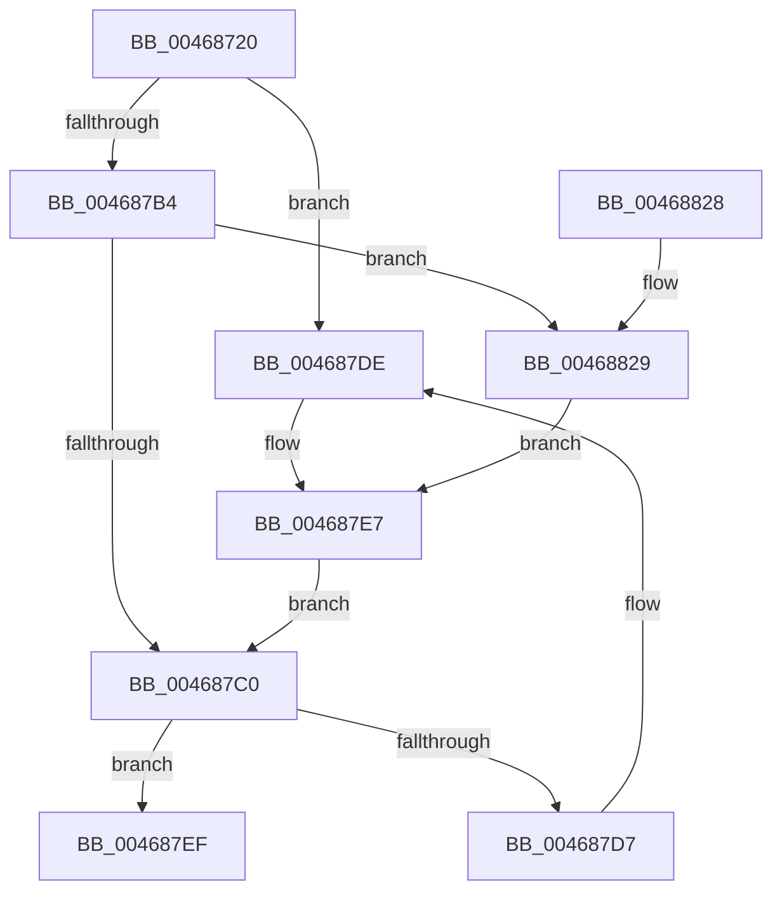

# ExInitializeNPagedLookasideListInternal

- RVA: `0x00468720`–`0x00468830` (길이 `272` bytes)
- VA: `0x0000000140468720`
- 실행 섹션: `.text`
- PDB 이름 있음: `예`; PDB Function 태그: `아니요`
- unwind 정보 RVA: `0x0006B020`
- 디코드: `67`개 명령, `272/272` bytes 표시
- 미해석 바이트: `0` (있으면 어셈블리에 `.byte`로 보존)

> 이 문서는 커널 이미지의 기계어와 PDB 기호를 분석해 생성했습니다. 4번과 5번은 함수 원형과 자료형을 바이너리 사용 방식에서 추정한 C 해석이며 원본 소스 복구 결과는 아닙니다.

## 1. Dependencies

- 직접 호출 지점: **3**; 고유 호출 대상: **3**
- 직접 호출자로 확인된 함수: **18**
- RIP 상대 이미지 참조: **7**

### Outgoing calls
- `0x00468745` → [InitializeSListHead](InitializeSListHead_function_00468A90.md) (function, `0x00468A90`)
- `0x004687A6` → [KeAcquireSpinLockRaiseToDpc](../20/KeAcquireSpinLockRaiseToDpc_function_00208470.md) (function, `0x00208470`)
- `0x00468808` → [KeReleaseSpinLock](../39/KeReleaseSpinLock_function_00392BA0.md) (function, `0x00392BA0`)

### Direct callers
- [ExInitializeNPagedLookasideList](ExInitializeNPagedLookasideList_function_004686E0.md) at `0x00468708`
- [VfObjectContextInit](../../pagevrfy/B9/VfObjectContextInit_function_00B94834.md) at `0x00B94870`
- [VfDeadlockInitialize](../../pagevrfy/BA/VfDeadlockInitialize_function_00BA7DDC.md) at `0x00BA7F30`
- [VfDeadlockInitialize](../../pagevrfy/BA/VfDeadlockInitialize_function_00BA7DDC.md) at `0x00BA7F86`
- [VfDeadlockInitialize](../../pagevrfy/BA/VfDeadlockInitialize_function_00BA7DDC.md) at `0x00BA7FD6`
- [ViDmaInit](../../pagevrfy/BA/ViDmaInit_function_00BAC018.md) at `0x00BAC0B4`
- [VfWdInit](../../pagevrfy/BA/VfWdInit_function_00BAC8E8.md) at `0x00BAC95C`
- [ViIovInitialization](../../pagevrfy/BB/ViIovInitialization_function_00BB4EC4.md) at `0x00BB4F83`
- [ViIovInitialization](../../pagevrfy/BB/ViIovInitialization_function_00BB4EC4.md) at `0x00BB4FCE`
- [ViIovInitialization](../../pagevrfy/BB/ViIovInitialization_function_00BB4EC4.md) at `0x00BB5018`
- [ViIovInitialization](../../pagevrfy/BB/ViIovInitialization_function_00BB4EC4.md) at `0x00BB5281`
- [CcInitializeCacheManager](../../init/BE/CcInitializeCacheManager_function_00BEE2E8.md) at `0x00BEE64E`
- [CcInitializeCacheManager](../../init/BE/CcInitializeCacheManager_function_00BEE2E8.md) at `0x00BEE683`
- [CcInitializeCacheManager](../../init/BE/CcInitializeCacheManager_function_00BEE2E8.md) at `0x00BEE6AD`
- [Phase1InitializationDiscard](../../init/C1/Phase1InitializationDiscard_function_00C1C728.md) at `0x00C1D760`
- [FsRtlInitializeLargeMcbs](../../init/C2/FsRtlInitializeLargeMcbs_function_00C29128.md) at `0x00C2918A`
- [FsRtlInitializeLargeMcbs](../../init/C2/FsRtlInitializeLargeMcbs_function_00C29128.md) at `0x00C291BE`
- [FsRtlInitializeFileLocks](../../init/C2/FsRtlInitializeFileLocks_function_00C292C0.md) at `0x00C292FF`
- [FsRtlInitializeFileLocks](../../init/C2/FsRtlInitializeFileLocks_function_00C292C0.md) at `0x00C2932E`
- [FsRtlInitializeFileLocks](../../init/C2/FsRtlInitializeFileLocks_function_00C292C0.md) at `0x00C2935D`
- [FsRtlInitializeFileLocks](../../init/C2/FsRtlInitializeFileLocks_function_00C292C0.md) at `0x00C29388`
- [FsRtlInitializeFileLocks](../../init/C2/FsRtlInitializeFileLocks_function_00C292C0.md) at `0x00C293BA`
- [FsRtlInitializeOplockPerf](../../init/C2/FsRtlInitializeOplockPerf_function_00C29458.md) at `0x00C29572`
- [IoInitSystemPreDrivers](../../init/C2/IoInitSystemPreDrivers_function_00C2AC3C.md) at `0x00C2AFC0`
- [IoInitSystemPreDrivers](../../init/C2/IoInitSystemPreDrivers_function_00C2AC3C.md) at `0x00C2B00A`
- [PopInitializeIrpWorkers](../../init/C4/PopInitializeIrpWorkers_function_00C40C64.md) at `0x00C40D86`
- [VfInitBootDriversLoaded](../../init/C4/VfInitBootDriversLoaded_function_00C4BD0C.md) at `0x00C4BDFD`
- [WmipInitializeRegistration](../../init/C4/WmipInitializeRegistration_function_00C4D32C.md) at `0x00C4D362`
- [MiInitNucleus](../../init/C5/MiInitNucleus_function_00C5FD38.md) at `0x00C60566`
- [ObInitSystem](../../init/C7/ObInitSystem_function_00C71C7C.md) at `0x00C72093`
- [PoInitSystem](../../init/C7/PoInitSystem_function_00C72358.md) at `0x00C724AE`

### Static image references
- `0x0046874A` → RVA `0x00E0EBA8` (`.data`; read)
- `0x00468751` → RVA `0x00EFABC0` (`.data`; read)
- `0x00468770` → RVA `0x0043F0D0` (`ExAllocatePoolEx`; read)
- `0x00468793` → RVA `0x00B82850` (`ExFreePool`; read)
- `0x004687C0` → RVA `0x00EFABF8` (`.data`; read)
- `0x004687C7` → RVA `0x00EFABF0` (`.data`; read)
- `0x00468801` → RVA `0x00EFABF8` (`.data`; write)

## 2. Other-region calls and transfers

- 다른 실행 섹션으로 향하는 call: **0**
- 별도 외부 분기/꼬리 이동을 확인하지 못했습니다.

## 3. Assembly (complete function range)

```asm
00468720  48 8B C4                        mov rax, rsp
00468723  48 89 58 08                     mov qword ptr [rax + 8], rbx
00468727  48 89 68 10                     mov qword ptr [rax + 0x10], rbp
0046872B  48 89 70 18                     mov qword ptr [rax + 0x18], rsi
0046872F  48 89 78 20                     mov qword ptr [rax + 0x20], rdi
00468733  41 56                           push r14
00468735  48 83 EC 20                     sub rsp, 0x20
00468739  41 8B D9                        mov ebx, r9d
0046873C  49 8B F0                        mov rsi, r8
0046873F  48 8B FA                        mov rdi, rdx
00468742  48 8B E9                        mov rbp, rcx
00468745  E8 46 03 00 00                  call 0x140468a90
0046874A  0F B7 05 57 64 9A 00            movzx eax, word ptr [rip + 0x9a6457]
00468751  48 8D 0D 68 24 A9 00            lea rcx, [rip + 0xa92468]
00468758  66 89 45 10                     mov word ptr [rbp + 0x10], ax
0046875C  45 33 F6                        xor r14d, r14d
0046875F  8B 44 24 58                     mov eax, dword ptr [rsp + 0x58]
00468763  48 85 FF                        test rdi, rdi
00468766  89 45 28                        mov dword ptr [rbp + 0x28], eax
00468769  8B 44 24 50                     mov eax, dword ptr [rsp + 0x50]
0046876D  89 45 2C                        mov dword ptr [rbp + 0x2c], eax
00468770  48 8D 05 59 69 FD FF            lea rax, [rip - 0x296a7]
00468777  48 0F 45 C7                     cmovne rax, rdi
0046877B  66 C7 45 12 00 01               mov word ptr [rbp + 0x12], 0x100
00468781  4C 89 75 14                     mov qword ptr [rbp + 0x14], r14
00468785  48 85 F6                        test rsi, rsi
00468788  4C 89 75 1C                     mov qword ptr [rbp + 0x1c], r14
0046878C  89 5D 24                        mov dword ptr [rbp + 0x24], ebx
0046878F  48 89 45 30                     mov qword ptr [rbp + 0x30], rax
00468793  48 8D 05 B6 A0 71 00            lea rax, [rip + 0x71a0b6]
0046879A  48 0F 45 C6                     cmovne rax, rsi
0046879E  48 89 45 38                     mov qword ptr [rbp + 0x38], rax
004687A2  4C 89 75 50                     mov qword ptr [rbp + 0x50], r14
004687A6  E8 C5 FC D9 FF                  call 0x140208470
004687AB  8A D0                           mov dl, al
004687AD  44 39 74 24 68                  cmp dword ptr [rsp + 0x68], r14d
004687B2  75 2A                           jne 0x1404687de
004687B4  0F B7 05 ED 63 9A 00            movzx eax, word ptr [rip + 0x9a63ed]
004687BB  66 85 C0                        test ax, ax
004687BE  74 69                           je 0x140468829
004687C0  48 8B 05 31 24 A9 00            mov rax, qword ptr [rip + 0xa92431]
004687C7  48 8D 0D 22 24 A9 00            lea rcx, [rip + 0xa92422]
004687CE  48 83 C5 40                     add rbp, 0x40
004687D2  48 39 08                        cmp qword ptr [rax], rcx
004687D5  74 18                           je 0x1404687ef
004687D7  B9 03 00 00 00                  mov ecx, 3
004687DC  CD 29                           int 0x29
004687DE  0F B7 4C 24 60                  movzx ecx, word ptr [rsp + 0x60]
004687E3  66 89 4D 10                     mov word ptr [rbp + 0x10], cx
004687E7  66 81 4D 12 FF FF               or word ptr [rbp + 0x12], 0xffff
004687ED  EB D1                           jmp 0x1404687c0
004687EF  48 89 4D 00                     mov qword ptr [rbp], rcx
004687F3  48 8D 0D C6 23 A9 00            lea rcx, [rip + 0xa923c6]
004687FA  48 89 45 08                     mov qword ptr [rbp + 8], rax
004687FE  48 89 28                        mov qword ptr [rax], rbp
00468801  48 89 2D F0 23 A9 00            mov qword ptr [rip + 0xa923f0], rbp
00468808  E8 93 A3 F2 FF                  call 0x140392ba0
0046880D  48 8B 5C 24 30                  mov rbx, qword ptr [rsp + 0x30]
00468812  48 8B 6C 24 38                  mov rbp, qword ptr [rsp + 0x38]
00468817  48 8B 74 24 40                  mov rsi, qword ptr [rsp + 0x40]
0046881C  48 8B 7C 24 48                  mov rdi, qword ptr [rsp + 0x48]
00468821  48 83 C4 20                     add rsp, 0x20
00468825  41 5E                           pop r14
00468827  C3                              ret
00468828  CC                              int3
00468829  66 44 89 75 10                  mov word ptr [rbp + 0x10], r14w
0046882E  EB B7                           jmp 0x1404687e7
```

## 4. C-style interpretation (structured pseudocode)

```c
__int64 __fastcall ExInitializeNPagedLookasideListInternal(__int64 a1, __int64 a2, __int64 a3, int a4, unsigned int a5, unsigned int a6, unsigned __int16 a7, unsigned int a8)
{
    __int64 result;
    __int64 v_r14;
    __int64 v_rbp;
    __int64 v_rsp;
    unsigned __int64 v_stack_p10;
    unsigned __int64 v_stack_p18;
    unsigned __int64 v_stack_p20;
    unsigned __int64 v_stack_p8;

    *(unsigned __int64 *)(v_rsp + 8) = v_rbx;
    *(unsigned __int64 *)(v_rsp + 16) = v_rbp;
    *(unsigned __int64 *)(v_rsp + 24) = v_rsi;
    *(unsigned __int64 *)(v_rsp + 32) = v_rdi;
    v_rsp = (v_rsp) - (32);
    result = InitializeSListHead(a1, a2, a3, a4);
    *(unsigned __int16 *)(a1 + 16) = (unsigned __int16)(*(unsigned __int16 *)(v_rip + 10118231));
    v_r14 = 0;
    *(unsigned int *)(a1 + 40) = (unsigned int)((unsigned int)(a6));
    *(unsigned int *)(a1 + 44) = (unsigned int)((unsigned int)(a5));
    result = v_rip - 169639;
    if (a2 != 0) { result = a2; }
    *(unsigned __int16 *)(a1 + 18) = 256;
    *(unsigned __int64 *)(a1 + 20) = 0;
    *(unsigned __int64 *)(a1 + 28) = 0;
    *(unsigned int *)(a1 + 36) = (unsigned int)((unsigned int)(a4));
    *(unsigned __int64 *)(a1 + 48) = result;
    result = v_rip + 7446710;
    if (a3 != 0) { result = a3; }
    *(unsigned __int64 *)(a1 + 56) = result;
    *(unsigned __int64 *)(a1 + 80) = 0;
    result = KeAcquireSpinLockRaiseToDpc(v_rip + 11084904, a2, a3, a4);
    if (a8 != 0) goto loc_004687DE;
    if ((unsigned __int16)(*(unsigned __int16 *)(v_rip + 10118125)) == 0) goto loc_00468829;
loc_004687C0:
    v_rbp = (a1) + (64);
    if ((*(unsigned __int64 *)(*(unsigned __int64 *)(v_rip + 11084849))) == (v_rip + 11084834)) goto loc_004687EF;
loc_004687DE:
    *(unsigned __int16 *)(v_rbp + 16) = a7;
loc_004687E7:
    goto loc_004687C0;
loc_004687EF:
    *(unsigned __int64 *)(v_rbp) = a7;
    *(unsigned __int64 *)(v_rbp + 8) = *(unsigned __int64 *)(v_rip + 11084849);
    *(unsigned __int64 *)(*(unsigned __int64 *)(v_rip + 11084849)) = v_rbp;
    *(unsigned __int64 *)(v_rip + 11084784) = v_rbp;
    result = KeReleaseSpinLock(v_rip + 11084742, (unsigned __int8)(result), a3, a4);
    v_rsp = (v_rsp) + (32);
    return result;
loc_00468829:
    *(unsigned __int16 *)(v_stack_p10 + 16) = 0;
    goto loc_004687E7;
}
```

## 5. (Beta) C Style

```c
int64_t ExInitializeNPagedLookasideListInternal(void *NPagedLookasideListInternal, int64_t Arg2, int64_t Arg3, int32_t Arg4, uint32_t Arg5, uint32_t Arg6, uint16_t Arg7, uint32_t Arg8)
{
    uint8_t *nPagedLookasideListInternal = (uint8_t *)NPagedLookasideListInternal;

    int64_t result;
    int64_t local_r14;
    int64_t local_rbp;
    int64_t local_rsp;
    uint64_t v_stack_p10;
    uint64_t v_stack_p18;
    uint64_t v_stack_p20;
    uint64_t v_stack_p8;

    *(uint64_t *)(local_rsp + 0x8) = local_rbx;
    *(uint64_t *)(local_rsp + 0x10) = local_rbp;
    *(uint64_t *)(local_rsp + 0x18) = local_rsi;
    *(uint64_t *)(local_rsp + 0x20) = local_rdi;
    local_rsp = (local_rsp) - (32);
    result = InitializeSListHead(NPagedLookasideListInternal, Arg2, Arg3, Arg4);
    *(uint16_t *)(nPagedLookasideListInternal + 0x10) = (uint16_t)(*(uint16_t *)(v_rip + 0x9A6457));
    local_r14 = 0;
    *(uint32_t *)(nPagedLookasideListInternal + 0x28) = (uint32_t)((uint32_t)(Arg6));
    *(uint32_t *)(nPagedLookasideListInternal + 0x2C) = (uint32_t)((uint32_t)(Arg5));
    result = v_rip - 169639;
    if (Arg2 != 0) { result = Arg2; }
    *(uint16_t *)(nPagedLookasideListInternal + 0x12) = 256;
    *(uint64_t *)(nPagedLookasideListInternal + 0x14) = 0;
    *(uint64_t *)(nPagedLookasideListInternal + 0x1C) = 0;
    *(uint32_t *)(nPagedLookasideListInternal + 0x24) = (uint32_t)((uint32_t)(Arg4));
    *(uint64_t *)(nPagedLookasideListInternal + 0x30) = result;
    result = v_rip + 7446710;
    if (Arg3 != 0) { result = Arg3; }
    *(uint64_t *)(nPagedLookasideListInternal + 0x38) = result;
    *(uint64_t *)(nPagedLookasideListInternal + 0x50) = 0;
    result = KeAcquireSpinLockRaiseToDpc(v_rip + 11084904, Arg2, Arg3, Arg4);
    if (Arg8 != 0) goto loc_004687DE;
    if ((uint16_t)(*(uint16_t *)(v_rip + 0x9A63ED)) == 0) goto loc_00468829;
loc_004687C0:
    local_rbp = (NPagedLookasideListInternal) + (64);
    if ((*(uint64_t *)(*(uint64_t *)(v_rip + 0xA92431))) == (v_rip + 11084834)) goto loc_004687EF;
loc_004687DE:
    *(uint16_t *)(local_rbp + 0x10) = Arg7;
loc_004687E7:
    goto loc_004687C0;
loc_004687EF:
    *(uint64_t *)(local_rbp) = Arg7;
    *(uint64_t *)(local_rbp + 0x8) = *(uint64_t *)(v_rip + 0xA92431);
    *(uint64_t *)(*(uint64_t *)(v_rip + 0xA92431)) = local_rbp;
    *(uint64_t *)(v_rip + 0xA923F0) = local_rbp;
    result = KeReleaseSpinLock(v_rip + 11084742, (uint8_t)(result), Arg3, Arg4);
    local_rsp = (local_rsp) + (32);
    return result;
loc_00468829:
    *(uint16_t *)(v_stack_p10 + 0x10) = 0;
    goto loc_004687E7;
}
```

### 관측된 메모리 오프셋

구조체 형식이 확인되지 않은 접근은 인자 기준의 오프셋으로만 기록했습니다.

| 기준 인자 | 오프셋 표현 | 폭 (bit) | 접근 |
|---|---:|---:|---|
| `NPagedLookasideListInternal` | `+ 0x0` | `64` | `W` |
| `NPagedLookasideListInternal` | `+ 0x8` | `64` | `W` |
| `NPagedLookasideListInternal` | `+ 0x10` | `16` | `W` |
| `NPagedLookasideListInternal` | `+ 0x12` | `16` | `R/W` |
| `NPagedLookasideListInternal` | `+ 0x12` | `16` | `W` |
| `NPagedLookasideListInternal` | `+ 0x14` | `64` | `W` |
| `NPagedLookasideListInternal` | `+ 0x1C` | `64` | `W` |
| `NPagedLookasideListInternal` | `+ 0x24` | `32` | `W` |
| `NPagedLookasideListInternal` | `+ 0x28` | `32` | `W` |
| `NPagedLookasideListInternal` | `+ 0x2C` | `32` | `W` |
| `NPagedLookasideListInternal` | `+ 0x30` | `64` | `W` |
| `NPagedLookasideListInternal` | `+ 0x38` | `64` | `W` |
| `NPagedLookasideListInternal` | `+ 0x50` | `64` | `W` |

## 6. Execution-region graph

[열기: 2D/3D 그래프와 함수 탐색 컨트롤 패널](../../../control-panel.html?section=text&rva=0x00468720&view=graph)

- 2D 그래프는 위에서 아래로 흐르고, 3D 그래프는 빈 공간을 드래그해 회전합니다. Shift+드래그는 이동, 휠은 확대·축소, 함수 노드 선택은 대상 보고서 이동입니다.

### Static fallback


