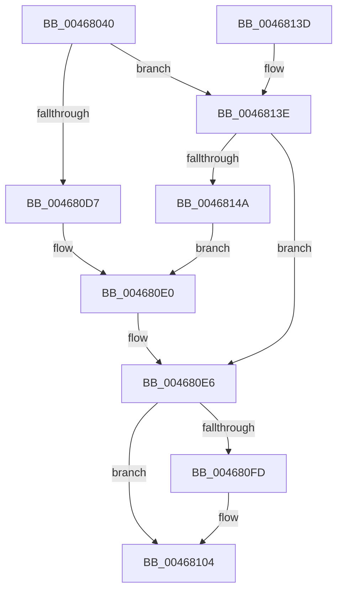

# ExInitializePagedLookasideListInternal

- RVA: `0x00468040`–`0x00468151` (길이 `273` bytes)
- VA: `0x0000000140468040`
- 실행 섹션: `.text`
- PDB 이름 있음: `예`; PDB Function 태그: `아니요`
- unwind 정보 RVA: `0x0005C70C`
- 디코드: `67`개 명령, `273/273` bytes 표시
- 미해석 바이트: `0` (있으면 어셈블리에 `.byte`로 보존)

> 이 문서는 커널 이미지의 기계어와 PDB 기호를 분석해 생성했습니다. 4번과 5번은 함수 원형과 자료형을 바이너리 사용 방식에서 추정한 C 해석이며 원본 소스 복구 결과는 아닙니다.

## 1. Dependencies

- 직접 호출 지점: **3**; 고유 호출 대상: **3**
- 직접 호출자로 확인된 함수: **3**
- RIP 상대 이미지 참조: **7**

### Outgoing calls
- `0x00468065` → [InitializeSListHead](InitializeSListHead_function_00468A90.md) (function, `0x00468A90`)
- `0x004680C9` → [KeAcquireSpinLockRaiseToDpc](../20/KeAcquireSpinLockRaiseToDpc_function_00208470.md) (function, `0x00208470`)
- `0x0046811D` → [KeReleaseSpinLock](../39/KeReleaseSpinLock_function_00392BA0.md) (function, `0x00392BA0`)

### Direct callers
- [FsRtlInitExtraCreateParameterLookasideList](../../page/71/FsRtlInitExtraCreateParameterLookasideList_function_00713910.md) at `0x0071395B`
- [AlpcpInitSystem](../../page/74/AlpcpInitSystem_function_0074CB9C.md) at `0x0074CD36`
- [AlpcpInitSystem](../../page/74/AlpcpInitSystem_function_0074CB9C.md) at `0x0074CD6E`
- [AlpcpInitSystem](../../page/74/AlpcpInitSystem_function_0074CB9C.md) at `0x0074CD9D`
- [ExInitializePagedLookasideList](../../page/AA/ExInitializePagedLookasideList_function_00AACC30.md) at `0x00AACC58`

### Static image references
- `0x0046806A` → RVA `0x00E0EBA8` (`.data`; read)
- `0x00468071` → RVA `0x00EFABE0` (`.data`; read)
- `0x00468093` → RVA `0x0043F0D0` (`ExAllocatePoolEx`; read)
- `0x004680B6` → RVA `0x00B82850` (`ExFreePool`; read)
- `0x004680E6` → RVA `0x00EFABB8` (`.data`; read)
- `0x004680ED` → RVA `0x00EFABB0` (`.data`; read)
- `0x00468116` → RVA `0x00EFABB8` (`.data`; write)

## 2. Other-region calls and transfers

- 다른 실행 섹션으로 향하는 call: **0**
- 별도 외부 분기/꼬리 이동을 확인하지 못했습니다.

## 3. Assembly (complete function range)

```asm
00468040  48 8B C4                        mov rax, rsp
00468043  48 89 58 08                     mov qword ptr [rax + 8], rbx
00468047  48 89 68 10                     mov qword ptr [rax + 0x10], rbp
0046804B  48 89 70 18                     mov qword ptr [rax + 0x18], rsi
0046804F  48 89 78 20                     mov qword ptr [rax + 0x20], rdi
00468053  41 56                           push r14
00468055  48 83 EC 20                     sub rsp, 0x20
00468059  41 8B D9                        mov ebx, r9d
0046805C  49 8B F0                        mov rsi, r8
0046805F  48 8B FA                        mov rdi, rdx
00468062  48 8B E9                        mov rbp, rcx
00468065  E8 26 0A 00 00                  call 0x140468a90
0046806A  0F B7 05 37 6B 9A 00            movzx eax, word ptr [rip + 0x9a6b37]
00468071  48 8D 0D 68 2B A9 00            lea rcx, [rip + 0xa92b68]
00468078  66 89 45 10                     mov word ptr [rbp + 0x10], ax
0046807C  45 33 F6                        xor r14d, r14d
0046807F  8B 44 24 58                     mov eax, dword ptr [rsp + 0x58]
00468083  83 CB 01                        or ebx, 1
00468086  89 45 28                        mov dword ptr [rbp + 0x28], eax
00468089  48 85 FF                        test rdi, rdi
0046808C  8B 44 24 50                     mov eax, dword ptr [rsp + 0x50]
00468090  89 45 2C                        mov dword ptr [rbp + 0x2c], eax
00468093  48 8D 05 36 70 FD FF            lea rax, [rip - 0x28fca]
0046809A  48 0F 45 C7                     cmovne rax, rdi
0046809E  66 C7 45 12 00 01               mov word ptr [rbp + 0x12], 0x100
004680A4  4C 89 75 14                     mov qword ptr [rbp + 0x14], r14
004680A8  48 85 F6                        test rsi, rsi
004680AB  4C 89 75 1C                     mov qword ptr [rbp + 0x1c], r14
004680AF  89 5D 24                        mov dword ptr [rbp + 0x24], ebx
004680B2  48 89 45 30                     mov qword ptr [rbp + 0x30], rax
004680B6  48 8D 05 93 A7 71 00            lea rax, [rip + 0x71a793]
004680BD  48 0F 45 C6                     cmovne rax, rsi
004680C1  48 89 45 38                     mov qword ptr [rbp + 0x38], rax
004680C5  4C 89 75 50                     mov qword ptr [rbp + 0x50], r14
004680C9  E8 A2 03 DA FF                  call 0x140208470
004680CE  8A D0                           mov dl, al
004680D0  44 39 74 24 68                  cmp dword ptr [rsp + 0x68], r14d
004680D5  74 67                           je 0x14046813e
004680D7  0F B7 4C 24 60                  movzx ecx, word ptr [rsp + 0x60]
004680DC  66 89 4D 10                     mov word ptr [rbp + 0x10], cx
004680E0  66 81 4D 12 FF FF               or word ptr [rbp + 0x12], 0xffff
004680E6  48 8B 05 CB 2A A9 00            mov rax, qword ptr [rip + 0xa92acb]
004680ED  48 8D 0D BC 2A A9 00            lea rcx, [rip + 0xa92abc]
004680F4  48 83 C5 40                     add rbp, 0x40
004680F8  48 39 08                        cmp qword ptr [rax], rcx
004680FB  74 07                           je 0x140468104
004680FD  B9 03 00 00 00                  mov ecx, 3
00468102  CD 29                           int 0x29
00468104  48 89 4D 00                     mov qword ptr [rbp], rcx
00468108  48 8D 0D D1 2A A9 00            lea rcx, [rip + 0xa92ad1]
0046810F  48 89 45 08                     mov qword ptr [rbp + 8], rax
00468113  48 89 28                        mov qword ptr [rax], rbp
00468116  48 89 2D 9B 2A A9 00            mov qword ptr [rip + 0xa92a9b], rbp
0046811D  E8 7E AA F2 FF                  call 0x140392ba0
00468122  48 8B 5C 24 30                  mov rbx, qword ptr [rsp + 0x30]
00468127  48 8B 6C 24 38                  mov rbp, qword ptr [rsp + 0x38]
0046812C  48 8B 74 24 40                  mov rsi, qword ptr [rsp + 0x40]
00468131  48 8B 7C 24 48                  mov rdi, qword ptr [rsp + 0x48]
00468136  48 83 C4 20                     add rsp, 0x20
0046813A  41 5E                           pop r14
0046813C  C3                              ret
0046813D  CC                              int3
0046813E  0F B7 05 63 6A 9A 00            movzx eax, word ptr [rip + 0x9a6a63]
00468145  66 85 C0                        test ax, ax
00468148  75 9C                           jne 0x1404680e6
0046814A  66 44 89 75 10                  mov word ptr [rbp + 0x10], r14w
0046814F  EB 8F                           jmp 0x1404680e0
```

## 4. C-style interpretation (structured pseudocode)

```c
__int64 __fastcall ExInitializePagedLookasideListInternal(__int64 a1, __int64 a2, __int64 a3, int a4, unsigned int a5, unsigned int a6, unsigned __int16 a7, unsigned int a8)
{
    __int64 result;
    __int64 v_r14;
    __int64 v_rbp;
    __int64 v_rbx;
    __int64 v_rsp;
    unsigned __int64 v_stack_p10;
    unsigned __int64 v_stack_p18;
    unsigned __int64 v_stack_p20;
    unsigned __int64 v_stack_p8;

    *(unsigned __int64 *)(v_rsp + 8) = v_rbx;
    *(unsigned __int64 *)(v_rsp + 16) = v_rbp;
    *(unsigned __int64 *)(v_rsp + 24) = v_rsi;
    *(unsigned __int64 *)(v_rsp + 32) = v_rdi;
    v_rsp = (v_rsp) - (32);
    result = InitializeSListHead(a1, a2, a3, a4);
    *(unsigned __int16 *)(a1 + 16) = (unsigned __int16)(*(unsigned __int16 *)(v_rip + 10119991));
    v_r14 = 0;
    v_rbx = (unsigned int)(((unsigned int)(a4)) | (1));
    *(unsigned int *)(a1 + 40) = (unsigned int)((unsigned int)(a6));
    *(unsigned int *)(a1 + 44) = (unsigned int)((unsigned int)(a5));
    result = v_rip - 167882;
    if (a2 != 0) { result = a2; }
    *(unsigned __int16 *)(a1 + 18) = 256;
    *(unsigned __int64 *)(a1 + 20) = 0;
    *(unsigned __int64 *)(a1 + 28) = 0;
    *(unsigned int *)(a1 + 36) = (unsigned int)(v_rbx);
    *(unsigned __int64 *)(a1 + 48) = result;
    result = v_rip + 7448467;
    if (a3 != 0) { result = a3; }
    *(unsigned __int64 *)(a1 + 56) = result;
    *(unsigned __int64 *)(a1 + 80) = 0;
    result = KeAcquireSpinLockRaiseToDpc(v_rip + 11086696, a2, a3, a4);
    if (a8 == 0) goto loc_0046813E;
    *(unsigned __int16 *)(a1 + 16) = a7;
loc_004680E0:
loc_004680E6:
    v_rbp = (a1) + (64);
    if ((*(unsigned __int64 *)(*(unsigned __int64 *)(v_rip + 11086539))) != (v_rip + 11086524)) {
        a1 = 3;
    }
    *(unsigned __int64 *)(v_rbp) = a1;
    *(unsigned __int64 *)(v_rbp + 8) = *(unsigned __int64 *)(v_rip + 11086539);
    *(unsigned __int64 *)(*(unsigned __int64 *)(v_rip + 11086539)) = v_rbp;
    *(unsigned __int64 *)(v_rip + 11086491) = v_rbp;
    result = KeReleaseSpinLock(v_rip + 11086545, (unsigned __int8)(result), a3, a4);
    v_rsp = (v_rsp) + (32);
    return result;
loc_0046813E:
    if ((unsigned __int16)(*(unsigned __int16 *)(v_rip + 10119779)) != 0) goto loc_004680E6;
    *(unsigned __int16 *)(v_stack_p10 + 16) = 0;
    goto loc_004680E0;
}
```

## 5. (Beta) C Style

```c
int64_t ExInitializePagedLookasideListInternal(void *PagedLookasideListInternal, int64_t Arg2, int64_t Arg3, int32_t Arg4, uint32_t Arg5, uint32_t Arg6, uint16_t Arg7, uint32_t Arg8)
{
    uint8_t *pagedLookasideListInternal = (uint8_t *)PagedLookasideListInternal;

    int64_t result;
    int64_t local_r14;
    int64_t local_rbp;
    int64_t local_rbx;
    int64_t local_rsp;
    uint64_t v_stack_p10;
    uint64_t v_stack_p18;
    uint64_t v_stack_p20;
    uint64_t v_stack_p8;

    *(uint64_t *)(local_rsp + 0x8) = local_rbx;
    *(uint64_t *)(local_rsp + 0x10) = local_rbp;
    *(uint64_t *)(local_rsp + 0x18) = local_rsi;
    *(uint64_t *)(local_rsp + 0x20) = local_rdi;
    local_rsp = (local_rsp) - (32);
    result = InitializeSListHead(PagedLookasideListInternal, Arg2, Arg3, Arg4);
    *(uint16_t *)(pagedLookasideListInternal + 0x10) = (uint16_t)(*(uint16_t *)(v_rip + 0x9A6B37));
    local_r14 = 0;
    local_rbx = (uint32_t)(((uint32_t)(Arg4)) | (1));
    *(uint32_t *)(pagedLookasideListInternal + 0x28) = (uint32_t)((uint32_t)(Arg6));
    *(uint32_t *)(pagedLookasideListInternal + 0x2C) = (uint32_t)((uint32_t)(Arg5));
    result = v_rip - 167882;
    if (Arg2 != 0) { result = Arg2; }
    *(uint16_t *)(pagedLookasideListInternal + 0x12) = 256;
    *(uint64_t *)(pagedLookasideListInternal + 0x14) = 0;
    *(uint64_t *)(pagedLookasideListInternal + 0x1C) = 0;
    *(uint32_t *)(pagedLookasideListInternal + 0x24) = (uint32_t)(local_rbx);
    *(uint64_t *)(pagedLookasideListInternal + 0x30) = result;
    result = v_rip + 7448467;
    if (Arg3 != 0) { result = Arg3; }
    *(uint64_t *)(pagedLookasideListInternal + 0x38) = result;
    *(uint64_t *)(pagedLookasideListInternal + 0x50) = 0;
    result = KeAcquireSpinLockRaiseToDpc(v_rip + 11086696, Arg2, Arg3, Arg4);
    if (Arg8 == 0) goto loc_0046813E;
    *(uint16_t *)(pagedLookasideListInternal + 0x10) = Arg7;
loc_004680E0:
loc_004680E6:
    local_rbp = (PagedLookasideListInternal) + (64);
    if ((*(uint64_t *)(*(uint64_t *)(v_rip + 0xA92ACB))) != (v_rip + 11086524)) {
        PagedLookasideListInternal = 3;
    }
    *(void **)(local_rbp) = PagedLookasideListInternal;
    *(uint64_t *)(local_rbp + 0x8) = *(uint64_t *)(v_rip + 0xA92ACB);
    *(uint64_t *)(*(uint64_t *)(v_rip + 0xA92ACB)) = local_rbp;
    *(uint64_t *)(v_rip + 0xA92A9B) = local_rbp;
    result = KeReleaseSpinLock(v_rip + 11086545, (uint8_t)(result), Arg3, Arg4);
    local_rsp = (local_rsp) + (32);
    return result;
loc_0046813E:
    if ((uint16_t)(*(uint16_t *)(v_rip + 0x9A6A63)) != 0) goto loc_004680E6;
    *(uint16_t *)(v_stack_p10 + 0x10) = 0;
    goto loc_004680E0;
}
```

### 관측된 메모리 오프셋

구조체 형식이 확인되지 않은 접근은 인자 기준의 오프셋으로만 기록했습니다.

| 기준 인자 | 오프셋 표현 | 폭 (bit) | 접근 |
|---|---:|---:|---|
| `PagedLookasideListInternal` | `+ 0x0` | `64` | `W` |
| `PagedLookasideListInternal` | `+ 0x8` | `64` | `W` |
| `PagedLookasideListInternal` | `+ 0x10` | `16` | `W` |
| `PagedLookasideListInternal` | `+ 0x12` | `16` | `R/W` |
| `PagedLookasideListInternal` | `+ 0x12` | `16` | `W` |
| `PagedLookasideListInternal` | `+ 0x14` | `64` | `W` |
| `PagedLookasideListInternal` | `+ 0x1C` | `64` | `W` |
| `PagedLookasideListInternal` | `+ 0x24` | `32` | `W` |
| `PagedLookasideListInternal` | `+ 0x28` | `32` | `W` |
| `PagedLookasideListInternal` | `+ 0x2C` | `32` | `W` |
| `PagedLookasideListInternal` | `+ 0x30` | `64` | `W` |
| `PagedLookasideListInternal` | `+ 0x38` | `64` | `W` |
| `PagedLookasideListInternal` | `+ 0x50` | `64` | `W` |

## 6. Execution-region graph

[열기: 2D/3D 그래프와 함수 탐색 컨트롤 패널](../../../control-panel.html?section=text&rva=0x00468040&view=graph)

- 2D 그래프는 위에서 아래로 흐르고, 3D 그래프는 빈 공간을 드래그해 회전합니다. Shift+드래그는 이동, 휠은 확대·축소, 함수 노드 선택은 대상 보고서 이동입니다.

### Static fallback


