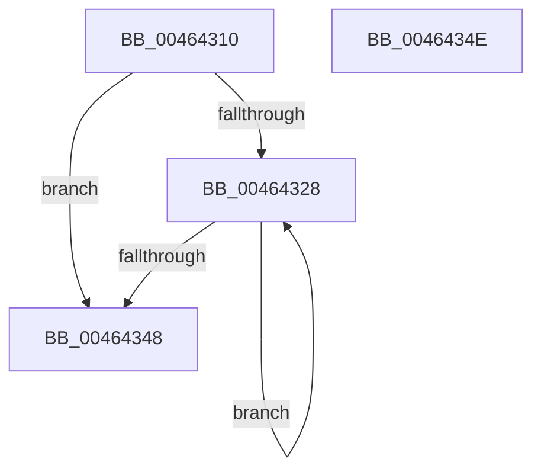

# ExReInitializeRundownProtectionCacheAware

- RVA: `0x00464310`–`0x0046434F` (길이 `63` bytes)
- VA: `0x0000000140464310`
- 실행 섹션: `.text`
- PDB 이름 있음: `예`; PDB Function 태그: `아니요`
- unwind 정보 RVA: `0x0005CF00`
- 디코드: `24`개 명령, `63/63` bytes 표시
- 미해석 바이트: `0` (있으면 어셈블리에 `.byte`로 보존)

> 이 문서는 커널 이미지의 기계어와 PDB 기호를 분석해 생성했습니다. 4번과 5번은 함수 원형과 자료형을 바이너리 사용 방식에서 추정한 C 해석이며 원본 소스 복구 결과는 아닙니다.

## 1. Dependencies

- 직접 호출 지점: **1**; 고유 호출 대상: **1**
- 직접 호출자로 확인된 함수: **2**
- RIP 상대 이미지 참조: **0**

### Outgoing calls
- `0x00464319` → [ExRundownCompletedCacheAware](ExRundownCompletedCacheAware_function_00464360.md) (function, `0x00464360`)

### Direct callers
- [PfpPartitionInsertToGlobals](../5C/PfpPartitionInsertToGlobals_function_005CE040.md) at `0x005CE0BC`
- [EtwpFreeLoggerContext](../../page/9C/EtwpFreeLoggerContext_function_009C1688.md) at `0x009C190C`

### Static image references
- 디코드된 RIP-relative 메모리 참조가 없습니다.

## 2. Other-region calls and transfers

- 다른 실행 섹션으로 향하는 call: **0**
- 별도 외부 분기/꼬리 이동을 확인하지 못했습니다.

## 3. Assembly (complete function range)

```asm
00464310  40 53                           push rbx
00464312  48 83 EC 20                     sub rsp, 0x20
00464316  48 8B D9                        mov rbx, rcx
00464319  E8 42 00 00 00                  call 0x140464360
0046431E  8B 4B 14                        mov ecx, dword ptr [rbx + 0x14]
00464321  45 33 C0                        xor r8d, r8d
00464324  85 C9                           test ecx, ecx
00464326  74 20                           je 0x140464348
00464328  33 D2                           xor edx, edx
0046432A  41 8B C0                        mov eax, r8d
0046432D  F7 F1                           div ecx
0046432F  33 C0                           xor eax, eax
00464331  41 FF C0                        inc r8d
00464334  0F AF 53 10                     imul edx, dword ptr [rbx + 0x10]
00464338  8B CA                           mov ecx, edx
0046433A  48 03 0B                        add rcx, qword ptr [rbx]
0046433D  48 87 01                        xchg qword ptr [rcx], rax
00464340  8B 4B 14                        mov ecx, dword ptr [rbx + 0x14]
00464343  44 3B C1                        cmp r8d, ecx
00464346  72 E0                           jb 0x140464328
00464348  48 83 C4 20                     add rsp, 0x20
0046434C  5B                              pop rbx
0046434D  C3                              ret
0046434E  CC                              int3
```

## 4. C-style interpretation (structured pseudocode)

```c
__int64 __fastcall ExReInitializeRundownProtectionCacheAware(__int64 a1, int a2, int a3)
{
    __int64 result;
    __int64 v_rsp;

    v_rsp = (v_rsp) - (32);
    result = ExRundownCompletedCacheAware(a1, a2, a3, a4);
    a3 = 0;
    if ((unsigned int)((unsigned int)(*(unsigned int *)(a1 + 20))) == 0) goto loc_00464348;
loc_00464328:
    a2 = 0;
    result = 0;
    a3 = (unsigned int)((a3) + 1);
    a2 = (unsigned int)((a2) * (*(unsigned int *)(a1 + 16)));
    a1 = ((unsigned int)(a2)) + (*(unsigned __int64 *)(a1));
    if (a3 < ((unsigned int)((unsigned int)(*(unsigned int *)(a1 + 20))))) goto loc_00464328;
loc_00464348:
    v_rsp = (v_rsp) + (32);
    return result;
}
```

## 5. (Beta) C Style

```c
int64_t ExReInitializeRundownProtectionCacheAware(void *Arg1, int32_t Arg2, int32_t Arg3)
{
    uint8_t *arg1 = (uint8_t *)Arg1;

    int64_t result;
    int64_t local_rsp;

    local_rsp = (local_rsp) - (32);
    result = ExRundownCompletedCacheAware(Arg1, Arg2, Arg3, a4);
    Arg3 = 0;
    if ((uint32_t)((uint32_t)(*(uint32_t *)(arg1 + 0x14))) == 0) goto loc_00464348;
loc_00464328:
    Arg2 = 0;
    result = 0;
    Arg3 = (uint32_t)((Arg3) + 1);
    Arg2 = (uint32_t)((Arg2) * (*(uint32_t *)(arg1 + 0x10)));
    Arg1 = ((uint32_t)(Arg2)) + (*(uint64_t *)(arg1));
    if (Arg3 < ((uint32_t)((uint32_t)(*(uint32_t *)(arg1 + 0x14))))) goto loc_00464328;
loc_00464348:
    local_rsp = (local_rsp) + (32);
    return result;
}
```

### 관측된 메모리 오프셋

구조체 형식이 확인되지 않은 접근은 인자 기준의 오프셋으로만 기록했습니다.

| 기준 인자 | 오프셋 표현 | 폭 (bit) | 접근 |
|---|---:|---:|---|
| `Arg1` | `+ 0x0` | `64` | `R` |
| `Arg1` | `+ 0x10` | `32` | `R` |
| `Arg1` | `+ 0x14` | `32` | `R` |

## 6. Execution-region graph

[열기: 2D/3D 그래프와 함수 탐색 컨트롤 패널](../../../control-panel.html?section=text&rva=0x00464310&view=graph)

- 2D 그래프는 위에서 아래로 흐르고, 3D 그래프는 빈 공간을 드래그해 회전합니다. Shift+드래그는 이동, 휠은 확대·축소, 함수 노드 선택은 대상 보고서 이동입니다.

### Static fallback


