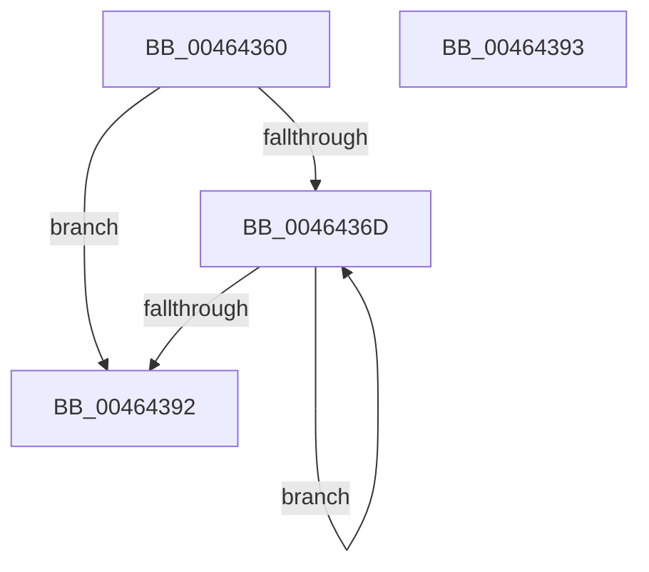

# ExRundownCompletedCacheAware

- RVA: `0x00464360`–`0x00464394` (길이 `52` bytes)
- VA: `0x0000000140464360`
- 실행 섹션: `.text`
- PDB 이름 있음: `예`; PDB Function 태그: `아니요`
- unwind 정보 RVA: `0x000DB714`
- 디코드: `19`개 명령, `52/52` bytes 표시
- 미해석 바이트: `0` (있으면 어셈블리에 `.byte`로 보존)

> 이 문서는 커널 이미지의 기계어와 PDB 기호를 분석해 생성했습니다. 4번과 5번은 함수 원형과 자료형을 바이너리 사용 방식에서 추정한 C 해석이며 원본 소스 복구 결과는 아닙니다.

## 1. Dependencies

- 직접 호출 지점: **0**; 고유 호출 대상: **0**
- 직접 호출자로 확인된 함수: **2**
- RIP 상대 이미지 참조: **0**

### Outgoing calls
- 직접 디코드된 call 명령이 없습니다.

### Direct callers
- [ExReInitializeRundownProtectionCacheAware](ExReInitializeRundownProtectionCacheAware_function_00464310.md) at `0x00464319`
- [MiDrainCrossPartitionUsage](../69/MiDrainCrossPartitionUsage_function_00690984.md) at `0x00690B2C`

### Static image references
- 디코드된 RIP-relative 메모리 참조가 없습니다.

## 2. Other-region calls and transfers

- 다른 실행 섹션으로 향하는 call: **0**
- 별도 외부 분기/꼬리 이동을 확인하지 못했습니다.

## 3. Assembly (complete function range)

```asm
00464360  4C 8B C9                        mov r9, rcx
00464363  45 33 C0                        xor r8d, r8d
00464366  8B 49 14                        mov ecx, dword ptr [rcx + 0x14]
00464369  85 C9                           test ecx, ecx
0046436B  74 25                           je 0x140464392
0046436D  33 D2                           xor edx, edx
0046436F  41 8B C0                        mov eax, r8d
00464372  F7 F1                           div ecx
00464374  B8 01 00 00 00                  mov eax, 1
00464379  41 FF C0                        inc r8d
0046437C  41 0F AF 51 10                  imul edx, dword ptr [r9 + 0x10]
00464381  8B CA                           mov ecx, edx
00464383  49 03 09                        add rcx, qword ptr [r9]
00464386  48 87 01                        xchg qword ptr [rcx], rax
00464389  41 8B 49 14                     mov ecx, dword ptr [r9 + 0x14]
0046438D  44 3B C1                        cmp r8d, ecx
00464390  72 DB                           jb 0x14046436d
00464392  C3                              ret
00464393  CC                              int3
```

## 4. C-style interpretation (structured pseudocode)

```c
__int64 __fastcall ExRundownCompletedCacheAware(__int64 a1, int a2, int a3)
{
    a3 = 0;
    if ((unsigned int)((unsigned int)(*(unsigned int *)(a1 + 20))) == 0) goto loc_00464392;
loc_0046436D:
    a2 = 0;
    a3 = (unsigned int)((a3) + 1);
    a2 = (unsigned int)((a2) * (*(unsigned int *)(a1 + 16)));
    a1 = ((unsigned int)(a2)) + (*(unsigned __int64 *)(a1));
    if (a3 < ((unsigned int)((unsigned int)(*(unsigned int *)(a1 + 20))))) goto loc_0046436D;
loc_00464392:
    return 1;
}
```

## 5. (Beta) C Style

```c
int64_t ExRundownCompletedCacheAware(void *Arg1, int32_t Arg2, int32_t Arg3)
{
    uint8_t *arg1 = (uint8_t *)Arg1;

    Arg3 = 0;
    if ((uint32_t)((uint32_t)(*(uint32_t *)(arg1 + 0x14))) == 0) goto loc_00464392;
loc_0046436D:
    Arg2 = 0;
    Arg3 = (uint32_t)((Arg3) + 1);
    Arg2 = (uint32_t)((Arg2) * (*(uint32_t *)(arg1 + 0x10)));
    Arg1 = ((uint32_t)(Arg2)) + (*(uint64_t *)(arg1));
    if (Arg3 < ((uint32_t)((uint32_t)(*(uint32_t *)(arg1 + 0x14))))) goto loc_0046436D;
loc_00464392:
    return 1;
}
```

### 관측된 메모리 오프셋

구조체 형식이 확인되지 않은 접근은 인자 기준의 오프셋으로만 기록했습니다.

| 기준 인자 | 오프셋 표현 | 폭 (bit) | 접근 |
|---|---:|---:|---|
| `Arg1` | `+ 0x0` | `64` | `R` |
| `Arg1` | `+ 0x10` | `32` | `R` |
| `Arg1` | `+ 0x14` | `32` | `R` |

## 6. Execution-region graph

[열기: 2D/3D 그래프와 함수 탐색 컨트롤 패널](../../../control-panel.html?section=text&rva=0x00464360&view=graph)

- 2D 그래프는 위에서 아래로 흐르고, 3D 그래프는 빈 공간을 드래그해 회전합니다. Shift+드래그는 이동, 휠은 확대·축소, 함수 노드 선택은 대상 보고서 이동입니다.

### Static fallback


