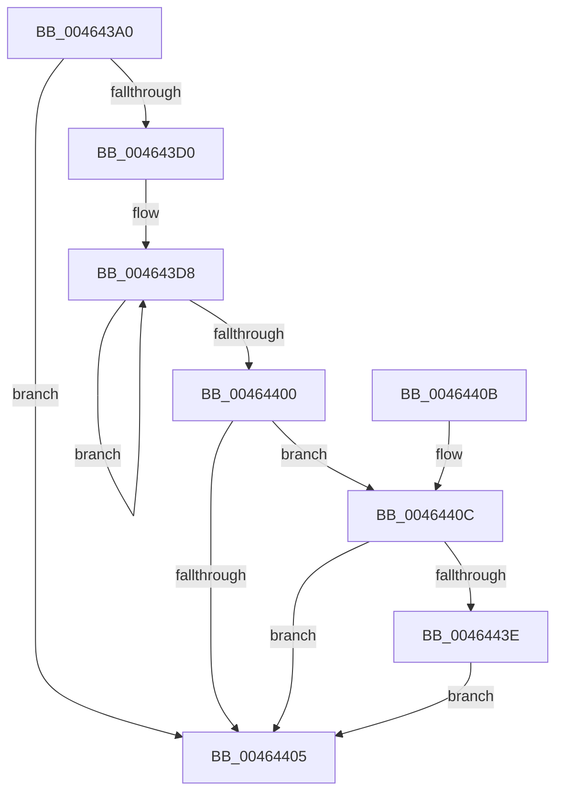

# ExWaitForRundownProtectionReleaseCacheAware

- RVA: `0x004643A0`–`0x00464457` (길이 `183` bytes)
- VA: `0x00000001404643A0`
- 실행 섹션: `.text`
- PDB 이름 있음: `예`; PDB Function 태그: `아니요`
- unwind 정보 RVA: `0x000AA874`
- 디코드: `55`개 명령, `183/183` bytes 표시
- 미해석 바이트: `0` (있으면 어셈블리에 `.byte`로 보존)

> 이 문서는 커널 이미지의 기계어와 PDB 기호를 분석해 생성했습니다. 4번과 5번은 함수 원형과 자료형을 바이너리 사용 방식에서 추정한 C 해석이며 원본 소스 복구 결과는 아닙니다.

## 1. Dependencies

- 직접 호출 지점: **1**; 고유 호출 대상: **1**
- 직접 호출자로 확인된 함수: **6**
- RIP 상대 이미지 참조: **0**

### Outgoing calls
- `0x00464450` → [KeWaitForSingleObject](../20/KeWaitForSingleObject_function_0020E6B0.md) (function, `0x0020E6B0`)

### Direct callers
- [RawVerifyVolume](../5E/RawVerifyVolume_function_005E5120.md) at `0x005E51A8`
- [MiDrainCrossPartitionUsage](../69/MiDrainCrossPartitionUsage_function_00690984.md) at `0x00690B20`
- [PfDeletePartition](../../page/75/PfDeletePartition_function_00751EB4.md) at `0x00751F52`
- [PfpPartitionAllocateState](../../page/75/PfpPartitionAllocateState_function_0075200C.md) at `0x00752039`
- [RawUserFsCtrl](../../page/9A/RawUserFsCtrl_function_009A45F4.md) at `0x009A476B`
- [EtwpFreeLoggerContext](../../page/9C/EtwpFreeLoggerContext_function_009C1688.md) at `0x009C16F6`

### Static image references
- 디코드된 RIP-relative 메모리 참조가 없습니다.

## 2. Other-region calls and transfers

- 다른 실행 섹션으로 향하는 call: **0**
- 별도 외부 분기/꼬리 이동을 확인하지 못했습니다.

## 3. Assembly (complete function range)

```asm
004643A0  40 55                           push rbp
004643A2  48 8B EC                        mov rbp, rsp
004643A5  48 83 EC 60                     sub rsp, 0x60
004643A9  48 83 65 D0 00                  and qword ptr [rbp - 0x30], 0
004643AE  45 33 C9                        xor r9d, r9d
004643B1  44 8B 41 14                     mov r8d, dword ptr [rcx + 0x14]
004643B5  45 33 DB                        xor r11d, r11d
004643B8  0F 57 C0                        xorps xmm0, xmm0
004643BB  0F 57 C9                        xorps xmm1, xmm1
004643BE  4C 8B D1                        mov r10, rcx
004643C1  F3 0F 7F 45 D8                  movdqu xmmword ptr [rbp - 0x28], xmm0
004643C6  F3 0F 7F 4D E8                  movdqu xmmword ptr [rbp - 0x18], xmm1
004643CB  45 85 C0                        test r8d, r8d
004643CE  74 35                           je 0x140464405
004643D0  48 8D 4D D0                     lea rcx, [rbp - 0x30]
004643D4  48 83 C9 01                     or rcx, 1
004643D8  33 D2                           xor edx, edx
004643DA  41 8B C3                        mov eax, r11d
004643DD  41 F7 F0                        div r8d
004643E0  48 8B C1                        mov rax, rcx
004643E3  41 FF C3                        inc r11d
004643E6  41 0F AF 52 10                  imul edx, dword ptr [r10 + 0x10]
004643EB  44 8B C2                        mov r8d, edx
004643EE  4D 03 02                        add r8, qword ptr [r10]
004643F1  49 87 00                        xchg qword ptr [r8], rax
004643F4  45 8B 42 14                     mov r8d, dword ptr [r10 + 0x14]
004643F8  4C 03 C8                        add r9, rax
004643FB  45 3B D8                        cmp r11d, r8d
004643FE  72 D8                           jb 0x1404643d8
00464400  4D 85 C9                        test r9, r9
00464403  75 07                           jne 0x14046440c
00464405  48 83 C4 60                     add rsp, 0x60
00464409  5D                              pop rbp
0046440A  C3                              ret
0046440B  CC                              int3
0046440C  48 8D 45 E0                     lea rax, [rbp - 0x20]
00464410  49 D1 E9                        shr r9, 1
00464413  83 65 DC 00                     and dword ptr [rbp - 0x24], 0
00464417  48 89 45 E8                     mov qword ptr [rbp - 0x18], rax
0046441B  48 8D 45 E0                     lea rax, [rbp - 0x20]
0046441F  48 89 45 E0                     mov qword ptr [rbp - 0x20], rax
00464423  49 8B C1                        mov rax, r9
00464426  66 C7 45 D8 01 00               mov word ptr [rbp - 0x28], 1
0046442C  C6 45 DA 06                     mov byte ptr [rbp - 0x26], 6
00464430  F0 48 0F C1 45 D0               lock xadd qword ptr [rbp - 0x30], rax
00464436  49 F7 D9                        neg r9
00464439  49 3B C1                        cmp rax, r9
0046443C  74 C7                           je 0x140464405
0046443E  48 83 64 24 20 00               and qword ptr [rsp + 0x20], 0
00464444  48 8D 4D D8                     lea rcx, [rbp - 0x28]
00464448  45 33 C9                        xor r9d, r9d
0046444B  45 33 C0                        xor r8d, r8d
0046444E  33 D2                           xor edx, edx
00464450  E8 5B A2 DA FF                  call 0x14020e6b0
00464455  EB AE                           jmp 0x140464405
```

## 4. C-style interpretation (structured pseudocode)

```c
__int64 __fastcall ExWaitForRundownProtectionReleaseCacheAware(__int64 a1, int a2, __int64 a3, int a4)
{
    __int64 result;
    __int64 v_r11;
    __int64 v_rsp;
    unsigned __int64 v_stack_m20;
    unsigned __int64 v_stack_m28;
    unsigned int v_stack_m2C;
    unsigned __int8 v_stack_m2E;
    unsigned __int64 v_stack_m30;
    unsigned __int64 v_stack_m38;
    unsigned __int64 v_stack_p20;

    v_rsp = (v_rsp) - (96);
    a4 = 0;
    v_r11 = 0;
    v_stack_m30 = v_xmm0;
    v_stack_m20 = v_xmm1;
    if ((unsigned int)((unsigned int)(*(unsigned int *)(a1 + 20))) == 0) goto loc_00464405;
    a1 = (v_stack_m38) | (1);
loc_004643D8:
    a2 = 0;
    v_r11 = (unsigned int)((v_r11) + 1);
    a2 = (unsigned int)((a2) * (*(unsigned int *)(a1 + 16)));
    a3 = ((unsigned int)(a2)) + (*(unsigned __int64 *)(a1));
    a4 = (a4) + (a1);
    if (((unsigned int)(v_r11)) < ((unsigned int)((unsigned int)(*(unsigned int *)(a1 + 20))))) goto loc_004643D8;
    if (a4 != 0) goto loc_0046440C;
loc_00464405:
    v_rsp = (v_rsp) + (96);
    return a1;
loc_0046440C:
    a4 = (a4) >> (1);
    v_stack_m20 = v_stack_m28;
    v_stack_m28 = v_stack_m28;
    v_stack_m30 = 1;
    v_stack_m2E = 6;
    a4 = -(a4);
    if (a4 == a4) goto loc_00464405;
    a4 = 0;
    a3 = 0;
    a2 = 0;
    result = KeWaitForSingleObject(v_stack_m30, a2, a3, a4);
    goto loc_00464405;
}
```

## 5. (Beta) C Style

```c
void *ExWaitForRundownProtectionReleaseCacheAware(void *Arg1, int32_t Arg2, int64_t Arg3, int32_t Arg4)
{
    uint8_t *arg1 = (uint8_t *)Arg1;

    int64_t result;
    int64_t local_r11;
    int64_t local_rsp;
    uint64_t v_stack_m20;
    uint64_t v_stack_m28;
    uint32_t v_stack_m2C;
    uint8_t v_stack_m2E;
    uint64_t v_stack_m30;
    uint64_t v_stack_m38;
    uint64_t v_stack_p20;

    local_rsp = (local_rsp) - (96);
    Arg4 = 0;
    local_r11 = 0;
    v_stack_m30 = v_xmm0;
    v_stack_m20 = v_xmm1;
    if ((uint32_t)((uint32_t)(*(uint32_t *)(arg1 + 0x14))) == 0) goto loc_00464405;
    Arg1 = (v_stack_m38) | (1);
loc_004643D8:
    Arg2 = 0;
    local_r11 = (uint32_t)((local_r11) + 1);
    Arg2 = (uint32_t)((Arg2) * (*(uint32_t *)(arg1 + 0x10)));
    Arg3 = ((uint32_t)(Arg2)) + (*(uint64_t *)(arg1));
    Arg4 = (Arg4) + (Arg1);
    if (((uint32_t)(local_r11)) < ((uint32_t)((uint32_t)(*(uint32_t *)(arg1 + 0x14))))) goto loc_004643D8;
    if (Arg4 != 0) goto loc_0046440C;
loc_00464405:
    local_rsp = (local_rsp) + (96);
    return Arg1;
loc_0046440C:
    Arg4 = (Arg4) >> (1);
    v_stack_m20 = v_stack_m28;
    v_stack_m28 = v_stack_m28;
    v_stack_m30 = 1;
    v_stack_m2E = 6;
    Arg4 = -(Arg4);
    if (Arg4 == Arg4) goto loc_00464405;
    Arg4 = 0;
    Arg3 = 0;
    Arg2 = 0;
    result = KeWaitForSingleObject(v_stack_m30, Arg2, Arg3, Arg4);
    goto loc_00464405;
}
```

### 관측된 메모리 오프셋

구조체 형식이 확인되지 않은 접근은 인자 기준의 오프셋으로만 기록했습니다.

| 기준 인자 | 오프셋 표현 | 폭 (bit) | 접근 |
|---|---:|---:|---|
| `Arg1` | `+ 0x0` | `64` | `R` |
| `Arg1` | `+ 0x10` | `32` | `R` |
| `Arg1` | `+ 0x14` | `32` | `R` |

## 6. Execution-region graph

[열기: 2D/3D 그래프와 함수 탐색 컨트롤 패널](../../../control-panel.html?section=text&rva=0x004643A0&view=graph)

- 2D 그래프는 위에서 아래로 흐르고, 3D 그래프는 빈 공간을 드래그해 회전합니다. Shift+드래그는 이동, 휠은 확대·축소, 함수 노드 선택은 대상 보고서 이동입니다.

### Static fallback


