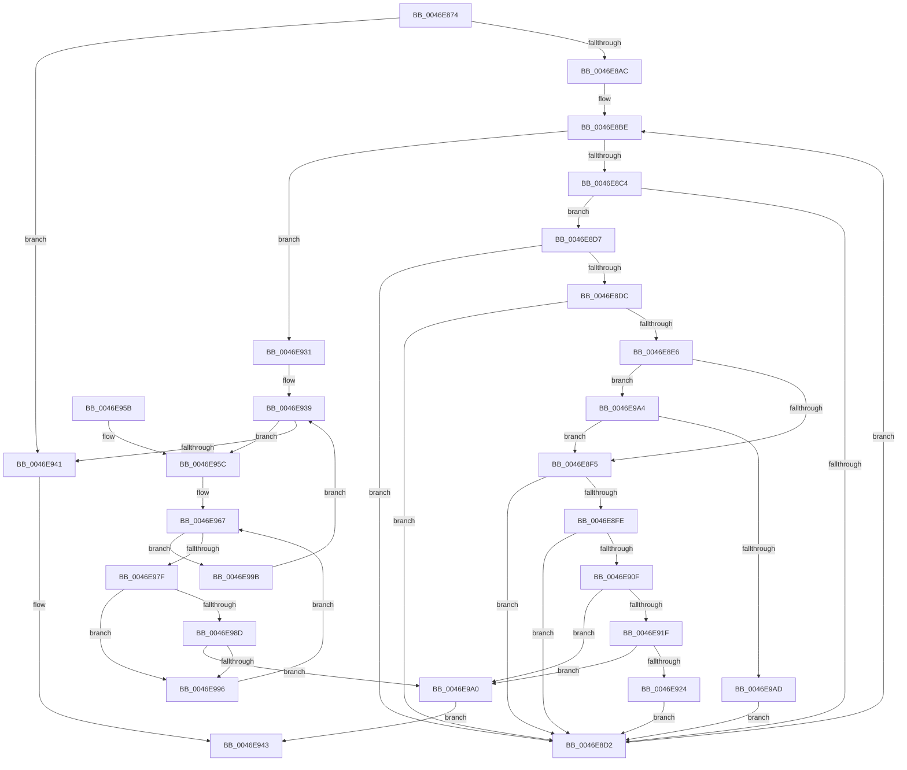

# ExpCheckThreadHistory

- RVA: `0x0046E874`–`0x0046E9B2` (길이 `318` bytes)
- VA: `0x000000014046E874`
- 실행 섹션: `.text`
- PDB 이름 있음: `예`; PDB Function 태그: `아니요`
- unwind 정보 RVA: `0x000ABB6C`
- 디코드: `91`개 명령, `318/318` bytes 표시
- 미해석 바이트: `0` (있으면 어셈블리에 `.byte`로 보존)

> 이 문서는 커널 이미지의 기계어와 PDB 기호를 분석해 생성했습니다. 4번과 5번은 함수 원형과 자료형을 바이너리 사용 방식에서 추정한 C 해석이며 원본 소스 복구 결과는 아닙니다.

## 1. Dependencies

- 직접 호출 지점: **1**; 고유 호출 대상: **1**
- 직접 호출자로 확인된 함수: **1**
- RIP 상대 이미지 참조: **1**

### Outgoing calls
- `0x0046E94B` → [_security_check_cookie](../6A/_security_check_cookie_function_006AC640.md) (function, `0x006AC640`)

### Direct callers
- [sub_00344568](../34/Unknown_function_00344568.md) at `0x003445A8`

### Static image references
- `0x0046E87E` → RVA `0x00E0A740` (`.data`; read)

## 2. Other-region calls and transfers

- 다른 실행 섹션으로 향하는 call: **0**
- 별도 외부 분기/꼬리 이동을 확인하지 못했습니다.

## 3. Assembly (complete function range)

```asm
0046E874  48 89 5C 24 08                  mov qword ptr [rsp + 8], rbx
0046E879  57                              push rdi
0046E87A  48 83 EC 30                     sub rsp, 0x30
0046E87E  48 8B 05 BB BE 99 00            mov rax, qword ptr [rip + 0x99bebb]
0046E885  48 33 C4                        xor rax, rsp
0046E888  48 89 44 24 20                  mov qword ptr [rsp + 0x20], rax
0046E88D  8B 81 98 01 00 00               mov eax, dword ptr [rcx + 0x198]
0046E893  0F 57 C0                        xorps xmm0, xmm0
0046E896  24 07                           and al, 7
0046E898  48 8B D9                        mov rbx, rcx
0046E89B  0F 11 04 24                     movups xmmword ptr [rsp], xmm0
0046E89F  0F 11 44 24 10                  movups xmmword ptr [rsp + 0x10], xmm0
0046E8A4  3C 04                           cmp al, 4
0046E8A6  0F 84 95 00 00 00               je 0x14046e941
0046E8AC  65 48 8B 3C 25 88 01 00 00      mov rdi, qword ptr gs:[0x188]
0046E8B5  45 33 C0                        xor r8d, r8d
0046E8B8  45 8A D0                        mov r10b, r8b
0046E8BB  45 8A C8                        mov r9b, r8b
0046E8BE  41 80 F9 04                     cmp r9b, 4
0046E8C2  7D 6D                           jge 0x14046e931
0046E8C4  49 0F BE C1                     movsx rax, r9b
0046E8C8  48 8B 4C C3 48                  mov rcx, qword ptr [rbx + rax*8 + 0x48]
0046E8CD  48 85 C9                        test rcx, rcx
0046E8D0  75 05                           jne 0x14046e8d7
0046E8D2  41 FE C1                        inc r9b
0046E8D5  EB E7                           jmp 0x14046e8be
0046E8D7  48 3B CF                        cmp rcx, rdi
0046E8DA  74 F6                           je 0x14046e8d2
0046E8DC  8A 81 84 01 00 00               mov al, byte ptr [rcx + 0x184]
0046E8E2  3C 05                           cmp al, 5
0046E8E4  75 EC                           jne 0x14046e8d2
0046E8E6  8A 51 70                        mov dl, byte ptr [rcx + 0x70]
0046E8E9  80 E2 07                        and dl, 7
0046E8EC  80 FA 01                        cmp dl, 1
0046E8EF  0F 85 AF 00 00 00               jne 0x14046e9a4
0046E8F5  80 B9 4B 02 00 00 01            cmp byte ptr [rcx + 0x24b], 1
0046E8FC  75 D4                           jne 0x14046e8d2
0046E8FE  48 8B 43 10                     mov rax, qword ptr [rbx + 0x10]
0046E902  4C 8B 99 60 01 00 00            mov r11, qword ptr [rcx + 0x160]
0046E909  4C 3B 58 08                     cmp r11, qword ptr [rax + 8]
0046E90D  74 C3                           je 0x14046e8d2
0046E90F  48 8D 81 E0 02 00 00            lea rax, [rcx + 0x2e0]
0046E916  4C 3B D8                        cmp r11, rax
0046E919  0F 84 81 00 00 00               je 0x14046e9a0
0046E91F  80 FA 04                        cmp dl, 4
0046E922  74 7C                           je 0x14046e9a0
0046E924  49 0F BE C2                     movsx rax, r10b
0046E928  41 FE C2                        inc r10b
0046E92B  4C 89 1C C4                     mov qword ptr [rsp + rax*8], r11
0046E92F  EB A1                           jmp 0x14046e8d2
0046E931  45 0F BE DA                     movsx r11d, r10b
0046E935  41 8D 5B FD                     lea ebx, [r11 - 3]
0046E939  41 0F BE C0                     movsx eax, r8b
0046E93D  3B C3                           cmp eax, ebx
0046E93F  7E 1B                           jle 0x14046e95c
0046E941  32 C0                           xor al, al
0046E943  48 8B 4C 24 20                  mov rcx, qword ptr [rsp + 0x20]
0046E948  48 33 CC                        xor rcx, rsp
0046E94B  E8 F0 DC 23 00                  call 0x1406ac640
0046E950  48 8B 5C 24 40                  mov rbx, qword ptr [rsp + 0x40]
0046E955  48 83 C4 30                     add rsp, 0x30
0046E959  5F                              pop rdi
0046E95A  C3                              ret
0046E95B  CC                              int3
0046E95C  41 B2 01                        mov r10b, 1
0046E95F  49 0F BE F8                     movsx rdi, r8b
0046E963  45 8D 48 01                     lea r9d, [r8 + 1]
0046E967  41 0F BE C1                     movsx eax, r9b
0046E96B  41 8B D3                        mov edx, r11d
0046E96E  2B D0                           sub edx, eax
0046E970  B9 03 00 00 00                  mov ecx, 3
0046E975  41 0F BE C2                     movsx eax, r10b
0046E979  2B C8                           sub ecx, eax
0046E97B  3B CA                           cmp ecx, edx
0046E97D  7F 1C                           jg 0x14046e99b
0046E97F  49 0F BE C1                     movsx rax, r9b
0046E983  48 8B 0C C4                     mov rcx, qword ptr [rsp + rax*8]
0046E987  48 39 0C FC                     cmp qword ptr [rsp + rdi*8], rcx
0046E98B  75 09                           jne 0x14046e996
0046E98D  41 FE C2                        inc r10b
0046E990  41 80 FA 03                     cmp r10b, 3
0046E994  7D 0A                           jge 0x14046e9a0
0046E996  41 FE C1                        inc r9b
0046E999  EB CC                           jmp 0x14046e967
0046E99B  41 FE C0                        inc r8b
0046E99E  EB 99                           jmp 0x14046e939
0046E9A0  B0 01                           mov al, 1
0046E9A2  EB 9F                           jmp 0x14046e943
0046E9A4  80 FA 04                        cmp dl, 4
0046E9A7  0F 84 48 FF FF FF               je 0x14046e8f5
0046E9AD  E9 20 FF FF FF                  jmp 0x14046e8d2
```

## 4. C-style interpretation (structured pseudocode)

```c
__int64 __fastcall ExpCheckThreadHistory(__int64 a1, __int64 a2, int a3)
{
    __int64 result;
    __int64 v_r10;
    __int64 v_rsp;
    unsigned __int64 v_stack_m18;
    unsigned __int64 v_stack_m28;
    unsigned __int64 v_stack_m38;
    unsigned __int64 v_stack_p8;

    v_stack_p8 = v_rbx;
    v_rsp = (v_rsp) - (48);
    result = (*(unsigned __int64 *)(v_rip + 10075835)) ^ (v_rsp);
    v_stack_m18 = result;
    result = (unsigned __int8)(((unsigned int)(*(unsigned int *)(a1 + 408))) & (7));
    v_stack_m38 = v_xmm0;
    v_stack_m28 = v_xmm0;
    if (((unsigned __int8)(result)) == 4) goto loc_0046E941;
    a3 = 0;
loc_0046E8BE:
    if (0 >= 4) goto loc_0046E931;
    if (*(unsigned __int64 *)(a1 + (__int8)(0) * 8 + 72) != 0) goto loc_0046E8D7;
loc_0046E8D2:
    a4 = (unsigned __int8)((0) + 1);
    goto loc_0046E8BE;
loc_0046E8D7:
    if ((*(unsigned __int64 *)(a1 + (__int8)(0) * 8 + 72)) == (*(unsigned __int64 *)(gs_base + (0 + 392)))) goto loc_0046E8D2;
    if (((unsigned __int8)(*(unsigned __int8 *)(*(unsigned __int64 *)(a1 + (__int8)(0) * 8 + 72) + 388))) != 5) goto loc_0046E8D2;
    a2 = (unsigned __int8)((*(unsigned __int8 *)(*(unsigned __int64 *)(a1 + (__int8)(0) * 8 + 72) + 112)) & (7));
    if (((unsigned __int8)(a2)) != 1) goto loc_0046E9A4;
loc_0046E8F5:
    if ((*(unsigned __int8 *)(*(unsigned __int64 *)(a1 + (__int8)(0) * 8 + 72) + 587)) != 1) goto loc_0046E8D2;
    if ((*(unsigned __int64 *)(*(unsigned __int64 *)(a1 + (__int8)(0) * 8 + 72) + 352)) == (*(unsigned __int64 *)(*(unsigned __int64 *)(a1 + 16) + 8))) goto loc_0046E8D2;
    if ((*(unsigned __int64 *)(*(unsigned __int64 *)(a1 + (__int8)(0) * 8 + 72) + 352)) == (*(unsigned __int64 *)(a1 + (__int8)(0) * 8 + 72) + 736)) goto loc_0046E9A0;
    if (((unsigned __int8)(a2)) == 4) goto loc_0046E9A0;
    v_r10 = (unsigned __int8)((0) + 1);
    *(unsigned __int64 *)(v_rsp + (__int8)(0) * 8) = *(unsigned __int64 *)(*(unsigned __int64 *)(a1 + (__int8)(0) * 8 + 72) + 352);
    goto loc_0046E8D2;
loc_0046E931:
loc_0046E939:
    if (((unsigned int)((__int8)(0))) <= ((unsigned int)((__int8)((unsigned __int8)(v_r10)) - 3))) goto loc_0046E95C;
loc_0046E941:
    result = 0;
loc_0046E943:
    a1 = (v_stack_m18) ^ (v_rsp);
    result = _security_check_cookie(a1, a2, a3, a4);
    v_rsp = (v_rsp) + (48);
    return result;
loc_0046E95C:
loc_0046E967:
    a2 = (unsigned int)(((unsigned int)((unsigned int)((__int8)((unsigned __int8)(v_r10))))) - ((unsigned int)((__int8)((unsigned __int8)(a3 + 1)))));
    a1 = (unsigned int)((3) - ((unsigned int)((__int8)(1))));
    if (((unsigned int)(a1)) > ((unsigned int)(a2))) goto loc_0046E99B;
    if ((*(unsigned __int64 *)(v_rsp + (__int8)(0) * 8)) != (*(unsigned __int64 *)(v_rsp + (__int8)((unsigned __int8)(a3 + 1)) * 8))) goto loc_0046E996;
    v_r10 = (unsigned __int8)((1) + 1);
    if (((unsigned __int8)(v_r10)) >= 3) goto loc_0046E9A0;
loc_0046E996:
    a4 = (unsigned __int8)((a3 + 1) + 1);
    goto loc_0046E967;
loc_0046E99B:
    a3 = (unsigned __int8)((a3) + 1);
    goto loc_0046E939;
loc_0046E9A0:
    goto loc_0046E943;
loc_0046E9A4:
    if (((unsigned __int8)(a2)) == 4) goto loc_0046E8F5;
    goto loc_0046E8D2;
}
```

## 5. (Beta) C Style

```c
int64_t ExpCheckThreadHistory(void *Arg1, int64_t Arg2, int32_t Arg3)
{
    uint8_t *arg1 = (uint8_t *)Arg1;

    int64_t result;
    int64_t local_r10;
    int64_t local_rsp;
    uint64_t v_stack_m18;
    uint64_t v_stack_m28;
    uint64_t v_stack_m38;
    uint64_t v_stack_p8;

    v_stack_p8 = local_rbx;
    local_rsp = (local_rsp) - (48);
    result = (*(uint64_t *)(v_rip + 0x99BEBB)) ^ (local_rsp);
    v_stack_m18 = result;
    result = (uint8_t)(((uint32_t)(*(uint32_t *)(arg1 + 0x198))) & (7));
    v_stack_m38 = v_xmm0;
    v_stack_m28 = v_xmm0;
    if (((uint8_t)(result)) == 4) goto loc_0046E941;
    Arg3 = 0;
loc_0046E8BE:
    if (0 >= 4) goto loc_0046E931;
    if (*(uint64_t *)(arg1 + (int8_t)(0) * 8 + 0x48) != 0) goto loc_0046E8D7;
loc_0046E8D2:
    a4 = (uint8_t)((0) + 1);
    goto loc_0046E8BE;
loc_0046E8D7:
    if ((*(uint64_t *)(arg1 + (int8_t)(0) * 8 + 0x48)) == (*(uint64_t *)(gs_base + (0 + 0x188)))) goto loc_0046E8D2;
    if (((uint8_t)(*(uint8_t *)(*(uint64_t *)(arg1 + (int8_t)(0) * 8 + 0x48) + 0x184))) != 5) goto loc_0046E8D2;
    Arg2 = (uint8_t)((*(uint8_t *)(*(uint64_t *)(arg1 + (int8_t)(0) * 8 + 0x48) + 0x70)) & (7));
    if (((uint8_t)(Arg2)) != 1) goto loc_0046E9A4;
loc_0046E8F5:
    if ((*(uint8_t *)(*(uint64_t *)(arg1 + (int8_t)(0) * 8 + 0x48) + 0x24B)) != 1) goto loc_0046E8D2;
    if ((*(uint64_t *)(*(uint64_t *)(arg1 + (int8_t)(0) * 8 + 0x48) + 0x160)) == (*(uint64_t *)(*(uint64_t *)(arg1 + 0x10) + 0x8))) goto loc_0046E8D2;
    if ((*(uint64_t *)(*(uint64_t *)(arg1 + (int8_t)(0) * 8 + 0x48) + 0x160)) == (*(uint64_t *)(arg1 + (int8_t)(0) * 8 + 0x48) + 736)) goto loc_0046E9A0;
    if (((uint8_t)(Arg2)) == 4) goto loc_0046E9A0;
    local_r10 = (uint8_t)((0) + 1);
    *(uint64_t *)(local_rsp + (int8_t)(0) * 8) = *(uint64_t *)(*(uint64_t *)(arg1 + (int8_t)(0) * 8 + 0x48) + 0x160);
    goto loc_0046E8D2;
loc_0046E931:
loc_0046E939:
    if (((uint32_t)((int8_t)(0))) <= ((uint32_t)((int8_t)((uint8_t)(local_r10)) - 3))) goto loc_0046E95C;
loc_0046E941:
    result = 0;
loc_0046E943:
    Arg1 = (v_stack_m18) ^ (local_rsp);
    result = _security_check_cookie(Arg1, Arg2, Arg3, a4);
    local_rsp = (local_rsp) + (48);
    return result;
loc_0046E95C:
loc_0046E967:
    Arg2 = (uint32_t)(((uint32_t)((uint32_t)((int8_t)((uint8_t)(local_r10))))) - ((uint32_t)((int8_t)((uint8_t)(Arg3 + 1)))));
    Arg1 = (uint32_t)((3) - ((uint32_t)((int8_t)(1))));
    if (((uint32_t)(Arg1)) > ((uint32_t)(Arg2))) goto loc_0046E99B;
    if ((*(uint64_t *)(local_rsp + (int8_t)(0) * 8)) != (*(uint64_t *)(local_rsp + (int8_t)((uint8_t)(Arg3 + 0x1)) * 8))) goto loc_0046E996;
    local_r10 = (uint8_t)((1) + 1);
    if (((uint8_t)(local_r10)) >= 3) goto loc_0046E9A0;
loc_0046E996:
    a4 = (uint8_t)((Arg3 + 1) + 1);
    goto loc_0046E967;
loc_0046E99B:
    Arg3 = (uint8_t)((Arg3) + 1);
    goto loc_0046E939;
loc_0046E9A0:
    goto loc_0046E943;
loc_0046E9A4:
    if (((uint8_t)(Arg2)) == 4) goto loc_0046E8F5;
    goto loc_0046E8D2;
}
```

### 관측된 메모리 오프셋

구조체 형식이 확인되지 않은 접근은 인자 기준의 오프셋으로만 기록했습니다.

| 기준 인자 | 오프셋 표현 | 폭 (bit) | 접근 |
|---|---:|---:|---|
| `Arg1` | `+ 0x10` | `64` | `R` |
| `Arg1` | `+ 0x48 + rax*8` | `64` | `R` |
| `Arg1` | `+ 0x198` | `32` | `R` |

## 6. Execution-region graph

[열기: 2D/3D 그래프와 함수 탐색 컨트롤 패널](../../../control-panel.html?section=text&rva=0x0046E874&view=graph)

- 2D 그래프는 위에서 아래로 흐르고, 3D 그래프는 빈 공간을 드래그해 회전합니다. Shift+드래그는 이동, 휠은 확대·축소, 함수 노드 선택은 대상 보고서 이동입니다.

### Static fallback


