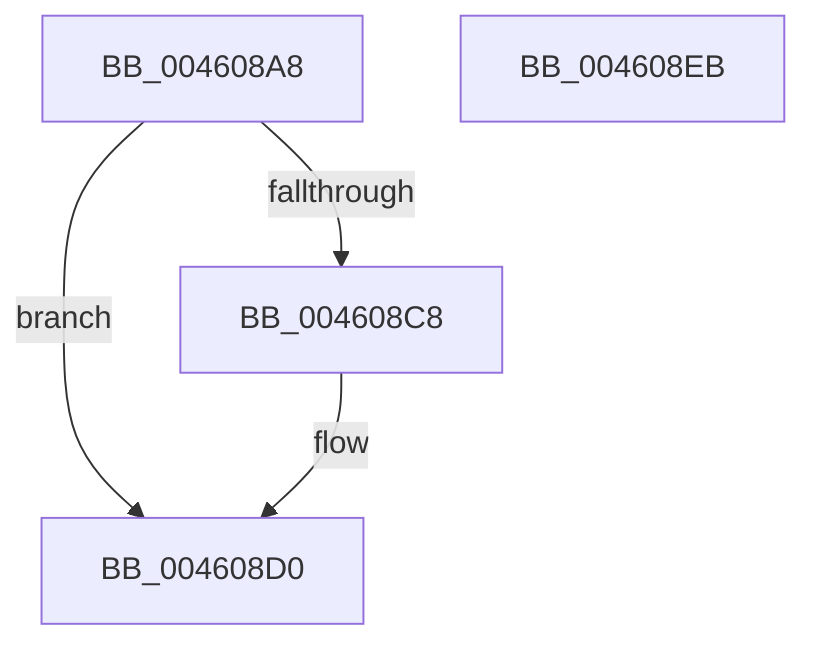

# ExpUnlockHandleTableExclusive

- RVA: `0x004608A8`–`0x004608EC` (길이 `68` bytes)
- VA: `0x00000001404608A8`
- 실행 섹션: `.text`
- PDB 이름 있음: `예`; PDB Function 태그: `아니요`
- unwind 정보 RVA: `0x0005CAAC`
- 디코드: `21`개 명령, `68/68` bytes 표시
- 미해석 바이트: `0` (있으면 어셈블리에 `.byte`로 보존)

> 이 문서는 커널 이미지의 기계어와 PDB 기호를 분석해 생성했습니다. 4번과 5번은 함수 원형과 자료형을 바이너리 사용 방식에서 추정한 C 해석이며 원본 소스 복구 결과는 아닙니다.

## 1. Dependencies

- 직접 호출 지점: **3**; 고유 호출 대상: **3**
- 직접 호출자로 확인된 함수: **5**
- RIP 상대 이미지 참조: **0**

### Outgoing calls
- `0x004608CB` → [ExfTryToWakePushLock](../26/ExfTryToWakePushLock_function_00265DD0.md) (function, `0x00265DD0`)
- `0x004608D3` → [KeAbPostRelease](../2E/KeAbPostRelease_function_002E1600.md) (function, `0x002E1600`)
- `0x004608DB` → [KeLeaveCriticalRegionThread](../25/KeLeaveCriticalRegionThread_function_0025EFF0.md) (function, `0x0025EFF0`)

### Direct callers
- [ExDisableHandleTracing](../65/ExDisableHandleTracing_function_00655CBC.md) at `0x00655CFE`
- [PspApplyMitigationOptions](../../page/A6/PspApplyMitigationOptions_function_00A699AC.md) at `0x00A6A430`
- [ExEnableRaiseUMExceptionOnInvalidHandleClose](../../page/A6/ExEnableRaiseUMExceptionOnInvalidHandleClose_function_00A6A868.md) at `0x00A6A89B`
- [ExEnableHandleExceptions](../../page/A7/ExEnableHandleExceptions_function_00A7580C.md) at `0x00A7585F`
- [ExEnableHandleTracing](../../page/AD/ExEnableHandleTracing_function_00AD2C8C.md) at `0x00AD2E1D`

### Static image references
- 디코드된 RIP-relative 메모리 참조가 없습니다.

## 2. Other-region calls and transfers

- 다른 실행 섹션으로 향하는 call: **0**
- 별도 외부 분기/꼬리 이동을 확인하지 못했습니다.

## 3. Assembly (complete function range)

```asm
004608A8  48 89 5C 24 08                  mov qword ptr [rsp + 8], rbx
004608AD  57                              push rdi
004608AE  48 83 EC 20                     sub rsp, 0x20
004608B2  48 8B FA                        mov rdi, rdx
004608B5  48 8D 59 38                     lea rbx, [rcx + 0x38]
004608B9  48 83 C8 FF                     or rax, 0xffffffffffffffff
004608BD  F0 48 0F C1 03                  lock xadd qword ptr [rbx], rax
004608C2  24 06                           and al, 6
004608C4  3C 02                           cmp al, 2
004608C6  75 08                           jne 0x1404608d0
004608C8  48 8B CB                        mov rcx, rbx
004608CB  E8 00 55 E0 FF                  call 0x140265dd0
004608D0  48 8B CB                        mov rcx, rbx
004608D3  E8 28 0D E8 FF                  call 0x1402e1600
004608D8  48 8B CF                        mov rcx, rdi
004608DB  E8 10 E7 DF FF                  call 0x14025eff0
004608E0  48 8B 5C 24 30                  mov rbx, qword ptr [rsp + 0x30]
004608E5  48 83 C4 20                     add rsp, 0x20
004608E9  5F                              pop rdi
004608EA  C3                              ret
004608EB  CC                              int3
```

## 4. C-style interpretation (structured pseudocode)

```c
__int64 __fastcall ExpUnlockHandleTableExclusive(__int64 a1, __int64 a2)
{
    __int64 result;
    __int64 v_rsp;
    unsigned __int64 v_stack_p8;

    v_stack_p8 = v_rbx;
    v_rsp = (v_rsp) - (32);
    result = (result) | (-1);
    result = (unsigned __int8)((result) & (6));
    if (((unsigned __int8)(result)) == 2) {
        a1 = a1 + 56;
        result = ExfTryToWakePushLock(a1, a2, a3, a4);
    }
    result = KeAbPostRelease(a1 + 56, a2, a3, a4);
    result = KeLeaveCriticalRegionThread(a2, a2, a3, a4);
    v_rsp = (v_rsp) + (32);
    return result;
}
```

## 5. (Beta) C Style

```c
int64_t ExpUnlockHandleTableExclusive(void *Arg1, int64_t Arg2)
{
    uint8_t *arg1 = (uint8_t *)Arg1;

    int64_t result;
    int64_t local_rsp;
    uint64_t v_stack_p8;

    v_stack_p8 = local_rbx;
    local_rsp = (local_rsp) - (32);
    result = (result) | (-1);
    result = (uint8_t)((result) & (6));
    if (((uint8_t)(result)) == 2) {
        Arg1 = Arg1 + 56;
        result = ExfTryToWakePushLock(Arg1, Arg2, a3, a4);
    }
    result = KeAbPostRelease(Arg1 + 56, Arg2, a3, a4);
    result = KeLeaveCriticalRegionThread(Arg2, Arg2, a3, a4);
    local_rsp = (local_rsp) + (32);
    return result;
}
```

### 관측된 메모리 오프셋

구조체 형식이 확인되지 않은 접근은 인자 기준의 오프셋으로만 기록했습니다.

| 기준 인자 | 오프셋 표현 | 폭 (bit) | 접근 |
|---|---:|---:|---|
| `Arg1` | `+ 0x0` | `64` | `R/W` |
| `Arg1` | `+ 0x38` | `64` | `R` |

## 6. Execution-region graph

[열기: 2D/3D 그래프와 함수 탐색 컨트롤 패널](../../../control-panel.html?section=text&rva=0x004608A8&view=graph)

- 2D 그래프는 위에서 아래로 흐르고, 3D 그래프는 빈 공간을 드래그해 회전합니다. Shift+드래그는 이동, 휠은 확대·축소, 함수 노드 선택은 대상 보고서 이동입니다.

### Static fallback


