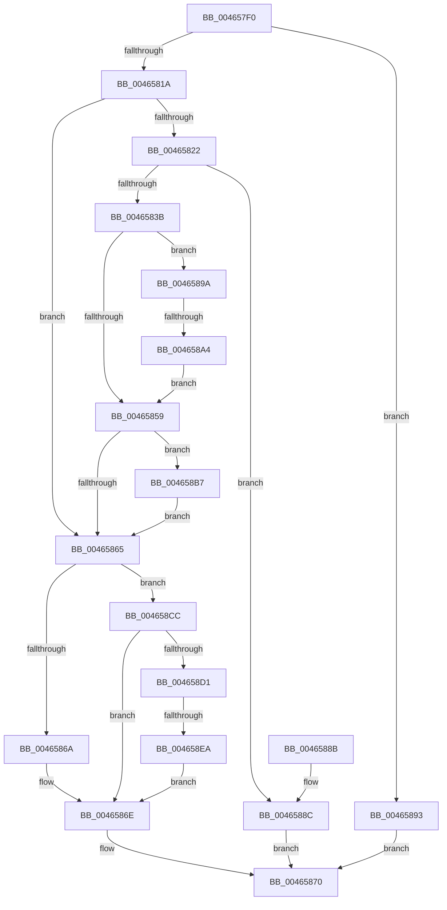

# FsRtlInsertPerFileContextWithReserve

- RVA: `0x004657F0`–`0x00465905` (길이 `277` bytes)
- VA: `0x00000001404657F0`
- 실행 섹션: `.text`
- PDB 이름 있음: `예`; PDB Function 태그: `예`
- unwind 정보 RVA: `0x000AAA88`
- 디코드: `80`개 명령, `277/277` bytes 표시
- 미해석 바이트: `0` (있으면 어셈블리에 `.byte`로 보존)

> 이 문서는 커널 이미지의 기계어와 PDB 기호를 분석해 생성했습니다. 4번과 5번은 함수 원형과 자료형을 바이너리 사용 방식에서 추정한 C 해석이며 원본 소스 복구 결과는 아닙니다.

## 1. Dependencies

- 직접 호출 지점: **4**; 고유 호출 대상: **4**
- 직접 호출자로 확인된 함수: **1**
- RIP 상대 이미지 참조: **0**

### Outgoing calls
- `0x0046582E` → [ExAllocatePool2](../../poolcode/B8/ExAllocatePool2_function_00B820F0.md) (function, `0x00B820F0`)
- `0x004658C2` → [ExFreePoolWithTag](../../poolcode/B8/ExFreePoolWithTag_function_00B82870.md) (function, `0x00B82870`)
- `0x004658D4` → [FsRtlAcquireAutoExpandPushLockExclusive](../26/FsRtlAcquireAutoExpandPushLockExclusive_function_0026539C.md) (function, `0x0026539C`)
- `0x004658FB` → [FsRtlReleaseAutoExpandPushLockExclusive](../26/FsRtlReleaseAutoExpandPushLockExclusive_function_00265B5C.md) (function, `0x00265B5C`)

### Direct callers
- [FsRtlInsertPerFileContext](../58/FsRtlInsertPerFileContext_function_00581650.md) at `0x00581657`

### Static image references
- 디코드된 RIP-relative 메모리 참조가 없습니다.

## 2. Other-region calls and transfers

- 다른 실행 섹션으로 향하는 call: **2**
  - `0x0046582E` → [ExAllocatePool2](../../poolcode/B8/ExAllocatePool2_function_00B820F0.md) (`.text` → `POOLCODE`)
  - `0x004658C2` → [ExFreePoolWithTag](../../poolcode/B8/ExFreePoolWithTag_function_00B82870.md) (`.text` → `POOLCODE`)
- call이 아닌 외부 분기/꼬리 이동: **2**
  - `0x0046589E` → [sub_006F2DE2](../6F/Unknown_function_006F2DE2.md) (`tail-transfer`)
  - `0x004658E4` → [sub_006F2DE2](../6F/Unknown_function_006F2DE2.md) (`tail-transfer`)

## 3. Assembly (complete function range)

```asm
004657F0  48 8B C4                        mov rax, rsp
004657F3  48 89 58 08                     mov qword ptr [rax + 8], rbx
004657F7  48 89 68 10                     mov qword ptr [rax + 0x10], rbp
004657FB  48 89 70 18                     mov qword ptr [rax + 0x18], rsi
004657FF  48 89 78 20                     mov qword ptr [rax + 0x20], rdi
00465803  41 56                           push r14
00465805  48 83 EC 20                     sub rsp, 0x20
00465809  40 32 ED                        xor bpl, bpl
0046580C  45 8B F0                        mov r14d, r8d
0046580F  48 8B FA                        mov rdi, rdx
00465812  48 8B F1                        mov rsi, rcx
00465815  48 85 C9                        test rcx, rcx
00465818  74 79                           je 0x140465893
0046581A  48 8B 19                        mov rbx, qword ptr [rcx]
0046581D  48 85 DB                        test rbx, rbx
00465820  75 43                           jne 0x140465865
00465822  8D 53 28                        lea edx, [rbx + 0x28]
00465825  41 B8 46 53 66 63               mov r8d, 0x63665346
0046582B  8D 4B 42                        lea ecx, [rbx + 0x42]
0046582E  E8 BD C8 71 00                  call 0x140b820f0
00465833  48 8B D8                        mov rbx, rax
00465836  48 85 C0                        test rax, rax
00465839  74 51                           je 0x14046588c
0046583B  48 83 60 08 00                  and qword ptr [rax + 8], 0
00465840  48 83 20 00                     and qword ptr [rax], 0
00465844  48 83 C0 10                     add rax, 0x10
00465848  48 89 40 08                     mov qword ptr [rax + 8], rax
0046584C  48 89 00                        mov qword ptr [rax], rax
0046584F  48 83 63 20 00                  and qword ptr [rbx + 0x20], 0
00465854  45 85 F6                        test r14d, r14d
00465857  74 41                           je 0x14046589a
00465859  33 C0                           xor eax, eax
0046585B  F0 48 0F B1 1E                  lock cmpxchg qword ptr [rsi], rbx
00465860  48 8B F0                        mov rsi, rax
00465863  75 52                           jne 0x1404658b7
00465865  45 85 F6                        test r14d, r14d
00465868  74 62                           je 0x1404658cc
0046586A  48 89 7B 20                     mov qword ptr [rbx + 0x20], rdi
0046586E  33 C0                           xor eax, eax
00465870  48 8B 5C 24 30                  mov rbx, qword ptr [rsp + 0x30]
00465875  48 8B 6C 24 38                  mov rbp, qword ptr [rsp + 0x38]
0046587A  48 8B 74 24 40                  mov rsi, qword ptr [rsp + 0x40]
0046587F  48 8B 7C 24 48                  mov rdi, qword ptr [rsp + 0x48]
00465884  48 83 C4 20                     add rsp, 0x20
00465888  41 5E                           pop r14
0046588A  C3                              ret
0046588B  CC                              int3
0046588C  B8 9A 00 00 C0                  mov eax, 0xc000009a
00465891  EB DD                           jmp 0x140465870
00465893  B8 10 00 00 C0                  mov eax, 0xc0000010
00465898  EB D6                           jmp 0x140465870
0046589A  48 39 40 08                     cmp qword ptr [rax + 8], rax
0046589E  0F 85 3E D5 28 00               jne 0x1406f2de2
004658A4  48 89 07                        mov qword ptr [rdi], rax
004658A7  40 B5 01                        mov bpl, 1
004658AA  48 89 47 08                     mov qword ptr [rdi + 8], rax
004658AE  48 89 78 08                     mov qword ptr [rax + 8], rdi
004658B2  48 89 38                        mov qword ptr [rax], rdi
004658B5  EB A2                           jmp 0x140465859
004658B7  40 32 ED                        xor bpl, bpl
004658BA  BA 46 53 66 63                  mov edx, 0x63665346
004658BF  48 8B CB                        mov rcx, rbx
004658C2  E8 A9 CF 71 00                  call 0x140b82870
004658C7  48 8B DE                        mov rbx, rsi
004658CA  EB 99                           jmp 0x140465865
004658CC  40 84 ED                        test bpl, bpl
004658CF  75 9D                           jne 0x14046586e
004658D1  48 8B CB                        mov rcx, rbx
004658D4  E8 C3 FA DF FF                  call 0x14026539c
004658D9  48 8D 43 10                     lea rax, [rbx + 0x10]
004658DD  48 8B 08                        mov rcx, qword ptr [rax]
004658E0  48 39 41 08                     cmp qword ptr [rcx + 8], rax
004658E4  0F 85 F8 D4 28 00               jne 0x1406f2de2
004658EA  48 89 0F                        mov qword ptr [rdi], rcx
004658ED  48 89 47 08                     mov qword ptr [rdi + 8], rax
004658F1  48 89 79 08                     mov qword ptr [rcx + 8], rdi
004658F5  48 8B CB                        mov rcx, rbx
004658F8  48 89 38                        mov qword ptr [rax], rdi
004658FB  E8 5C 02 E0 FF                  call 0x140265b5c
00465900  E9 69 FF FF FF                  jmp 0x14046586e
```

## 4. C-style interpretation (structured pseudocode)

```c
__int64 __fastcall FsRtlInsertPerFileContextWithReserve(__int64 a1, __int64 a2, int a3)
{
    __int64 result;
    __int64 v_rbp;
    __int64 v_rsp;
    unsigned __int64 v_stack_p10;
    unsigned __int64 v_stack_p18;
    unsigned __int64 v_stack_p20;
    unsigned __int64 v_stack_p8;

    *(unsigned __int64 *)(v_rsp + 8) = v_rbx;
    *(unsigned __int64 *)(v_rsp + 16) = v_rbp;
    *(unsigned __int64 *)(v_rsp + 24) = v_rsi;
    *(unsigned __int64 *)(v_rsp + 32) = v_rdi;
    v_rsp = (v_rsp) - (32);
    v_rbp = 0;
    if (a1 == 0) goto loc_00465893;
    if (*(unsigned __int64 *)(a1) != 0) goto loc_00465865;
    result = ExAllocatePool2(*(unsigned __int64 *)(a1) + 66, *(unsigned __int64 *)(a1) + 40, (unsigned int)(0x63665346ULL), a4);
    if (result == 0) goto loc_0046588C;
    result = (result) + (16);
    *(unsigned __int64 *)(result + 8) = result;
    *(unsigned __int64 *)(result) = result;
    if ((unsigned int)((unsigned int)(a3)) == 0) goto loc_0046589A;
loc_00465859:
    result = 0;
    if (condition_is_not_equal) goto loc_004658B7;
loc_00465865:
    if ((unsigned int)((unsigned int)(a3)) == 0) goto loc_004658CC;
    *(unsigned __int64 *)(result + 32) = a2;
loc_0046586E:
    result = 0;
loc_00465870:
    v_rsp = (v_rsp) + (32);
    return result;
loc_0046588C:
    goto loc_00465870;
loc_00465893:
    goto loc_00465870;
loc_0046589A:
    *(unsigned __int64 *)(v_stack_p20) = (unsigned int)(0xC0000010ULL);
    *(unsigned __int64 *)(v_stack_p20 + 8) = (unsigned int)(0xC0000010ULL);
    *(unsigned __int64 *)((unsigned int)(0xC0000010ULL) + 8) = v_stack_p20;
    *(unsigned __int64 *)((unsigned int)(0xC0000010ULL)) = v_stack_p20;
    goto loc_00465859;
loc_004658B7:
    v_rbp = 0;
    result = ExFreePoolWithTag(v_stack_p8, (unsigned int)(0x63665346ULL), (unsigned int)(0x63665346ULL), a4);
    goto loc_00465865;
loc_004658CC:
    if (0 != 0) goto loc_0046586E;
    result = FsRtlAcquireAutoExpandPushLockExclusive(v_stack_p18, (unsigned int)(0x63665346ULL), (unsigned int)(0x63665346ULL), a4);
    *(unsigned __int64 *)(v_stack_p20) = *(unsigned __int64 *)(v_stack_p18 + 16);
    *(unsigned __int64 *)(v_stack_p20 + 8) = v_stack_p18 + 16;
    *(unsigned __int64 *)(*(unsigned __int64 *)(v_stack_p18 + 16) + 8) = v_stack_p20;
    *(unsigned __int64 *)(v_stack_p18 + 16) = v_stack_p20;
    result = FsRtlReleaseAutoExpandPushLockExclusive(v_stack_p18, (unsigned int)(0x63665346ULL), (unsigned int)(0x63665346ULL), a4);
    goto loc_0046586E;
}
```

## 5. (Beta) C Style

```c
int64_t FsRtlInsertPerFileContextWithReserve(void *Arg1, void *Arg2, int32_t Arg3)
{
    uint8_t *arg1 = (uint8_t *)Arg1;
    uint8_t *arg2 = (uint8_t *)Arg2;

    int64_t result;
    int64_t local_rbp;
    int64_t local_rsp;
    uint64_t v_stack_p10;
    uint64_t v_stack_p18;
    uint64_t v_stack_p20;
    uint64_t v_stack_p8;

    *(uint64_t *)(local_rsp + 0x8) = local_rbx;
    *(uint64_t *)(local_rsp + 0x10) = local_rbp;
    *(uint64_t *)(local_rsp + 0x18) = local_rsi;
    *(uint64_t *)(local_rsp + 0x20) = local_rdi;
    local_rsp = (local_rsp) - (32);
    local_rbp = 0;
    if (Arg1 == NULL) goto loc_00465893;
    if (*(uint64_t *)(arg1) != 0) goto loc_00465865;
    result = ExAllocatePool2(*(uint64_t *)(arg1) + 66, *(uint64_t *)(arg1) + 40, (uint32_t)(0x63665346ULL), a4);
    if (result == 0) goto loc_0046588C;
    result = (result) + (16);
    *(uint64_t *)(result + 0x8) = result;
    *(uint64_t *)(result) = result;
    if ((uint32_t)((uint32_t)(Arg3)) == 0) goto loc_0046589A;
loc_00465859:
    result = 0;
    if (condition_is_not_equal) goto loc_004658B7;
loc_00465865:
    if ((uint32_t)((uint32_t)(Arg3)) == 0) goto loc_004658CC;
    *(void **)(result + 0x20) = Arg2;
loc_0046586E:
    result = 0;
loc_00465870:
    local_rsp = (local_rsp) + (32);
    return result;
loc_0046588C:
    goto loc_00465870;
loc_00465893:
    goto loc_00465870;
loc_0046589A:
    *(uint64_t *)(v_stack_p20) = (uint32_t)(0xC0000010ULL);
    *(uint64_t *)(v_stack_p20 + 0x8) = (uint32_t)(0xC0000010ULL);
    *(uint64_t *)((uint32_t)(0xC0000010ULL) + 0x8) = v_stack_p20;
    *(uint64_t *)((uint32_t)(0xC0000010ULL)) = v_stack_p20;
    goto loc_00465859;
loc_004658B7:
    local_rbp = 0;
    result = ExFreePoolWithTag(v_stack_p8, (uint32_t)(0x63665346ULL), (uint32_t)(0x63665346ULL), a4);
    goto loc_00465865;
loc_004658CC:
    if (0 != 0) goto loc_0046586E;
    result = FsRtlAcquireAutoExpandPushLockExclusive(v_stack_p18, (uint32_t)(0x63665346ULL), (uint32_t)(0x63665346ULL), a4);
    *(uint64_t *)(v_stack_p20) = *(uint64_t *)(v_stack_p18 + 0x10);
    *(uint64_t *)(v_stack_p20 + 0x8) = v_stack_p18 + 16;
    *(uint64_t *)(*(uint64_t *)(v_stack_p18 + 0x10) + 0x8) = v_stack_p20;
    *(uint64_t *)(v_stack_p18 + 0x10) = v_stack_p20;
    result = FsRtlReleaseAutoExpandPushLockExclusive(v_stack_p18, (uint32_t)(0x63665346ULL), (uint32_t)(0x63665346ULL), a4);
    goto loc_0046586E;
}
```

### 관측된 메모리 오프셋

구조체 형식이 확인되지 않은 접근은 인자 기준의 오프셋으로만 기록했습니다.

| 기준 인자 | 오프셋 표현 | 폭 (bit) | 접근 |
|---|---:|---:|---|
| `Arg1` | `+ 0x0` | `64` | `R` |
| `Arg2` | `+ 0x0` | `64` | `W` |
| `Arg2` | `+ 0x8` | `64` | `W` |

## 6. Execution-region graph

[열기: 2D/3D 그래프와 함수 탐색 컨트롤 패널](../../../control-panel.html?section=text&rva=0x004657F0&view=graph)

- 2D 그래프는 위에서 아래로 흐르고, 3D 그래프는 빈 공간을 드래그해 회전합니다. Shift+드래그는 이동, 휠은 확대·축소, 함수 노드 선택은 대상 보고서 이동입니다.

### Static fallback


