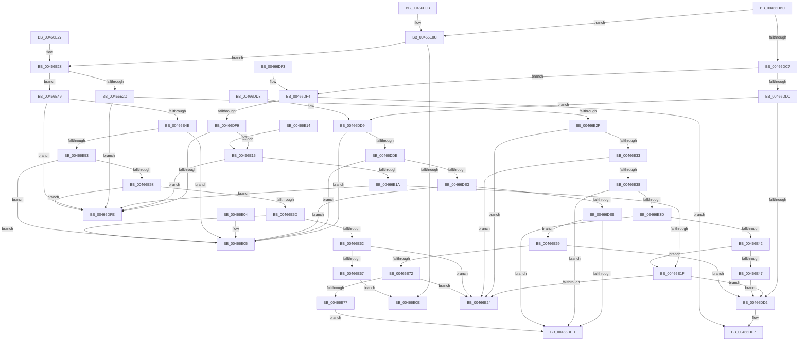

# GetBaseTypeSize

- RVA: `0x00466DBC`–`0x00466E7C` (길이 `192` bytes)
- VA: `0x0000000140466DBC`
- 실행 섹션: `.text`
- PDB 이름 있음: `예`; PDB Function 태그: `아니요`
- unwind 정보 RVA: `0x000DB714`
- 디코드: `76`개 명령, `192/192` bytes 표시
- 미해석 바이트: `0` (있으면 어셈블리에 `.byte`로 보존)

> 이 문서는 커널 이미지의 기계어와 PDB 기호를 분석해 생성했습니다. 4번과 5번은 함수 원형과 자료형을 바이너리 사용 방식에서 추정한 C 해석이며 원본 소스 복구 결과는 아닙니다.

## 1. Dependencies

- 직접 호출 지점: **0**; 고유 호출 대상: **0**
- 직접 호출자로 확인된 함수: **1**
- RIP 상대 이미지 참조: **0**

### Outgoing calls
- 직접 디코드된 call 명령이 없습니다.

### Direct callers
- [PnpValidatePropertyData](../../page/8F/PnpValidatePropertyData_function_008F7658.md) at `0x008F7692`

### Static image references
- 디코드된 RIP-relative 메모리 참조가 없습니다.

## 2. Other-region calls and transfers

- 다른 실행 섹션으로 향하는 call: **0**
- 별도 외부 분기/꼬리 이동을 확인하지 못했습니다.

## 3. Assembly (complete function range)

```asm
00466DBC  81 E1 FF 0F 00 00               and ecx, 0xfff
00466DC2  83 F9 0D                        cmp ecx, 0xd
00466DC5  76 45                           jbe 0x140466e0c
00466DC7  B8 14 00 00 00                  mov eax, 0x14
00466DCC  3B C8                           cmp ecx, eax
00466DCE  77 24                           ja 0x140466df4
00466DD0  75 07                           jne 0x140466dd9
00466DD2  B8 02 00 00 00                  mov eax, 2
00466DD7  C3                              ret
00466DD8  CC                              int3
00466DD9  83 E9 0E                        sub ecx, 0xe
00466DDC  74 27                           je 0x140466e05
00466DDE  83 E9 01                        sub ecx, 1
00466DE1  74 22                           je 0x140466e05
00466DE3  83 E9 01                        sub ecx, 1
00466DE6  74 1D                           je 0x140466e05
00466DE8  83 E9 01                        sub ecx, 1
00466DEB  75 7C                           jne 0x140466e69
00466DED  B8 01 00 00 00                  mov eax, 1
00466DF2  C3                              ret
00466DF3  CC                              int3
00466DF4  83 E9 15                        sub ecx, 0x15
00466DF7  74 DE                           je 0x140466dd7
00466DF9  83 E9 01                        sub ecx, 1
00466DFC  75 17                           jne 0x140466e15
00466DFE  B8 04 00 00 00                  mov eax, 4
00466E03  C3                              ret
00466E04  CC                              int3
00466E05  B8 08 00 00 00                  mov eax, 8
00466E0A  C3                              ret
00466E0B  CC                              int3
00466E0C  75 1A                           jne 0x140466e28
00466E0E  B8 10 00 00 00                  mov eax, 0x10
00466E13  C3                              ret
00466E14  CC                              int3
00466E15  83 E9 01                        sub ecx, 1
00466E18  74 E4                           je 0x140466dfe
00466E1A  83 E9 01                        sub ecx, 1
00466E1D  74 DF                           je 0x140466dfe
00466E1F  83 F9 01                        cmp ecx, 1
00466E22  74 AE                           je 0x140466dd2
00466E24  33 C0                           xor eax, eax
00466E26  C3                              ret
00466E27  CC                              int3
00466E28  83 F9 06                        cmp ecx, 6
00466E2B  77 1C                           ja 0x140466e49
00466E2D  74 CF                           je 0x140466dfe
00466E2F  85 C9                           test ecx, ecx
00466E31  74 F1                           je 0x140466e24
00466E33  83 E9 01                        sub ecx, 1
00466E36  74 EC                           je 0x140466e24
00466E38  83 E9 01                        sub ecx, 1
00466E3B  74 B0                           je 0x140466ded
00466E3D  83 E9 01                        sub ecx, 1
00466E40  74 AB                           je 0x140466ded
00466E42  83 E9 01                        sub ecx, 1
00466E45  75 D8                           jne 0x140466e1f
00466E47  EB 89                           jmp 0x140466dd2
00466E49  83 E9 07                        sub ecx, 7
00466E4C  74 B0                           je 0x140466dfe
00466E4E  83 E9 01                        sub ecx, 1
00466E51  74 B2                           je 0x140466e05
00466E53  83 E9 01                        sub ecx, 1
00466E56  74 AD                           je 0x140466e05
00466E58  83 E9 01                        sub ecx, 1
00466E5B  74 A1                           je 0x140466dfe
00466E5D  83 E9 01                        sub ecx, 1
00466E60  74 A3                           je 0x140466e05
00466E62  83 F9 01                        cmp ecx, 1
00466E65  75 BD                           jne 0x140466e24
00466E67  EB A5                           jmp 0x140466e0e
00466E69  83 E9 01                        sub ecx, 1
00466E6C  0F 84 60 FF FF FF               je 0x140466dd2
00466E72  83 F9 01                        cmp ecx, 1
00466E75  75 AD                           jne 0x140466e24
00466E77  E9 71 FF FF FF                  jmp 0x140466ded
```

## 4. C-style interpretation (structured pseudocode)

```c
__int64 __fastcall GetBaseTypeSize(int a1)
{
    __int64 result;

    a1 = (unsigned int)((a1) & (0xFFFULL));
    if (a1 <= 13) goto loc_00466E0C;
    if (a1 > 20) goto loc_00466DF4;
    if (a1 != 20) goto loc_00466DD9;
loc_00466DD2:
loc_00466DD7:
    return 2;
loc_00466DD9:
    a1 = (unsigned int)((a1) - (14));
    if (condition_is_equal) goto loc_00466E05;
    a1 = (unsigned int)((a1) - (1));
    if (condition_is_equal) goto loc_00466E05;
    a1 = (unsigned int)((a1) - (1));
    if (condition_is_equal) goto loc_00466E05;
    a1 = (unsigned int)((a1) - (1));
    if (condition_is_not_equal) goto loc_00466E69;
loc_00466DED:
    return 1;
loc_00466DF4:
    a1 = (unsigned int)((a1) - (21));
    if (condition_is_equal) goto loc_00466DD7;
    a1 = (unsigned int)((a1) - (1));
    if (condition_is_not_equal) goto loc_00466E15;
loc_00466DFE:
    return 4;
loc_00466E05:
    return 8;
loc_00466E0C:
    if (condition_is_not_equal) goto loc_00466E28;
loc_00466E0E:
    return 16;
loc_00466E15:
    a1 = (unsigned int)((a1) - (1));
    if (condition_is_equal) goto loc_00466DFE;
    a1 = (unsigned int)((a1) - (1));
    if (condition_is_equal) goto loc_00466DFE;
loc_00466E1F:
    if (a1 == 1) goto loc_00466DD2;
loc_00466E24:
    result = 0;
    return result;
loc_00466E28:
    if (a1 > 6) goto loc_00466E49;
    if (a1 == 6) goto loc_00466DFE;
    if (a1 == 0) goto loc_00466E24;
    a1 = (unsigned int)((a1) - (1));
    if (condition_is_equal) goto loc_00466E24;
    a1 = (unsigned int)((a1) - (1));
    if (condition_is_equal) goto loc_00466DED;
    a1 = (unsigned int)((a1) - (1));
    if (condition_is_equal) goto loc_00466DED;
    a1 = (unsigned int)((a1) - (1));
    if (condition_is_not_equal) goto loc_00466E1F;
    goto loc_00466DD2;
loc_00466E49:
    a1 = (unsigned int)((a1) - (7));
    if (condition_is_equal) goto loc_00466DFE;
    a1 = (unsigned int)((a1) - (1));
    if (condition_is_equal) goto loc_00466E05;
    a1 = (unsigned int)((a1) - (1));
    if (condition_is_equal) goto loc_00466E05;
    a1 = (unsigned int)((a1) - (1));
    if (condition_is_equal) goto loc_00466DFE;
    a1 = (unsigned int)((a1) - (1));
    if (condition_is_equal) goto loc_00466E05;
    if (a1 != 1) goto loc_00466E24;
    goto loc_00466E0E;
loc_00466E69:
    a1 = (unsigned int)((a1) - (1));
    if (condition_is_equal) goto loc_00466DD2;
    if (a1 != 1) goto loc_00466E24;
    goto loc_00466DED;
}
```

## 5. (Beta) C Style

```c
int64_t GetBaseTypeSize(int32_t Arg1)
{
    int64_t result;

    Arg1 = (uint32_t)((Arg1) & (0xFFFULL));
    if (Arg1 <= 13) goto loc_00466E0C;
    if (Arg1 > 20) goto loc_00466DF4;
    if (Arg1 != 20) goto loc_00466DD9;
loc_00466DD2:
loc_00466DD7:
    return 2;
loc_00466DD9:
    Arg1 = (uint32_t)((Arg1) - (14));
    if (condition_is_equal) goto loc_00466E05;
    Arg1 = (uint32_t)((Arg1) - (1));
    if (condition_is_equal) goto loc_00466E05;
    Arg1 = (uint32_t)((Arg1) - (1));
    if (condition_is_equal) goto loc_00466E05;
    Arg1 = (uint32_t)((Arg1) - (1));
    if (condition_is_not_equal) goto loc_00466E69;
loc_00466DED:
    return 1;
loc_00466DF4:
    Arg1 = (uint32_t)((Arg1) - (21));
    if (condition_is_equal) goto loc_00466DD7;
    Arg1 = (uint32_t)((Arg1) - (1));
    if (condition_is_not_equal) goto loc_00466E15;
loc_00466DFE:
    return 4;
loc_00466E05:
    return 8;
loc_00466E0C:
    if (condition_is_not_equal) goto loc_00466E28;
loc_00466E0E:
    return 16;
loc_00466E15:
    Arg1 = (uint32_t)((Arg1) - (1));
    if (condition_is_equal) goto loc_00466DFE;
    Arg1 = (uint32_t)((Arg1) - (1));
    if (condition_is_equal) goto loc_00466DFE;
loc_00466E1F:
    if (Arg1 == 1) goto loc_00466DD2;
loc_00466E24:
    result = 0;
    return result;
loc_00466E28:
    if (Arg1 > 6) goto loc_00466E49;
    if (Arg1 == 6) goto loc_00466DFE;
    if (Arg1 == 0) goto loc_00466E24;
    Arg1 = (uint32_t)((Arg1) - (1));
    if (condition_is_equal) goto loc_00466E24;
    Arg1 = (uint32_t)((Arg1) - (1));
    if (condition_is_equal) goto loc_00466DED;
    Arg1 = (uint32_t)((Arg1) - (1));
    if (condition_is_equal) goto loc_00466DED;
    Arg1 = (uint32_t)((Arg1) - (1));
    if (condition_is_not_equal) goto loc_00466E1F;
    goto loc_00466DD2;
loc_00466E49:
    Arg1 = (uint32_t)((Arg1) - (7));
    if (condition_is_equal) goto loc_00466DFE;
    Arg1 = (uint32_t)((Arg1) - (1));
    if (condition_is_equal) goto loc_00466E05;
    Arg1 = (uint32_t)((Arg1) - (1));
    if (condition_is_equal) goto loc_00466E05;
    Arg1 = (uint32_t)((Arg1) - (1));
    if (condition_is_equal) goto loc_00466DFE;
    Arg1 = (uint32_t)((Arg1) - (1));
    if (condition_is_equal) goto loc_00466E05;
    if (Arg1 != 1) goto loc_00466E24;
    goto loc_00466E0E;
loc_00466E69:
    Arg1 = (uint32_t)((Arg1) - (1));
    if (condition_is_equal) goto loc_00466DD2;
    if (Arg1 != 1) goto loc_00466E24;
    goto loc_00466DED;
}
```

## 6. Execution-region graph

[열기: 2D/3D 그래프와 함수 탐색 컨트롤 패널](../../../control-panel.html?section=text&rva=0x00466DBC&view=graph)

- 2D 그래프는 위에서 아래로 흐르고, 3D 그래프는 빈 공간을 드래그해 회전합니다. Shift+드래그는 이동, 휠은 확대·축소, 함수 노드 선택은 대상 보고서 이동입니다.

### Static fallback


