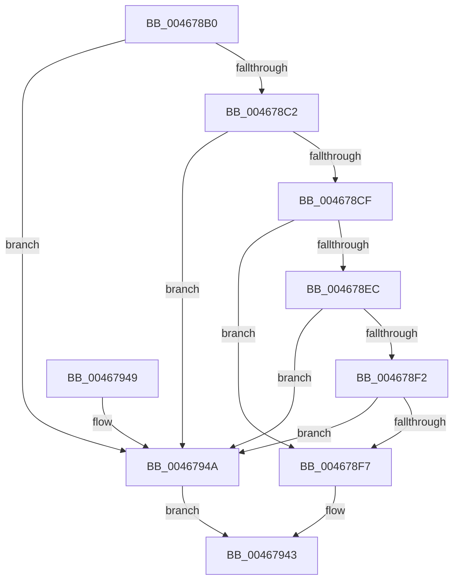

# HalBuildScatterGatherListDmarThinEx

- RVA: `0x004678B0`–`0x00467951` (길이 `161` bytes)
- VA: `0x00000001404678B0`
- 실행 섹션: `.text`
- PDB 이름 있음: `예`; PDB Function 태그: `아니요`
- unwind 정보 RVA: `0x000AAFF0`
- 디코드: `37`개 명령, `161/161` bytes 표시
- 미해석 바이트: `0` (있으면 어셈블리에 `.byte`로 보존)

> 이 문서는 커널 이미지의 기계어와 PDB 기호를 분석해 생성했습니다. 4번과 5번은 함수 원형과 자료형을 바이너리 사용 방식에서 추정한 C 해석이며 원본 소스 복구 결과는 아닙니다.

## 1. Dependencies

- 직접 호출 지점: **1**; 고유 호출 대상: **1**
- 직접 호출자로 확인된 함수: **0**
- RIP 상대 이미지 참조: **0**

### Outgoing calls
- `0x0046793E` → [HalpBuildScatterGatherListDmarThin](HalpBuildScatterGatherListDmarThin_function_00467B28.md) (function, `0x00467B28`)

### Direct callers
- 이 함수 시작 RVA로 연결되는 직접 call은 확인되지 않았습니다. 간접 호출은 완전히 역산할 수 없습니다.

### Static image references
- 디코드된 RIP-relative 메모리 참조가 없습니다.

## 2. Other-region calls and transfers

- 다른 실행 섹션으로 향하는 call: **0**
- 별도 외부 분기/꼬리 이동을 확인하지 못했습니다.

## 3. Assembly (complete function range)

```asm
004678B0  40 53                           push rbx
004678B2  48 83 EC 70                     sub rsp, 0x70
004678B6  49 8B D9                        mov rbx, r9
004678B9  4D 85 C0                        test r8, r8
004678BC  0F 84 88 00 00 00               je 0x14046794a
004678C2  4C 8B 94 24 D0 00 00 00         mov r10, qword ptr [rsp + 0xd0]
004678CA  4D 85 D2                        test r10, r10
004678CD  74 7B                           je 0x14046794a
004678CF  4C 8B 8C 24 B8 00 00 00         mov r9, qword ptr [rsp + 0xb8]
004678D7  48 8B 84 24 F0 00 00 00         mov rax, qword ptr [rsp + 0xf0]
004678DF  44 8B 9C 24 B0 00 00 00         mov r11d, dword ptr [rsp + 0xb0]
004678E7  4D 85 C9                        test r9, r9
004678EA  75 0B                           jne 0x1404678f7
004678EC  41 F6 C3 01                     test r11b, 1
004678F0  74 58                           je 0x14046794a
004678F2  48 85 C0                        test rax, rax
004678F5  74 53                           je 0x14046794a
004678F7  48 89 44 24 60                  mov qword ptr [rsp + 0x60], rax
004678FC  8B 84 24 D8 00 00 00            mov eax, dword ptr [rsp + 0xd8]
00467903  89 44 24 58                     mov dword ptr [rsp + 0x58], eax
00467907  48 8B 84 24 C0 00 00 00         mov rax, qword ptr [rsp + 0xc0]
0046790F  4C 89 54 24 50                  mov qword ptr [rsp + 0x50], r10
00467914  48 89 44 24 40                  mov qword ptr [rsp + 0x40], rax
00467919  8B 84 24 A8 00 00 00            mov eax, dword ptr [rsp + 0xa8]
00467920  4C 89 4C 24 38                  mov qword ptr [rsp + 0x38], r9
00467925  4C 8B CB                        mov r9, rbx
00467928  44 89 5C 24 30                  mov dword ptr [rsp + 0x30], r11d
0046792D  89 44 24 28                     mov dword ptr [rsp + 0x28], eax
00467931  48 8B 84 24 A0 00 00 00         mov rax, qword ptr [rsp + 0xa0]
00467939  48 89 44 24 20                  mov qword ptr [rsp + 0x20], rax
0046793E  E8 E5 01 00 00                  call 0x140467b28
00467943  48 83 C4 70                     add rsp, 0x70
00467947  5B                              pop rbx
00467948  C3                              ret
00467949  CC                              int3
0046794A  B8 0D 00 00 C0                  mov eax, 0xc000000d
0046794F  EB F2                           jmp 0x140467943
```

## 4. C-style interpretation (structured pseudocode)

```c
__int64 __fastcall HalBuildScatterGatherListDmarThinEx(__int64 a1, __int64 a2, __int64 a3, __int64 a4, __int64 a5, unsigned int a6, unsigned int a7, __int64 a8, __int64 a9, __int64 a10, __int64 a11, unsigned int a12, __int64 a13, __int64 a14, __int64 a15)
{
    __int64 result;
    __int64 v_rsp;
    unsigned __int64 v_stack_m18;
    unsigned int v_stack_m20;
    unsigned __int64 v_stack_m28;
    unsigned __int64 v_stack_m38;
    unsigned __int64 v_stack_m40;
    unsigned int v_stack_m48;
    unsigned int v_stack_m50;
    unsigned __int64 v_stack_m58;

    v_rsp = (v_rsp) - (112);
    if (a3 == 0) goto loc_0046794A;
    if (a11 == 0) goto loc_0046794A;
    if (a8 != 0) goto loc_004678F7;
    if ((((unsigned __int8)((unsigned int)(a7))) & (1)) == 0) goto loc_0046794A;
    if (a15 == 0) goto loc_0046794A;
loc_004678F7:
    v_stack_m18 = a15;
    v_stack_m20 = (unsigned int)((unsigned int)(a12));
    v_stack_m28 = a11;
    v_stack_m38 = a9;
    v_stack_m40 = a8;
    v_stack_m48 = (unsigned int)((unsigned int)(a7));
    v_stack_m50 = (unsigned int)((unsigned int)(a6));
    v_stack_m58 = a5;
    result = HalpBuildScatterGatherListDmarThin(a1, a2, a3, a4);
loc_00467943:
    v_rsp = (v_rsp) + (112);
    return result;
loc_0046794A:
    goto loc_00467943;
}
```

## 5. (Beta) C Style

```c
int64_t HalBuildScatterGatherListDmarThinEx(int64_t Arg1, int64_t Arg2, int64_t Arg3, int64_t Arg4, int64_t Arg5, uint32_t Arg6, uint32_t Arg7, int64_t Arg8, int64_t Arg9, uint64_t Arg10, int64_t Arg11, uint32_t Arg12, uint64_t Arg13, uint64_t Arg14, int64_t Arg15)
{
    int64_t result;
    int64_t local_rsp;
    uint64_t v_stack_m18;
    uint32_t v_stack_m20;
    uint64_t v_stack_m28;
    uint64_t v_stack_m38;
    uint64_t v_stack_m40;
    uint32_t v_stack_m48;
    uint32_t v_stack_m50;
    uint64_t v_stack_m58;

    local_rsp = (local_rsp) - (112);
    if (Arg3 == 0) goto loc_0046794A;
    if (Arg11 == 0) goto loc_0046794A;
    if (Arg8 != 0) goto loc_004678F7;
    if ((((uint8_t)((uint32_t)(Arg7))) & (1)) == 0) goto loc_0046794A;
    if (Arg15 == 0) goto loc_0046794A;
loc_004678F7:
    v_stack_m18 = Arg15;
    v_stack_m20 = (uint32_t)((uint32_t)(Arg12));
    v_stack_m28 = Arg11;
    v_stack_m38 = Arg9;
    v_stack_m40 = Arg8;
    v_stack_m48 = (uint32_t)((uint32_t)(Arg7));
    v_stack_m50 = (uint32_t)((uint32_t)(Arg6));
    v_stack_m58 = Arg5;
    result = HalpBuildScatterGatherListDmarThin(Arg1, Arg2, Arg3, Arg4);
loc_00467943:
    local_rsp = (local_rsp) + (112);
    return result;
loc_0046794A:
    goto loc_00467943;
}
```

## 6. Execution-region graph

[열기: 2D/3D 그래프와 함수 탐색 컨트롤 패널](../../../control-panel.html?section=text&rva=0x004678B0&view=graph)

- 2D 그래프는 위에서 아래로 흐르고, 3D 그래프는 빈 공간을 드래그해 회전합니다. Shift+드래그는 이동, 휠은 확대·축소, 함수 노드 선택은 대상 보고서 이동입니다.

### Static fallback


