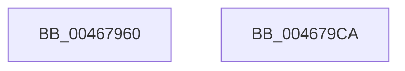

# HalBuildScatterGatherListDmarThin

- RVA: `0x00467960`–`0x004679CB` (길이 `107` bytes)
- VA: `0x0000000140467960`
- 실행 섹션: `.text`
- PDB 이름 있음: `예`; PDB Function 태그: `아니요`
- unwind 정보 RVA: `0x0006C9B8`
- 디코드: `24`개 명령, `107/107` bytes 표시
- 미해석 바이트: `0` (있으면 어셈블리에 `.byte`로 보존)

> 이 문서는 커널 이미지의 기계어와 PDB 기호를 분석해 생성했습니다. 4번과 5번은 함수 원형과 자료형을 바이너리 사용 방식에서 추정한 C 해석이며 원본 소스 복구 결과는 아닙니다.

## 1. Dependencies

- 직접 호출 지점: **1**; 고유 호출 대상: **1**
- 직접 호출자로 확인된 함수: **0**
- RIP 상대 이미지 참조: **0**

### Outgoing calls
- `0x004679C0` → [HalpBuildScatterGatherListDmarThin](HalpBuildScatterGatherListDmarThin_function_00467B28.md) (function, `0x00467B28`)

### Direct callers
- 이 함수 시작 RVA로 연결되는 직접 call은 확인되지 않았습니다. 간접 호출은 완전히 역산할 수 없습니다.

### Static image references
- 디코드된 RIP-relative 메모리 참조가 없습니다.

## 2. Other-region calls and transfers

- 다른 실행 섹션으로 향하는 call: **0**
- 별도 외부 분기/꼬리 이동을 확인하지 못했습니다.

## 3. Assembly (complete function range)

```asm
00467960  4C 8B DC                        mov r11, rsp
00467963  48 83 EC 78                     sub rsp, 0x78
00467967  49 83 63 E8 00                  and qword ptr [r11 - 0x18], 0
0046796C  41 8B 40 2C                     mov eax, dword ptr [r8 + 0x2c]
00467970  4C 2B C8                        sub r9, rax
00467973  8B 84 24 C8 00 00 00            mov eax, dword ptr [rsp + 0xc8]
0046797A  4D 2B 48 20                     sub r9, qword ptr [r8 + 0x20]
0046797E  89 44 24 58                     mov dword ptr [rsp + 0x58], eax
00467982  48 8B 84 24 C0 00 00 00         mov rax, qword ptr [rsp + 0xc0]
0046798A  49 89 43 D8                     mov qword ptr [r11 - 0x28], rax
0046798E  48 8B 84 24 B0 00 00 00         mov rax, qword ptr [rsp + 0xb0]
00467996  49 89 43 C8                     mov qword ptr [r11 - 0x38], rax
0046799A  48 8B 84 24 A8 00 00 00         mov rax, qword ptr [rsp + 0xa8]
004679A2  49 89 43 C0                     mov qword ptr [r11 - 0x40], rax
004679A6  83 64 24 30 00                  and dword ptr [rsp + 0x30], 0
004679AB  8B 84 24 A0 00 00 00            mov eax, dword ptr [rsp + 0xa0]
004679B2  89 44 24 28                     mov dword ptr [rsp + 0x28], eax
004679B6  4D 89 4B A8                     mov qword ptr [r11 - 0x58], r9
004679BA  4D 8B C8                        mov r9, r8
004679BD  45 33 C0                        xor r8d, r8d
004679C0  E8 63 01 00 00                  call 0x140467b28
004679C5  48 83 C4 78                     add rsp, 0x78
004679C9  C3                              ret
004679CA  CC                              int3
```

## 4. C-style interpretation (structured pseudocode)

```c
__int64 __fastcall HalBuildScatterGatherListDmarThin(__int64 a1, __int64 a2, __int64 a3, __int64 a4, unsigned int a5, __int64 a6, __int64 a7, __int64 a8, __int64 a9, unsigned int a10)
{
    __int64 result;
    __int64 v_rsp;
    unsigned int v_stack_m20;
    unsigned int v_stack_m48;
    unsigned int v_stack_m50;

    v_rsp = (v_rsp) - (120);
    a4 = (a4) - ((unsigned int)(*(unsigned int *)(a3 + 44)));
    a4 = (a4) - (*(unsigned __int64 *)(a3 + 32));
    v_stack_m20 = (unsigned int)((unsigned int)(a10));
    *(unsigned __int64 *)(v_rsp - 40) = a9;
    *(unsigned __int64 *)(v_rsp - 56) = a7;
    *(unsigned __int64 *)(v_rsp - 64) = a6;
    v_stack_m50 = (unsigned int)((unsigned int)(a5));
    *(unsigned __int64 *)(v_rsp - 88) = a4;
    a3 = 0;
    result = HalpBuildScatterGatherListDmarThin(a1, a2, a3, a3);
    v_rsp = (v_rsp) + (120);
    return result;
}
```

## 5. (Beta) C Style

```c
int64_t HalBuildScatterGatherListDmarThin(int64_t Arg1, int64_t Arg2, void *Arg3, int64_t Arg4, uint32_t Arg5, int64_t Arg6, int64_t Arg7, uint64_t Arg8, int64_t Arg9, uint32_t Arg10)
{
    uint8_t *arg3 = (uint8_t *)Arg3;

    int64_t result;
    int64_t local_rsp;
    uint32_t v_stack_m20;
    uint32_t v_stack_m48;
    uint32_t v_stack_m50;

    local_rsp = (local_rsp) - (120);
    Arg4 = (Arg4) - ((uint32_t)(*(uint32_t *)(arg3 + 0x2C)));
    Arg4 = (Arg4) - (*(uint64_t *)(arg3 + 0x20));
    v_stack_m20 = (uint32_t)((uint32_t)(Arg10));
    *(uint64_t *)(local_rsp - 0x28) = Arg9;
    *(uint64_t *)(local_rsp - 0x38) = Arg7;
    *(uint64_t *)(local_rsp - 0x40) = Arg6;
    v_stack_m50 = (uint32_t)((uint32_t)(Arg5));
    *(uint64_t *)(local_rsp - 0x58) = Arg4;
    Arg3 = 0;
    result = HalpBuildScatterGatherListDmarThin(Arg1, Arg2, Arg3, Arg3);
    local_rsp = (local_rsp) + (120);
    return result;
}
```

### 관측된 메모리 오프셋

구조체 형식이 확인되지 않은 접근은 인자 기준의 오프셋으로만 기록했습니다.

| 기준 인자 | 오프셋 표현 | 폭 (bit) | 접근 |
|---|---:|---:|---|
| `Arg3` | `+ 0x20` | `64` | `R` |
| `Arg3` | `+ 0x2C` | `32` | `R` |

## 6. Execution-region graph

[열기: 2D/3D 그래프와 함수 탐색 컨트롤 패널](../../../control-panel.html?section=text&rva=0x00467960&view=graph)

- 2D 그래프는 위에서 아래로 흐르고, 3D 그래프는 빈 공간을 드래그해 회전합니다. Shift+드래그는 이동, 휠은 확대·축소, 함수 노드 선택은 대상 보고서 이동입니다.

### Static fallback


