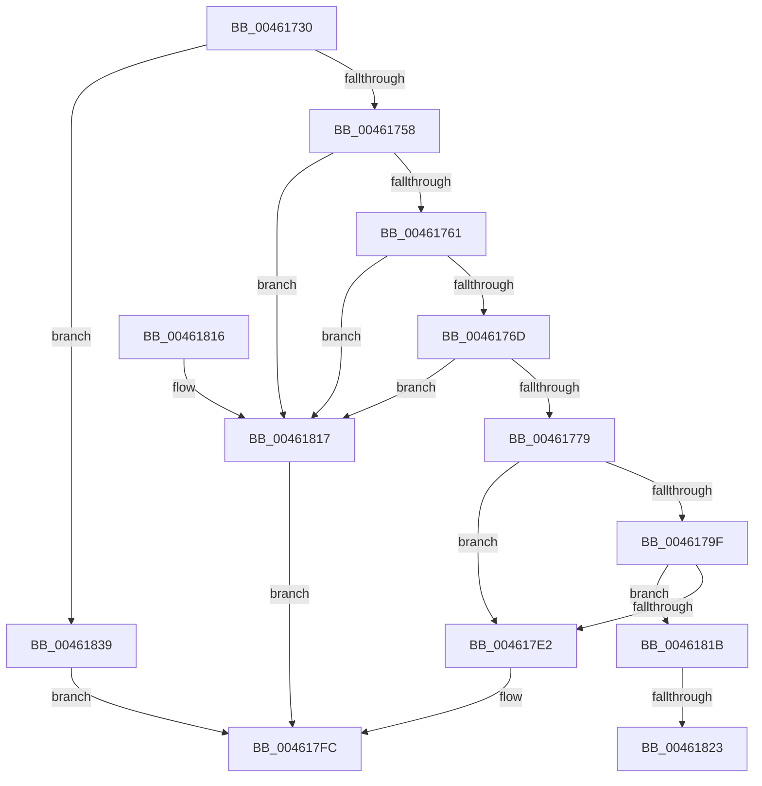

# HalGetBusDataByOffset

- RVA: `0x00461730`–`0x00461852` (길이 `290` bytes)
- VA: `0x0000000140461730`
- 실행 섹션: `.text`
- PDB 이름 있음: `예`; PDB Function 태그: `예`
- unwind 정보 RVA: `0x000A9EC4`
- 디코드: `78`개 명령, `290/290` bytes 표시
- 미해석 바이트: `0` (있으면 어셈블리에 `.byte`로 보존)

> 이 문서는 커널 이미지의 기계어와 PDB 기호를 분석해 생성했습니다. 4번과 5번은 함수 원형과 자료형을 바이너리 사용 방식에서 추정한 C 해석이며 원본 소스 복구 결과는 아닙니다.

## 1. Dependencies

- 직접 호출 지점: **4**; 고유 호출 대상: **4**
- 직접 호출자로 확인된 함수: **4**
- RIP 상대 이미지 참조: **3**

### Outgoing calls
- `0x004617D6` → [guard_dispatch_icall](../6B/guard_dispatch_icall_function_006BAAD0.md) (function, `0x006BAAD0`)
- `0x004617F7` → [HalpGetPCIData](HalpGetPCIData_function_00461858.md) (function, `0x00461858`)
- `0x0046182E` → [memset](../6C/memset_function_006C6C40.md) (function, `0x006C6C40`)
- `0x0046184B` → [HalpGetSetCmosData](../42/HalpGetSetCmosData_function_0042D794.md) (function, `0x0042D794`)

### Direct callers
- [HalGetBusData](../53/HalGetBusData_function_0053F280.md) at `0x0053F291`
- [HalpWhackICHUsbSmi](../56/HalpWhackICHUsbSmi_function_00563900.md) at `0x00563926`
- [HalpPiix4Detect](../../pagelk/B7/HalpPiix4Detect_function_00B79E00.md) at `0x00B7A0E5`
- [HalpPiix4Detect](../../pagelk/B7/HalpPiix4Detect_function_00B79E00.md) at `0x00B7A2E7`
- [KdpSysReadBusData](../../pagekd/B8/KdpSysReadBusData_function_00B88540.md) at `0x00B88580`

### Static image references
- `0x00461761` → RVA `0x00E103FC` (`.data`; read)
- `0x0046176D` → RVA `0x00E10400` (`.data`; read)
- `0x00461780` → RVA `0x00E00D00` (`.data`; read)

## 2. Other-region calls and transfers

- 다른 실행 섹션으로 향하는 call: **0**
- call이 아닌 외부 분기/꼬리 이동: **2**
  - `0x0046181D` → [sub_006F2676](../6F/Unknown_function_006F2676.md) (`tail-transfer`)
  - `0x00461834` → [sub_006F2676](../6F/Unknown_function_006F2676.md) (`tail-transfer`)

## 3. Assembly (complete function range)

```asm
00461730  4C 8B DC                        mov r11, rsp
00461733  49 89 5B 10                     mov qword ptr [r11 + 0x10], rbx
00461737  49 89 6B 18                     mov qword ptr [r11 + 0x18], rbp
0046173B  49 89 73 20                     mov qword ptr [r11 + 0x20], rsi
0046173F  57                              push rdi
00461740  41 56                           push r14
00461742  41 57                           push r15
00461744  48 83 EC 60                     sub rsp, 0x60
00461748  49 8B F9                        mov rdi, r9
0046174B  41 8B E8                        mov ebp, r8d
0046174E  8B DA                           mov ebx, edx
00461750  85 C9                           test ecx, ecx
00461752  0F 84 E1 00 00 00               je 0x140461839
00461758  83 F9 04                        cmp ecx, 4
0046175B  0F 85 B6 00 00 00               jne 0x140461817
00461761  3B 15 95 EC 9A 00               cmp edx, dword ptr [rip + 0x9aec95]
00461767  0F 87 AA 00 00 00               ja 0x140461817
0046176D  3B 15 8D EC 9A 00               cmp edx, dword ptr [rip + 0x9aec8d]
00461773  0F 82 9E 00 00 00               jb 0x140461817
00461779  41 83 63 08 00                  and dword ptr [r11 + 8], 0
0046177E  8B F2                           mov esi, edx
00461780  48 8B 05 79 F5 99 00            mov rax, qword ptr [rip + 0x99f579]
00461787  44 8B B4 24 A8 00 00 00         mov r14d, dword ptr [rsp + 0xa8]
0046178F  44 8B BC 24 A0 00 00 00         mov r15d, dword ptr [rsp + 0xa0]
00461797  C1 EE 08                        shr esi, 8
0046179A  48 85 C0                        test rax, rax
0046179D  74 43                           je 0x1404617e2
0046179F  48 8B 54 24 78                  mov rdx, qword ptr [rsp + 0x78]
004617A4  4D 8D 4B 08                     lea r9, [r11 + 8]
004617A8  4D 89 4B D0                     mov qword ptr [r11 - 0x30], r9
004617AC  8B CD                           mov ecx, ebp
004617AE  49 89 7B C8                     mov qword ptr [r11 - 0x38], rdi
004617B2  83 E1 1F                        and ecx, 0x1f
004617B5  45 89 73 C0                     mov dword ptr [r11 - 0x40], r14d
004617B9  44 8A CB                        mov r9b, bl
004617BC  41 C1 E8 05                     shr r8d, 5
004617C0  41 83 E0 07                     and r8d, 7
004617C4  45 89 7B B8                     mov dword ptr [r11 - 0x48], r15d
004617C8  45 89 43 B0                     mov dword ptr [r11 - 0x50], r8d
004617CC  44 0F B7 C6                     movzx r8d, si
004617D0  89 4C 24 20                     mov dword ptr [rsp + 0x20], ecx
004617D4  B1 01                           mov cl, 1
004617D6  E8 F5 92 25 00                  call 0x1406baad0
004617DB  3D 0E 00 00 C0                  cmp eax, 0xc000000e
004617E0  75 39                           jne 0x14046181b
004617E2  44 89 74 24 28                  mov dword ptr [rsp + 0x28], r14d
004617E7  4C 8B CF                        mov r9, rdi
004617EA  44 8B C5                        mov r8d, ebp
004617ED  44 89 7C 24 20                  mov dword ptr [rsp + 0x20], r15d
004617F2  8A D3                           mov dl, bl
004617F4  0F B7 CE                        movzx ecx, si
004617F7  E8 5C 00 00 00                  call 0x140461858
004617FC  4C 8D 5C 24 60                  lea r11, [rsp + 0x60]
00461801  49 8B 5B 28                     mov rbx, qword ptr [r11 + 0x28]
00461805  49 8B 6B 30                     mov rbp, qword ptr [r11 + 0x30]
00461809  49 8B 73 38                     mov rsi, qword ptr [r11 + 0x38]
0046180D  49 8B E3                        mov rsp, r11
00461810  41 5F                           pop r15
00461812  41 5E                           pop r14
00461814  5F                              pop rdi
00461815  C3                              ret
00461816  CC                              int3
00461817  33 C0                           xor eax, eax
00461819  EB E1                           jmp 0x1404617fc
0046181B  85 C0                           test eax, eax
0046181D  0F 89 53 0E 29 00               jns 0x1406f2676
00461823  4D 8B C6                        mov r8, r14
00461826  BA FF 00 00 00                  mov edx, 0xff
0046182B  48 8B CF                        mov rcx, rdi
0046182E  E8 0D 54 26 00                  call 0x1406c6c40
00461833  90                              nop
00461834  E9 3D 0E 29 00                  jmp 0x1406f2676
00461839  44 8B 8C 24 A8 00 00 00         mov r9d, dword ptr [rsp + 0xa8]
00461841  4C 8B C7                        mov r8, rdi
00461844  8B D5                           mov edx, ebp
00461846  C6 44 24 20 00                  mov byte ptr [rsp + 0x20], 0
0046184B  E8 44 BF FC FF                  call 0x14042d794
00461850  EB AA                           jmp 0x1404617fc
```

## 4. C-style interpretation (structured pseudocode)

```c
__int64 __fastcall HalGetBusDataByOffset(int a1, int a2, int a3, __int64 a4, unsigned int a5, unsigned int a6)
{
    __int64 result;
    __int64 v_rsi;
    __int64 v_rsp;
    unsigned __int64 v_stack_m18;
    unsigned __int8 v_stack_m40;
    unsigned int v_stack_m50;
    unsigned int v_stack_m58;
    unsigned __int64 v_stack_p0;

    *(unsigned __int64 *)(v_rsp + 16) = v_rbx;
    *(unsigned __int64 *)(v_rsp + 24) = v_rbp;
    *(unsigned __int64 *)(v_rsp + 32) = v_rsi;
    v_rsp = (v_rsp) - (96);
    if (a1 == 0) goto loc_00461839;
    if (a1 != 4) goto loc_00461817;
    if (a2 > (*(unsigned int *)(v_rip + 10153109))) goto loc_00461817;
    if (a2 < (*(unsigned int *)(v_rip + 10153101))) goto loc_00461817;
    v_rsi = (unsigned int)(((unsigned int)(a2)) >> (8));
    if (*(unsigned __int64 *)(v_rip + 10089849) == 0) goto loc_004617E2;
    *(unsigned __int64 *)(v_rsp - 48) = v_rsp + 8;
    *(unsigned __int64 *)(v_rsp - 56) = a4;
    a1 = (unsigned int)(((unsigned int)((unsigned int)((unsigned int)(a3)))) & (31));
    *(unsigned int *)(v_rsp - 64) = (unsigned int)((unsigned int)(a6));
    a3 = (unsigned int)((a3) >> (5));
    a3 = (unsigned int)((a3) & (7));
    *(unsigned int *)(v_rsp - 72) = (unsigned int)((unsigned int)(a5));
    *(unsigned int *)(v_rsp - 80) = a3;
    v_stack_m58 = a1;
    result = guard_dispatch_icall(1, v_stack_p0, (unsigned __int16)(v_rsi), (unsigned __int8)((unsigned int)(a2)));
    if (((unsigned int)(result)) != 0xC000000EULL) goto loc_0046181B;
loc_004617E2:
    v_stack_m50 = (unsigned int)((unsigned int)(a6));
    v_stack_m58 = (unsigned int)((unsigned int)(a5));
    result = HalpGetPCIData((unsigned __int16)(v_rsi), (unsigned __int8)((unsigned int)(a2)), (unsigned int)((unsigned int)((unsigned int)(a3))), a4);
loc_004617FC:
    return result;
loc_00461817:
    result = 0;
    goto loc_004617FC;
loc_0046181B:
    result = memset(a4, 255, (unsigned int)(a6), a4);
loc_00461839:
    v_stack_m40 = 0;
    result = HalpGetSetCmosData(a4, (unsigned int)((unsigned int)(*(unsigned __int64 *)(v_stack_m18 + 48))), a4, (unsigned int)(a6));
    goto loc_004617FC;
}
```

## 5. (Beta) C Style

```c
int64_t HalGetBusDataByOffset(int32_t Arg1, int32_t Arg2, int32_t Arg3, int64_t Arg4, uint32_t Arg5, uint32_t Arg6)
{
    int64_t result;
    int64_t local_rsi;
    int64_t local_rsp;
    uint64_t v_stack_m18;
    uint8_t v_stack_m40;
    uint32_t v_stack_m50;
    uint32_t v_stack_m58;
    uint64_t v_stack_p0;

    *(uint64_t *)(local_rsp + 0x10) = local_rbx;
    *(uint64_t *)(local_rsp + 0x18) = local_rbp;
    *(uint64_t *)(local_rsp + 0x20) = local_rsi;
    local_rsp = (local_rsp) - (96);
    if (Arg1 == 0) goto loc_00461839;
    if (Arg1 != 4) goto loc_00461817;
    if (Arg2 > (*(uint32_t *)(v_rip + 0x9AEC95))) goto loc_00461817;
    if (Arg2 < (*(uint32_t *)(v_rip + 0x9AEC8D))) goto loc_00461817;
    local_rsi = (uint32_t)(((uint32_t)(Arg2)) >> (8));
    if (*(uint64_t *)(v_rip + 0x99F579) == 0) goto loc_004617E2;
    *(uint64_t *)(local_rsp - 0x30) = local_rsp + 8;
    *(uint64_t *)(local_rsp - 0x38) = Arg4;
    Arg1 = (uint32_t)(((uint32_t)((uint32_t)((uint32_t)(Arg3)))) & (31));
    *(uint32_t *)(local_rsp - 0x40) = (uint32_t)((uint32_t)(Arg6));
    Arg3 = (uint32_t)((Arg3) >> (5));
    Arg3 = (uint32_t)((Arg3) & (7));
    *(uint32_t *)(local_rsp - 0x48) = (uint32_t)((uint32_t)(Arg5));
    *(uint32_t *)(local_rsp - 0x50) = Arg3;
    v_stack_m58 = Arg1;
    result = guard_dispatch_icall(1, v_stack_p0, (uint16_t)(local_rsi), (uint8_t)((uint32_t)(Arg2)));
    if (((uint32_t)(result)) != 0xC000000EULL) goto loc_0046181B;
loc_004617E2:
    v_stack_m50 = (uint32_t)((uint32_t)(Arg6));
    v_stack_m58 = (uint32_t)((uint32_t)(Arg5));
    result = HalpGetPCIData((uint16_t)(local_rsi), (uint8_t)((uint32_t)(Arg2)), (uint32_t)((uint32_t)((uint32_t)(Arg3))), Arg4);
loc_004617FC:
    return result;
loc_00461817:
    result = 0;
    goto loc_004617FC;
loc_0046181B:
    result = memset(Arg4, 255, (uint32_t)(Arg6), Arg4);
loc_00461839:
    v_stack_m40 = 0;
    result = HalpGetSetCmosData(Arg4, (uint32_t)((uint32_t)(*(uint64_t *)(v_stack_m18 + 0x30))), Arg4, (uint32_t)(Arg6));
    goto loc_004617FC;
}
```

## 6. Execution-region graph

[열기: 2D/3D 그래프와 함수 탐색 컨트롤 패널](../../../control-panel.html?section=text&rva=0x00461730&view=graph)

- 2D 그래프는 위에서 아래로 흐르고, 3D 그래프는 빈 공간을 드래그해 회전합니다. Shift+드래그는 이동, 휠은 확대·축소, 함수 노드 선택은 대상 보고서 이동입니다.

### Static fallback


