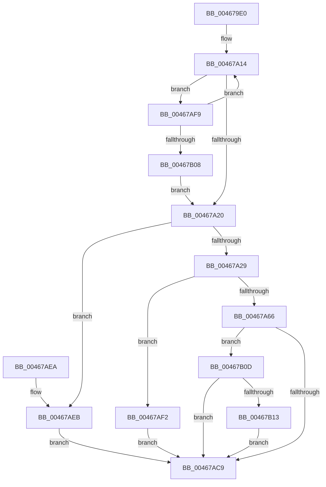

# HalGetScatterGatherListDmarThin

- RVA: `0x004679E0`–`0x00467B1F` (길이 `319` bytes)
- VA: `0x00000001404679E0`
- 실행 섹션: `.text`
- PDB 이름 있음: `예`; PDB Function 태그: `아니요`
- unwind 정보 RVA: `0x000AAFFC`
- 디코드: `85`개 명령, `319/319` bytes 표시
- 미해석 바이트: `0` (있으면 어셈블리에 `.byte`로 보존)

> 이 문서는 커널 이미지의 기계어와 PDB 기호를 분석해 생성했습니다. 4번과 5번은 함수 원형과 자료형을 바이너리 사용 방식에서 추정한 C 해석이며 원본 소스 복구 결과는 아닙니다.

## 1. Dependencies

- 직접 호출 지점: **4**; 고유 호출 대상: **4**
- 직접 호출자로 확인된 함수: **0**
- RIP 상대 이미지 참조: **0**

### Outgoing calls
- `0x00467A37` → [HalpGetNumberOfSGElementsDmarThin](HalpGetNumberOfSGElementsDmarThin_function_00467CD4.md) (function, `0x00467CD4`)
- `0x00467A55` → [ExAllocatePool2](../../poolcode/B8/ExAllocatePool2_function_00B820F0.md) (function, `0x00B820F0`)
- `0x00467ABE` → [HalpConstructScatterGatherListDmarThin](HalpConstructScatterGatherListDmarThin_function_00467D30.md) (function, `0x00467D30`)
- `0x00467B18` → [ExFreePoolWithTag](../../poolcode/B8/ExFreePoolWithTag_function_00B82870.md) (function, `0x00B82870`)

### Direct callers
- 이 함수 시작 RVA로 연결되는 직접 call은 확인되지 않았습니다. 간접 호출은 완전히 역산할 수 없습니다.

### Static image references
- 디코드된 RIP-relative 메모리 참조가 없습니다.

## 2. Other-region calls and transfers

- 다른 실행 섹션으로 향하는 call: **2**
  - `0x00467A55` → [ExAllocatePool2](../../poolcode/B8/ExAllocatePool2_function_00B820F0.md) (`.text` → `POOLCODE`)
  - `0x00467B18` → [ExFreePoolWithTag](../../poolcode/B8/ExFreePoolWithTag_function_00B82870.md) (`.text` → `POOLCODE`)
- 별도 외부 분기/꼬리 이동을 확인하지 못했습니다.

## 3. Assembly (complete function range)

```asm
004679E0  48 8B C4                        mov rax, rsp
004679E3  48 89 58 08                     mov qword ptr [rax + 8], rbx
004679E7  48 89 68 10                     mov qword ptr [rax + 0x10], rbp
004679EB  48 89 70 18                     mov qword ptr [rax + 0x18], rsi
004679EF  48 89 78 20                     mov qword ptr [rax + 0x20], rdi
004679F3  41 54                           push r12
004679F5  41 56                           push r14
004679F7  41 57                           push r15
004679F9  48 83 EC 20                     sub rsp, 0x20
004679FD  41 8B 40 2C                     mov eax, dword ptr [r8 + 0x2c]
00467A01  49 8B F9                        mov rdi, r9
00467A04  48 2B F8                        sub rdi, rax
00467A07  49 8B D8                        mov rbx, r8
00467A0A  49 2B 78 20                     sub rdi, qword ptr [r8 + 0x20]
00467A0E  4C 8B FA                        mov r15, rdx
00467A11  4C 8B E1                        mov r12, rcx
00467A14  8B 43 28                        mov eax, dword ptr [rbx + 0x28]
00467A17  48 3B F8                        cmp rdi, rax
00467A1A  0F 83 D9 00 00 00               jae 0x140467af9
00467A20  48 85 DB                        test rbx, rbx
00467A23  0F 84 C2 00 00 00               je 0x140467aeb
00467A29  44 8B 74 24 60                  mov r14d, dword ptr [rsp + 0x60]
00467A2E  48 8B D7                        mov rdx, rdi
00467A31  45 8B C6                        mov r8d, r14d
00467A34  48 8B CB                        mov rcx, rbx
00467A37  E8 98 02 00 00                  call 0x140467cd4
00467A3C  8B C0                           mov eax, eax
00467A3E  B9 42 00 00 00                  mov ecx, 0x42
00467A43  41 B8 48 61 6C 44               mov r8d, 0x446c6148
00467A49  48 8D 34 40                     lea rsi, [rax + rax*2]
00467A4D  48 8D 14 F5 78 00 00 00         lea rdx, [rsi*8 + 0x78]
00467A55  E8 96 A6 71 00                  call 0x140b820f0
00467A5A  48 8B E8                        mov rbp, rax
00467A5D  48 85 C0                        test rax, rax
00467A60  0F 84 8C 00 00 00               je 0x140467af2
00467A66  48 8D 34 F5 00 00 00 00         lea rsi, [rsi*8]
00467A6E  48 03 F0                        add rsi, rax
00467A71  C6 46 71 01                     mov byte ptr [rsi + 0x71], 1
00467A75  48 8D 4E 10                     lea rcx, [rsi + 0x10]
00467A79  4C 89 66 28                     mov qword ptr [rsi + 0x28], r12
00467A7D  4C 89 7E 30                     mov qword ptr [rsi + 0x30], r15
00467A81  49 8B 47 20                     mov rax, qword ptr [r15 + 0x20]
00467A85  48 83 66 68 00                  and qword ptr [rsi + 0x68], 0
00467A8A  48 89 46 38                     mov qword ptr [rsi + 0x38], rax
00467A8E  48 8B 44 24 68                  mov rax, qword ptr [rsp + 0x68]
00467A93  48 89 46 50                     mov qword ptr [rsi + 0x50], rax
00467A97  48 8B 44 24 70                  mov rax, qword ptr [rsp + 0x70]
00467A9C  48 89 46 58                     mov qword ptr [rsi + 0x58], rax
00467AA0  44 89 76 48                     mov dword ptr [rsi + 0x48], r14d
00467AA4  48 89 5E 40                     mov qword ptr [rsi + 0x40], rbx
00467AA8  89 7E 4C                        mov dword ptr [rsi + 0x4c], edi
00467AAB  48 89 6E 60                     mov qword ptr [rsi + 0x60], rbp
00467AAF  C6 46 70 00                     mov byte ptr [rsi + 0x70], 0
00467AB3  C7 46 20 01 00 00 00            mov dword ptr [rsi + 0x20], 1
00467ABA  C6 46 72 00                     mov byte ptr [rsi + 0x72], 0
00467ABE  E8 6D 02 00 00                  call 0x140467d30
00467AC3  8B D8                           mov ebx, eax
00467AC5  85 C0                           test eax, eax
00467AC7  78 44                           js 0x140467b0d
00467AC9  48 8B 6C 24 48                  mov rbp, qword ptr [rsp + 0x48]
00467ACE  8B C3                           mov eax, ebx
00467AD0  48 8B 5C 24 40                  mov rbx, qword ptr [rsp + 0x40]
00467AD5  48 8B 74 24 50                  mov rsi, qword ptr [rsp + 0x50]
00467ADA  48 8B 7C 24 58                  mov rdi, qword ptr [rsp + 0x58]
00467ADF  48 83 C4 20                     add rsp, 0x20
00467AE3  41 5F                           pop r15
00467AE5  41 5E                           pop r14
00467AE7  41 5C                           pop r12
00467AE9  C3                              ret
00467AEA  CC                              int3
00467AEB  BB 0D 00 00 C0                  mov ebx, 0xc000000d
00467AF0  EB D7                           jmp 0x140467ac9
00467AF2  BB 9A 00 00 C0                  mov ebx, 0xc000009a
00467AF7  EB D0                           jmp 0x140467ac9
00467AF9  48 8B 1B                        mov rbx, qword ptr [rbx]
00467AFC  48 2B F8                        sub rdi, rax
00467AFF  48 85 DB                        test rbx, rbx
00467B02  0F 85 0C FF FF FF               jne 0x140467a14
00467B08  E9 13 FF FF FF                  jmp 0x140467a20
00467B0D  80 7E 71 00                     cmp byte ptr [rsi + 0x71], 0
00467B11  74 B6                           je 0x140467ac9
00467B13  33 D2                           xor edx, edx
00467B15  48 8B CD                        mov rcx, rbp
00467B18  E8 53 AD 71 00                  call 0x140b82870
00467B1D  EB AA                           jmp 0x140467ac9
```

## 4. C-style interpretation (structured pseudocode)

```c
__int64 __fastcall HalGetScatterGatherListDmarThin(__int64 a1, __int64 a2, __int64 a3, __int64 a4, unsigned int a5, __int64 a6, __int64 a7)
{
    __int64 result;
    __int64 v_rdi;
    __int64 v_rsi;
    __int64 v_rsp;
    unsigned __int64 v_stack_p10;
    unsigned __int64 v_stack_p18;
    unsigned __int64 v_stack_p20;
    unsigned __int64 v_stack_p8;

    *(unsigned __int64 *)(v_rsp + 8) = v_rbx;
    *(unsigned __int64 *)(v_rsp + 16) = v_rbp;
    *(unsigned __int64 *)(v_rsp + 24) = v_rsi;
    *(unsigned __int64 *)(v_rsp + 32) = v_rdi;
    v_rsp = (v_rsp) - (32);
    v_rdi = (a4) - ((unsigned int)(*(unsigned int *)(a3 + 44)));
    v_rdi = (v_rdi) - (*(unsigned __int64 *)(a3 + 32));
loc_00467A14:
    if (v_rdi >= ((unsigned int)(*(unsigned int *)(a3 + 40)))) goto loc_00467AF9;
loc_00467A20:
    if (a3 == 0) goto loc_00467AEB;
    result = HalpGetNumberOfSGElementsDmarThin(a3, v_rdi, (unsigned int)((unsigned int)((unsigned int)(a5))), a4);
    result = ExAllocatePool2(66, (unsigned int)((unsigned int)(result)) + (unsigned int)((unsigned int)(result)) * 2 * 8 + 120, (unsigned int)(0x446C6148ULL), a4);
    if (result == 0) goto loc_00467AF2;
    v_rsi = ((unsigned int)((unsigned int)(result)) + (unsigned int)((unsigned int)(result)) * 2 * 8) + (result);
    *(unsigned __int8 *)(v_rsi + 113) = 1;
    *(unsigned __int64 *)(v_rsi + 40) = a1;
    *(unsigned __int64 *)(v_rsi + 48) = a2;
    *(unsigned __int64 *)(v_rsi + 56) = *(unsigned __int64 *)(a2 + 32);
    *(unsigned __int64 *)(v_rsi + 80) = a6;
    *(unsigned __int64 *)(v_rsi + 88) = a7;
    *(unsigned int *)(v_rsi + 72) = (unsigned int)((unsigned int)(a5));
    *(unsigned __int64 *)(v_rsi + 64) = a3;
    *(unsigned int *)(v_rsi + 76) = (unsigned int)(v_rdi);
    *(unsigned __int64 *)(v_rsi + 96) = result;
    *(unsigned __int8 *)(v_rsi + 112) = 0;
    *(unsigned int *)(v_rsi + 32) = 1;
    *(unsigned __int8 *)(v_rsi + 114) = 0;
    result = HalpConstructScatterGatherListDmarThin(v_rsi + 16, (unsigned int)((unsigned int)(result)) + (unsigned int)((unsigned int)(result)) * 2 * 8 + 120, (unsigned int)(0x446C6148ULL), a4);
    if (sign_flag) goto loc_00467B0D;
loc_00467AC9:
    v_rsp = (v_rsp) + (32);
    return (unsigned int)((unsigned int)((unsigned int)((unsigned int)(result))));
loc_00467AEB:
    goto loc_00467AC9;
loc_00467AF2:
    goto loc_00467AC9;
loc_00467AF9:
    v_rdi = (v_stack_p20) - ((unsigned int)((unsigned int)((unsigned int)((unsigned int)(result)))));
    if (*(unsigned __int64 *)((unsigned int)(0xC000009AULL)) != 0) goto loc_00467A14;
    goto loc_00467A20;
loc_00467B0D:
    if ((*(unsigned __int8 *)(v_stack_p18 + 113)) == 0) goto loc_00467AC9;
    a2 = 0;
    result = ExFreePoolWithTag(v_stack_p10, a2, (unsigned int)(0x446C6148ULL), a4);
    goto loc_00467AC9;
}
```

## 5. (Beta) C Style

```c
int64_t HalGetScatterGatherListDmarThin(int64_t Arg1, void *Arg2, void *Arg3, int64_t Arg4, uint32_t Arg5, int64_t Arg6, int64_t Arg7)
{
    uint8_t *arg2 = (uint8_t *)Arg2;
    uint8_t *arg3 = (uint8_t *)Arg3;

    int64_t result;
    int64_t local_rdi;
    int64_t local_rsi;
    int64_t local_rsp;
    uint64_t v_stack_p10;
    uint64_t v_stack_p18;
    uint64_t v_stack_p20;
    uint64_t v_stack_p8;

    *(uint64_t *)(local_rsp + 0x8) = local_rbx;
    *(uint64_t *)(local_rsp + 0x10) = local_rbp;
    *(uint64_t *)(local_rsp + 0x18) = local_rsi;
    *(uint64_t *)(local_rsp + 0x20) = local_rdi;
    local_rsp = (local_rsp) - (32);
    local_rdi = (Arg4) - ((uint32_t)(*(uint32_t *)(arg3 + 0x2C)));
    local_rdi = (local_rdi) - (*(uint64_t *)(arg3 + 0x20));
loc_00467A14:
    if (local_rdi >= ((uint32_t)(*(uint32_t *)(arg3 + 0x28)))) goto loc_00467AF9;
loc_00467A20:
    if (Arg3 == NULL) goto loc_00467AEB;
    result = HalpGetNumberOfSGElementsDmarThin(Arg3, local_rdi, (uint32_t)((uint32_t)((uint32_t)(Arg5))), Arg4);
    result = ExAllocatePool2(66, (uint32_t)((uint32_t)(result)) + (uint32_t)((uint32_t)(result)) * 2 * 8 + 120, (uint32_t)(0x446C6148ULL), Arg4);
    if (result == 0) goto loc_00467AF2;
    local_rsi = ((uint32_t)((uint32_t)(result)) + (uint32_t)((uint32_t)(result)) * 2 * 8) + (result);
    *(uint8_t *)(local_rsi + 0x71) = 1;
    *(uint64_t *)(local_rsi + 0x28) = Arg1;
    *(void **)(local_rsi + 0x30) = Arg2;
    *(uint64_t *)(local_rsi + 0x38) = *(uint64_t *)(arg2 + 0x20);
    *(uint64_t *)(local_rsi + 0x50) = Arg6;
    *(uint64_t *)(local_rsi + 0x58) = Arg7;
    *(uint32_t *)(local_rsi + 0x48) = (uint32_t)((uint32_t)(Arg5));
    *(void **)(local_rsi + 0x40) = Arg3;
    *(uint32_t *)(local_rsi + 0x4C) = (uint32_t)(local_rdi);
    *(uint64_t *)(local_rsi + 0x60) = result;
    *(uint8_t *)(local_rsi + 0x70) = 0;
    *(uint32_t *)(local_rsi + 0x20) = 1;
    *(uint8_t *)(local_rsi + 0x72) = 0;
    result = HalpConstructScatterGatherListDmarThin(local_rsi + 16, (uint32_t)((uint32_t)(result)) + (uint32_t)((uint32_t)(result)) * 2 * 8 + 120, (uint32_t)(0x446C6148ULL), Arg4);
    if (sign_flag) goto loc_00467B0D;
loc_00467AC9:
    local_rsp = (local_rsp) + (32);
    return (uint32_t)((uint32_t)((uint32_t)((uint32_t)(result))));
loc_00467AEB:
    goto loc_00467AC9;
loc_00467AF2:
    goto loc_00467AC9;
loc_00467AF9:
    local_rdi = (v_stack_p20) - ((uint32_t)((uint32_t)((uint32_t)((uint32_t)(result)))));
    if (*(uint64_t *)((uint32_t)(0xC000009AULL)) != 0) goto loc_00467A14;
    goto loc_00467A20;
loc_00467B0D:
    if ((*(uint8_t *)(v_stack_p18 + 0x71)) == 0) goto loc_00467AC9;
    Arg2 = 0;
    result = ExFreePoolWithTag(v_stack_p10, Arg2, (uint32_t)(0x446C6148ULL), Arg4);
    goto loc_00467AC9;
}
```

### 관측된 메모리 오프셋

구조체 형식이 확인되지 않은 접근은 인자 기준의 오프셋으로만 기록했습니다.

| 기준 인자 | 오프셋 표현 | 폭 (bit) | 접근 |
|---|---:|---:|---|
| `Arg2` | `+ 0x20` | `64` | `R` |
| `Arg3` | `+ 0x20` | `64` | `R` |
| `Arg3` | `+ 0x2C` | `32` | `R` |

## 6. Execution-region graph

[열기: 2D/3D 그래프와 함수 탐색 컨트롤 패널](../../../control-panel.html?section=text&rva=0x004679E0&view=graph)

- 2D 그래프는 위에서 아래로 흐르고, 3D 그래프는 빈 공간을 드래그해 회전합니다. Shift+드래그는 이동, 휠은 확대·축소, 함수 노드 선택은 대상 보고서 이동입니다.

### Static fallback


