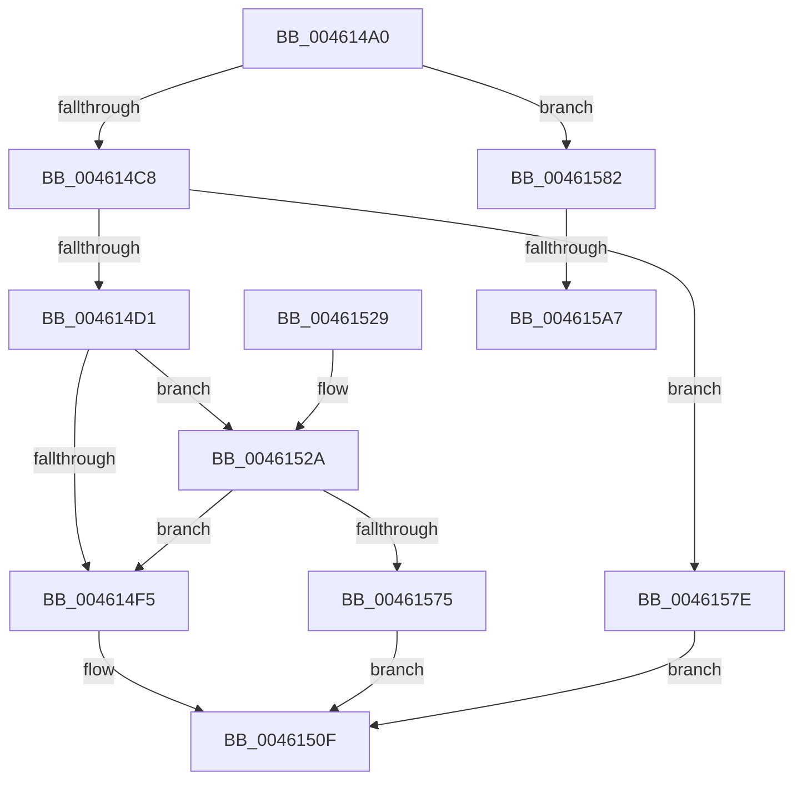

# HalSetBusDataByOffset

- RVA: `0x004614A0`–`0x004615AC` (길이 `268` bytes)
- VA: `0x00000001404614A0`
- 실행 섹션: `.text`
- PDB 이름 있음: `예`; PDB Function 태그: `예`
- unwind 정보 RVA: `0x000A9E48`
- 디코드: `73`개 명령, `268/268` bytes 표시
- 미해석 바이트: `0` (있으면 어셈블리에 `.byte`로 보존)

> 이 문서는 커널 이미지의 기계어와 PDB 기호를 분석해 생성했습니다. 4번과 5번은 함수 원형과 자료형을 바이너리 사용 방식에서 추정한 C 해석이며 원본 소스 복구 결과는 아닙니다.

## 1. Dependencies

- 직접 호출 지점: **3**; 고유 호출 대상: **3**
- 직접 호출자로 확인된 함수: **3**
- RIP 상대 이미지 참조: **2**

### Outgoing calls
- `0x0046150A` → [HalpSetPCIData](HalpSetPCIData_function_004615B4.md) (function, `0x004615B4`)
- `0x00461569` → [guard_dispatch_icall](../6B/guard_dispatch_icall_function_006BAAD0.md) (function, `0x006BAAD0`)
- `0x0046159A` → [HalpAcquireCmosSpinLock](../42/HalpAcquireCmosSpinLock_function_0042DEE8.md) (function, `0x0042DEE8`)

### Direct callers
- [HalSetBusData](../53/HalSetBusData_function_0053F2B0.md) at `0x0053F2C1`
- [HalpPiix4Detect](../../pagelk/B7/HalpPiix4Detect_function_00B79E00.md) at `0x00B7A313`
- [KdpSysWriteBusData](../../pagekd/B8/KdpSysWriteBusData_function_00B885A8.md) at `0x00B885E8`

### Static image references
- `0x004614D7` → RVA `0x00E00D00` (`.data`; read)
- `0x00461582` → RVA `0x00E003D0` (`.data`; read)

## 2. Other-region calls and transfers

- 다른 실행 섹션으로 향하는 call: **0**
- call이 아닌 외부 분기/꼬리 이동: **2**
  - `0x004615A1` → [sub_006F25C4](../6F/Unknown_function_006F25C4.md) (`tail-transfer`)
  - `0x004615A7` → [sub_006F25C4 + 0x1A](../6F/Unknown_function_006F25C4.md) (`tail-transfer`)

## 3. Assembly (complete function range)

```asm
004614A0  48 8B C4                        mov rax, rsp
004614A3  48 89 58 10                     mov qword ptr [rax + 0x10], rbx
004614A7  48 89 68 18                     mov qword ptr [rax + 0x18], rbp
004614AB  48 89 70 20                     mov qword ptr [rax + 0x20], rsi
004614AF  57                              push rdi
004614B0  41 56                           push r14
004614B2  41 57                           push r15
004614B4  48 83 EC 60                     sub rsp, 0x60
004614B8  4D 8B F1                        mov r14, r9
004614BB  41 8B F8                        mov edi, r8d
004614BE  8B F2                           mov esi, edx
004614C0  85 C9                           test ecx, ecx
004614C2  0F 84 BA 00 00 00               je 0x140461582
004614C8  83 F9 04                        cmp ecx, 4
004614CB  0F 85 AD 00 00 00               jne 0x14046157e
004614D1  83 60 08 00                     and dword ptr [rax + 8], 0
004614D5  8B DA                           mov ebx, edx
004614D7  48 8B 05 22 F8 99 00            mov rax, qword ptr [rip + 0x99f822]
004614DE  8B AC 24 A8 00 00 00            mov ebp, dword ptr [rsp + 0xa8]
004614E5  44 8B BC 24 A0 00 00 00         mov r15d, dword ptr [rsp + 0xa0]
004614ED  C1 EB 08                        shr ebx, 8
004614F0  48 85 C0                        test rax, rax
004614F3  75 35                           jne 0x14046152a
004614F5  89 6C 24 28                     mov dword ptr [rsp + 0x28], ebp
004614F9  4D 8B CE                        mov r9, r14
004614FC  44 8B C7                        mov r8d, edi
004614FF  44 89 7C 24 20                  mov dword ptr [rsp + 0x20], r15d
00461504  40 8A D6                        mov dl, sil
00461507  0F B7 CB                        movzx ecx, bx
0046150A  E8 A5 00 00 00                  call 0x1404615b4
0046150F  4C 8D 5C 24 60                  lea r11, [rsp + 0x60]
00461514  49 8B 5B 28                     mov rbx, qword ptr [r11 + 0x28]
00461518  49 8B 6B 30                     mov rbp, qword ptr [r11 + 0x30]
0046151C  49 8B 73 38                     mov rsi, qword ptr [r11 + 0x38]
00461520  49 8B E3                        mov rsp, r11
00461523  41 5F                           pop r15
00461525  41 5E                           pop r14
00461527  5F                              pop rdi
00461528  C3                              ret
00461529  CC                              int3
0046152A  48 8B 54 24 78                  mov rdx, qword ptr [rsp + 0x78]
0046152F  4C 8D 8C 24 80 00 00 00         lea r9, [rsp + 0x80]
00461537  4C 89 4C 24 48                  mov qword ptr [rsp + 0x48], r9
0046153C  8B CF                           mov ecx, edi
0046153E  4C 89 74 24 40                  mov qword ptr [rsp + 0x40], r14
00461543  83 E1 1F                        and ecx, 0x1f
00461546  41 C1 E8 05                     shr r8d, 5
0046154A  44 8A CE                        mov r9b, sil
0046154D  89 6C 24 38                     mov dword ptr [rsp + 0x38], ebp
00461551  41 83 E0 07                     and r8d, 7
00461555  44 89 7C 24 30                  mov dword ptr [rsp + 0x30], r15d
0046155A  44 89 44 24 28                  mov dword ptr [rsp + 0x28], r8d
0046155F  44 0F B7 C3                     movzx r8d, bx
00461563  89 4C 24 20                     mov dword ptr [rsp + 0x20], ecx
00461567  33 C9                           xor ecx, ecx
00461569  E8 62 95 25 00                  call 0x1406baad0
0046156E  3D 0E 00 00 C0                  cmp eax, 0xc000000e
00461573  74 80                           je 0x1404614f5
00461575  8B 84 24 80 00 00 00            mov eax, dword ptr [rsp + 0x80]
0046157C  EB 91                           jmp 0x14046150f
0046157E  33 C0                           xor eax, eax
00461580  EB 8D                           jmp 0x14046150f
00461582  8B 35 48 EE 99 00               mov esi, dword ptr [rip + 0x99ee48]
00461588  8B DF                           mov ebx, edi
0046158A  8B 8C 24 A8 00 00 00            mov ecx, dword ptr [rsp + 0xa8]
00461591  FF C9                           dec ecx
00461593  03 CF                           add ecx, edi
00461595  3B CE                           cmp ecx, esi
00461597  0F 46 F1                        cmovbe esi, ecx
0046159A  E8 49 C9 FC FF                  call 0x14042dee8
0046159F  3B FE                           cmp edi, esi
004615A1  0F 86 1D 10 29 00               jbe 0x1406f25c4
004615A7  E9 32 10 29 00                  jmp 0x1406f25de
```

## 4. C-style interpretation (structured pseudocode)

```c
__int64 __fastcall HalSetBusDataByOffset(int a1, int a2, int a3, __int64 a4, unsigned int a5, unsigned int a6)
{
    __int64 result;
    __int64 v_rbx;
    __int64 v_rsi;
    __int64 v_rsp;
    unsigned __int64 v_stack_m18;
    unsigned __int64 v_stack_m20;
    unsigned int v_stack_m28;
    unsigned int v_stack_m30;
    unsigned int v_stack_m38;
    unsigned int v_stack_m40;
    unsigned int v_stack_m50;
    unsigned int v_stack_m58;
    unsigned __int64 v_stack_p18;
    unsigned __int64 v_stack_p20;

    *(unsigned __int64 *)(v_rsp + 16) = v_rbx;
    *(unsigned __int64 *)(v_rsp + 24) = v_rbp;
    *(unsigned __int64 *)(v_rsp + 32) = v_rsi;
    v_rsp = (v_rsp) - (96);
    if (a1 == 0) goto loc_00461582;
    if (a1 != 4) goto loc_0046157E;
    v_rbx = (unsigned int)(((unsigned int)(a2)) >> (8));
    if (*(unsigned __int64 *)(v_rip + 10090530) != 0) goto loc_0046152A;
loc_004614F5:
    v_stack_m50 = (unsigned int)((unsigned int)(a6));
    v_stack_m58 = (unsigned int)((unsigned int)(a5));
    result = HalpSetPCIData((unsigned __int16)(v_rbx), (unsigned __int8)((unsigned int)(a2)), (unsigned int)((unsigned int)((unsigned int)(a3))), a4);
loc_0046150F:
    return result;
loc_0046152A:
    v_stack_m18 = v_stack_p20;
    v_stack_m20 = a4;
    a1 = (unsigned int)(((unsigned int)((unsigned int)((unsigned int)(a3)))) & (31));
    a3 = (unsigned int)(((unsigned int)((unsigned int)((unsigned int)(a3)))) >> (5));
    v_stack_m28 = (unsigned int)(*(unsigned __int64 *)(v_stack_m18 + 48));
    a3 = (unsigned int)((a3) & (7));
    v_stack_m30 = (unsigned int)((unsigned int)(a5));
    v_stack_m38 = a3;
    v_stack_m40 = a1;
    a1 = 0;
    result = guard_dispatch_icall(a1, v_stack_p18, (unsigned __int16)(*(unsigned __int64 *)(v_stack_m18 + 40)), (unsigned __int8)(*(unsigned __int64 *)(v_stack_m18 + 56)));
    if (((unsigned int)(result)) == 0xC000000EULL) goto loc_004614F5;
    goto loc_0046150F;
loc_0046157E:
    result = 0;
    goto loc_0046150F;
loc_00461582:
    a1 = (unsigned int)(((unsigned int)(a6)) - 1);
    a1 = (unsigned int)((a1) + ((unsigned int)((unsigned int)(a3))));
    v_rsi = (unsigned int)(*(unsigned int *)(v_rip + 10088008));
    if (a1 <= ((unsigned int)((unsigned int)(*(unsigned int *)(v_rip + 10088008))))) { v_rsi = a1; }
    result = HalpAcquireCmosSpinLock(a1, v_stack_p18, (unsigned __int16)(*(unsigned __int64 *)(v_stack_m18 + 40)), (unsigned __int8)(*(unsigned __int64 *)(v_stack_m18 + 56)));
}
```

## 5. (Beta) C Style

```c
int64_t HalSetBusDataByOffset(int32_t Arg1, int32_t Arg2, int32_t Arg3, int64_t Arg4, uint32_t Arg5, uint32_t Arg6)
{
    int64_t result;
    int64_t local_rbx;
    int64_t local_rsi;
    int64_t local_rsp;
    uint64_t v_stack_m18;
    uint64_t v_stack_m20;
    uint32_t v_stack_m28;
    uint32_t v_stack_m30;
    uint32_t v_stack_m38;
    uint32_t v_stack_m40;
    uint32_t v_stack_m50;
    uint32_t v_stack_m58;
    uint64_t v_stack_p18;
    uint64_t v_stack_p20;

    *(uint64_t *)(local_rsp + 0x10) = local_rbx;
    *(uint64_t *)(local_rsp + 0x18) = local_rbp;
    *(uint64_t *)(local_rsp + 0x20) = local_rsi;
    local_rsp = (local_rsp) - (96);
    if (Arg1 == 0) goto loc_00461582;
    if (Arg1 != 4) goto loc_0046157E;
    local_rbx = (uint32_t)(((uint32_t)(Arg2)) >> (8));
    if (*(uint64_t *)(v_rip + 0x99F822) != 0) goto loc_0046152A;
loc_004614F5:
    v_stack_m50 = (uint32_t)((uint32_t)(Arg6));
    v_stack_m58 = (uint32_t)((uint32_t)(Arg5));
    result = HalpSetPCIData((uint16_t)(local_rbx), (uint8_t)((uint32_t)(Arg2)), (uint32_t)((uint32_t)((uint32_t)(Arg3))), Arg4);
loc_0046150F:
    return result;
loc_0046152A:
    v_stack_m18 = v_stack_p20;
    v_stack_m20 = Arg4;
    Arg1 = (uint32_t)(((uint32_t)((uint32_t)((uint32_t)(Arg3)))) & (31));
    Arg3 = (uint32_t)(((uint32_t)((uint32_t)((uint32_t)(Arg3)))) >> (5));
    v_stack_m28 = (uint32_t)(*(uint64_t *)(v_stack_m18 + 0x30));
    Arg3 = (uint32_t)((Arg3) & (7));
    v_stack_m30 = (uint32_t)((uint32_t)(Arg5));
    v_stack_m38 = Arg3;
    v_stack_m40 = Arg1;
    Arg1 = 0;
    result = guard_dispatch_icall(Arg1, v_stack_p18, (uint16_t)(*(uint64_t *)(v_stack_m18 + 0x28)), (uint8_t)(*(uint64_t *)(v_stack_m18 + 0x38)));
    if (((uint32_t)(result)) == 0xC000000EULL) goto loc_004614F5;
    goto loc_0046150F;
loc_0046157E:
    result = 0;
    goto loc_0046150F;
loc_00461582:
    Arg1 = (uint32_t)(((uint32_t)(Arg6)) - 1);
    Arg1 = (uint32_t)((Arg1) + ((uint32_t)((uint32_t)(Arg3))));
    local_rsi = (uint32_t)(*(uint32_t *)(v_rip + 0x99EE48));
    if (Arg1 <= ((uint32_t)((uint32_t)(*(uint32_t *)(v_rip + 0x99EE48))))) { local_rsi = Arg1; }
    result = HalpAcquireCmosSpinLock(Arg1, v_stack_p18, (uint16_t)(*(uint64_t *)(v_stack_m18 + 0x28)), (uint8_t)(*(uint64_t *)(v_stack_m18 + 0x38)));
}
```

## 6. Execution-region graph

[열기: 2D/3D 그래프와 함수 탐색 컨트롤 패널](../../../control-panel.html?section=text&rva=0x004614A0&view=graph)

- 2D 그래프는 위에서 아래로 흐르고, 3D 그래프는 빈 공간을 드래그해 회전합니다. Shift+드래그는 이동, 휠은 확대·축소, 함수 노드 선택은 대상 보고서 이동입니다.

### Static fallback


