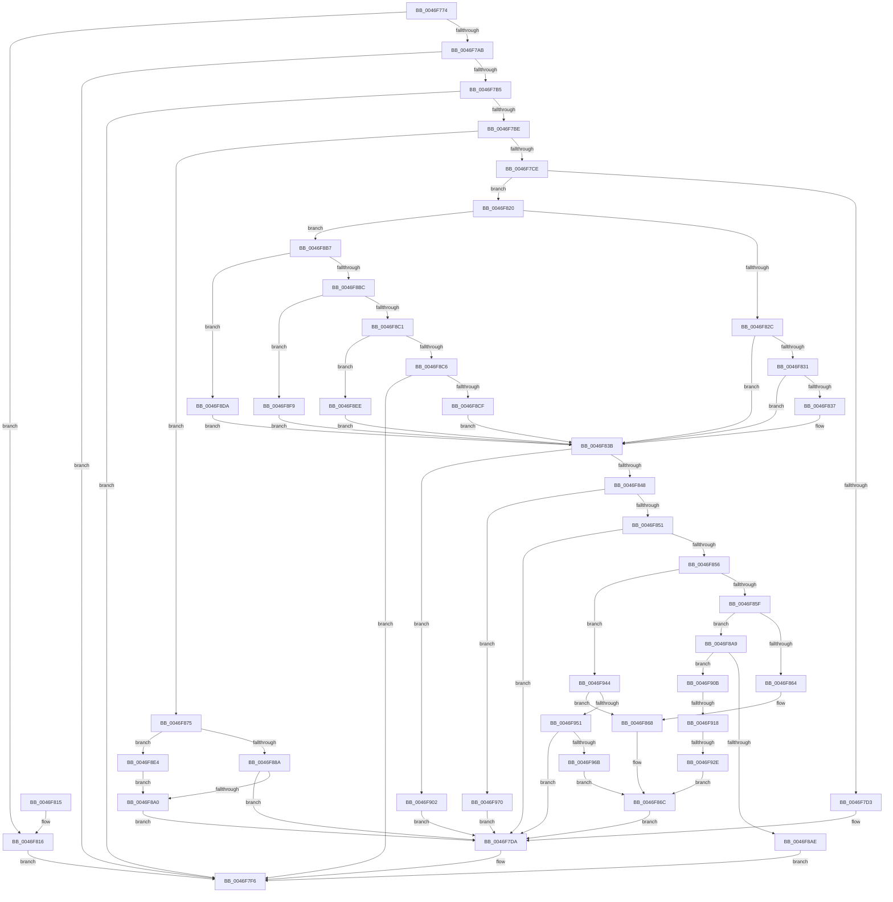

# HalpApicConvertToRte

- RVA: `0x0046F774`–`0x0046F98E` (길이 `538` bytes)
- VA: `0x000000014046F774`
- 실행 섹션: `.text`
- PDB 이름 있음: `예`; PDB Function 태그: `예`
- unwind 정보 RVA: `0x000ABC84`
- 디코드: `133`개 명령, `538/538` bytes 표시
- 미해석 바이트: `0` (있으면 어셈블리에 `.byte`로 보존)

> 이 문서는 커널 이미지의 기계어와 PDB 기호를 분석해 생성했습니다. 4번과 5번은 함수 원형과 자료형을 바이너리 사용 방식에서 추정한 C 해석이며 원본 소스 복구 결과는 아닙니다.

## 1. Dependencies

- 직접 호출 지점: **1**; 고유 호출 대상: **1**
- 직접 호출자로 확인된 함수: **1**
- RIP 상대 이미지 참조: **2**

### Outgoing calls
- `0x0046F935` → [HalpApicConvertId](../56/HalpApicConvertId_function_005697A0.md) (function, `0x005697A0`)

### Direct callers
- [HalpApicSetLineState](HalpApicSetLineState_function_0046F680.md) at `0x0046F6AB`

### Static image references
- `0x0046F83B` → RVA `0x00E10461` (`.data`; read)
- `0x0046F90B` → RVA `0x00E10452` (`.data`; read)

## 2. Other-region calls and transfers

- 다른 실행 섹션으로 향하는 call: **0**
- call이 아닌 외부 분기/꼬리 이동: **2**
  - `0x0046F912` → [sub_006F361A + 0x11](../6F/Unknown_function_006F361A.md) (`tail-transfer`)
  - `0x0046F928` → [sub_006F361A](../6F/Unknown_function_006F361A.md) (`tail-transfer`)

## 3. Assembly (complete function range)

```asm
0046F774  48 8B C4                        mov rax, rsp
0046F777  48 89 58 10                     mov qword ptr [rax + 0x10], rbx
0046F77B  48 89 70 18                     mov qword ptr [rax + 0x18], rsi
0046F77F  48 89 78 20                     mov qword ptr [rax + 0x20], rdi
0046F783  41 56                           push r14
0046F785  48 83 EC 20                     sub rsp, 0x20
0046F789  83 60 08 00                     and dword ptr [rax + 8], 0
0046F78D  45 33 C9                        xor r9d, r9d
0046F790  44 8B 51 0C                     mov r10d, dword ptr [rcx + 0xc]
0046F794  33 DB                           xor ebx, ebx
0046F796  49 8B F0                        mov rsi, r8
0046F799  4C 8B F2                        mov r14, rdx
0046F79C  48 8B F9                        mov rdi, rcx
0046F79F  41 BB BB 00 00 C0               mov r11d, 0xc00000bb
0046F7A5  41 F6 C2 01                     test r10b, 1
0046F7A9  74 6B                           je 0x14046f816
0046F7AB  8B 41 30                        mov eax, dword ptr [rcx + 0x30]
0046F7AE  A9 00 FF FF FF                  test eax, 0xffffff00
0046F7B3  75 41                           jne 0x14046f7f6
0046F7B5  83 79 10 FF                     cmp dword ptr [rcx + 0x10], -1
0046F7B9  0F B6 D8                        movzx ebx, al
0046F7BC  75 38                           jne 0x14046f7f6
0046F7BE  4C 8D 41 18                     lea r8, [rcx + 0x18]
0046F7C2  41 8B 08                        mov ecx, dword ptr [r8]
0046F7C5  83 F9 07                        cmp ecx, 7
0046F7C8  0F 84 A7 00 00 00               je 0x14046f875
0046F7CE  83 F9 08                        cmp ecx, 8
0046F7D1  75 4D                           jne 0x14046f820
0046F7D3  8B 5F 20                        mov ebx, dword ptr [rdi + 0x20]
0046F7D6  44 8B 4F 24                     mov r9d, dword ptr [rdi + 0x24]
0046F7DA  8B D3                           mov edx, ebx
0046F7DC  0F BA EA 0F                     bts edx, 0xf
0046F7E0  83 7F 08 00                     cmp dword ptr [rdi + 8], 0
0046F7E4  0F 45 D3                        cmovne edx, ebx
0046F7E7  45 33 DB                        xor r11d, r11d
0046F7EA  8B DA                           mov ebx, edx
0046F7EC  0F BA EB 0D                     bts ebx, 0xd
0046F7F0  83 3F 02                        cmp dword ptr [rdi], 2
0046F7F3  0F 45 DA                        cmovne ebx, edx
0046F7F6  48 8B 7C 24 48                  mov rdi, qword ptr [rsp + 0x48]
0046F7FB  41 8B C3                        mov eax, r11d
0046F7FE  41 89 1E                        mov dword ptr [r14], ebx
0046F801  48 8B 5C 24 38                  mov rbx, qword ptr [rsp + 0x38]
0046F806  44 89 0E                        mov dword ptr [rsi], r9d
0046F809  48 8B 74 24 40                  mov rsi, qword ptr [rsp + 0x40]
0046F80E  48 83 C4 20                     add rsp, 0x20
0046F812  41 5E                           pop r14
0046F814  C3                              ret
0046F815  CC                              int3
0046F816  BB FF 00 01 00                  mov ebx, 0x100ff
0046F81B  45 33 DB                        xor r11d, r11d
0046F81E  EB D6                           jmp 0x14046f7f6
0046F820  8B 57 14                        mov edx, dword ptr [rdi + 0x14]
0046F823  83 EA 01                        sub edx, 1
0046F826  0F 85 8B 00 00 00               jne 0x14046f8b7
0046F82C  83 F9 04                        cmp ecx, 4
0046F82F  74 0A                           je 0x14046f83b
0046F831  41 F6 C2 02                     test r10b, 2
0046F835  74 04                           je 0x14046f83b
0046F837  0F BA EB 08                     bts ebx, 8
0046F83B  44 38 0D 1F 0C 9A 00            cmp byte ptr [rip + 0x9a0c1f], r9b
0046F842  0F 85 BA 00 00 00               jne 0x14046f902
0046F848  83 E9 01                        sub ecx, 1
0046F84B  0F 84 1F 01 00 00               je 0x14046f970
0046F851  83 E9 02                        sub ecx, 2
0046F854  74 84                           je 0x14046f7da
0046F856  83 E9 01                        sub ecx, 1
0046F859  0F 84 E5 00 00 00               je 0x14046f944
0046F85F  83 E9 01                        sub ecx, 1
0046F862  75 45                           jne 0x14046f8a9
0046F864  0F BA EB 0B                     bts ebx, 0xb
0046F868  44 8B 4F 20                     mov r9d, dword ptr [rdi + 0x20]
0046F86C  41 C1 E1 18                     shl r9d, 0x18
0046F870  E9 65 FF FF FF                  jmp 0x14046f7da
0046F875  65 48 8B 04 25 20 00 00 00      mov rax, qword ptr gs:[0x20]
0046F87E  8B 4F 20                        mov ecx, dword ptr [rdi + 0x20]
0046F881  80 B8 8D 00 00 00 01            cmp byte ptr [rax + 0x8d], 1
0046F888  74 5A                           je 0x14046f8e4
0046F88A  44 8B C9                        mov r9d, ecx
0046F88D  41 C1 E1 11                     shl r9d, 0x11
0046F891  41 0F BA E9 10                  bts r9d, 0x10
0046F896  0F BA E1 0F                     bt ecx, 0xf
0046F89A  0F 83 3A FF FF FF               jae 0x14046f7da
0046F8A0  0F BA EB 0B                     bts ebx, 0xb
0046F8A4  E9 31 FF FF FF                  jmp 0x14046f7da
0046F8A9  83 F9 01                        cmp ecx, 1
0046F8AC  74 5D                           je 0x14046f90b
0046F8AE  0F BA EB 0B                     bts ebx, 0xb
0046F8B2  E9 3F FF FF FF                  jmp 0x14046f7f6
0046F8B7  83 EA 01                        sub edx, 1
0046F8BA  74 1E                           je 0x14046f8da
0046F8BC  83 EA 01                        sub edx, 1
0046F8BF  74 38                           je 0x14046f8f9
0046F8C1  83 EA 01                        sub edx, 1
0046F8C4  74 28                           je 0x14046f8ee
0046F8C6  83 FA 03                        cmp edx, 3
0046F8C9  0F 85 27 FF FF FF               jne 0x14046f7f6
0046F8CF  81 CB 00 05 00 00               or ebx, 0x500
0046F8D5  E9 61 FF FF FF                  jmp 0x14046f83b
0046F8DA  BB 00 04 00 00                  mov ebx, 0x400
0046F8DF  E9 57 FF FF FF                  jmp 0x14046f83b
0046F8E4  8B D9                           mov ebx, ecx
0046F8E6  81 E3 FF 01 00 00               and ebx, 0x1ff
0046F8EC  EB B2                           jmp 0x14046f8a0
0046F8EE  81 CB 00 07 00 00               or ebx, 0x700
0046F8F4  E9 42 FF FF FF                  jmp 0x14046f83b
0046F8F9  0F BA EB 09                     bts ebx, 9
0046F8FD  E9 39 FF FF FF                  jmp 0x14046f83b
0046F902  0F BA F3 08                     btr ebx, 8
0046F906  E9 CF FE FF FF                  jmp 0x14046f7da
0046F90B  44 38 0D 40 0B 9A 00            cmp byte ptr [rip + 0x9a0b40], r9b
0046F912  0F 84 13 3D 28 00               je 0x1406f362b
0046F918  65 48 8B 04 25 20 00 00 00      mov rax, qword ptr gs:[0x20]
0046F921  80 B8 8D 00 00 00 01            cmp byte ptr [rax + 0x8d], 1
0046F928  0F 85 EC 3C 28 00               jne 0x1406f361a
0046F92E  48 8D 54 24 30                  lea rdx, [rsp + 0x30]
0046F933  33 C9                           xor ecx, ecx
0046F935  E8 66 9E 0F 00                  call 0x1405697a0
0046F93A  44 8B 4C 24 30                  mov r9d, dword ptr [rsp + 0x30]
0046F93F  E9 28 FF FF FF                  jmp 0x14046f86c
0046F944  44 38 0D 07 0B 9A 00            cmp byte ptr [rip + 0x9a0b07], r9b
0046F94B  0F 84 17 FF FF FF               je 0x14046f868
0046F951  65 48 8B 04 25 20 00 00 00      mov rax, qword ptr gs:[0x20]
0046F95A  44 8B 4F 20                     mov r9d, dword ptr [rdi + 0x20]
0046F95E  80 B8 8D 00 00 00 01            cmp byte ptr [rax + 0x8d], 1
0046F965  0F 85 6F FE FF FF               jne 0x14046f7da
0046F96B  E9 FC FE FF FF                  jmp 0x14046f86c
0046F970  8A 05 DC 0A 9A 00               mov al, byte ptr [rip + 0x9a0adc]
0046F976  F6 D8                           neg al
0046F978  45 1B C9                        sbb r9d, r9d
0046F97B  41 81 E1 FF FF FF 00            and r9d, 0xffffff
0046F982  41 81 C1 00 00 00 FF            add r9d, 0xff000000
0046F989  E9 4C FE FF FF                  jmp 0x14046f7da
```

## 4. C-style interpretation (structured pseudocode)

```c
__int64 __fastcall HalpApicConvertToRte(__int64 a1, __int64 a2, __int64 a3, int a4)
{
    __int64 result;
    __int64 v_r11;
    __int64 v_rbx;
    __int64 v_rsp;
    unsigned __int64 v_stack_p10;
    unsigned __int64 v_stack_p18;
    unsigned __int64 v_stack_p20;
    unsigned __int64 v_stack_p30;

    *(unsigned __int64 *)(v_rsp + 16) = v_rbx;
    *(unsigned __int64 *)(v_rsp + 24) = v_rsi;
    *(unsigned __int64 *)(v_rsp + 32) = v_rdi;
    v_rsp = (v_rsp) - (32);
    a4 = 0;
    v_rbx = 0;
    if ((((unsigned __int8)((unsigned int)(*(unsigned int *)(a1 + 12)))) & (1)) == 0) goto loc_0046F816;
    if ((((unsigned int)((unsigned int)(*(unsigned int *)(a1 + 48)))) & (0xFFFFFF00ULL)) != 0) goto loc_0046F7F6;
    if ((*(unsigned int *)(a1 + 16)) != -1) goto loc_0046F7F6;
    if (((unsigned int)((unsigned int)(*(unsigned int *)(a1 + 24)))) == 7) goto loc_0046F875;
    if (((unsigned int)((unsigned int)(*(unsigned int *)(a1 + 24)))) != 8) goto loc_0046F820;
loc_0046F7DA:
    a2 = (unsigned int)((unsigned int)((unsigned int)(*(unsigned int *)(a1 + 32))));
    if ((*(unsigned int *)(a1 + 8)) != 0) { a2 = (unsigned int)((unsigned int)(*(unsigned int *)(a1 + 32))); }
    v_r11 = 0;
    v_rbx = (unsigned int)((unsigned int)(a2));
    if ((*(unsigned int *)(a1)) != 2) { v_rbx = (unsigned int)(a2); }
loc_0046F7F6:
    *(unsigned int *)(a2) = (unsigned int)(v_rbx);
    *(unsigned int *)(a3) = (unsigned int)((unsigned int)(*(unsigned int *)(a1 + 36)));
    v_rsp = (v_rsp) + (32);
    return 0;
loc_0046F816:
    v_r11 = 0;
    goto loc_0046F7F6;
loc_0046F820:
    a2 = (unsigned int)(((unsigned int)(*(unsigned int *)(v_stack_p20 + 20))) - (1));
    if (condition_is_not_equal) goto loc_0046F8B7;
    if (((unsigned int)((unsigned int)(*(unsigned int *)(a1 + 24)))) == 4) goto loc_0046F83B;
    if ((((unsigned __int8)((unsigned int)(*(unsigned int *)(a1 + 12)))) & (2)) != 0) {
    }
    if ((*(unsigned __int8 *)(v_rip + 10095647)) != ((unsigned __int8)((unsigned int)(*(unsigned int *)(a1 + 36))))) goto loc_0046F902;
    a1 = (unsigned int)(((unsigned int)(*(unsigned int *)(a1 + 24))) - (1));
    if (condition_is_equal) goto loc_0046F970;
    a1 = (unsigned int)((a1) - (2));
    if (condition_is_equal) goto loc_0046F7DA;
    a1 = (unsigned int)((a1) - (1));
    if (condition_is_equal) goto loc_0046F944;
    a1 = (unsigned int)((a1) - (1));
    if (condition_is_not_equal) goto loc_0046F8A9;
loc_0046F868:
loc_0046F86C:
    a4 = (unsigned int)(((unsigned int)(*(unsigned int *)(v_stack_p20 + 32))) << (24));
    goto loc_0046F7DA;
loc_0046F875:
    if ((*(unsigned __int8 *)(*(unsigned __int64 *)(gs_base + (0 + 32)) + 141)) == 1) goto loc_0046F8E4;
    a4 = (unsigned int)(((unsigned int)((unsigned int)((unsigned int)(*(unsigned int *)(v_stack_p20 + 32))))) << (17));
    if (condition_is_above_or_equal) goto loc_0046F7DA;
loc_0046F8A0:
    goto loc_0046F7DA;
loc_0046F8A9:
    if (((unsigned int)((unsigned int)(*(unsigned int *)(v_stack_p20 + 32)))) == 1) goto loc_0046F90B;
    goto loc_0046F7F6;
loc_0046F8B7:
    a2 = (unsigned int)((a2) - (1));
    if (condition_is_equal) goto loc_0046F8DA;
    a2 = (unsigned int)((a2) - (1));
    if (condition_is_equal) goto loc_0046F8F9;
    a2 = (unsigned int)((a2) - (1));
    if (condition_is_equal) goto loc_0046F8EE;
    if (((unsigned int)(a2)) != 3) goto loc_0046F7F6;
    v_rbx = (unsigned int)(((unsigned int)(0x100FFULL)) | (0x500ULL));
    goto loc_0046F83B;
loc_0046F8DA:
    goto loc_0046F83B;
loc_0046F8E4:
    v_rbx = (unsigned int)(((unsigned int)((unsigned int)((unsigned int)(*(unsigned int *)(v_stack_p20 + 32))))) & (511));
    goto loc_0046F8A0;
loc_0046F8EE:
    v_rbx = (unsigned int)((v_rbx) | (0x700ULL));
    goto loc_0046F83B;
loc_0046F8F9:
    goto loc_0046F83B;
loc_0046F902:
    goto loc_0046F7DA;
loc_0046F90B:
    a1 = 0;
    result = HalpApicConvertId(a1, v_stack_p30, a1 + 24, a4);
    goto loc_0046F86C;
loc_0046F944:
    if ((*(unsigned __int8 *)(v_rip + 10095367)) == ((unsigned __int8)((unsigned int)(v_stack_p30)))) goto loc_0046F868;
    if ((*(unsigned __int8 *)(*(unsigned __int64 *)(gs_base + (0 + 32)) + 141)) != 1) goto loc_0046F7DA;
    goto loc_0046F86C;
loc_0046F970:
    result = (unsigned __int8)(-(*(unsigned __int8 *)(v_rip + 10095324)));
    a4 = (unsigned int)(((unsigned int)(*(unsigned int *)(v_stack_p20 + 32))) & (0xFFFFFFULL));
    a4 = (unsigned int)((a4) + (0xFF000000ULL));
    goto loc_0046F7DA;
}
```

## 5. (Beta) C Style

```c
int64_t HalpApicConvertToRte(void *Arg1, void *Arg2, void *Arg3, int32_t Arg4)
{
    uint8_t *arg1 = (uint8_t *)Arg1;
    uint8_t *arg2 = (uint8_t *)Arg2;
    uint8_t *arg3 = (uint8_t *)Arg3;

    int64_t result;
    int64_t local_r11;
    int64_t local_rbx;
    int64_t local_rsp;
    uint64_t v_stack_p10;
    uint64_t v_stack_p18;
    uint64_t v_stack_p20;
    uint64_t v_stack_p30;

    *(uint64_t *)(local_rsp + 0x10) = local_rbx;
    *(uint64_t *)(local_rsp + 0x18) = local_rsi;
    *(uint64_t *)(local_rsp + 0x20) = local_rdi;
    local_rsp = (local_rsp) - (32);
    Arg4 = 0;
    local_rbx = 0;
    if ((((uint8_t)((uint32_t)(*(uint32_t *)(arg1 + 0xC)))) & (1)) == 0) goto loc_0046F816;
    if ((((uint32_t)((uint32_t)(*(uint32_t *)(arg1 + 0x30)))) & (0xFFFFFF00ULL)) != 0) goto loc_0046F7F6;
    if ((*(uint32_t *)(arg1 + 0x10)) != -1) goto loc_0046F7F6;
    if (((uint32_t)((uint32_t)(*(uint32_t *)(arg1 + 0x18)))) == 7) goto loc_0046F875;
    if (((uint32_t)((uint32_t)(*(uint32_t *)(arg1 + 0x18)))) != 8) goto loc_0046F820;
loc_0046F7DA:
    Arg2 = (uint32_t)((uint32_t)((uint32_t)(*(uint32_t *)(arg1 + 0x20))));
    if ((*(uint32_t *)(arg1 + 0x8)) != 0) { Arg2 = (uint32_t)((uint32_t)(*(uint32_t *)(arg1 + 0x20))); }
    local_r11 = 0;
    local_rbx = (uint32_t)((uint32_t)(Arg2));
    if ((*(uint32_t *)(arg1)) != 2) { local_rbx = (uint32_t)(Arg2); }
loc_0046F7F6:
    *(uint32_t *)(arg2) = (uint32_t)(local_rbx);
    *(uint32_t *)(arg3) = (uint32_t)((uint32_t)(*(uint32_t *)(arg1 + 0x24)));
    local_rsp = (local_rsp) + (32);
    return 0;
loc_0046F816:
    local_r11 = 0;
    goto loc_0046F7F6;
loc_0046F820:
    Arg2 = (uint32_t)(((uint32_t)(*(uint32_t *)(v_stack_p20 + 0x14))) - (1));
    if (condition_is_not_equal) goto loc_0046F8B7;
    if (((uint32_t)((uint32_t)(*(uint32_t *)(arg1 + 0x18)))) == 4) goto loc_0046F83B;
    if ((((uint8_t)((uint32_t)(*(uint32_t *)(arg1 + 0xC)))) & (2)) != 0) {
    }
    if ((*(uint8_t *)(v_rip + 0x9A0C1F)) != ((uint8_t)((uint32_t)(*(uint32_t *)(arg1 + 0x24))))) goto loc_0046F902;
    Arg1 = (uint32_t)(((uint32_t)(*(uint32_t *)(arg1 + 0x18))) - (1));
    if (condition_is_equal) goto loc_0046F970;
    Arg1 = (uint32_t)((Arg1) - (2));
    if (condition_is_equal) goto loc_0046F7DA;
    Arg1 = (uint32_t)((Arg1) - (1));
    if (condition_is_equal) goto loc_0046F944;
    Arg1 = (uint32_t)((Arg1) - (1));
    if (condition_is_not_equal) goto loc_0046F8A9;
loc_0046F868:
loc_0046F86C:
    Arg4 = (uint32_t)(((uint32_t)(*(uint32_t *)(v_stack_p20 + 0x20))) << (24));
    goto loc_0046F7DA;
loc_0046F875:
    if ((*(uint8_t *)(*(uint64_t *)(gs_base + (0 + 0x20)) + 0x8D)) == 1) goto loc_0046F8E4;
    Arg4 = (uint32_t)(((uint32_t)((uint32_t)((uint32_t)(*(uint32_t *)(v_stack_p20 + 0x20))))) << (17));
    if (condition_is_above_or_equal) goto loc_0046F7DA;
loc_0046F8A0:
    goto loc_0046F7DA;
loc_0046F8A9:
    if (((uint32_t)((uint32_t)(*(uint32_t *)(v_stack_p20 + 0x20)))) == 1) goto loc_0046F90B;
    goto loc_0046F7F6;
loc_0046F8B7:
    Arg2 = (uint32_t)((Arg2) - (1));
    if (condition_is_equal) goto loc_0046F8DA;
    Arg2 = (uint32_t)((Arg2) - (1));
    if (condition_is_equal) goto loc_0046F8F9;
    Arg2 = (uint32_t)((Arg2) - (1));
    if (condition_is_equal) goto loc_0046F8EE;
    if (((uint32_t)(Arg2)) != 3) goto loc_0046F7F6;
    local_rbx = (uint32_t)(((uint32_t)(0x100FFULL)) | (0x500ULL));
    goto loc_0046F83B;
loc_0046F8DA:
    goto loc_0046F83B;
loc_0046F8E4:
    local_rbx = (uint32_t)(((uint32_t)((uint32_t)((uint32_t)(*(uint32_t *)(v_stack_p20 + 0x20))))) & (511));
    goto loc_0046F8A0;
loc_0046F8EE:
    local_rbx = (uint32_t)((local_rbx) | (0x700ULL));
    goto loc_0046F83B;
loc_0046F8F9:
    goto loc_0046F83B;
loc_0046F902:
    goto loc_0046F7DA;
loc_0046F90B:
    Arg1 = 0;
    result = HalpApicConvertId(Arg1, v_stack_p30, Arg1 + 24, Arg4);
    goto loc_0046F86C;
loc_0046F944:
    if ((*(uint8_t *)(v_rip + 0x9A0B07)) == ((uint8_t)((uint32_t)(v_stack_p30)))) goto loc_0046F868;
    if ((*(uint8_t *)(*(uint64_t *)(gs_base + (0 + 0x20)) + 0x8D)) != 1) goto loc_0046F7DA;
    goto loc_0046F86C;
loc_0046F970:
    result = (uint8_t)(-(*(uint8_t *)(v_rip + 0x9A0ADC)));
    Arg4 = (uint32_t)(((uint32_t)(*(uint32_t *)(v_stack_p20 + 0x20))) & (0xFFFFFFULL));
    Arg4 = (uint32_t)((Arg4) + (0xFF000000ULL));
    goto loc_0046F7DA;
}
```

### 관측된 메모리 오프셋

구조체 형식이 확인되지 않은 접근은 인자 기준의 오프셋으로만 기록했습니다.

| 기준 인자 | 오프셋 표현 | 폭 (bit) | 접근 |
|---|---:|---:|---|
| `Arg1` | `+ 0x0` | `32` | `R` |
| `Arg1` | `+ 0x8` | `32` | `R` |
| `Arg1` | `+ 0xC` | `32` | `R` |
| `Arg1` | `+ 0x10` | `32` | `R` |
| `Arg1` | `+ 0x14` | `32` | `R` |
| `Arg1` | `+ 0x18` | `64` | `R` |
| `Arg1` | `+ 0x20` | `32` | `R` |
| `Arg1` | `+ 0x24` | `32` | `R` |
| `Arg1` | `+ 0x30` | `32` | `R` |
| `Arg2` | `+ 0x0` | `32` | `W` |
| `Arg3` | `+ 0x0` | `32` | `W` |

## 6. Execution-region graph

[열기: 2D/3D 그래프와 함수 탐색 컨트롤 패널](../../../control-panel.html?section=text&rva=0x0046F774&view=graph)

- 2D 그래프는 위에서 아래로 흐르고, 3D 그래프는 빈 공간을 드래그해 회전합니다. Shift+드래그는 이동, 휠은 확대·축소, 함수 노드 선택은 대상 보고서 이동입니다.

### Static fallback


