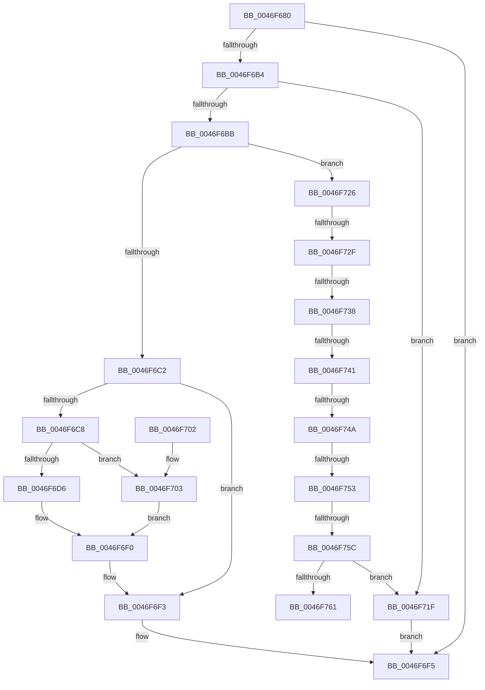

# HalpApicSetLineState

- RVA: `0x0046F680`–`0x0046F76B` (길이 `235` bytes)
- VA: `0x000000014046F680`
- 실행 섹션: `.text`
- PDB 이름 있음: `예`; PDB Function 태그: `예`
- unwind 정보 RVA: `0x000ABC60`
- 디코드: `74`개 명령, `235/235` bytes 표시
- 미해석 바이트: `0` (있으면 어셈블리에 `.byte`로 보존)

> 이 문서는 커널 이미지의 기계어와 PDB 기호를 분석해 생성했습니다. 4번과 5번은 함수 원형과 자료형을 바이너리 사용 방식에서 추정한 C 해석이며 원본 소스 복구 결과는 아닙니다.

## 1. Dependencies

- 직접 호출 지점: **1**; 고유 호출 대상: **1**
- 직접 호출자로 확인된 함수: **0**
- RIP 상대 이미지 참조: **0**

### Outgoing calls
- `0x0046F6AB` → [HalpApicConvertToRte](HalpApicConvertToRte_function_0046F774.md) (function, `0x0046F774`)

### Direct callers
- 이 함수 시작 RVA로 연결되는 직접 call은 확인되지 않았습니다. 간접 호출은 완전히 역산할 수 없습니다.

### Static image references
- 디코드된 RIP-relative 메모리 참조가 없습니다.

## 2. Other-region calls and transfers

- 다른 실행 섹션으로 향하는 call: **0**
- call이 아닌 외부 분기/꼬리 이동: **7**
  - `0x0046F729` → [sub_006F35D8 + 0x21](../6F/Unknown_function_006F35D8.md) (`tail-transfer`)
  - `0x0046F732` → [sub_006F35D8 + 0x1C](../6F/Unknown_function_006F35D8.md) (`tail-transfer`)
  - `0x0046F73B` → [sub_006F35D8 + 0x15](../6F/Unknown_function_006F35D8.md) (`tail-transfer`)
  - `0x0046F744` → [sub_006F35D8 + 0xE](../6F/Unknown_function_006F35D8.md) (`tail-transfer`)
  - `0x0046F74D` → [sub_006F35D8 + 0x7](../6F/Unknown_function_006F35D8.md) (`tail-transfer`)
  - `0x0046F756` → [sub_006F35D8](../6F/Unknown_function_006F35D8.md) (`tail-transfer`)
  - `0x0046F766` → [sub_006F35D8 + 0x2C](../6F/Unknown_function_006F35D8.md) (`tail-transfer`)

## 3. Assembly (complete function range)

```asm
0046F680  48 89 5C 24 10                  mov qword ptr [rsp + 0x10], rbx
0046F685  55                              push rbp
0046F686  56                              push rsi
0046F687  57                              push rdi
0046F688  48 8B EC                        mov rbp, rsp
0046F68B  48 83 EC 20                     sub rsp, 0x20
0046F68F  83 65 38 00                     and dword ptr [rbp + 0x38], 0
0046F693  49 8B F0                        mov rsi, r8
0046F696  83 65 20 00                     and dword ptr [rbp + 0x20], 0
0046F69A  4C 8D 45 38                     lea r8, [rbp + 0x38]
0046F69E  48 8B FA                        mov rdi, rdx
0046F6A1  48 8B D9                        mov rbx, rcx
0046F6A4  48 8B CE                        mov rcx, rsi
0046F6A7  48 8D 55 20                     lea rdx, [rbp + 0x20]
0046F6AB  E8 C4 00 00 00                  call 0x14046f774
0046F6B0  85 C0                           test eax, eax
0046F6B2  78 41                           js 0x14046f6f5
0046F6B4  8B 43 08                        mov eax, dword ptr [rbx + 8]
0046F6B7  39 07                           cmp dword ptr [rdi], eax
0046F6B9  75 64                           jne 0x14046f71f
0046F6BB  8B 47 04                        mov eax, dword ptr [rdi + 4]
0046F6BE  85 C0                           test eax, eax
0046F6C0  78 64                           js 0x14046f726
0046F6C2  80 7B 28 00                     cmp byte ptr [rbx + 0x28], 0
0046F6C6  75 2B                           jne 0x14046f6f3
0046F6C8  48 8B 4B 10                     mov rcx, qword ptr [rbx + 0x10]
0046F6CC  8D 14 00                        lea edx, [rax + rax]
0046F6CF  8B 46 0C                        mov eax, dword ptr [rsi + 0xc]
0046F6D2  A8 01                           test al, 1
0046F6D4  74 2D                           je 0x14046f703
0046F6D6  8D 42 11                        lea eax, [rdx + 0x11]
0046F6D9  89 01                           mov dword ptr [rcx], eax
0046F6DB  8B 45 38                        mov eax, dword ptr [rbp + 0x38]
0046F6DE  89 41 10                        mov dword ptr [rcx + 0x10], eax
0046F6E1  8B 47 04                        mov eax, dword ptr [rdi + 4]
0046F6E4  8D 04 45 10 00 00 00            lea eax, [rax*2 + 0x10]
0046F6EB  89 01                           mov dword ptr [rcx], eax
0046F6ED  8B 45 20                        mov eax, dword ptr [rbp + 0x20]
0046F6F0  89 41 10                        mov dword ptr [rcx + 0x10], eax
0046F6F3  33 C0                           xor eax, eax
0046F6F5  48 8B 5C 24 48                  mov rbx, qword ptr [rsp + 0x48]
0046F6FA  48 83 C4 20                     add rsp, 0x20
0046F6FE  5F                              pop rdi
0046F6FF  5E                              pop rsi
0046F700  5D                              pop rbp
0046F701  C3                              ret
0046F702  CC                              int3
0046F703  8D 42 10                        lea eax, [rdx + 0x10]
0046F706  89 01                           mov dword ptr [rcx], eax
0046F708  8B 45 20                        mov eax, dword ptr [rbp + 0x20]
0046F70B  89 41 10                        mov dword ptr [rcx + 0x10], eax
0046F70E  8B 47 04                        mov eax, dword ptr [rdi + 4]
0046F711  8D 04 45 11 00 00 00            lea eax, [rax*2 + 0x11]
0046F718  89 01                           mov dword ptr [rcx], eax
0046F71A  8B 45 38                        mov eax, dword ptr [rbp + 0x38]
0046F71D  EB D1                           jmp 0x14046f6f0
0046F71F  B8 0D 00 00 C0                  mov eax, 0xc000000d
0046F724  EB CF                           jmp 0x14046f6f5
0046F726  83 F8 F8                        cmp eax, -8
0046F729  0F 84 CA 3E 28 00               je 0x1406f35f9
0046F72F  83 F8 F9                        cmp eax, -7
0046F732  0F 84 BC 3E 28 00               je 0x1406f35f4
0046F738  83 F8 FA                        cmp eax, -6
0046F73B  0F 84 AC 3E 28 00               je 0x1406f35ed
0046F741  83 F8 FB                        cmp eax, -5
0046F744  0F 84 9C 3E 28 00               je 0x1406f35e6
0046F74A  83 F8 FC                        cmp eax, -4
0046F74D  0F 84 8C 3E 28 00               je 0x1406f35df
0046F753  83 F8 FD                        cmp eax, -3
0046F756  0F 84 7C 3E 28 00               je 0x1406f35d8
0046F75C  83 F8 FE                        cmp eax, -2
0046F75F  75 BE                           jne 0x14046f71f
0046F761  B9 30 03 00 00                  mov ecx, 0x330
0046F766  E9 99 3E 28 00                  jmp 0x1406f3604
```

## 4. C-style interpretation (structured pseudocode)

```c
__int64 __fastcall HalpApicSetLineState(__int64 a1, __int64 a2, __int64 a3)
{
    __int64 result;
    __int64 v_rsp;
    unsigned __int64 v_stack_p10;
    unsigned int v_stack_p20;
    unsigned int v_stack_p8;

    v_stack_p10 = v_rbx;
    v_rsp = (v_rsp) - (32);
    result = HalpApicConvertToRte(a3, v_stack_p8, v_stack_p20, a4);
    if (sign_flag) goto loc_0046F6F5;
    if ((*(unsigned int *)(a2)) != ((unsigned int)((unsigned int)(*(unsigned int *)(a1 + 8))))) goto loc_0046F71F;
    if (sign_flag) goto loc_0046F726;
    if ((*(unsigned __int8 *)(a1 + 40)) != 0) goto loc_0046F6F3;
    if ((((unsigned __int8)((unsigned int)(*(unsigned int *)(a3 + 12)))) & (1)) == 0) goto loc_0046F703;
    *(unsigned int *)(*(unsigned __int64 *)(a1 + 16)) = (unsigned int)((unsigned int)(*(unsigned int *)(a2 + 4)) + (unsigned int)(*(unsigned int *)(a2 + 4)) * 1 + 17);
    *(unsigned int *)(*(unsigned __int64 *)(a1 + 16) + 16) = (unsigned int)((unsigned int)(v_stack_p20));
    *(unsigned int *)(*(unsigned __int64 *)(a1 + 16)) = (unsigned int)((unsigned int)(*(unsigned int *)(a2 + 4)) * 2 + 16);
loc_0046F6F0:
    *(unsigned int *)(*(unsigned __int64 *)(a1 + 16) + 16) = (unsigned int)((unsigned int)(v_stack_p8));
loc_0046F6F3:
    result = 0;
loc_0046F6F5:
    v_rsp = (v_rsp) + (32);
    return result;
loc_0046F703:
    *(unsigned int *)(*(unsigned __int64 *)(a1 + 16)) = (unsigned int)((unsigned int)(*(unsigned int *)(a2 + 4)) + (unsigned int)(*(unsigned int *)(a2 + 4)) * 1 + 16);
    *(unsigned int *)(*(unsigned __int64 *)(a1 + 16) + 16) = (unsigned int)((unsigned int)(v_stack_p8));
    *(unsigned int *)(*(unsigned __int64 *)(a1 + 16)) = (unsigned int)((unsigned int)(*(unsigned int *)(a2 + 4)) * 2 + 17);
    goto loc_0046F6F0;
loc_0046F71F:
    goto loc_0046F6F5;
loc_0046F726:
    if (((unsigned int)((unsigned int)(0xC000000DULL))) != -2) goto loc_0046F71F;
}
```

## 5. (Beta) C Style

```c
int64_t HalpApicSetLineState(void *Arg1, void *Arg2, void *Arg3)
{
    uint8_t *arg1 = (uint8_t *)Arg1;
    uint8_t *arg2 = (uint8_t *)Arg2;
    uint8_t *arg3 = (uint8_t *)Arg3;

    int64_t result;
    int64_t local_rsp;
    uint64_t v_stack_p10;
    uint32_t v_stack_p20;
    uint32_t v_stack_p8;

    v_stack_p10 = local_rbx;
    local_rsp = (local_rsp) - (32);
    result = HalpApicConvertToRte(Arg3, v_stack_p8, v_stack_p20, a4);
    if (sign_flag) goto loc_0046F6F5;
    if ((*(uint32_t *)(arg2)) != ((uint32_t)((uint32_t)(*(uint32_t *)(arg1 + 0x8))))) goto loc_0046F71F;
    if (sign_flag) goto loc_0046F726;
    if ((*(uint8_t *)(arg1 + 0x28)) != 0) goto loc_0046F6F3;
    if ((((uint8_t)((uint32_t)(*(uint32_t *)(arg3 + 0xC)))) & (1)) == 0) goto loc_0046F703;
    *(uint32_t *)(*(uint64_t *)(arg1 + 0x10)) = (uint32_t)((uint32_t)(*(uint32_t *)(arg2 + 0x4)) + (uint32_t)(*(uint32_t *)(arg2 + 0x4)) * 1 + 17);
    *(uint32_t *)(*(uint64_t *)(arg1 + 0x10) + 0x10) = (uint32_t)((uint32_t)(v_stack_p20));
    *(uint32_t *)(*(uint64_t *)(arg1 + 0x10)) = (uint32_t)((uint32_t)(*(uint32_t *)(arg2 + 0x4)) * 2 + 16);
loc_0046F6F0:
    *(uint32_t *)(*(uint64_t *)(arg1 + 0x10) + 0x10) = (uint32_t)((uint32_t)(v_stack_p8));
loc_0046F6F3:
    result = 0;
loc_0046F6F5:
    local_rsp = (local_rsp) + (32);
    return result;
loc_0046F703:
    *(uint32_t *)(*(uint64_t *)(arg1 + 0x10)) = (uint32_t)((uint32_t)(*(uint32_t *)(arg2 + 0x4)) + (uint32_t)(*(uint32_t *)(arg2 + 0x4)) * 1 + 16);
    *(uint32_t *)(*(uint64_t *)(arg1 + 0x10) + 0x10) = (uint32_t)((uint32_t)(v_stack_p8));
    *(uint32_t *)(*(uint64_t *)(arg1 + 0x10)) = (uint32_t)((uint32_t)(*(uint32_t *)(arg2 + 0x4)) * 2 + 17);
    goto loc_0046F6F0;
loc_0046F71F:
    goto loc_0046F6F5;
loc_0046F726:
    if (((uint32_t)((uint32_t)(0xC000000DULL))) != -2) goto loc_0046F71F;
}
```

### 관측된 메모리 오프셋

구조체 형식이 확인되지 않은 접근은 인자 기준의 오프셋으로만 기록했습니다.

| 기준 인자 | 오프셋 표현 | 폭 (bit) | 접근 |
|---|---:|---:|---|
| `Arg1` | `+ 0x8` | `32` | `R` |
| `Arg1` | `+ 0x10` | `64` | `R` |
| `Arg1` | `+ 0x28` | `8` | `R` |
| `Arg2` | `+ 0x0` | `32` | `R` |
| `Arg2` | `+ 0x4` | `32` | `R` |
| `Arg3` | `+ 0xC` | `32` | `R` |

## 6. Execution-region graph

[열기: 2D/3D 그래프와 함수 탐색 컨트롤 패널](../../../control-panel.html?section=text&rva=0x0046F680&view=graph)

- 2D 그래프는 위에서 아래로 흐르고, 3D 그래프는 빈 공간을 드래그해 회전합니다. Shift+드래그는 이동, 휠은 확대·축소, 함수 노드 선택은 대상 보고서 이동입니다.

### Static fallback


