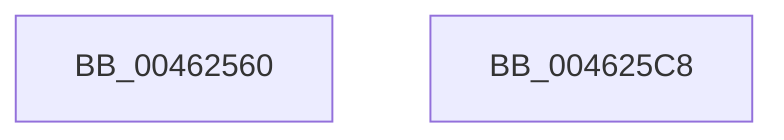

# HalpApicTimerArm

- RVA: `0x00462560`–`0x004625C9` (길이 `105` bytes)
- VA: `0x0000000140462560`
- 실행 섹션: `.text`
- PDB 이름 있음: `예`; PDB Function 태그: `아니요`
- unwind 정보 RVA: `0x0005CAAC`
- 디코드: `28`개 명령, `105/105` bytes 표시
- 미해석 바이트: `0` (있으면 어셈블리에 `.byte`로 보존)

> 이 문서는 커널 이미지의 기계어와 PDB 기호를 분석해 생성했습니다. 4번과 5번은 함수 원형과 자료형을 바이너리 사용 방식에서 추정한 C 해석이며 원본 소스 복구 결과는 아닙니다.

## 1. Dependencies

- 직접 호출 지점: **3**; 고유 호출 대상: **1**
- 직접 호출자로 확인된 함수: **0**
- RIP 상대 이미지 참조: **1**

### Outgoing calls
- `0x0046258F` → [guard_dispatch_icall](../6B/guard_dispatch_icall_function_006BAAD0.md) (function, `0x006BAAD0`)
- `0x004625A3` → [guard_dispatch_icall](../6B/guard_dispatch_icall_function_006BAAD0.md) (function, `0x006BAAD0`)
- `0x004625B6` → [guard_dispatch_icall](../6B/guard_dispatch_icall_function_006BAAD0.md) (function, `0x006BAAD0`)

### Direct callers
- 이 함수 시작 RVA로 연결되는 직접 call은 확인되지 않았습니다. 간접 호출은 완전히 역산할 수 없습니다.

### Static image references
- `0x00462588` → RVA `0x00E10430` (`.data`; read)

## 2. Other-region calls and transfers

- 다른 실행 섹션으로 향하는 call: **0**
- 별도 외부 분기/꼬리 이동을 확인하지 못했습니다.

## 3. Assembly (complete function range)

```asm
00462560  48 89 5C 24 08                  mov qword ptr [rsp + 8], rbx
00462565  57                              push rdi
00462566  48 83 EC 20                     sub rsp, 0x20
0046256A  0F B6 01                        movzx eax, byte ptr [rcx]
0046256D  44 8B CA                        mov r9d, edx
00462570  8B D0                           mov edx, eax
00462572  48 8B D9                        mov rbx, rcx
00462575  0F BA EA 11                     bts edx, 0x11
00462579  B9 20 03 00 00                  mov ecx, 0x320
0046257E  41 83 F9 02                     cmp r9d, 2
00462582  49 8B F8                        mov rdi, r8
00462585  0F 45 D0                        cmovne edx, eax
00462588  48 8B 05 A1 DE 9A 00            mov rax, qword ptr [rip + 0x9adea1]
0046258F  E8 3C 85 25 00                  call 0x1406baad0
00462594  48 8B 05 95 DE 9A 00            mov rax, qword ptr [rip + 0x9ade95]
0046259B  B9 E0 03 00 00                  mov ecx, 0x3e0
004625A0  8B 53 04                        mov edx, dword ptr [rbx + 4]
004625A3  E8 28 85 25 00                  call 0x1406baad0
004625A8  48 8B 05 81 DE 9A 00            mov rax, qword ptr [rip + 0x9ade81]
004625AF  8B D7                           mov edx, edi
004625B1  B9 80 03 00 00                  mov ecx, 0x380
004625B6  E8 15 85 25 00                  call 0x1406baad0
004625BB  48 8B 5C 24 30                  mov rbx, qword ptr [rsp + 0x30]
004625C0  33 C0                           xor eax, eax
004625C2  48 83 C4 20                     add rsp, 0x20
004625C6  5F                              pop rdi
004625C7  C3                              ret
004625C8  CC                              int3
```

## 4. C-style interpretation (structured pseudocode)

```c
__int64 __fastcall HalpApicTimerArm(__int64 a1, int a2, __int64 a3)
{
    __int64 result;
    __int64 v_rsp;
    unsigned __int64 v_stack_p8;

    v_stack_p8 = v_rbx;
    v_rsp = (v_rsp) - (32);
    a2 = (unsigned int)((unsigned int)(*(unsigned __int8 *)(a1)));
    if (((unsigned int)((unsigned int)(a2))) != 2) { a2 = (unsigned int)(*(unsigned __int8 *)(a1)); }
    result = guard_dispatch_icall(800, a2, a3, (unsigned int)(a2));
    result = guard_dispatch_icall(992, (unsigned int)(*(unsigned int *)(a1 + 4)), a3, (unsigned int)(a2));
    result = guard_dispatch_icall(896, (unsigned int)((unsigned int)(a3)), a3, (unsigned int)(a2));
    result = 0;
    v_rsp = (v_rsp) + (32);
    return result;
}
```

## 5. (Beta) C Style

```c
int64_t HalpApicTimerArm(void *Arg1, int32_t Arg2, int64_t Arg3)
{
    uint8_t *arg1 = (uint8_t *)Arg1;

    int64_t result;
    int64_t local_rsp;
    uint64_t v_stack_p8;

    v_stack_p8 = local_rbx;
    local_rsp = (local_rsp) - (32);
    Arg2 = (uint32_t)((uint32_t)(*(uint8_t *)(arg1)));
    if (((uint32_t)((uint32_t)(Arg2))) != 2) { Arg2 = (uint32_t)(*(uint8_t *)(arg1)); }
    result = guard_dispatch_icall(800, Arg2, Arg3, (uint32_t)(Arg2));
    result = guard_dispatch_icall(992, (uint32_t)(*(uint32_t *)(arg1 + 0x4)), Arg3, (uint32_t)(Arg2));
    result = guard_dispatch_icall(896, (uint32_t)((uint32_t)(Arg3)), Arg3, (uint32_t)(Arg2));
    result = 0;
    local_rsp = (local_rsp) + (32);
    return result;
}
```

### 관측된 메모리 오프셋

구조체 형식이 확인되지 않은 접근은 인자 기준의 오프셋으로만 기록했습니다.

| 기준 인자 | 오프셋 표현 | 폭 (bit) | 접근 |
|---|---:|---:|---|
| `Arg1` | `+ 0x0` | `8` | `R` |
| `Arg1` | `+ 0x4` | `32` | `R` |

## 6. Execution-region graph

[열기: 2D/3D 그래프와 함수 탐색 컨트롤 패널](../../../control-panel.html?section=text&rva=0x00462560&view=graph)

- 2D 그래프는 위에서 아래로 흐르고, 3D 그래프는 빈 공간을 드래그해 회전합니다. Shift+드래그는 이동, 휠은 확대·축소, 함수 노드 선택은 대상 보고서 이동입니다.

### Static fallback


