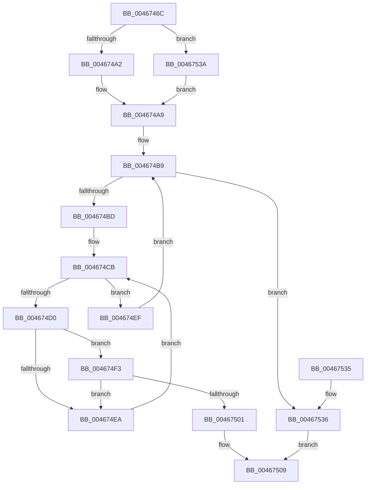

# HalpBuddyAllocatorBltFindAndPop

- RVA: `0x0046746C`–`0x00467544` (길이 `216` bytes)
- VA: `0x000000014046746C`
- 실행 섹션: `.text`
- PDB 이름 있음: `예`; PDB Function 태그: `아니요`
- unwind 정보 RVA: `0x000AAF28`
- 디코드: `68`개 명령, `216/216` bytes 표시
- 미해석 바이트: `0` (있으면 어셈블리에 `.byte`로 보존)

> 이 문서는 커널 이미지의 기계어와 PDB 기호를 분석해 생성했습니다. 4번과 5번은 함수 원형과 자료형을 바이너리 사용 방식에서 추정한 C 해석이며 원본 소스 복구 결과는 아닙니다.

## 1. Dependencies

- 직접 호출 지점: **3**; 고유 호출 대상: **3**
- 직접 호출자로 확인된 함수: **1**
- RIP 상대 이미지 참조: **0**

### Outgoing calls
- `0x004674B1` → [KeAcquireSpinLockRaiseToDpc](../20/KeAcquireSpinLockRaiseToDpc_function_00208470.md) (function, `0x00208470`)
- `0x00467504` → [HalpBuddyAllocatorBltRemoveInternal](HalpBuddyAllocatorBltRemoveInternal_function_004675BC.md) (function, `0x004675BC`)
- `0x00467510` → [KeReleaseSpinLock](../39/KeReleaseSpinLock_function_00392BA0.md) (function, `0x00392BA0`)

### Direct callers
- [HalpBuddyAllocatorAllocateLogicalAddress](../30/HalpBuddyAllocatorAllocateLogicalAddress_function_00307EE0.md) at `0x0030802A`
- [HalpBuddyAllocatorAllocateLogicalAddress](../30/HalpBuddyAllocatorAllocateLogicalAddress_function_00307EE0.md) at `0x0030825C`

### Static image references
- 디코드된 RIP-relative 메모리 참조가 없습니다.

## 2. Other-region calls and transfers

- 다른 실행 섹션으로 향하는 call: **0**
- 별도 외부 분기/꼬리 이동을 확인하지 못했습니다.

## 3. Assembly (complete function range)

```asm
0046746C  48 89 5C 24 08                  mov qword ptr [rsp + 8], rbx
00467471  48 89 6C 24 18                  mov qword ptr [rsp + 0x18], rbp
00467476  48 89 74 24 20                  mov qword ptr [rsp + 0x20], rsi
0046747B  57                              push rdi
0046747C  41 54                           push r12
0046747E  41 55                           push r13
00467480  41 56                           push r14
00467482  41 57                           push r15
00467484  48 83 EC 20                     sub rsp, 0x20
00467488  48 8B 42 28                     mov rax, qword ptr [rdx + 0x28]
0046748C  4D 8B E1                        mov r12, r9
0046748F  4D 8B E8                        mov r13, r8
00467492  48 8B EA                        mov rbp, rdx
00467495  4C 8B F1                        mov r14, rcx
00467498  48 83 F8 FF                     cmp rax, -1
0046749C  0F 84 98 00 00 00               je 0x14046753a
004674A2  48 FF C0                        inc rax
004674A5  48 0F BC F0                     bsf rsi, rax
004674A9  49 0F BC FE                     bsf rdi, r14
004674AD  48 8D 4A 68                     lea rcx, [rdx + 0x68]
004674B1  E8 BA 0F DA FF                  call 0x140208470
004674B6  44 8A C8                        mov r9b, al
004674B9  3B FE                           cmp edi, esi
004674BB  77 79                           ja 0x140467536
004674BD  8D 57 F4                        lea edx, [rdi - 0xc]
004674C0  48 C1 E2 04                     shl rdx, 4
004674C4  48 03 55 60                     add rdx, qword ptr [rbp + 0x60]
004674C8  48 8B 1A                        mov rbx, qword ptr [rdx]
004674CB  48 3B DA                        cmp rbx, rdx
004674CE  74 1F                           je 0x1404674ef
004674D0  48 8B 4B 38                     mov rcx, qword ptr [rbx + 0x38]
004674D4  49 8D 45 FF                     lea rax, [r13 - 1]
004674D8  4C 8B 43 30                     mov r8, qword ptr [rbx + 0x30]
004674DC  48 FF C9                        dec rcx
004674DF  49 03 C8                        add rcx, r8
004674E2  49 03 C6                        add rax, r14
004674E5  48 3B C8                        cmp rcx, rax
004674E8  73 09                           jae 0x1404674f3
004674EA  48 8B 1B                        mov rbx, qword ptr [rbx]
004674ED  EB DC                           jmp 0x1404674cb
004674EF  FF C7                           inc edi
004674F1  EB C6                           jmp 0x1404674b9
004674F3  49 8B C4                        mov rax, r12
004674F6  49 2B C6                        sub rax, r14
004674F9  48 FF C0                        inc rax
004674FC  4C 3B C0                        cmp r8, rax
004674FF  77 E9                           ja 0x1404674ea
00467501  48 8B CB                        mov rcx, rbx
00467504  E8 B3 00 00 00                  call 0x1404675bc
00467509  41 8A D1                        mov dl, r9b
0046750C  48 8D 4D 68                     lea rcx, [rbp + 0x68]
00467510  E8 8B B6 F2 FF                  call 0x140392ba0
00467515  48 8B 6C 24 60                  mov rbp, qword ptr [rsp + 0x60]
0046751A  48 8B C3                        mov rax, rbx
0046751D  48 8B 5C 24 50                  mov rbx, qword ptr [rsp + 0x50]
00467522  48 8B 74 24 68                  mov rsi, qword ptr [rsp + 0x68]
00467527  48 83 C4 20                     add rsp, 0x20
0046752B  41 5F                           pop r15
0046752D  41 5E                           pop r14
0046752F  41 5D                           pop r13
00467531  41 5C                           pop r12
00467533  5F                              pop rdi
00467534  C3                              ret
00467535  CC                              int3
00467536  33 DB                           xor ebx, ebx
00467538  EB CF                           jmp 0x140467509
0046753A  BE 3F 00 00 00                  mov esi, 0x3f
0046753F  E9 65 FF FF FF                  jmp 0x1404674a9
```

## 4. C-style interpretation (structured pseudocode)

```c
__int64 __fastcall HalpBuddyAllocatorBltFindAndPop(__int64 a1, __int64 a2, __int64 a3, __int64 a4)
{
    __int64 result;
    __int64 v_rbx;
    __int64 v_rdi;
    __int64 v_rsp;
    unsigned __int64 v_stack_p18;
    unsigned __int64 v_stack_p20;
    unsigned __int64 v_stack_p8;

    v_stack_p8 = v_rbx;
    v_stack_p18 = v_rbp;
    v_stack_p20 = v_rsi;
    v_rsp = (v_rsp) - (32);
    if ((*(unsigned __int64 *)(a2 + 40)) == -1) goto loc_0046753A;
    result = (*(unsigned __int64 *)(a2 + 40)) + 1;
loc_004674A9:
    result = KeAcquireSpinLockRaiseToDpc(a2 + 104, a2, a3, a4);
loc_004674B9:
    if (((unsigned int)(v_rdi)) > ((unsigned int)(v_rsi))) goto loc_00467536;
    a2 = (v_rdi - 12) << (4);
    a2 = (a2) + (*(unsigned __int64 *)(a2 + 96));
loc_004674CB:
    if ((*(unsigned __int64 *)(a2)) == a2) goto loc_004674EF;
    a1 = (*(unsigned __int64 *)(*(unsigned __int64 *)(a2) + 56)) - 1;
    a1 = (a1) + (*(unsigned __int64 *)(*(unsigned __int64 *)(a2) + 48));
    result = (a3 - 1) + (a1);
    if (a1 >= result) goto loc_004674F3;
loc_004674EA:
    goto loc_004674CB;
loc_004674EF:
    v_rdi = (unsigned int)((v_rdi) + 1);
    goto loc_004674B9;
loc_004674F3:
    result = (a4) - (a1);
    result = (result) + 1;
    if ((*(unsigned __int64 *)(*(unsigned __int64 *)(a2) + 48)) > result) goto loc_004674EA;
    result = HalpBuddyAllocatorBltRemoveInternal(*(unsigned __int64 *)(*(unsigned __int64 *)(a2)), a2, *(unsigned __int64 *)(*(unsigned __int64 *)(a2) + 48), (unsigned __int8)(result));
loc_00467509:
    result = KeReleaseSpinLock(a2 + 104, (unsigned __int8)((unsigned __int8)(result)), *(unsigned __int64 *)(*(unsigned __int64 *)(a2) + 48), (unsigned __int8)(result));
    v_rsp = (v_rsp) + (32);
    return *(unsigned __int64 *)(*(unsigned __int64 *)(a2));
loc_00467536:
    v_rbx = 0;
    goto loc_00467509;
loc_0046753A:
    goto loc_004674A9;
}
```

## 5. (Beta) C Style

```c
int64_t HalpBuddyAllocatorBltFindAndPop(int64_t Arg1, void *Arg2, void *Arg3, int64_t Arg4)
{
    uint8_t *arg2 = (uint8_t *)Arg2;
    uint8_t *arg3 = (uint8_t *)Arg3;

    int64_t result;
    int64_t local_rbx;
    int64_t local_rdi;
    int64_t local_rsp;
    uint64_t v_stack_p18;
    uint64_t v_stack_p20;
    uint64_t v_stack_p8;

    v_stack_p8 = local_rbx;
    v_stack_p18 = local_rbp;
    v_stack_p20 = local_rsi;
    local_rsp = (local_rsp) - (32);
    if ((*(uint64_t *)(arg2 + 0x28)) == -1) goto loc_0046753A;
    result = (*(uint64_t *)(arg2 + 0x28)) + 1;
loc_004674A9:
    result = KeAcquireSpinLockRaiseToDpc(Arg2 + 104, Arg2, Arg3, Arg4);
loc_004674B9:
    if (((uint32_t)(local_rdi)) > ((uint32_t)(local_rsi))) goto loc_00467536;
    Arg2 = (local_rdi - 12) << (4);
    Arg2 = (Arg2) + (*(uint64_t *)(arg2 + 0x60));
loc_004674CB:
    if ((*(uint64_t *)(arg2)) == Arg2) goto loc_004674EF;
    Arg1 = (*(uint64_t *)(*(uint64_t *)(arg2) + 0x38)) - 1;
    Arg1 = (Arg1) + (*(uint64_t *)(*(uint64_t *)(arg2) + 0x30));
    result = (Arg3 - 1) + (Arg1);
    if (Arg1 >= result) goto loc_004674F3;
loc_004674EA:
    goto loc_004674CB;
loc_004674EF:
    local_rdi = (uint32_t)((local_rdi) + 1);
    goto loc_004674B9;
loc_004674F3:
    result = (Arg4) - (Arg1);
    result = (result) + 1;
    if ((*(uint64_t *)(*(uint64_t *)(arg2) + 0x30)) > result) goto loc_004674EA;
    result = HalpBuddyAllocatorBltRemoveInternal(*(uint64_t *)(*(uint64_t *)(arg2)), Arg2, *(uint64_t *)(*(uint64_t *)(arg2) + 0x30), (uint8_t)(result));
loc_00467509:
    result = KeReleaseSpinLock(Arg2 + 104, (uint8_t)((uint8_t)(result)), *(uint64_t *)(*(uint64_t *)(arg2) + 0x30), (uint8_t)(result));
    local_rsp = (local_rsp) + (32);
    return *(uint64_t *)(*(uint64_t *)(arg2));
loc_00467536:
    local_rbx = 0;
    goto loc_00467509;
loc_0046753A:
    goto loc_004674A9;
}
```

### 관측된 메모리 오프셋

구조체 형식이 확인되지 않은 접근은 인자 기준의 오프셋으로만 기록했습니다.

| 기준 인자 | 오프셋 표현 | 폭 (bit) | 접근 |
|---|---:|---:|---|
| `Arg2` | `+ 0x28` | `64` | `R` |
| `Arg2` | `+ 0x60` | `64` | `R` |
| `Arg2` | `+ 0x68` | `64` | `R` |
| `Arg3` | `- 0x1` | `64` | `R` |

## 6. Execution-region graph

[열기: 2D/3D 그래프와 함수 탐색 컨트롤 패널](../../../control-panel.html?section=text&rva=0x0046746C&view=graph)

- 2D 그래프는 위에서 아래로 흐르고, 3D 그래프는 빈 공간을 드래그해 회전합니다. Shift+드래그는 이동, 휠은 확대·축소, 함수 노드 선택은 대상 보고서 이동입니다.

### Static fallback


