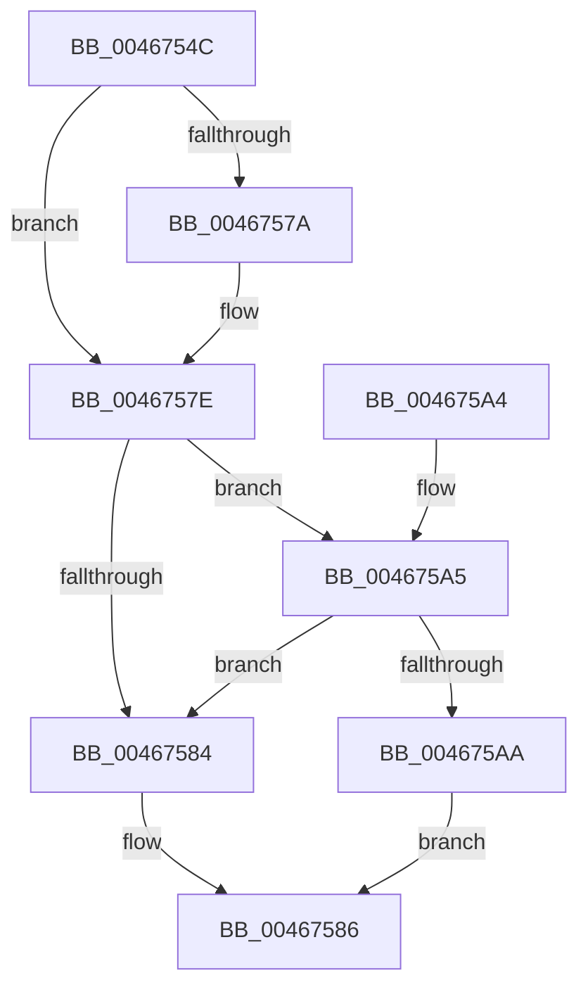

# HalpBuddyAllocatorBltPopBuddy

- RVA: `0x0046754C`–`0x004675B4` (길이 `104` bytes)
- VA: `0x000000014046754C`
- 실행 섹션: `.text`
- PDB 이름 있음: `예`; PDB Function 태그: `아니요`
- unwind 정보 RVA: `0x00073EA0`
- 디코드: `32`개 명령, `104/104` bytes 표시
- 미해석 바이트: `0` (있으면 어셈블리에 `.byte`로 보존)

> 이 문서는 커널 이미지의 기계어와 PDB 기호를 분석해 생성했습니다. 4번과 5번은 함수 원형과 자료형을 바이너리 사용 방식에서 추정한 C 해석이며 원본 소스 복구 결과는 아닙니다.

## 1. Dependencies

- 직접 호출 지점: **3**; 고유 호출 대상: **3**
- 직접 호출자로 확인된 함수: **1**
- RIP 상대 이미지 참조: **0**

### Outgoing calls
- `0x00467565` → [KeAcquireSpinLockRaiseToDpc](../20/KeAcquireSpinLockRaiseToDpc_function_00208470.md) (function, `0x00208470`)
- `0x0046758C` → [KeReleaseSpinLock](../39/KeReleaseSpinLock_function_00392BA0.md) (function, `0x00392BA0`)
- `0x004675AD` → [HalpBuddyAllocatorBltRemoveInternal](HalpBuddyAllocatorBltRemoveInternal_function_004675BC.md) (function, `0x004675BC`)

### Direct callers
- [HalpBuddyAllocatorFreeLogicalAddress](../30/HalpBuddyAllocatorFreeLogicalAddress_function_00307140.md) at `0x0030720D`

### Static image references
- 디코드된 RIP-relative 메모리 참조가 없습니다.

## 2. Other-region calls and transfers

- 다른 실행 섹션으로 향하는 call: **0**
- 별도 외부 분기/꼬리 이동을 확인하지 못했습니다.

## 3. Assembly (complete function range)

```asm
0046754C  48 89 5C 24 08                  mov qword ptr [rsp + 8], rbx
00467551  48 89 74 24 10                  mov qword ptr [rsp + 0x10], rsi
00467556  57                              push rdi
00467557  48 83 EC 20                     sub rsp, 0x20
0046755B  48 8D 72 68                     lea rsi, [rdx + 0x68]
0046755F  48 8B D9                        mov rbx, rcx
00467562  48 8B CE                        mov rcx, rsi
00467565  E8 06 0F DA FF                  call 0x140208470
0046756A  48 8B 4B 10                     mov rcx, qword ptr [rbx + 0x10]
0046756E  44 8A C0                        mov r8b, al
00467571  48 8B 79 18                     mov rdi, qword ptr [rcx + 0x18]
00467575  48 3B DF                        cmp rbx, rdi
00467578  75 04                           jne 0x14046757e
0046757A  48 8B 79 20                     mov rdi, qword ptr [rcx + 0x20]
0046757E  80 7F 48 00                     cmp byte ptr [rdi + 0x48], 0
00467582  74 21                           je 0x1404675a5
00467584  33 FF                           xor edi, edi
00467586  41 8A D0                        mov dl, r8b
00467589  48 8B CE                        mov rcx, rsi
0046758C  E8 0F B6 F2 FF                  call 0x140392ba0
00467591  48 8B 5C 24 30                  mov rbx, qword ptr [rsp + 0x30]
00467596  48 8B C7                        mov rax, rdi
00467599  48 8B 74 24 38                  mov rsi, qword ptr [rsp + 0x38]
0046759E  48 83 C4 20                     add rsp, 0x20
004675A2  5F                              pop rdi
004675A3  C3                              ret
004675A4  CC                              int3
004675A5  48 39 3F                        cmp qword ptr [rdi], rdi
004675A8  74 DA                           je 0x140467584
004675AA  48 8B CF                        mov rcx, rdi
004675AD  E8 0A 00 00 00                  call 0x1404675bc
004675B2  EB D2                           jmp 0x140467586
```

## 4. C-style interpretation (structured pseudocode)

```c
__int64 __fastcall HalpBuddyAllocatorBltPopBuddy(__int64 a1, __int64 a2)
{
    __int64 result;
    __int64 v_rdi;
    __int64 v_rsp;
    unsigned __int64 v_stack_p10;
    unsigned __int64 v_stack_p8;

    v_stack_p8 = v_rbx;
    v_stack_p10 = v_rsi;
    v_rsp = (v_rsp) - (32);
    result = KeAcquireSpinLockRaiseToDpc(a2 + 104, a2, a3, a4);
    v_rdi = *(unsigned __int64 *)(*(unsigned __int64 *)(a1 + 16) + 24);
    if (a1 == (*(unsigned __int64 *)(*(unsigned __int64 *)(a1 + 16) + 24))) {
        v_rdi = *(unsigned __int64 *)(*(unsigned __int64 *)(a1 + 16) + 32);
    }
    if ((*(unsigned __int8 *)(v_rdi + 72)) == 0) goto loc_004675A5;
loc_00467584:
    v_rdi = 0;
loc_00467586:
    result = KeReleaseSpinLock(a2 + 104, (unsigned __int8)((unsigned __int8)(result)), (unsigned __int8)(result), a4);
    v_rsp = (v_rsp) + (32);
    return 0;
loc_004675A5:
    if ((*(unsigned __int64 *)(v_rdi)) == 0) goto loc_00467584;
    result = HalpBuddyAllocatorBltRemoveInternal(0, (unsigned __int8)((unsigned __int8)(result)), (unsigned __int8)(result), a4);
    goto loc_00467586;
}
```

## 5. (Beta) C Style

```c
int64_t HalpBuddyAllocatorBltPopBuddy(void *Arg1, void *Arg2)
{
    uint8_t *arg1 = (uint8_t *)Arg1;
    uint8_t *arg2 = (uint8_t *)Arg2;

    int64_t result;
    int64_t local_rdi;
    int64_t local_rsp;
    uint64_t v_stack_p10;
    uint64_t v_stack_p8;

    v_stack_p8 = local_rbx;
    v_stack_p10 = local_rsi;
    local_rsp = (local_rsp) - (32);
    result = KeAcquireSpinLockRaiseToDpc(Arg2 + 104, Arg2, a3, a4);
    local_rdi = *(uint64_t *)(*(uint64_t *)(arg1 + 0x10) + 0x18);
    if (Arg1 == (*(uint64_t *)(*(uint64_t *)(arg1 + 0x10) + 0x18))) {
        local_rdi = *(uint64_t *)(*(uint64_t *)(arg1 + 0x10) + 0x20);
    }
    if ((*(uint8_t *)(local_rdi + 0x48)) == 0) goto loc_004675A5;
loc_00467584:
    local_rdi = 0;
loc_00467586:
    result = KeReleaseSpinLock(Arg2 + 104, (uint8_t)((uint8_t)(result)), (uint8_t)(result), a4);
    local_rsp = (local_rsp) + (32);
    return 0;
loc_004675A5:
    if ((*(uint64_t *)(local_rdi)) == 0) goto loc_00467584;
    result = HalpBuddyAllocatorBltRemoveInternal(0, (uint8_t)((uint8_t)(result)), (uint8_t)(result), a4);
    goto loc_00467586;
}
```

### 관측된 메모리 오프셋

구조체 형식이 확인되지 않은 접근은 인자 기준의 오프셋으로만 기록했습니다.

| 기준 인자 | 오프셋 표현 | 폭 (bit) | 접근 |
|---|---:|---:|---|
| `Arg1` | `+ 0x10` | `64` | `R` |
| `Arg2` | `+ 0x68` | `64` | `R` |

## 6. Execution-region graph

[열기: 2D/3D 그래프와 함수 탐색 컨트롤 패널](../../../control-panel.html?section=text&rva=0x0046754C&view=graph)

- 2D 그래프는 위에서 아래로 흐르고, 3D 그래프는 빈 공간을 드래그해 회전합니다. Shift+드래그는 이동, 휠은 확대·축소, 함수 노드 선택은 대상 보고서 이동입니다.

### Static fallback


