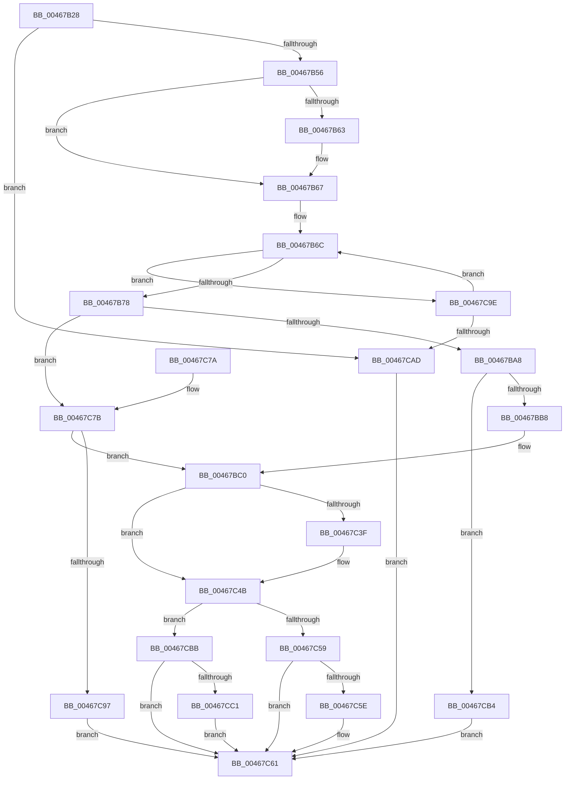

# HalpBuildScatterGatherListDmarThin

- RVA: `0x00467B28`–`0x00467CCD` (길이 `421` bytes)
- VA: `0x0000000140467B28`
- 실행 섹션: `.text`
- PDB 이름 있음: `예`; PDB Function 태그: `아니요`
- unwind 정보 RVA: `0x000AB01C`
- 디코드: `109`개 명령, `421/421` bytes 표시
- 미해석 바이트: `0` (있으면 어셈블리에 `.byte`로 보존)

> 이 문서는 커널 이미지의 기계어와 PDB 기호를 분석해 생성했습니다. 4번과 5번은 함수 원형과 자료형을 바이너리 사용 방식에서 추정한 C 해석이며 원본 소스 복구 결과는 아닙니다.

## 1. Dependencies

- 직접 호출 지점: **4**; 고유 호출 대상: **4**
- 직접 호출자로 확인된 함수: **3**
- RIP 상대 이미지 참조: **0**

### Outgoing calls
- `0x00467B86` → [HalpGetNumberOfSGElementsDmarThin](HalpGetNumberOfSGElementsDmarThin_function_00467CD4.md) (function, `0x00467CD4`)
- `0x00467C4E` → [HalpConstructScatterGatherListDmarThin](HalpConstructScatterGatherListDmarThin_function_00467D30.md) (function, `0x00467D30`)
- `0x00467C86` → [ExAllocatePool2](../../poolcode/B8/ExAllocatePool2_function_00B820F0.md) (function, `0x00B820F0`)
- `0x00467CC6` → [ExFreePoolWithTag](../../poolcode/B8/ExFreePoolWithTag_function_00B82870.md) (function, `0x00B82870`)

### Direct callers
- [HalBuildScatterGatherListDmarThinEx](HalBuildScatterGatherListDmarThinEx_function_004678B0.md) at `0x0046793E`
- [HalBuildScatterGatherListDmarThin](HalBuildScatterGatherListDmarThin_function_00467960.md) at `0x004679C0`
- [HalGetScatterGatherListDmarThinEx](../55/HalGetScatterGatherListDmarThinEx_function_00552FA0.md) at `0x0055301C`

### Static image references
- 디코드된 RIP-relative 메모리 참조가 없습니다.

## 2. Other-region calls and transfers

- 다른 실행 섹션으로 향하는 call: **2**
  - `0x00467C86` → [ExAllocatePool2](../../poolcode/B8/ExAllocatePool2_function_00B820F0.md) (`.text` → `POOLCODE`)
  - `0x00467CC6` → [ExFreePoolWithTag](../../poolcode/B8/ExFreePoolWithTag_function_00B82870.md) (`.text` → `POOLCODE`)
- 별도 외부 분기/꼬리 이동을 확인하지 못했습니다.

## 3. Assembly (complete function range)

```asm
00467B28  48 8B C4                        mov rax, rsp
00467B2B  48 89 58 18                     mov qword ptr [rax + 0x18], rbx
00467B2F  48 89 68 20                     mov qword ptr [rax + 0x20], rbp
00467B33  48 89 50 10                     mov qword ptr [rax + 0x10], rdx
00467B37  48 89 48 08                     mov qword ptr [rax + 8], rcx
00467B3B  56                              push rsi
00467B3C  57                              push rdi
00467B3D  41 55                           push r13
00467B3F  41 56                           push r14
00467B41  41 57                           push r15
00467B43  48 83 EC 20                     sub rsp, 0x20
00467B47  49 8B D9                        mov rbx, r9
00467B4A  4D 8B F8                        mov r15, r8
00467B4D  4D 85 C9                        test r9, r9
00467B50  0F 84 57 01 00 00               je 0x140467cad
00467B56  48 8B B4 24 B0 00 00 00         mov rsi, qword ptr [rsp + 0xb0]
00467B5E  48 85 F6                        test rsi, rsi
00467B61  74 04                           je 0x140467b67
00467B63  48 83 26 00                     and qword ptr [rsi], 0
00467B67  4C 8B 74 24 70                  mov r14, qword ptr [rsp + 0x70]
00467B6C  8B 43 28                        mov eax, dword ptr [rbx + 0x28]
00467B6F  4C 3B F0                        cmp r14, rax
00467B72  0F 83 26 01 00 00               jae 0x140467c9e
00467B78  44 8B 6C 24 78                  mov r13d, dword ptr [rsp + 0x78]
00467B7D  49 8B D6                        mov rdx, r14
00467B80  45 8B C5                        mov r8d, r13d
00467B83  48 8B CB                        mov rcx, rbx
00467B86  E8 49 01 00 00                  call 0x140467cd4
00467B8B  48 83 BC 24 A0 00 00 00 00      cmp qword ptr [rsp + 0xa0], 0
00467B94  8B C0                           mov eax, eax
00467B96  48 8D 3C 40                     lea rdi, [rax + rax*2]
00467B9A  48 8D 14 FD 78 00 00 00         lea rdx, [rdi*8 + 0x78]
00467BA2  0F 84 D3 00 00 00               je 0x140467c7b
00467BA8  8B 84 24 A8 00 00 00            mov eax, dword ptr [rsp + 0xa8]
00467BAF  48 3B C2                        cmp rax, rdx
00467BB2  0F 82 FC 00 00 00               jb 0x140467cb4
00467BB8  48 8B AC 24 A0 00 00 00         mov rbp, qword ptr [rsp + 0xa0]
00467BC0  48 8D 3C FD 10 00 00 00         lea rdi, [rdi*8 + 0x10]
00467BC8  48 03 FD                        add rdi, rbp
00467BCB  48 83 BC 24 A0 00 00 00 00      cmp qword ptr [rsp + 0xa0], 0
00467BD4  0F 94 C0                        sete al
00467BD7  88 47 61                        mov byte ptr [rdi + 0x61], al
00467BDA  48 8B 44 24 50                  mov rax, qword ptr [rsp + 0x50]
00467BDF  48 89 47 18                     mov qword ptr [rdi + 0x18], rax
00467BE3  48 8B 44 24 58                  mov rax, qword ptr [rsp + 0x58]
00467BE8  48 89 47 20                     mov qword ptr [rdi + 0x20], rax
00467BEC  48 8B 40 20                     mov rax, qword ptr [rax + 0x20]
00467BF0  48 89 47 28                     mov qword ptr [rdi + 0x28], rax
00467BF4  48 8B 84 24 88 00 00 00         mov rax, qword ptr [rsp + 0x88]
00467BFC  48 89 47 40                     mov qword ptr [rdi + 0x40], rax
00467C00  48 8B 84 24 90 00 00 00         mov rax, qword ptr [rsp + 0x90]
00467C08  48 89 47 48                     mov qword ptr [rdi + 0x48], rax
00467C0C  8A 84 24 80 00 00 00            mov al, byte ptr [rsp + 0x80]
00467C13  24 01                           and al, 1
00467C15  44 89 77 3C                     mov dword ptr [rdi + 0x3c], r14d
00467C19  45 33 F6                        xor r14d, r14d
00467C1C  44 89 6F 38                     mov dword ptr [rdi + 0x38], r13d
00467C20  48 89 5F 30                     mov qword ptr [rdi + 0x30], rbx
00467C24  48 89 6F 50                     mov qword ptr [rdi + 0x50], rbp
00467C28  88 47 60                        mov byte ptr [rdi + 0x60], al
00467C2B  C7 47 10 01 00 00 00            mov dword ptr [rdi + 0x10], 1
00467C32  44 88 77 62                     mov byte ptr [rdi + 0x62], r14b
00467C36  4C 89 77 58                     mov qword ptr [rdi + 0x58], r14
00467C3A  4D 85 FF                        test r15, r15
00467C3D  74 0C                           je 0x140467c4b
00467C3F  49 8D 47 08                     lea rax, [r15 + 8]
00467C43  49 89 7F 58                     mov qword ptr [r15 + 0x58], rdi
00467C47  48 89 47 58                     mov qword ptr [rdi + 0x58], rax
00467C4B  48 8B CF                        mov rcx, rdi
00467C4E  E8 DD 00 00 00                  call 0x140467d30
00467C53  8B D8                           mov ebx, eax
00467C55  85 C0                           test eax, eax
00467C57  78 62                           js 0x140467cbb
00467C59  48 85 F6                        test rsi, rsi
00467C5C  74 03                           je 0x140467c61
00467C5E  48 89 2E                        mov qword ptr [rsi], rbp
00467C61  48 8B 6C 24 68                  mov rbp, qword ptr [rsp + 0x68]
00467C66  8B C3                           mov eax, ebx
00467C68  48 8B 5C 24 60                  mov rbx, qword ptr [rsp + 0x60]
00467C6D  48 83 C4 20                     add rsp, 0x20
00467C71  41 5F                           pop r15
00467C73  41 5E                           pop r14
00467C75  41 5D                           pop r13
00467C77  5F                              pop rdi
00467C78  5E                              pop rsi
00467C79  C3                              ret
00467C7A  CC                              int3
00467C7B  B9 42 00 00 00                  mov ecx, 0x42
00467C80  41 B8 48 61 6C 44               mov r8d, 0x446c6148
00467C86  E8 65 A4 71 00                  call 0x140b820f0
00467C8B  48 8B E8                        mov rbp, rax
00467C8E  48 85 C0                        test rax, rax
00467C91  0F 85 29 FF FF FF               jne 0x140467bc0
00467C97  BB 9A 00 00 C0                  mov ebx, 0xc000009a
00467C9C  EB C3                           jmp 0x140467c61
00467C9E  48 8B 1B                        mov rbx, qword ptr [rbx]
00467CA1  4C 2B F0                        sub r14, rax
00467CA4  48 85 DB                        test rbx, rbx
00467CA7  0F 85 BF FE FF FF               jne 0x140467b6c
00467CAD  BB 0D 00 00 C0                  mov ebx, 0xc000000d
00467CB2  EB AD                           jmp 0x140467c61
00467CB4  BB 23 00 00 C0                  mov ebx, 0xc0000023
00467CB9  EB A6                           jmp 0x140467c61
00467CBB  44 38 77 61                     cmp byte ptr [rdi + 0x61], r14b
00467CBF  74 A0                           je 0x140467c61
00467CC1  33 D2                           xor edx, edx
00467CC3  48 8B CD                        mov rcx, rbp
00467CC6  E8 A5 AB 71 00                  call 0x140b82870
00467CCB  EB 94                           jmp 0x140467c61
```

## 4. C-style interpretation (structured pseudocode)

```c
__int64 __fastcall HalpBuildScatterGatherListDmarThin(__int64 a1, __int64 a2, __int64 a3, __int64 a4, __int64 a5, unsigned int a6, unsigned __int8 a7, __int64 a8, __int64 a9, __int64 a10, __int64 a11, unsigned int a12, __int64 a13)
{
    __int64 result;
    __int64 v_r14;
    __int64 v_rdi;
    __int64 v_rsp;
    unsigned __int64 v_stack_p10;
    unsigned __int64 v_stack_p18;
    unsigned __int64 v_stack_p20;
    unsigned __int64 v_stack_p8;

    *(unsigned __int64 *)(v_rsp + 24) = v_rbx;
    *(unsigned __int64 *)(v_rsp + 32) = v_rbp;
    *(unsigned __int64 *)(v_rsp + 16) = a2;
    *(unsigned __int64 *)(v_rsp + 8) = a1;
    v_rsp = (v_rsp) - (32);
    if (a4 == 0) goto loc_00467CAD;
    if (a13 != 0) {
    }
loc_00467B6C:
    if (a5 >= ((unsigned int)(*(unsigned int *)(a4 + 40)))) goto loc_00467C9E;
    result = HalpGetNumberOfSGElementsDmarThin(a4, a5, (unsigned int)((unsigned int)((unsigned int)(a6))), a4);
    if (a11 == 0) goto loc_00467C7B;
    if (((unsigned int)(a12)) < ((unsigned int)((unsigned int)(result)) + (unsigned int)((unsigned int)(result)) * 2 * 8 + 120)) goto loc_00467CB4;
loc_00467BC0:
    v_rdi = ((unsigned int)((unsigned int)(result)) + (unsigned int)((unsigned int)(result)) * 2 * 8 + 16) + (a11);
    result = (a11 == 0) ? 1 : 0;
    *(unsigned __int8 *)(v_rdi + 97) = (unsigned __int8)(result);
    *(unsigned __int64 *)(v_rdi + 24) = v_stack_p8;
    *(unsigned __int64 *)(v_rdi + 32) = v_stack_p10;
    *(unsigned __int64 *)(v_rdi + 40) = *(unsigned __int64 *)(v_stack_p10 + 32);
    *(unsigned __int64 *)(v_rdi + 64) = a8;
    *(unsigned __int64 *)(v_rdi + 72) = a9;
    result = (unsigned __int8)((a7) & (1));
    *(unsigned int *)(v_rdi + 60) = (unsigned int)(a5);
    v_r14 = 0;
    *(unsigned int *)(v_rdi + 56) = (unsigned int)((unsigned int)(a6));
    *(unsigned __int64 *)(v_rdi + 48) = a4;
    *(unsigned __int64 *)(v_rdi + 80) = a11;
    *(unsigned __int8 *)(v_rdi + 96) = (unsigned __int8)(result);
    *(unsigned int *)(v_rdi + 16) = 1;
    *(unsigned __int8 *)(v_rdi + 98) = 0;
    *(unsigned __int64 *)(v_rdi + 88) = 0;
    if (a3 != 0) {
        result = a3 + 8;
        *(unsigned __int64 *)(a3 + 88) = v_rdi;
        *(unsigned __int64 *)(v_rdi + 88) = result;
    }
    result = HalpConstructScatterGatherListDmarThin(v_rdi, (unsigned int)((unsigned int)(result)) + (unsigned int)((unsigned int)(result)) * 2 * 8 + 120, (unsigned int)((unsigned int)((unsigned int)(a6))), a4);
    if (sign_flag) goto loc_00467CBB;
    if (a13 != 0) {
        *(unsigned __int64 *)(a13) = a11;
    }
    v_rsp = (v_rsp) + (32);
    return (unsigned int)((unsigned int)((unsigned int)((unsigned int)(result))));
loc_00467C7B:
    result = ExAllocatePool2(66, (unsigned int)((unsigned int)(result)) + (unsigned int)((unsigned int)(result)) * 2 * 8 + 120, (unsigned int)(0x446C6148ULL), a4);
    if (result != 0) goto loc_00467BC0;
    goto loc_00467C61;
loc_00467C9E:
    v_r14 = (v_r14) - (result);
    if (*(unsigned __int64 *)((unsigned int)(0xC000009AULL)) != 0) goto loc_00467B6C;
loc_00467CAD:
    goto loc_00467C61;
loc_00467CB4:
    goto loc_00467C61;
loc_00467CBB:
    if ((*(unsigned __int8 *)(v_rdi + 97)) == ((unsigned __int8)(v_r14))) goto loc_00467C61;
    a2 = 0;
    result = ExFreePoolWithTag(result, a2, (unsigned int)(0x446C6148ULL), a4);
    goto loc_00467C61;
}
```

## 5. (Beta) C Style

```c
int64_t HalpBuildScatterGatherListDmarThin(int64_t Arg1, int64_t Arg2, int64_t Arg3, int64_t Arg4, int64_t Arg5, uint32_t Arg6, uint8_t Arg7, int64_t Arg8, int64_t Arg9, uint64_t Arg10, int64_t Arg11, uint32_t Arg12, int64_t Arg13)
{
    int64_t result;
    int64_t local_r14;
    int64_t local_rdi;
    int64_t local_rsp;
    uint64_t v_stack_p10;
    uint64_t v_stack_p18;
    uint64_t v_stack_p20;
    uint64_t v_stack_p8;

    *(uint64_t *)(local_rsp + 0x18) = local_rbx;
    *(uint64_t *)(local_rsp + 0x20) = local_rbp;
    *(uint64_t *)(local_rsp + 0x10) = Arg2;
    *(uint64_t *)(local_rsp + 0x8) = Arg1;
    local_rsp = (local_rsp) - (32);
    if (Arg4 == 0) goto loc_00467CAD;
    if (Arg13 != 0) {
    }
loc_00467B6C:
    if (Arg5 >= ((uint32_t)(*(uint32_t *)(Arg4 + 0x28)))) goto loc_00467C9E;
    result = HalpGetNumberOfSGElementsDmarThin(Arg4, Arg5, (uint32_t)((uint32_t)((uint32_t)(Arg6))), Arg4);
    if (Arg11 == 0) goto loc_00467C7B;
    if (((uint32_t)(Arg12)) < ((uint32_t)((uint32_t)(result)) + (uint32_t)((uint32_t)(result)) * 2 * 8 + 120)) goto loc_00467CB4;
loc_00467BC0:
    local_rdi = ((uint32_t)((uint32_t)(result)) + (uint32_t)((uint32_t)(result)) * 2 * 8 + 16) + (Arg11);
    result = (Arg11 == 0) ? 1 : 0;
    *(uint8_t *)(local_rdi + 0x61) = (uint8_t)(result);
    *(uint64_t *)(local_rdi + 0x18) = v_stack_p8;
    *(uint64_t *)(local_rdi + 0x20) = v_stack_p10;
    *(uint64_t *)(local_rdi + 0x28) = *(uint64_t *)(v_stack_p10 + 0x20);
    *(uint64_t *)(local_rdi + 0x40) = Arg8;
    *(uint64_t *)(local_rdi + 0x48) = Arg9;
    result = (uint8_t)((Arg7) & (1));
    *(uint32_t *)(local_rdi + 0x3C) = (uint32_t)(Arg5);
    local_r14 = 0;
    *(uint32_t *)(local_rdi + 0x38) = (uint32_t)((uint32_t)(Arg6));
    *(uint64_t *)(local_rdi + 0x30) = Arg4;
    *(uint64_t *)(local_rdi + 0x50) = Arg11;
    *(uint8_t *)(local_rdi + 0x60) = (uint8_t)(result);
    *(uint32_t *)(local_rdi + 0x10) = 1;
    *(uint8_t *)(local_rdi + 0x62) = 0;
    *(uint64_t *)(local_rdi + 0x58) = 0;
    if (Arg3 != 0) {
        result = Arg3 + 8;
        *(uint64_t *)(Arg3 + 0x58) = local_rdi;
        *(uint64_t *)(local_rdi + 0x58) = result;
    }
    result = HalpConstructScatterGatherListDmarThin(local_rdi, (uint32_t)((uint32_t)(result)) + (uint32_t)((uint32_t)(result)) * 2 * 8 + 120, (uint32_t)((uint32_t)((uint32_t)(Arg6))), Arg4);
    if (sign_flag) goto loc_00467CBB;
    if (Arg13 != 0) {
        *(uint64_t *)(Arg13) = Arg11;
    }
    local_rsp = (local_rsp) + (32);
    return (uint32_t)((uint32_t)((uint32_t)((uint32_t)(result))));
loc_00467C7B:
    result = ExAllocatePool2(66, (uint32_t)((uint32_t)(result)) + (uint32_t)((uint32_t)(result)) * 2 * 8 + 120, (uint32_t)(0x446C6148ULL), Arg4);
    if (result != 0) goto loc_00467BC0;
    goto loc_00467C61;
loc_00467C9E:
    local_r14 = (local_r14) - (result);
    if (*(uint64_t *)((uint32_t)(0xC000009AULL)) != 0) goto loc_00467B6C;
loc_00467CAD:
    goto loc_00467C61;
loc_00467CB4:
    goto loc_00467C61;
loc_00467CBB:
    if ((*(uint8_t *)(local_rdi + 0x61)) == ((uint8_t)(local_r14))) goto loc_00467C61;
    Arg2 = 0;
    result = ExFreePoolWithTag(result, Arg2, (uint32_t)(0x446C6148ULL), Arg4);
    goto loc_00467C61;
}
```

## 6. Execution-region graph

[열기: 2D/3D 그래프와 함수 탐색 컨트롤 패널](../../../control-panel.html?section=text&rva=0x00467B28&view=graph)

- 2D 그래프는 위에서 아래로 흐르고, 3D 그래프는 빈 공간을 드래그해 회전합니다. Shift+드래그는 이동, 휠은 확대·축소, 함수 노드 선택은 대상 보고서 이동입니다.

### Static fallback


