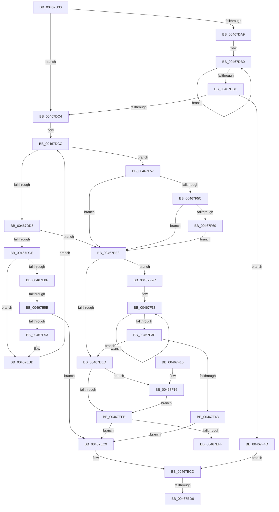

# HalpConstructScatterGatherListDmarThin

- RVA: `0x00467D30`–`0x00467F72` (길이 `578` bytes)
- VA: `0x0000000140467D30`
- 실행 섹션: `.text`
- PDB 이름 있음: `예`; PDB Function 태그: `예`
- unwind 정보 RVA: `0x000AB038`
- 디코드: `166`개 명령, `578/578` bytes 표시
- 미해석 바이트: `0` (있으면 어셈블리에 `.byte`로 보존)

> 이 문서는 커널 이미지의 기계어와 PDB 기호를 분석해 생성했습니다. 4번과 5번은 함수 원형과 자료형을 바이너리 사용 방식에서 추정한 C 해석이며 원본 소스 복구 결과는 아닙니다.

## 1. Dependencies

- 직접 호출 지점: **3**; 고유 호출 대상: **2**
- 직접 호출자로 확인된 함수: **4**
- RIP 상대 이미지 참조: **1**

### Outgoing calls
- `0x00467E88` → [guard_dispatch_icall](../6B/guard_dispatch_icall_function_006BAAD0.md) (function, `0x006BAAD0`)
- `0x00467EDD` → [HalpPutScatterGatherListDmarThin](../30/HalpPutScatterGatherListDmarThin_function_00306DB4.md) (function, `0x00306DB4`)
- `0x00467F25` → [guard_dispatch_icall](../6B/guard_dispatch_icall_function_006BAAD0.md) (function, `0x006BAAD0`)

### Direct callers
- [HalGetScatterGatherListDmarThin](HalGetScatterGatherListDmarThin_function_004679E0.md) at `0x00467ABE`
- [HalpBuildScatterGatherListDmarThin](HalpBuildScatterGatherListDmarThin_function_00467B28.md) at `0x00467C4E`
- [HalpDmaReturnEmergencyLogicalAddressResources](../53/HalpDmaReturnEmergencyLogicalAddressResources_function_0053E4E8.md) at `0x0053E5AF`
- [sub_006F2DEA](../6F/Unknown_function_006F2DEA.md) at `0x006F2E76`

### Static image references
- `0x00467E4E` → RVA `0x00FC1778` (`.data`; read)

## 2. Other-region calls and transfers

- 다른 실행 섹션으로 향하는 call: **0**
- call이 아닌 외부 분기/꼬리 이동: **3**
  - `0x00467E58` → [sub_006F2DEA](../6F/Unknown_function_006F2DEA.md) (`tail-transfer`)
  - `0x00467ED0` → [sub_006F2DEA + 0x58](../6F/Unknown_function_006F2DEA.md) (`tail-transfer`)
  - `0x00467EE3` → [sub_006F2DEA + 0x58](../6F/Unknown_function_006F2DEA.md) (`tail-transfer`)

## 3. Assembly (complete function range)

```asm
00467D30  40 55                           push rbp
00467D32  53                              push rbx
00467D33  56                              push rsi
00467D34  57                              push rdi
00467D35  41 54                           push r12
00467D37  41 55                           push r13
00467D39  41 56                           push r14
00467D3B  41 57                           push r15
00467D3D  48 8D 6C 24 E1                  lea rbp, [rsp - 0x1f]
00467D42  48 81 EC A8 00 00 00            sub rsp, 0xa8
00467D49  4C 8B 59 18                     mov r11, qword ptr [rcx + 0x18]
00467D4D  33 C0                           xor eax, eax
00467D4F  48 21 45 77                     and qword ptr [rbp + 0x77], rax
00467D53  0F 57 C0                        xorps xmm0, xmm0
00467D56  4C 8B 71 58                     mov r14, qword ptr [rcx + 0x58]
00467D5A  45 33 D2                        xor r10d, r10d
00467D5D  48 8B 51 40                     mov rdx, qword ptr [rcx + 0x40]
00467D61  33 FF                           xor edi, edi
00467D63  44 8A 69 60                     mov r13b, byte ptr [rcx + 0x60]
00467D67  48 8B D9                        mov rbx, rcx
00467D6A  4C 8B 61 30                     mov r12, qword ptr [rcx + 0x30]
00467D6E  44 8B 79 38                     mov r15d, dword ptr [rcx + 0x38]
00467D72  44 8B 41 3C                     mov r8d, dword ptr [rcx + 0x3c]
00467D76  48 8B 71 50                     mov rsi, qword ptr [rcx + 0x50]
00467D7A  48 89 45 07                     mov qword ptr [rbp + 7], rax
00467D7E  89 45 CF                        mov dword ptr [rbp - 0x31], eax
00467D81  4C 89 5D B7                     mov qword ptr [rbp - 0x49], r11
00467D85  48 89 55 EF                     mov qword ptr [rbp - 0x11], rdx
00467D89  44 88 6D 67                     mov byte ptr [rbp + 0x67], r13b
00467D8D  4C 89 55 7F                     mov qword ptr [rbp + 0x7f], r10
00467D91  0F 11 45 F7                     movups xmmword ptr [rbp - 9], xmm0
00467D95  0F 11 45 BF                     movups xmmword ptr [rbp - 0x41], xmm0
00467D99  49 8B 83 00 02 00 00            mov rax, qword ptr [r11 + 0x200]
00467DA0  48 89 45 D7                     mov qword ptr [rbp - 0x29], rax
00467DA4  4D 85 F6                        test r14, r14
00467DA7  74 1B                           je 0x140467dc4
00467DA9  41 0F 0D 0E                     prefetchw byte ptr [r14]
00467DAD  41 8B 06                        mov eax, dword ptr [r14]
00467DB0  8B C8                           mov ecx, eax
00467DB2  83 C9 04                        or ecx, 4
00467DB5  F0 41 0F B1 0E                  lock cmpxchg dword ptr [r14], ecx
00467DBA  75 F4                           jne 0x140467db0
00467DBC  A8 02                           test al, 2
00467DBE  0F 85 89 01 00 00               jne 0x140467f4d
00467DC4  21 3E                           and dword ptr [rsi], edi
00467DC6  33 C9                           xor ecx, ecx
00467DC8  48 89 5E 08                     mov qword ptr [rsi + 8], rbx
00467DCC  4D 85 E4                        test r12, r12
00467DCF  0F 84 82 01 00 00               je 0x140467f57
00467DD5  45 85 FF                        test r15d, r15d
00467DD8  0F 84 0A 01 00 00               je 0x140467ee8
00467DDE  45 8B 4C 24 2C                  mov r9d, dword ptr [r12 + 0x2c]
00467DE3  8B C1                           mov eax, ecx
00467DE5  48 8D 14 40                     lea rdx, [rax + rax*2]
00467DE9  41 8B 44 24 28                  mov eax, dword ptr [r12 + 0x28]
00467DEE  41 2B C0                        sub eax, r8d
00467DF1  48 89 55 E7                     mov qword ptr [rbp - 0x19], rdx
00467DF5  41 3B C7                        cmp eax, r15d
00467DF8  41 8B D7                        mov edx, r15d
00467DFB  0F 46 D0                        cmovbe edx, eax
00467DFE  45 03 C8                        add r9d, r8d
00467E01  44 2B FA                        sub r15d, edx
00467E04  89 55 6F                        mov dword ptr [rbp + 0x6f], edx
00467E07  85 D2                           test edx, edx
00467E09  0F 84 AE 00 00 00               je 0x140467ebd
00467E0F  45 8B C1                        mov r8d, r9d
00467E12  41 81 E0 FF 0F 00 00            and r8d, 0xfff
00467E19  44 8B EA                        mov r13d, edx
00467E1C  49 81 C5 FF 0F 00 00            add r13, 0xfff
00467E23  41 8B C1                        mov eax, r9d
00467E26  48 C1 E8 0C                     shr rax, 0xc
00467E2A  4D 03 E8                        add r13, r8
00467E2D  48 83 C0 06                     add rax, 6
00467E31  49 C1 ED 0C                     shr r13, 0xc
00467E35  33 D2                           xor edx, edx
00467E37  4C 89 45 DF                     mov qword ptr [rbp - 0x21], r8
00467E3B  C7 45 BF 02 00 00 00            mov dword ptr [rbp - 0x41], 2
00467E42  4C 89 6D CF                     mov qword ptr [rbp - 0x31], r13
00467E46  49 8D 04 C4                     lea rax, [r12 + rax*8]
00467E4A  48 89 45 C7                     mov qword ptr [rbp - 0x39], rax
00467E4E  48 8B 05 23 99 B5 00            mov rax, qword ptr [rip + 0xb59923]
00467E55  38 53 62                        cmp byte ptr [rbx + 0x62], dl
00467E58  0F 85 8C AF 28 00               jne 0x1406f2dea
00467E5E  48 8B 40 38                     mov rax, qword ptr [rax + 0x38]
00467E62  48 8D 4D 77                     lea rcx, [rbp + 0x77]
00467E66  48 89 4C 24 30                  mov qword ptr [rsp + 0x30], rcx
00467E6B  4C 8D 45 BF                     lea r8, [rbp - 0x41]
00467E6F  48 8B 4D D7                     mov rcx, qword ptr [rbp - 0x29]
00467E73  45 33 C9                        xor r9d, r9d
00467E76  48 89 54 24 28                  mov qword ptr [rsp + 0x28], rdx
00467E7B  48 89 54 24 20                  mov qword ptr [rsp + 0x20], rdx
00467E80  48 8B 49 28                     mov rcx, qword ptr [rcx + 0x28]
00467E84  41 8D 51 03                     lea edx, [r9 + 3]
00467E88  E8 43 2C 25 00                  call 0x1406baad0
00467E8D  8B F8                           mov edi, eax
00467E8F  85 C0                           test eax, eax
00467E91  78 36                           js 0x140467ec9
00467E93  48 8B 45 77                     mov rax, qword ptr [rbp + 0x77]
00467E97  4C 8B 55 7F                     mov r10, qword ptr [rbp + 0x7f]
00467E9B  4C 8B 5D B7                     mov r11, qword ptr [rbp - 0x49]
00467E9F  48 8B 4D E7                     mov rcx, qword ptr [rbp - 0x19]
00467EA3  48 03 45 DF                     add rax, qword ptr [rbp - 0x21]
00467EA7  48 83 64 CE 20 00               and qword ptr [rsi + rcx*8 + 0x20], 0
00467EAD  48 89 44 CE 10                  mov qword ptr [rsi + rcx*8 + 0x10], rax
00467EB2  8B 45 6F                        mov eax, dword ptr [rbp + 0x6f]
00467EB5  89 44 CE 18                     mov dword ptr [rsi + rcx*8 + 0x18], eax
00467EB9  FF 06                           inc dword ptr [rsi]
00467EBB  8B 0E                           mov ecx, dword ptr [rsi]
00467EBD  4D 8B 24 24                     mov r12, qword ptr [r12]
00467EC1  45 33 C0                        xor r8d, r8d
00467EC4  E9 03 FF FF FF                  jmp 0x140467dcc
00467EC9  44 8A 6D 67                     mov r13b, byte ptr [rbp + 0x67]
00467ECD  83 3E 00                        cmp dword ptr [rsi], 0
00467ED0  0F 86 6C AF 28 00               jbe 0x1406f2e42
00467ED6  48 8B 4B 18                     mov rcx, qword ptr [rbx + 0x18]
00467EDA  48 8B D6                        mov rdx, rsi
00467EDD  E8 D2 EE E9 FF                  call 0x140306db4
00467EE2  90                              nop
00467EE3  E9 5A AF 28 00                  jmp 0x1406f2e42
00467EE8  4D 85 F6                        test r14, r14
00467EEB  75 3F                           jne 0x140467f2c
00467EED  48 83 65 77 00                  and qword ptr [rbp + 0x77], 0
00467EF2  48 8B 45 EF                     mov rax, qword ptr [rbp - 0x11]
00467EF6  48 85 C0                        test rax, rax
00467EF9  75 1B                           jne 0x140467f16
00467EFB  85 FF                           test edi, edi
00467EFD  78 CA                           js 0x140467ec9
00467EFF  8B C7                           mov eax, edi
00467F01  48 81 C4 A8 00 00 00            add rsp, 0xa8
00467F08  41 5F                           pop r15
00467F0A  41 5E                           pop r14
00467F0C  41 5D                           pop r13
00467F0E  41 5C                           pop r12
00467F10  5F                              pop rdi
00467F11  5E                              pop rsi
00467F12  5B                              pop rbx
00467F13  5D                              pop rbp
00467F14  C3                              ret
00467F15  CC                              int3
00467F16  4C 8B 4B 48                     mov r9, qword ptr [rbx + 0x48]
00467F1A  4C 8B C6                        mov r8, rsi
00467F1D  48 8B 53 28                     mov rdx, qword ptr [rbx + 0x28]
00467F21  48 8B 4B 20                     mov rcx, qword ptr [rbx + 0x20]
00467F25  E8 A6 2B 25 00                  call 0x1406baad0
00467F2A  EB CF                           jmp 0x140467efb
00467F2C  41 0F 0D 0E                     prefetchw byte ptr [r14]
00467F30  41 8B 06                        mov eax, dword ptr [r14]
00467F33  8B C8                           mov ecx, eax
00467F35  83 C9 01                        or ecx, 1
00467F38  F0 41 0F B1 0E                  lock cmpxchg dword ptr [r14], ecx
00467F3D  75 F4                           jne 0x140467f33
00467F3F  A8 02                           test al, 2
00467F41  74 AA                           je 0x140467eed
00467F43  BF 20 01 00 C0                  mov edi, 0xc0000120
00467F48  E9 7C FF FF FF                  jmp 0x140467ec9
00467F4D  BF 20 01 00 C0                  mov edi, 0xc0000120
00467F52  E9 76 FF FF FF                  jmp 0x140467ecd
00467F57  45 85 FF                        test r15d, r15d
00467F5A  74 8C                           je 0x140467ee8
00467F5C  85 C9                           test ecx, ecx
00467F5E  74 88                           je 0x140467ee8
00467F60  FF C9                           dec ecx
00467F62  48 FF C1                        inc rcx
00467F65  48 8D 04 49                     lea rax, [rcx + rcx*2]
00467F69  44 01 3C C6                     add dword ptr [rsi + rax*8], r15d
00467F6D  E9 76 FF FF FF                  jmp 0x140467ee8
```

## 4. C-style interpretation (structured pseudocode)

```c
__int64 __fastcall HalpConstructScatterGatherListDmarThin(__int64 a1)
{
    __int64 result;
    __int64 v_r10;
    __int64 v_r13;
    __int64 v_r15;
    __int64 v_rdi;
    __int64 v_rsp;
    unsigned __int64 v_stack_m58;
    unsigned __int64 v_stack_m5F;
    unsigned __int64 v_stack_m68;
    unsigned __int64 v_stack_m70;
    unsigned __int64 v_stack_m78;
    unsigned __int64 v_stack_m80;
    unsigned __int64 v_stack_m88;
    unsigned int v_stack_m90;
    unsigned __int64 v_stack_m98;
    unsigned __int64 v_stack_mA0;
    unsigned __int64 v_stack_mA8;
    unsigned __int64 v_stack_mB8;
    unsigned __int64 v_stack_mC0;
    unsigned __int64 v_stack_mC8;
    unsigned int v_stack_p10;
    unsigned __int64 v_stack_p18;
    unsigned __int64 v_stack_p20;
    unsigned __int8 v_stack_p8;

    v_rsp = (v_rsp) - (168);
    result = 0;
    v_r10 = 0;
    v_rdi = 0;
    v_stack_m58 = 0;
    v_stack_m90 = 0;
    v_stack_mA8 = *(unsigned __int64 *)(a1 + 24);
    v_stack_m70 = *(unsigned __int64 *)(a1 + 64);
    v_stack_p8 = (unsigned __int8)(*(unsigned __int8 *)(a1 + 96));
    v_stack_p20 = 0;
    v_stack_m68 = v_xmm0;
    v_stack_mA0 = v_xmm0;
    v_stack_m88 = *(unsigned __int64 *)(*(unsigned __int64 *)(a1 + 24) + 512);
    if (*(unsigned __int64 *)(a1 + 88) == 0) goto loc_00467DC4;
loc_00467DB0:
    a1 = (unsigned int)(((unsigned int)((unsigned int)((unsigned int)(*(unsigned int *)(*(unsigned __int64 *)(a1 + 88)))))) | (4));
    if (condition_is_not_equal) goto loc_00467DB0;
    if ((((unsigned __int8)((unsigned int)(*(unsigned int *)(*(unsigned __int64 *)(a1 + 88))))) & (2)) != 0) goto loc_00467F4D;
loc_00467DC4:
    a1 = 0;
    *(unsigned __int64 *)(*(unsigned __int64 *)(a1 + 80) + 8) = 0;
loc_00467DCC:
    if (*(unsigned __int64 *)(a1 + 48) == 0) goto loc_00467F57;
    if ((unsigned int)((unsigned int)(*(unsigned int *)(a1 + 56))) == 0) goto loc_00467EE8;
    result = (unsigned int)(((unsigned int)(*(unsigned int *)(*(unsigned __int64 *)(a1 + 48) + 40))) - ((unsigned int)((unsigned int)(*(unsigned int *)(a1 + 60)))));
    v_stack_m78 = 0 + 0 * 2;
    a2 = (unsigned int)((unsigned int)((unsigned int)(*(unsigned int *)(a1 + 56))));
    if (((unsigned int)(result)) <= ((unsigned int)((unsigned int)(*(unsigned int *)(a1 + 56))))) { a2 = (unsigned int)(result); }
    a4 = (unsigned int)(((unsigned int)(*(unsigned int *)(*(unsigned __int64 *)(a1 + 48) + 44))) + ((unsigned int)((unsigned int)(*(unsigned int *)(a1 + 60)))));
    v_r15 = (unsigned int)(((unsigned int)(*(unsigned int *)(a1 + 56))) - ((unsigned int)(a2)));
    v_stack_p10 = (unsigned int)(a2);
    if ((unsigned int)(a2) == 0) goto loc_00467EBD;
    a3 = (unsigned int)(((unsigned int)((unsigned int)(a4))) & (0xFFFULL));
    v_r13 = ((unsigned int)((unsigned int)(a2))) + (0xFFFULL);
    result = ((unsigned int)((unsigned int)(a4))) >> (12);
    v_r13 = (v_r13) + (a3);
    result = (result) + (6);
    v_r13 = (v_r13) >> (12);
    a2 = 0;
    v_stack_m80 = a3;
    v_stack_mA0 = 2;
    v_stack_m90 = v_r13;
    v_stack_m98 = *(unsigned __int64 *)(a1 + 48) + result * 8;
    v_stack_mB8 = v_stack_p18;
    a4 = 0;
    v_stack_mC0 = 0;
    v_stack_mC8 = 0;
    result = guard_dispatch_icall(*(unsigned __int64 *)(v_stack_m88 + 40), a4 + 3, v_stack_mA0, a4);
    if (sign_flag) goto loc_00467EC9;
    result = (v_stack_p18) + (v_stack_m80);
    *(unsigned __int64 *)(*(unsigned __int64 *)(a1 + 80) + v_stack_m78 * 8 + 16) = result;
    *(unsigned int *)(*(unsigned __int64 *)(a1 + 80) + v_stack_m78 * 8 + 24) = (unsigned int)((unsigned int)(v_stack_p10));
loc_00467EBD:
    a3 = 0;
    goto loc_00467DCC;
loc_00467EC9:
loc_00467ECD:
    result = HalpPutScatterGatherListDmarThin(*(unsigned __int64 *)(a1 + 24), *(unsigned __int64 *)(a1 + 80), a3, a4);
loc_00467EE8:
    if (*(unsigned __int64 *)(a1 + 88) != 0) goto loc_00467F2C;
loc_00467EED:
    if (v_stack_m70 != 0) goto loc_00467F16;
loc_00467EFB:
    if (sign_flag) goto loc_00467EC9;
    v_rsp = (v_rsp) + (168);
    return (unsigned int)((unsigned int)((unsigned int)((unsigned int)(result))));
loc_00467F16:
    result = guard_dispatch_icall(*(unsigned __int64 *)(a1 + 32), *(unsigned __int64 *)(a1 + 40), *(unsigned __int64 *)(a1 + 80), *(unsigned __int64 *)(a1 + 72));
    goto loc_00467EFB;
loc_00467F2C:
loc_00467F33:
    a1 = (unsigned int)(((unsigned int)((unsigned int)((unsigned int)(*(unsigned int *)(*(unsigned __int64 *)(a1 + 88)))))) | (1));
    if (condition_is_not_equal) goto loc_00467F33;
    if ((((unsigned __int8)((unsigned int)(*(unsigned int *)(*(unsigned __int64 *)(a1 + 88))))) & (2)) == 0) goto loc_00467EED;
    goto loc_00467EC9;
loc_00467F4D:
    goto loc_00467ECD;
loc_00467F57:
    if ((unsigned int)(v_r15) == 0) goto loc_00467EE8;
    if ((unsigned int)(a1) == 0) goto loc_00467EE8;
    a1 = (unsigned int)((a1) - 1);
    a1 = (a1) + 1;
    goto loc_00467EE8;
}
```

## 5. (Beta) C Style

```c
int64_t HalpConstructScatterGatherListDmarThin(void *Arg1)
{
    uint8_t *arg1 = (uint8_t *)Arg1;

    int64_t result;
    int64_t local_r10;
    int64_t local_r13;
    int64_t local_r15;
    int64_t local_rdi;
    int64_t local_rsp;
    uint64_t v_stack_m58;
    uint64_t v_stack_m5F;
    uint64_t v_stack_m68;
    uint64_t v_stack_m70;
    uint64_t v_stack_m78;
    uint64_t v_stack_m80;
    uint64_t v_stack_m88;
    uint32_t v_stack_m90;
    uint64_t v_stack_m98;
    uint64_t v_stack_mA0;
    uint64_t v_stack_mA8;
    uint64_t v_stack_mB8;
    uint64_t v_stack_mC0;
    uint64_t v_stack_mC8;
    uint32_t v_stack_p10;
    uint64_t v_stack_p18;
    uint64_t v_stack_p20;
    uint8_t v_stack_p8;

    local_rsp = (local_rsp) - (168);
    result = 0;
    local_r10 = 0;
    local_rdi = 0;
    v_stack_m58 = 0;
    v_stack_m90 = 0;
    v_stack_mA8 = *(uint64_t *)(arg1 + 0x18);
    v_stack_m70 = *(uint64_t *)(arg1 + 0x40);
    v_stack_p8 = (uint8_t)(*(uint8_t *)(arg1 + 0x60));
    v_stack_p20 = 0;
    v_stack_m68 = v_xmm0;
    v_stack_mA0 = v_xmm0;
    v_stack_m88 = *(uint64_t *)(*(uint64_t *)(arg1 + 0x18) + 0x200);
    if (*(uint64_t *)(arg1 + 0x58) == 0) goto loc_00467DC4;
loc_00467DB0:
    Arg1 = (uint32_t)(((uint32_t)((uint32_t)((uint32_t)(*(uint32_t *)(*(uint64_t *)(arg1 + 0x58)))))) | (4));
    if (condition_is_not_equal) goto loc_00467DB0;
    if ((((uint8_t)((uint32_t)(*(uint32_t *)(*(uint64_t *)(arg1 + 0x58))))) & (2)) != 0) goto loc_00467F4D;
loc_00467DC4:
    Arg1 = 0;
    *(uint64_t *)(*(uint64_t *)(arg1 + 0x50) + 0x8) = 0;
loc_00467DCC:
    if (*(uint64_t *)(arg1 + 0x30) == 0) goto loc_00467F57;
    if ((uint32_t)((uint32_t)(*(uint32_t *)(arg1 + 0x38))) == 0) goto loc_00467EE8;
    result = (uint32_t)(((uint32_t)(*(uint32_t *)(*(uint64_t *)(arg1 + 0x30) + 0x28))) - ((uint32_t)((uint32_t)(*(uint32_t *)(arg1 + 0x3C)))));
    v_stack_m78 = 0 + 0 * 2;
    a2 = (uint32_t)((uint32_t)((uint32_t)(*(uint32_t *)(arg1 + 0x38))));
    if (((uint32_t)(result)) <= ((uint32_t)((uint32_t)(*(uint32_t *)(arg1 + 0x38))))) { a2 = (uint32_t)(result); }
    a4 = (uint32_t)(((uint32_t)(*(uint32_t *)(*(uint64_t *)(arg1 + 0x30) + 0x2C))) + ((uint32_t)((uint32_t)(*(uint32_t *)(arg1 + 0x3C)))));
    local_r15 = (uint32_t)(((uint32_t)(*(uint32_t *)(arg1 + 0x38))) - ((uint32_t)(a2)));
    v_stack_p10 = (uint32_t)(a2);
    if ((uint32_t)(a2) == 0) goto loc_00467EBD;
    a3 = (uint32_t)(((uint32_t)((uint32_t)(a4))) & (0xFFFULL));
    local_r13 = ((uint32_t)((uint32_t)(a2))) + (0xFFFULL);
    result = ((uint32_t)((uint32_t)(a4))) >> (12);
    local_r13 = (local_r13) + (a3);
    result = (result) + (6);
    local_r13 = (local_r13) >> (12);
    a2 = 0;
    v_stack_m80 = a3;
    v_stack_mA0 = 2;
    v_stack_m90 = local_r13;
    v_stack_m98 = *(uint64_t *)(arg1 + 0x30) + result * 8;
    v_stack_mB8 = v_stack_p18;
    a4 = 0;
    v_stack_mC0 = 0;
    v_stack_mC8 = 0;
    result = guard_dispatch_icall(*(uint64_t *)(v_stack_m88 + 0x28), a4 + 3, v_stack_mA0, a4);
    if (sign_flag) goto loc_00467EC9;
    result = (v_stack_p18) + (v_stack_m80);
    *(uint64_t *)(*(uint64_t *)(arg1 + 0x50) + v_stack_m78 * 8 + 0x10) = result;
    *(uint32_t *)(*(uint64_t *)(arg1 + 0x50) + v_stack_m78 * 8 + 0x18) = (uint32_t)((uint32_t)(v_stack_p10));
loc_00467EBD:
    a3 = 0;
    goto loc_00467DCC;
loc_00467EC9:
loc_00467ECD:
    result = HalpPutScatterGatherListDmarThin(*(uint64_t *)(arg1 + 0x18), *(uint64_t *)(arg1 + 0x50), a3, a4);
loc_00467EE8:
    if (*(uint64_t *)(arg1 + 0x58) != 0) goto loc_00467F2C;
loc_00467EED:
    if (v_stack_m70 != 0) goto loc_00467F16;
loc_00467EFB:
    if (sign_flag) goto loc_00467EC9;
    local_rsp = (local_rsp) + (168);
    return (uint32_t)((uint32_t)((uint32_t)((uint32_t)(result))));
loc_00467F16:
    result = guard_dispatch_icall(*(uint64_t *)(arg1 + 0x20), *(uint64_t *)(arg1 + 0x28), *(uint64_t *)(arg1 + 0x50), *(uint64_t *)(arg1 + 0x48));
    goto loc_00467EFB;
loc_00467F2C:
loc_00467F33:
    Arg1 = (uint32_t)(((uint32_t)((uint32_t)((uint32_t)(*(uint32_t *)(*(uint64_t *)(arg1 + 0x58)))))) | (1));
    if (condition_is_not_equal) goto loc_00467F33;
    if ((((uint8_t)((uint32_t)(*(uint32_t *)(*(uint64_t *)(arg1 + 0x58))))) & (2)) == 0) goto loc_00467EED;
    goto loc_00467EC9;
loc_00467F4D:
    goto loc_00467ECD;
loc_00467F57:
    if ((uint32_t)(local_r15) == 0) goto loc_00467EE8;
    if ((uint32_t)(Arg1) == 0) goto loc_00467EE8;
    Arg1 = (uint32_t)((Arg1) - 1);
    Arg1 = (Arg1) + 1;
    goto loc_00467EE8;
}
```

### 관측된 메모리 오프셋

구조체 형식이 확인되지 않은 접근은 인자 기준의 오프셋으로만 기록했습니다.

| 기준 인자 | 오프셋 표현 | 폭 (bit) | 접근 |
|---|---:|---:|---|
| `Arg1` | `+ 0x18` | `64` | `R` |
| `Arg1` | `+ 0x20` | `64` | `R` |
| `Arg1` | `+ 0x28` | `64` | `R` |
| `Arg1` | `+ 0x30` | `64` | `R` |
| `Arg1` | `+ 0x38` | `32` | `R` |
| `Arg1` | `+ 0x3C` | `32` | `R` |
| `Arg1` | `+ 0x40` | `64` | `R` |
| `Arg1` | `+ 0x48` | `64` | `R` |
| `Arg1` | `+ 0x50` | `64` | `R` |
| `Arg1` | `+ 0x58` | `64` | `R` |
| `Arg1` | `+ 0x60` | `8` | `R` |
| `Arg1` | `+ 0x62` | `8` | `R` |

## 6. Execution-region graph

[열기: 2D/3D 그래프와 함수 탐색 컨트롤 패널](../../../control-panel.html?section=text&rva=0x00467D30&view=graph)

- 2D 그래프는 위에서 아래로 흐르고, 3D 그래프는 빈 공간을 드래그해 회전합니다. Shift+드래그는 이동, 휠은 확대·축소, 함수 노드 선택은 대상 보고서 이동입니다.

### Static fallback


