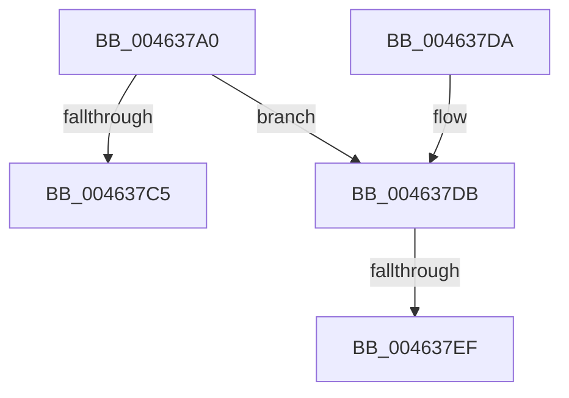

# HalpDmaReleaseBufferMappings

- RVA: `0x004637A0`–`0x004637FD` (길이 `93` bytes)
- VA: `0x00000001404637A0`
- 실행 섹션: `.text`
- PDB 이름 있음: `예`; PDB Function 태그: `예`
- unwind 정보 RVA: `0x000AA744`
- 디코드: `26`개 명령, `93/93` bytes 표시
- 미해석 바이트: `0` (있으면 어셈블리에 `.byte`로 보존)

> 이 문서는 커널 이미지의 기계어와 PDB 기호를 분석해 생성했습니다. 4번과 5번은 함수 원형과 자료형을 바이너리 사용 방식에서 추정한 C 해석이며 원본 소스 복구 결과는 아닙니다.

## 1. Dependencies

- 직접 호출 지점: **1**; 고유 호출 대상: **1**
- 직접 호출자로 확인된 함수: **1**
- RIP 상대 이미지 참조: **0**

### Outgoing calls
- `0x004637F2` → [MmUnmapLockedPages](../24/MmUnmapLockedPages_function_00246E60.md) (function, `0x00246E60`)

### Direct callers
- [HalpDmaZeroMapBuffers](../55/HalpDmaZeroMapBuffers_function_005511EC.md) at `0x0055130B`

### Static image references
- 디코드된 RIP-relative 메모리 참조가 없습니다.

## 2. Other-region calls and transfers

- 다른 실행 섹션으로 향하는 call: **0**
- call이 아닌 외부 분기/꼬리 이동: **2**
  - `0x004637E9` → [sub_006F2BBA](../6F/Unknown_function_006F2BBA.md) (`tail-transfer`)
  - `0x004637F8` → [sub_006F2BBA + 0x41](../6F/Unknown_function_006F2BBA.md) (`tail-transfer`)

## 3. Assembly (complete function range)

```asm
004637A0  48 89 5C 24 10                  mov qword ptr [rsp + 0x10], rbx
004637A5  48 89 6C 24 18                  mov qword ptr [rsp + 0x18], rbp
004637AA  48 89 74 24 20                  mov qword ptr [rsp + 0x20], rsi
004637AF  57                              push rdi
004637B0  48 83 EC 20                     sub rsp, 0x20
004637B4  41 8B F0                        mov esi, r8d
004637B7  49 8B F9                        mov rdi, r9
004637BA  4D 8B 01                        mov r8, qword ptr [r9]
004637BD  48 8B DA                        mov rbx, rdx
004637C0  4D 85 C0                        test r8, r8
004637C3  75 16                           jne 0x1404637db
004637C5  48 8B 5C 24 38                  mov rbx, qword ptr [rsp + 0x38]
004637CA  48 8B 6C 24 40                  mov rbp, qword ptr [rsp + 0x40]
004637CF  48 8B 74 24 48                  mov rsi, qword ptr [rsp + 0x48]
004637D4  48 83 C4 20                     add rsp, 0x20
004637D8  5F                              pop rdi
004637D9  C3                              ret
004637DA  CC                              int3
004637DB  41 80 79 30 00                  cmp byte ptr [r9 + 0x30], 0
004637E0  BD 01 00 00 00                  mov ebp, 1
004637E5  49 8B 49 08                     mov rcx, qword ptr [r9 + 8]
004637E9  0F 85 CB F3 28 00               jne 0x1406f2bba
004637EF  49 8B D0                        mov rdx, r8
004637F2  E8 69 36 DE FF                  call 0x140246e60
004637F7  90                              nop
004637F8  E9 FE F3 28 00                  jmp 0x1406f2bfb
```

## 4. C-style interpretation (structured pseudocode)

```c
__int64 __fastcall HalpDmaReleaseBufferMappings(__int64 a1, __int64 a2, int a3, __int64 a4)
{
    __int64 result;
    __int64 v_rsp;
    unsigned __int64 v_stack_p10;
    unsigned __int64 v_stack_p18;
    unsigned __int64 v_stack_p20;

    v_stack_p10 = v_rbx;
    v_stack_p18 = v_rbp;
    v_stack_p20 = v_rsi;
    v_rsp = (v_rsp) - (32);
    if (*(unsigned __int64 *)(a4) != 0) goto loc_004637DB;
    v_rsp = (v_rsp) + (32);
    return result;
loc_004637DB:
    result = MmUnmapLockedPages(*(unsigned __int64 *)(a4 + 8), *(unsigned __int64 *)(a4), *(unsigned __int64 *)(a4), a4);
}
```

## 5. (Beta) C Style

```c
int64_t HalpDmaReleaseBufferMappings(int64_t Arg1, int64_t Arg2, int32_t Arg3, void *Arg4)
{
    uint8_t *arg4 = (uint8_t *)Arg4;

    int64_t result;
    int64_t local_rsp;
    uint64_t v_stack_p10;
    uint64_t v_stack_p18;
    uint64_t v_stack_p20;

    v_stack_p10 = local_rbx;
    v_stack_p18 = local_rbp;
    v_stack_p20 = local_rsi;
    local_rsp = (local_rsp) - (32);
    if (*(uint64_t *)(arg4) != 0) goto loc_004637DB;
    local_rsp = (local_rsp) + (32);
    return result;
loc_004637DB:
    result = MmUnmapLockedPages(*(uint64_t *)(arg4 + 0x8), *(uint64_t *)(arg4), *(uint64_t *)(arg4), Arg4);
}
```

### 관측된 메모리 오프셋

구조체 형식이 확인되지 않은 접근은 인자 기준의 오프셋으로만 기록했습니다.

| 기준 인자 | 오프셋 표현 | 폭 (bit) | 접근 |
|---|---:|---:|---|
| `Arg4` | `+ 0x0` | `64` | `R` |
| `Arg4` | `+ 0x8` | `64` | `R` |
| `Arg4` | `+ 0x30` | `8` | `R` |

## 6. Execution-region graph

[열기: 2D/3D 그래프와 함수 탐색 컨트롤 패널](../../../control-panel.html?section=text&rva=0x004637A0&view=graph)

- 2D 그래프는 위에서 아래로 흐르고, 3D 그래프는 빈 공간을 드래그해 회전합니다. Shift+드래그는 이동, 휠은 확대·축소, 함수 노드 선택은 대상 보고서 이동입니다.

### Static fallback


