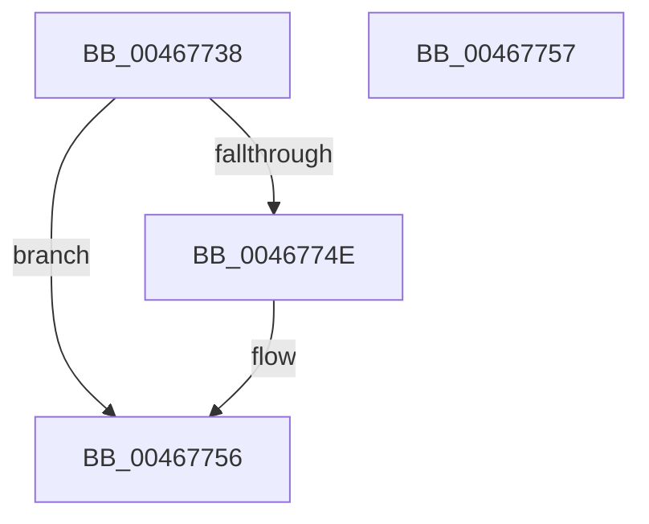

# HalpEfiIncrementEfiCall

- RVA: `0x00467738`–`0x00467758` (길이 `32` bytes)
- VA: `0x0000000140467738`
- 실행 섹션: `.text`
- PDB 이름 있음: `예`; PDB Function 태그: `아니요`
- unwind 정보 RVA: `0x000DB714`
- 디코드: `11`개 명령, `32/32` bytes 표시
- 미해석 바이트: `0` (있으면 어셈블리에 `.byte`로 보존)

> 이 문서는 커널 이미지의 기계어와 PDB 기호를 분석해 생성했습니다. 4번과 5번은 함수 원형과 자료형을 바이너리 사용 방식에서 추정한 C 해석이며 원본 소스 복구 결과는 아닙니다.

## 1. Dependencies

- 직접 호출 지점: **0**; 고유 호출 대상: **0**
- 직접 호출자로 확인된 함수: **5**
- RIP 상대 이미지 참조: **1**

### Outgoing calls
- 직접 디코드된 call 명령이 없습니다.

### Direct callers
- [HalEfiGetTime](../54/HalEfiGetTime_function_0054DC6C.md) at `0x0054DCCB`
- [HalEfiResetSystem](../54/HalEfiResetSystem_function_0054DDE8.md) at `0x0054DE12`
- [HalEfiResetSystem](../54/HalEfiResetSystem_function_0054DDE8.md) at `0x0054DE1E`
- [HalEfiSetTime](../54/HalEfiSetTime_function_0054DE84.md) at `0x0054DEF0`
- [HalEfiSetTime](../54/HalEfiSetTime_function_0054DE84.md) at `0x0054DFC1`
- [HalEfiSetTime](../54/HalEfiSetTime_function_0054DE84.md) at `0x0054DFCD`
- [HalEfiUpdateCapsule](../54/HalEfiUpdateCapsule_function_0054E0C0.md) at `0x0054E0E7`
- [HalEfiUpdateCapsule](../54/HalEfiUpdateCapsule_function_0054E0C0.md) at `0x0054E0F3`
- [HalpQueryCapsuleCapabilities](../56/HalpQueryCapsuleCapabilities_function_00563CE0.md) at `0x00563D99`

### Static image references
- `0x0046773F` → RVA `0x00FC1C30` (`.data`; read/write)

## 2. Other-region calls and transfers

- 다른 실행 섹션으로 향하는 call: **0**
- 별도 외부 분기/꼬리 이동을 확인하지 못했습니다.

## 3. Assembly (complete function range)

```asm
00467738  BA 01 00 00 00                  mov edx, 1
0046773D  8B C2                           mov eax, edx
0046773F  F0 0F C1 05 E9 A4 B5 00         lock xadd dword ptr [rip + 0xb5a4e9], eax
00467747  03 C2                           add eax, edx
00467749  48 85 C9                        test rcx, rcx
0046774C  74 08                           je 0x140467756
0046774E  8B C2                           mov eax, edx
00467750  F0 0F C1 01                     lock xadd dword ptr [rcx], eax
00467754  03 C2                           add eax, edx
00467756  C3                              ret
00467757  CC                              int3
```

## 4. C-style interpretation (structured pseudocode)

```c
__int64 __fastcall HalpEfiIncrementEfiCall(__int64 a1)
{
    __int64 result;

    result = (unsigned int)((1) + (1));
    if (a1 != 0) {
        result = 1;
        result = (unsigned int)((result) + (1));
    }
    return result;
}
```

## 5. (Beta) C Style

```c
int64_t HalpEfiIncrementEfiCall(int64_t Arg1)
{
    int64_t result;

    result = (uint32_t)((1) + (1));
    if (Arg1 != 0) {
        result = 1;
        result = (uint32_t)((result) + (1));
    }
    return result;
}
```

## 6. Execution-region graph

[열기: 2D/3D 그래프와 함수 탐색 컨트롤 패널](../../../control-panel.html?section=text&rva=0x00467738&view=graph)

- 2D 그래프는 위에서 아래로 흐르고, 3D 그래프는 빈 공간을 드래그해 회전합니다. Shift+드래그는 이동, 휠은 확대·축소, 함수 노드 선택은 대상 보고서 이동입니다.

### Static fallback


