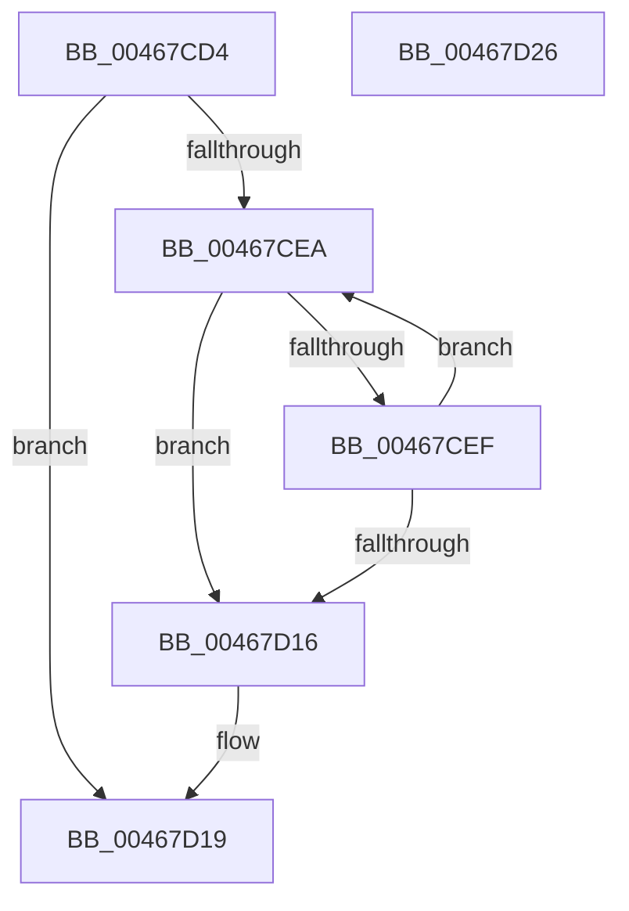

# HalpGetNumberOfSGElementsDmarThin

- RVA: `0x00467CD4`–`0x00467D27` (길이 `83` bytes)
- VA: `0x0000000140467CD4`
- 실행 섹션: `.text`
- PDB 이름 있음: `예`; PDB Function 태그: `아니요`
- unwind 정보 RVA: `0x00071750`
- 디코드: `28`개 명령, `83/83` bytes 표시
- 미해석 바이트: `0` (있으면 어셈블리에 `.byte`로 보존)

> 이 문서는 커널 이미지의 기계어와 PDB 기호를 분석해 생성했습니다. 4번과 5번은 함수 원형과 자료형을 바이너리 사용 방식에서 추정한 C 해석이며 원본 소스 복구 결과는 아닙니다.

## 1. Dependencies

- 직접 호출 지점: **0**; 고유 호출 대상: **0**
- 직접 호출자로 확인된 함수: **2**
- RIP 상대 이미지 참조: **0**

### Outgoing calls
- 직접 디코드된 call 명령이 없습니다.

### Direct callers
- [HalGetScatterGatherListDmarThin](HalGetScatterGatherListDmarThin_function_004679E0.md) at `0x00467A37`
- [HalpBuildScatterGatherListDmarThin](HalpBuildScatterGatherListDmarThin_function_00467B28.md) at `0x00467B86`

### Static image references
- 디코드된 RIP-relative 메모리 참조가 없습니다.

## 2. Other-region calls and transfers

- 다른 실행 섹션으로 향하는 call: **0**
- 별도 외부 분기/꼬리 이동을 확인하지 못했습니다.

## 3. Assembly (complete function range)

```asm
00467CD4  48 89 5C 24 08                  mov qword ptr [rsp + 8], rbx
00467CD9  45 33 C9                        xor r9d, r9d
00467CDC  48 8B DA                        mov rbx, rdx
00467CDF  4C 8B D1                        mov r10, rcx
00467CE2  45 8B D9                        mov r11d, r9d
00467CE5  45 85 C0                        test r8d, r8d
00467CE8  74 2F                           je 0x140467d19
00467CEA  4D 85 D2                        test r10, r10
00467CED  74 27                           je 0x140467d16
00467CEF  41 8B 42 28                     mov eax, dword ptr [r10 + 0x28]
00467CF3  41 8D 4B 01                     lea ecx, [r11 + 1]
00467CF7  4D 8B 12                        mov r10, qword ptr [r10]
00467CFA  2B C3                           sub eax, ebx
00467CFC  41 3B C0                        cmp eax, r8d
00467CFF  41 8B D0                        mov edx, r8d
00467D02  49 8B D9                        mov rbx, r9
00467D05  0F 46 D0                        cmovbe edx, eax
00467D08  85 D2                           test edx, edx
00467D0A  41 0F 44 CB                     cmove ecx, r11d
00467D0E  44 8B D9                        mov r11d, ecx
00467D11  44 2B C2                        sub r8d, edx
00467D14  75 D4                           jne 0x140467cea
00467D16  45 85 C0                        test r8d, r8d
00467D19  48 8B 5C 24 08                  mov rbx, qword ptr [rsp + 8]
00467D1E  45 0F 44 CB                     cmove r9d, r11d
00467D22  41 8B C1                        mov eax, r9d
00467D25  C3                              ret
00467D26  CC                              int3
```

## 4. C-style interpretation (structured pseudocode)

```c
__int64 __fastcall HalpGetNumberOfSGElementsDmarThin(__int64 a1, __int64 a2, int a3, int a4)
{
    __int64 result;
    unsigned __int64 v_stack_p8;

    v_stack_p8 = v_rbx;
    a4 = 0;
    if (a3 == 0) goto loc_00467D19;
loc_00467CEA:
    if (a1 == 0) goto loc_00467D16;
    result = (unsigned int)(((unsigned int)(*(unsigned int *)(a1 + 40))) - ((unsigned int)(a2)));
    a2 = (unsigned int)(a3);
    if (((unsigned int)(result)) <= a3) { a2 = (unsigned int)(result); }
    a1 = 0 + 1;
    if ((unsigned int)(a2) == 0) { a1 = 0; }
    a3 = (unsigned int)((a3) - ((unsigned int)(a2)));
    if (condition_is_not_equal) goto loc_00467CEA;
loc_00467D16:
loc_00467D19:
    if (a3 == 0) { a4 = (unsigned int)((unsigned int)((unsigned int)(a1))); }
    return (unsigned int)(a4);
}
```

## 5. (Beta) C Style

```c
int64_t HalpGetNumberOfSGElementsDmarThin(int64_t Arg1, int64_t Arg2, int32_t Arg3, int32_t Arg4)
{
    int64_t result;
    uint64_t v_stack_p8;

    v_stack_p8 = local_rbx;
    Arg4 = 0;
    if (Arg3 == 0) goto loc_00467D19;
loc_00467CEA:
    if (Arg1 == 0) goto loc_00467D16;
    result = (uint32_t)(((uint32_t)(*(uint32_t *)(Arg1 + 0x28))) - ((uint32_t)(Arg2)));
    Arg2 = (uint32_t)(Arg3);
    if (((uint32_t)(result)) <= Arg3) { Arg2 = (uint32_t)(result); }
    Arg1 = 0 + 1;
    if ((uint32_t)(Arg2) == 0) { Arg1 = 0; }
    Arg3 = (uint32_t)((Arg3) - ((uint32_t)(Arg2)));
    if (condition_is_not_equal) goto loc_00467CEA;
loc_00467D16:
loc_00467D19:
    if (Arg3 == 0) { Arg4 = (uint32_t)((uint32_t)((uint32_t)(Arg1))); }
    return (uint32_t)(Arg4);
}
```

## 6. Execution-region graph

[열기: 2D/3D 그래프와 함수 탐색 컨트롤 패널](../../../control-panel.html?section=text&rva=0x00467CD4&view=graph)

- 2D 그래프는 위에서 아래로 흐르고, 3D 그래프는 빈 공간을 드래그해 회전합니다. Shift+드래그는 이동, 휠은 확대·축소, 함수 노드 선택은 대상 보고서 이동입니다.

### Static fallback


