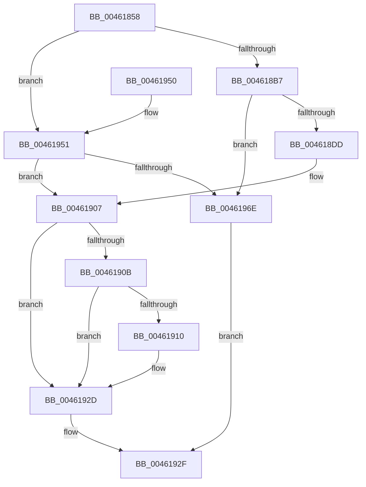

# HalpGetPCIData

- RVA: `0x00461858`–`0x00461972` (길이 `282` bytes)
- VA: `0x0000000140461858`
- 실행 섹션: `.text`
- PDB 이름 있음: `예`; PDB Function 태그: `아니요`
- unwind 정보 RVA: `0x000A9EF0`
- 디코드: `82`개 명령, `282/282` bytes 표시
- 미해석 바이트: `0` (있으면 어셈블리에 `.byte`로 보존)

> 이 문서는 커널 이미지의 기계어와 PDB 기호를 분석해 생성했습니다. 4번과 5번은 함수 원형과 자료형을 바이너리 사용 방식에서 추정한 C 해석이며 원본 소스 복구 결과는 아닙니다.

## 1. Dependencies

- 직접 호출 지점: **5**; 고유 호출 대상: **3**
- 직접 호출자로 확인된 함수: **2**
- RIP 상대 이미지 참조: **1**

### Outgoing calls
- `0x004618BF` → [HalpReadPCIConfig](HalpReadPCIConfig_function_00461978.md) (function, `0x00461978`)
- `0x004618F5` → [memcpy](../6C/memcpy_function_006C6840.md) (function, `0x006C6840`)
- `0x00461926` → [HalpReadPCIConfig](HalpReadPCIConfig_function_00461978.md) (function, `0x00461978`)
- `0x00461937` → [_security_check_cookie](../6A/_security_check_cookie_function_006AC640.md) (function, `0x006AC640`)
- `0x0046195D` → [HalpReadPCIConfig](HalpReadPCIConfig_function_00461978.md) (function, `0x00461978`)

### Direct callers
- [HalGetBusDataByOffset](HalGetBusDataByOffset_function_00461730.md) at `0x004617F7`
- [HalpPciReadSecondaryBusNumber](../55/HalpPciReadSecondaryBusNumber_function_00553D1C.md) at `0x00553D8B`

### Static image references
- `0x0046186C` → RVA `0x00E0A740` (`.data`; read)

## 2. Other-region calls and transfers

- 다른 실행 섹션으로 향하는 call: **0**
- 별도 외부 분기/꼬리 이동을 확인하지 못했습니다.

## 3. Assembly (complete function range)

```asm
00461858  40 53                           push rbx
0046185A  55                              push rbp
0046185B  56                              push rsi
0046185C  57                              push rdi
0046185D  41 54                           push r12
0046185F  41 55                           push r13
00461861  41 56                           push r14
00461863  41 57                           push r15
00461865  48 81 EC 88 00 00 00            sub rsp, 0x88
0046186C  48 8B 05 CD 8E 9A 00            mov rax, qword ptr [rip + 0x9a8ecd]
00461873  48 33 C4                        xor rax, rsp
00461876  48 89 44 24 70                  mov qword ptr [rsp + 0x70], rax
0046187B  44 8B B4 24 F0 00 00 00         mov r14d, dword ptr [rsp + 0xf0]
00461883  BD 00 10 00 00                  mov ebp, 0x1000
00461888  39 AC 24 F8 00 00 00            cmp dword ptr [rsp + 0xf8], ebp
0046188F  4D 8B E9                        mov r13, r9
00461892  41 8B D8                        mov ebx, r8d
00461895  4C 8D 4C 24 30                  lea r9, [rsp + 0x30]
0046189A  0F 46 AC 24 F8 00 00 00         cmovbe ebp, dword ptr [rsp + 0xf8]
004618A2  44 8A E2                        mov r12b, dl
004618A5  33 F6                           xor esi, esi
004618A7  44 0F B7 F9                     movzx r15d, cx
004618AB  8D 7E 40                        lea edi, [rsi + 0x40]
004618AE  44 3B F7                        cmp r14d, edi
004618B1  0F 83 9A 00 00 00               jae 0x140461951
004618B7  89 7C 24 28                     mov dword ptr [rsp + 0x28], edi
004618BB  21 74 24 20                     and dword ptr [rsp + 0x20], esi
004618BF  E8 B4 00 00 00                  call 0x140461978
004618C4  B8 FF FF 00 00                  mov eax, 0xffff
004618C9  8D 77 C2                        lea esi, [rdi - 0x3e]
004618CC  66 39 44 24 30                  cmp word ptr [rsp + 0x30], ax
004618D1  0F 45 F7                        cmovne esi, edi
004618D4  41 3B F6                        cmp esi, r14d
004618D7  0F 82 91 00 00 00               jb 0x14046196e
004618DD  41 2B F6                        sub esi, r14d
004618E0  48 8D 54 24 30                  lea rdx, [rsp + 0x30]
004618E5  3B F5                           cmp esi, ebp
004618E7  49 8B CD                        mov rcx, r13
004618EA  0F 47 F5                        cmova esi, ebp
004618ED  49 03 D6                        add rdx, r14
004618F0  44 8B C6                        mov r8d, esi
004618F3  8B FE                           mov edi, esi
004618F5  E8 46 4F 26 00                  call 0x1406c6840
004618FA  4C 03 EF                        add r13, rdi
004618FD  44 03 F6                        add r14d, esi
00461900  2B EE                           sub ebp, esi
00461902  BF 40 00 00 00                  mov edi, 0x40
00461907  85 ED                           test ebp, ebp
00461909  74 22                           je 0x14046192d
0046190B  44 3B F7                        cmp r14d, edi
0046190E  72 1D                           jb 0x14046192d
00461910  89 6C 24 28                     mov dword ptr [rsp + 0x28], ebp
00461914  4D 8B CD                        mov r9, r13
00461917  44 8B C3                        mov r8d, ebx
0046191A  44 89 74 24 20                  mov dword ptr [rsp + 0x20], r14d
0046191F  41 8A D4                        mov dl, r12b
00461922  41 0F B7 CF                     movzx ecx, r15w
00461926  E8 4D 00 00 00                  call 0x140461978
0046192B  03 F5                           add esi, ebp
0046192D  8B C6                           mov eax, esi
0046192F  48 8B 4C 24 70                  mov rcx, qword ptr [rsp + 0x70]
00461934  48 33 CC                        xor rcx, rsp
00461937  E8 04 AD 24 00                  call 0x1406ac640
0046193C  48 81 C4 88 00 00 00            add rsp, 0x88
00461943  41 5F                           pop r15
00461945  41 5E                           pop r14
00461947  41 5D                           pop r13
00461949  41 5C                           pop r12
0046194B  5F                              pop rdi
0046194C  5E                              pop rsi
0046194D  5D                              pop rbp
0046194E  5B                              pop rbx
0046194F  C3                              ret
00461950  CC                              int3
00461951  C7 44 24 28 04 00 00 00         mov dword ptr [rsp + 0x28], 4
00461959  21 74 24 20                     and dword ptr [rsp + 0x20], esi
0046195D  E8 16 00 00 00                  call 0x140461978
00461962  B8 FF FF 00 00                  mov eax, 0xffff
00461967  66 39 44 24 30                  cmp word ptr [rsp + 0x30], ax
0046196C  75 99                           jne 0x140461907
0046196E  33 C0                           xor eax, eax
00461970  EB BD                           jmp 0x14046192f
```

## 4. C-style interpretation (structured pseudocode)

```c
__int64 __fastcall HalpGetPCIData(unsigned __int16 a1, unsigned __int8 a2, int a3, __int64 a4, unsigned int a5, unsigned int a6)
{
    __int64 result;
    __int64 v_r13;
    __int64 v_r14;
    __int64 v_rbp;
    __int64 v_rsi;
    __int64 v_rsp;
    unsigned __int64 v_stack_m58;
    unsigned __int64 v_stack_m98;
    unsigned int v_stack_mA0;
    unsigned int v_stack_mA8;
    unsigned int v_stack_p20;
    unsigned int v_stack_p28;
    unsigned __int16 v_stack_p30;

    v_rsp = (v_rsp) - (136);
    result = (*(unsigned __int64 *)(v_rip + 10129101)) ^ (v_rsp);
    v_stack_m58 = result;
    v_rbp = (unsigned int)(0x1000ULL);
    if (a6 <= ((unsigned int)((unsigned int)(0x1000ULL)))) { v_rbp = a6; }
    v_rsi = 0;
    if (((unsigned int)((unsigned int)(a5))) >= ((unsigned int)(v_rsi + 64))) goto loc_00461951;
    v_stack_mA0 = (unsigned int)(v_rsi + 64);
    result = HalpReadPCIConfig(a1, a2, a3, v_stack_m98);
    v_rsi = v_rsi + 64 - 62;
    if (v_stack_m98 != ((unsigned __int16)((unsigned int)(0xFFFFULL)))) { v_rsi = (unsigned int)(v_rsi + 64); }
    if (((unsigned int)(v_rsi)) < ((unsigned int)((unsigned int)(a5)))) goto loc_0046196E;
    v_rsi = (unsigned int)((v_rsi) - ((unsigned int)((unsigned int)(a5))));
    if (((unsigned int)(v_rsi)) > ((unsigned int)(v_rbp))) { v_rsi = (unsigned int)(v_rbp); }
    a2 = (v_stack_m98) + ((unsigned int)(a5));
    result = memcpy(a4, a2, (unsigned int)((unsigned int)(v_rsi)), v_stack_m98);
    v_r13 = (a4) + ((unsigned int)((unsigned int)(v_rsi)));
    v_r14 = (unsigned int)(((unsigned int)(a5)) + ((unsigned int)(v_rsi)));
    v_rbp = (unsigned int)((v_rbp) - ((unsigned int)(v_rsi)));
loc_00461907:
    if ((unsigned int)(v_rbp) == 0) goto loc_0046192D;
    if (((unsigned int)(v_r14)) >= 64) {
        v_stack_mA0 = (unsigned int)(v_rbp);
        a4 = v_r13;
        a3 = (unsigned int)((unsigned int)(a3));
        v_stack_mA8 = (unsigned int)(v_r14);
        a2 = a2;
        a1 = a1;
        result = HalpReadPCIConfig(a1, a2, a3, a4);
        v_rsi = (unsigned int)((v_rsi) + ((unsigned int)(v_rbp)));
    }
loc_0046192F:
    a1 = (v_stack_m58) ^ (v_rsp);
    result = _security_check_cookie(a1, a2, a3, a4);
    v_rsp = (v_rsp) + (136);
    return result;
loc_00461951:
    v_stack_p28 = 4;
    result = HalpReadPCIConfig(a1, a2, a3, a4);
    if (v_stack_p30 != ((unsigned __int16)((unsigned int)(0xFFFFULL)))) goto loc_00461907;
loc_0046196E:
    result = 0;
    goto loc_0046192F;
}
```

## 5. (Beta) C Style

```c
int64_t HalpGetPCIData(uint16_t Arg1, uint8_t Arg2, int32_t Arg3, int64_t Arg4, uint32_t Arg5, uint32_t Arg6)
{
    int64_t result;
    int64_t local_r13;
    int64_t local_r14;
    int64_t local_rbp;
    int64_t local_rsi;
    int64_t local_rsp;
    uint64_t v_stack_m58;
    uint64_t v_stack_m98;
    uint32_t v_stack_mA0;
    uint32_t v_stack_mA8;
    uint32_t v_stack_p20;
    uint32_t v_stack_p28;
    uint16_t v_stack_p30;

    local_rsp = (local_rsp) - (136);
    result = (*(uint64_t *)(v_rip + 0x9A8ECD)) ^ (local_rsp);
    v_stack_m58 = result;
    local_rbp = (uint32_t)(0x1000ULL);
    if (Arg6 <= ((uint32_t)((uint32_t)(0x1000ULL)))) { local_rbp = Arg6; }
    local_rsi = 0;
    if (((uint32_t)((uint32_t)(Arg5))) >= ((uint32_t)(local_rsi + 64))) goto loc_00461951;
    v_stack_mA0 = (uint32_t)(local_rsi + 64);
    result = HalpReadPCIConfig(Arg1, Arg2, Arg3, v_stack_m98);
    local_rsi = local_rsi + 64 - 62;
    if (v_stack_m98 != ((uint16_t)((uint32_t)(0xFFFFULL)))) { local_rsi = (uint32_t)(local_rsi + 64); }
    if (((uint32_t)(local_rsi)) < ((uint32_t)((uint32_t)(Arg5)))) goto loc_0046196E;
    local_rsi = (uint32_t)((local_rsi) - ((uint32_t)((uint32_t)(Arg5))));
    if (((uint32_t)(local_rsi)) > ((uint32_t)(local_rbp))) { local_rsi = (uint32_t)(local_rbp); }
    Arg2 = (v_stack_m98) + ((uint32_t)(Arg5));
    result = memcpy(Arg4, Arg2, (uint32_t)((uint32_t)(local_rsi)), v_stack_m98);
    local_r13 = (Arg4) + ((uint32_t)((uint32_t)(local_rsi)));
    local_r14 = (uint32_t)(((uint32_t)(Arg5)) + ((uint32_t)(local_rsi)));
    local_rbp = (uint32_t)((local_rbp) - ((uint32_t)(local_rsi)));
loc_00461907:
    if ((uint32_t)(local_rbp) == 0) goto loc_0046192D;
    if (((uint32_t)(local_r14)) >= 64) {
        v_stack_mA0 = (uint32_t)(local_rbp);
        Arg4 = local_r13;
        Arg3 = (uint32_t)((uint32_t)(Arg3));
        v_stack_mA8 = (uint32_t)(local_r14);
        Arg2 = Arg2;
        Arg1 = Arg1;
        result = HalpReadPCIConfig(Arg1, Arg2, Arg3, Arg4);
        local_rsi = (uint32_t)((local_rsi) + ((uint32_t)(local_rbp)));
    }
loc_0046192F:
    Arg1 = (v_stack_m58) ^ (local_rsp);
    result = _security_check_cookie(Arg1, Arg2, Arg3, Arg4);
    local_rsp = (local_rsp) + (136);
    return result;
loc_00461951:
    v_stack_p28 = 4;
    result = HalpReadPCIConfig(Arg1, Arg2, Arg3, Arg4);
    if (v_stack_p30 != ((uint16_t)((uint32_t)(0xFFFFULL)))) goto loc_00461907;
loc_0046196E:
    result = 0;
    goto loc_0046192F;
}
```

## 6. Execution-region graph

[열기: 2D/3D 그래프와 함수 탐색 컨트롤 패널](../../../control-panel.html?section=text&rva=0x00461858&view=graph)

- 2D 그래프는 위에서 아래로 흐르고, 3D 그래프는 빈 공간을 드래그해 회전합니다. Shift+드래그는 이동, 휠은 확대·축소, 함수 노드 선택은 대상 보고서 이동입니다.

### Static fallback


