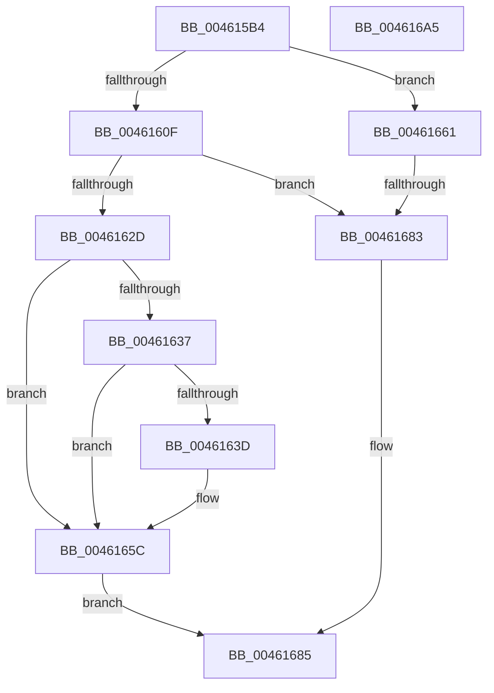

# HalpSetPCIData

- RVA: `0x004615B4`–`0x004616A6` (길이 `242` bytes)
- VA: `0x00000001404615B4`
- 실행 섹션: `.text`
- PDB 이름 있음: `예`; PDB Function 태그: `예`
- unwind 정보 RVA: `0x000A9E74`
- 디코드: `68`개 명령, `242/242` bytes 표시
- 미해석 바이트: `0` (있으면 어셈블리에 `.byte`로 보존)

> 이 문서는 커널 이미지의 기계어와 PDB 기호를 분석해 생성했습니다. 4번과 5번은 함수 원형과 자료형을 바이너리 사용 방식에서 추정한 C 해석이며 원본 소스 복구 결과는 아닙니다.

## 1. Dependencies

- 직접 호출 지점: **4**; 고유 호출 대상: **3**
- 직접 호출자로 확인된 함수: **1**
- RIP 상대 이미지 참조: **1**

### Outgoing calls
- `0x0046161C` → [HalpReadPCIConfig](HalpReadPCIConfig_function_00461978.md) (function, `0x00461978`)
- `0x00461654` → [HalpWritePCIConfig](HalpWritePCIConfig_function_004616AC.md) (function, `0x004616AC`)
- `0x0046166E` → [HalpReadPCIConfig](HalpReadPCIConfig_function_00461978.md) (function, `0x00461978`)
- `0x0046168C` → [_security_check_cookie](../6A/_security_check_cookie_function_006AC640.md) (function, `0x006AC640`)

### Direct callers
- [HalSetBusDataByOffset](HalSetBusDataByOffset_function_004614A0.md) at `0x0046150A`

### Static image references
- `0x004615CD` → RVA `0x00E0A740` (`.data`; read)

## 2. Other-region calls and transfers

- 다른 실행 섹션으로 향하는 call: **0**
- call이 아닌 외부 분기/꼬리 이동: **1**
  - `0x0046167D` → [sub_006F25EC](../6F/Unknown_function_006F25EC.md) (`tail-transfer`)

## 3. Assembly (complete function range)

```asm
004615B4  40 55                           push rbp
004615B6  53                              push rbx
004615B7  56                              push rsi
004615B8  57                              push rdi
004615B9  41 54                           push r12
004615BB  41 55                           push r13
004615BD  41 56                           push r14
004615BF  41 57                           push r15
004615C1  48 8D 6C 24 F1                  lea rbp, [rsp - 0xf]
004615C6  48 81 EC D8 00 00 00            sub rsp, 0xd8
004615CD  48 8B 05 6C 91 9A 00            mov rax, qword ptr [rip + 0x9a916c]
004615D4  48 33 C4                        xor rax, rsp
004615D7  48 89 45 F7                     mov qword ptr [rbp - 9], rax
004615DB  44 8B 65 77                     mov r12d, dword ptr [rbp + 0x77]
004615DF  41 BE 00 10 00 00               mov r14d, 0x1000
004615E5  44 39 75 7F                     cmp dword ptr [rbp + 0x7f], r14d
004615E9  41 8B D8                        mov ebx, r8d
004615EC  4C 89 4C 24 38                  mov qword ptr [rsp + 0x38], r9
004615F1  40 8A FA                        mov dil, dl
004615F4  44 0F 46 75 7F                  cmovbe r14d, dword ptr [rbp + 0x7f]
004615F9  4C 8D 4C 24 40                  lea r9, [rsp + 0x40]
004615FE  45 33 FF                        xor r15d, r15d
00461601  88 54 24 30                     mov byte ptr [rsp + 0x30], dl
00461605  44 0F B7 E9                     movzx r13d, cx
00461609  41 83 FC 40                     cmp r12d, 0x40
0046160D  72 52                           jb 0x140461661
0046160F  C7 44 24 28 04 00 00 00         mov dword ptr [rsp + 0x28], 4
00461617  44 21 7C 24 20                  and dword ptr [rsp + 0x20], r15d
0046161C  E8 57 03 00 00                  call 0x140461978
00461621  B8 FF FF 00 00                  mov eax, 0xffff
00461626  66 39 44 24 40                  cmp word ptr [rsp + 0x40], ax
0046162B  74 56                           je 0x140461683
0046162D  48 8B 44 24 38                  mov rax, qword ptr [rsp + 0x38]
00461632  45 85 F6                        test r14d, r14d
00461635  74 25                           je 0x14046165c
00461637  41 83 FC 40                     cmp r12d, 0x40
0046163B  72 1F                           jb 0x14046165c
0046163D  44 89 74 24 28                  mov dword ptr [rsp + 0x28], r14d
00461642  4C 8B C8                        mov r9, rax
00461645  44 8B C3                        mov r8d, ebx
00461648  44 89 64 24 20                  mov dword ptr [rsp + 0x20], r12d
0046164D  40 8A D7                        mov dl, dil
00461650  41 0F B7 CD                     movzx ecx, r13w
00461654  E8 53 00 00 00                  call 0x1404616ac
00461659  45 03 FE                        add r15d, r14d
0046165C  41 8B C7                        mov eax, r15d
0046165F  EB 24                           jmp 0x140461685
00461661  C7 44 24 28 40 00 00 00         mov dword ptr [rsp + 0x28], 0x40
00461669  44 21 7C 24 20                  and dword ptr [rsp + 0x20], r15d
0046166E  E8 05 03 00 00                  call 0x140461978
00461673  B8 FF FF 00 00                  mov eax, 0xffff
00461678  66 39 44 24 40                  cmp word ptr [rsp + 0x40], ax
0046167D  0F 85 69 0F 29 00               jne 0x1406f25ec
00461683  33 C0                           xor eax, eax
00461685  48 8B 4D F7                     mov rcx, qword ptr [rbp - 9]
00461689  48 33 CC                        xor rcx, rsp
0046168C  E8 AF AF 24 00                  call 0x1406ac640
00461691  48 81 C4 D8 00 00 00            add rsp, 0xd8
00461698  41 5F                           pop r15
0046169A  41 5E                           pop r14
0046169C  41 5D                           pop r13
0046169E  41 5C                           pop r12
004616A0  5F                              pop rdi
004616A1  5E                              pop rsi
004616A2  5B                              pop rbx
004616A3  5D                              pop rbp
004616A4  C3                              ret
004616A5  CC                              int3
```

## 4. C-style interpretation (structured pseudocode)

```c
__int64 __fastcall HalpSetPCIData(unsigned __int16 a1, unsigned __int8 a2, int a3, __int64 a4, unsigned int a5, unsigned int a6)
{
    __int64 result;
    __int64 v_r14;
    __int64 v_r15;
    __int64 v_rsp;
    unsigned __int64 v_stack_m4F;
    unsigned __int64 v_stack_m58;
    unsigned __int64 v_stack_mD8;
    unsigned __int64 v_stack_mE0;
    unsigned __int8 v_stack_mE8;
    unsigned int v_stack_mF0;
    unsigned int v_stack_mF8;

    v_rsp = (v_rsp) - (216);
    result = (*(unsigned __int64 *)(v_rip + 10129772)) ^ (v_rsp);
    v_stack_m58 = result;
    v_stack_mE0 = a4;
    v_r14 = (unsigned int)(0x1000ULL);
    if (a6 <= ((unsigned int)((unsigned int)(0x1000ULL)))) { v_r14 = a6; }
    v_r15 = 0;
    v_stack_mE8 = a2;
    if (((unsigned int)((unsigned int)(a5))) < 64) goto loc_00461661;
    v_stack_mF0 = 4;
    result = HalpReadPCIConfig(a1, a2, a3, v_stack_mD8);
    if (v_stack_mD8 == ((unsigned __int16)((unsigned int)(0xFFFFULL)))) goto loc_00461683;
    if ((unsigned int)(v_r14) == 0) goto loc_0046165C;
    result = v_stack_mE0;
    if (((unsigned int)((unsigned int)(a5))) >= 64) {
        v_stack_mF0 = (unsigned int)(v_r14);
        a4 = v_stack_mE0;
        a3 = (unsigned int)((unsigned int)(a3));
        v_stack_mF8 = (unsigned int)((unsigned int)(a5));
        a2 = a2;
        a1 = a1;
        result = HalpWritePCIConfig(a1, a2, a3, a4);
        v_r15 = (unsigned int)((v_r15) + ((unsigned int)(v_r14)));
    }
    goto loc_00461685;
loc_00461661:
    v_stack_mF0 = 64;
    result = HalpReadPCIConfig(a1, a2, a3, a4);
loc_00461683:
    result = 0;
loc_00461685:
    a1 = (v_stack_m58) ^ (v_rsp);
    result = _security_check_cookie(a1, a2, a3, a4);
    v_rsp = (v_rsp) + (216);
    return result;
}
```

## 5. (Beta) C Style

```c
int64_t HalpSetPCIData(uint16_t Arg1, uint8_t Arg2, int32_t Arg3, int64_t Arg4, uint32_t Arg5, uint32_t Arg6)
{
    int64_t result;
    int64_t local_r14;
    int64_t local_r15;
    int64_t local_rsp;
    uint64_t v_stack_m4F;
    uint64_t v_stack_m58;
    uint64_t v_stack_mD8;
    uint64_t v_stack_mE0;
    uint8_t v_stack_mE8;
    uint32_t v_stack_mF0;
    uint32_t v_stack_mF8;

    local_rsp = (local_rsp) - (216);
    result = (*(uint64_t *)(v_rip + 0x9A916C)) ^ (local_rsp);
    v_stack_m58 = result;
    v_stack_mE0 = Arg4;
    local_r14 = (uint32_t)(0x1000ULL);
    if (Arg6 <= ((uint32_t)((uint32_t)(0x1000ULL)))) { local_r14 = Arg6; }
    local_r15 = 0;
    v_stack_mE8 = Arg2;
    if (((uint32_t)((uint32_t)(Arg5))) < 64) goto loc_00461661;
    v_stack_mF0 = 4;
    result = HalpReadPCIConfig(Arg1, Arg2, Arg3, v_stack_mD8);
    if (v_stack_mD8 == ((uint16_t)((uint32_t)(0xFFFFULL)))) goto loc_00461683;
    if ((uint32_t)(local_r14) == 0) goto loc_0046165C;
    result = v_stack_mE0;
    if (((uint32_t)((uint32_t)(Arg5))) >= 64) {
        v_stack_mF0 = (uint32_t)(local_r14);
        Arg4 = v_stack_mE0;
        Arg3 = (uint32_t)((uint32_t)(Arg3));
        v_stack_mF8 = (uint32_t)((uint32_t)(Arg5));
        Arg2 = Arg2;
        Arg1 = Arg1;
        result = HalpWritePCIConfig(Arg1, Arg2, Arg3, Arg4);
        local_r15 = (uint32_t)((local_r15) + ((uint32_t)(local_r14)));
    }
    goto loc_00461685;
loc_00461661:
    v_stack_mF0 = 64;
    result = HalpReadPCIConfig(Arg1, Arg2, Arg3, Arg4);
loc_00461683:
    result = 0;
loc_00461685:
    Arg1 = (v_stack_m58) ^ (local_rsp);
    result = _security_check_cookie(Arg1, Arg2, Arg3, Arg4);
    local_rsp = (local_rsp) + (216);
    return result;
}
```

## 6. Execution-region graph

[열기: 2D/3D 그래프와 함수 탐색 컨트롤 패널](../../../control-panel.html?section=text&rva=0x004615B4&view=graph)

- 2D 그래프는 위에서 아래로 흐르고, 3D 그래프는 빈 공간을 드래그해 회전합니다. Shift+드래그는 이동, 휠은 확대·축소, 함수 노드 선택은 대상 보고서 이동입니다.

### Static fallback


