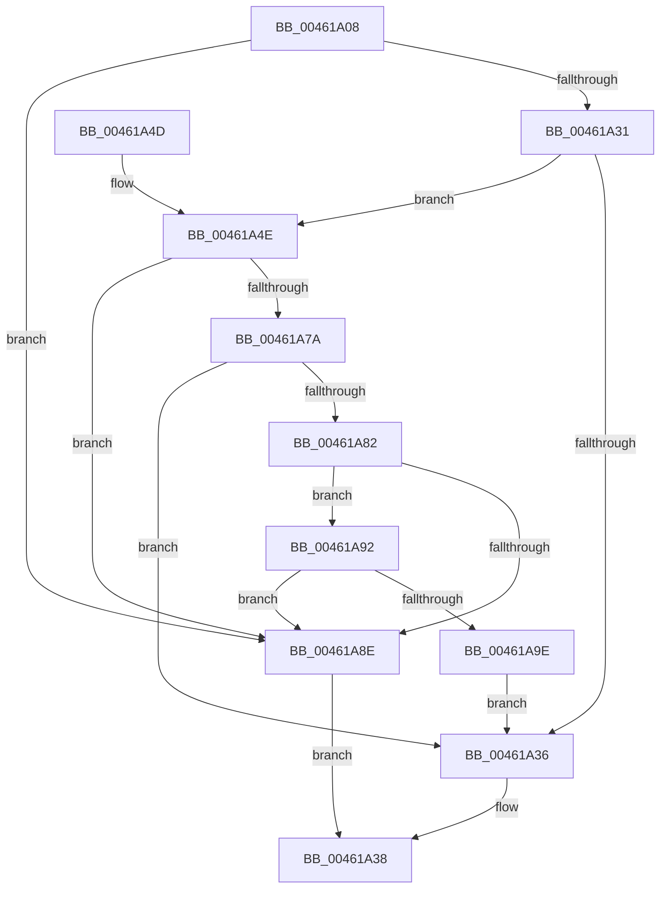

# HalpValidPCISlot

- RVA: `0x00461A08`–`0x00461ACC` (길이 `196` bytes)
- VA: `0x0000000140461A08`
- 실행 섹션: `.text`
- PDB 이름 있음: `예`; PDB Function 태그: `아니요`
- unwind 정보 RVA: `0x000A9F30`
- 디코드: `54`개 명령, `196/196` bytes 표시
- 미해석 바이트: `0` (있으면 어셈블리에 `.byte`로 보존)

> 이 문서는 커널 이미지의 기계어와 PDB 기호를 분석해 생성했습니다. 4번과 5번은 함수 원형과 자료형을 바이너리 사용 방식에서 추정한 C 해석이며 원본 소스 복구 결과는 아닙니다.

## 1. Dependencies

- 직접 호출 지점: **3**; 고유 호출 대상: **3**
- 직접 호출자로 확인된 함수: **2**
- RIP 상대 이미지 참조: **1**

### Outgoing calls
- `0x00461A40` → [_security_check_cookie](../6A/_security_check_cookie_function_006AC640.md) (function, `0x006AC640`)
- `0x00461A69` → [HalpReadPCIConfig](HalpReadPCIConfig_function_00461978.md) (function, `0x00461978`)
- `0x00461AC2` → [HalpWritePCIConfig](HalpWritePCIConfig_function_004616AC.md) (function, `0x004616AC`)

### Direct callers
- [HalpWritePCIConfig](HalpWritePCIConfig_function_004616AC.md) at `0x004616D1`
- [HalpReadPCIConfig](HalpReadPCIConfig_function_00461978.md) at `0x0046199E`

### Static image references
- `0x00461A10` → RVA `0x00E0A740` (`.data`; read)

## 2. Other-region calls and transfers

- 다른 실행 섹션으로 향하는 call: **0**
- 별도 외부 분기/꼬리 이동을 확인하지 못했습니다.

## 3. Assembly (complete function range)

```asm
00461A08  40 53                           push rbx
00461A0A  56                              push rsi
00461A0B  57                              push rdi
00461A0C  48 83 EC 50                     sub rsp, 0x50
00461A10  48 8B 05 29 8D 9A 00            mov rax, qword ptr [rip + 0x9a8d29]
00461A17  48 33 C4                        xor rax, rsp
00461A1A  48 89 44 24 40                  mov qword ptr [rsp + 0x40], rax
00461A1F  41 8B D8                        mov ebx, r8d
00461A22  40 8A F2                        mov sil, dl
00461A25  0F B7 F9                        movzx edi, cx
00461A28  41 81 F8 00 01 00 00            cmp r8d, 0x100
00461A2F  73 5D                           jae 0x140461a8e
00461A31  F6 C3 E0                        test bl, 0xe0
00461A34  75 18                           jne 0x140461a4e
00461A36  B0 01                           mov al, 1
00461A38  48 8B 4C 24 40                  mov rcx, qword ptr [rsp + 0x40]
00461A3D  48 33 CC                        xor rcx, rsp
00461A40  E8 FB AB 24 00                  call 0x1406ac640
00461A45  48 83 C4 50                     add rsp, 0x50
00461A49  5F                              pop rdi
00461A4A  5E                              pop rsi
00461A4B  5B                              pop rbx
00461A4C  C3                              ret
00461A4D  CC                              int3
00461A4E  81 E3 1F FF FF FF               and ebx, 0xffffff1f
00461A54  C7 44 24 28 10 00 00 00         mov dword ptr [rsp + 0x28], 0x10
00461A5C  83 64 24 20 00                  and dword ptr [rsp + 0x20], 0
00461A61  4C 8D 4C 24 30                  lea r9, [rsp + 0x30]
00461A66  44 8B C3                        mov r8d, ebx
00461A69  E8 0A FF FF FF                  call 0x140461978
00461A6E  B8 FF FF 00 00                  mov eax, 0xffff
00461A73  66 39 44 24 30                  cmp word ptr [rsp + 0x30], ax
00461A78  74 14                           je 0x140461a8e
00461A7A  8A 44 24 3E                     mov al, byte ptr [rsp + 0x3e]
00461A7E  84 C0                           test al, al
00461A80  78 B4                           js 0x140461a36
00461A82  B9 86 80 00 00                  mov ecx, 0x8086
00461A87  66 39 4C 24 30                  cmp word ptr [rsp + 0x30], cx
00461A8C  74 04                           je 0x140461a92
00461A8E  32 C0                           xor al, al
00461A90  EB A6                           jmp 0x140461a38
00461A92  B9 2E 12 00 00                  mov ecx, 0x122e
00461A97  66 39 4C 24 32                  cmp word ptr [rsp + 0x32], cx
00461A9C  75 F0                           jne 0x140461a8e
00461A9E  0C 80                           or al, 0x80
00461AA0  C7 44 24 28 01 00 00 00         mov dword ptr [rsp + 0x28], 1
00461AA8  4C 8D 4C 24 3E                  lea r9, [rsp + 0x3e]
00461AAD  88 44 24 3E                     mov byte ptr [rsp + 0x3e], al
00461AB1  44 8B C3                        mov r8d, ebx
00461AB4  C7 44 24 20 0E 00 00 00         mov dword ptr [rsp + 0x20], 0xe
00461ABC  40 8A D6                        mov dl, sil
00461ABF  0F B7 CF                        movzx ecx, di
00461AC2  E8 E5 FB FF FF                  call 0x1404616ac
00461AC7  E9 6A FF FF FF                  jmp 0x140461a36
```

## 4. C-style interpretation (structured pseudocode)

```c
__int64 __fastcall HalpValidPCISlot(unsigned __int16 a1, unsigned __int8 a2, int a3)
{
    __int64 result;
    __int64 v_rbx;
    __int64 v_rsp;
    unsigned __int64 v_stack_m28;
    unsigned int v_stack_p20;
    unsigned int v_stack_p28;
    unsigned __int64 v_stack_p30;
    unsigned __int16 v_stack_p32;
    unsigned __int8 v_stack_p3E;

    v_rsp = (v_rsp) - (80);
    result = (*(unsigned __int64 *)(v_rip + 10128681)) ^ (v_rsp);
    v_stack_m28 = result;
    if (a3 >= 256) goto loc_00461A8E;
    if ((((unsigned __int8)((unsigned int)(a3))) & (224)) != 0) goto loc_00461A4E;
loc_00461A36:
loc_00461A38:
    a1 = (v_stack_m28) ^ (v_rsp);
    result = _security_check_cookie(a1, a2, a3, a4);
    v_rsp = (v_rsp) + (80);
    return result;
loc_00461A4E:
    v_rbx = (unsigned int)(((unsigned int)(a3)) & (0xFFFFFF1FULL));
    v_stack_p28 = 16;
    result = HalpReadPCIConfig(a1, a2, (unsigned int)((unsigned int)(v_rbx)), v_stack_p30);
    if (v_stack_p30 == ((unsigned __int16)((unsigned int)(0xFFFFULL)))) goto loc_00461A8E;
    if (sign_flag) goto loc_00461A36;
    if (v_stack_p30 == ((unsigned __int16)((unsigned int)(0x8086ULL)))) goto loc_00461A92;
loc_00461A8E:
    result = 0;
    goto loc_00461A38;
loc_00461A92:
    if (v_stack_p32 != ((unsigned __int16)((unsigned int)(0x122EULL)))) goto loc_00461A8E;
    result = (unsigned __int8)((result) | (128));
    v_stack_p28 = 1;
    v_stack_p3E = (unsigned __int8)(result);
    v_stack_p20 = 14;
    result = HalpWritePCIConfig(a1, a2, (unsigned int)((unsigned int)(v_rbx)), v_stack_p3E);
    goto loc_00461A36;
}
```

## 5. (Beta) C Style

```c
int64_t HalpValidPCISlot(uint16_t Arg1, uint8_t Arg2, int32_t Arg3)
{
    int64_t result;
    int64_t local_rbx;
    int64_t local_rsp;
    uint64_t v_stack_m28;
    uint32_t v_stack_p20;
    uint32_t v_stack_p28;
    uint64_t v_stack_p30;
    uint16_t v_stack_p32;
    uint8_t v_stack_p3E;

    local_rsp = (local_rsp) - (80);
    result = (*(uint64_t *)(v_rip + 0x9A8D29)) ^ (local_rsp);
    v_stack_m28 = result;
    if (Arg3 >= 256) goto loc_00461A8E;
    if ((((uint8_t)((uint32_t)(Arg3))) & (224)) != 0) goto loc_00461A4E;
loc_00461A36:
loc_00461A38:
    Arg1 = (v_stack_m28) ^ (local_rsp);
    result = _security_check_cookie(Arg1, Arg2, Arg3, a4);
    local_rsp = (local_rsp) + (80);
    return result;
loc_00461A4E:
    local_rbx = (uint32_t)(((uint32_t)(Arg3)) & (0xFFFFFF1FULL));
    v_stack_p28 = 16;
    result = HalpReadPCIConfig(Arg1, Arg2, (uint32_t)((uint32_t)(local_rbx)), v_stack_p30);
    if (v_stack_p30 == ((uint16_t)((uint32_t)(0xFFFFULL)))) goto loc_00461A8E;
    if (sign_flag) goto loc_00461A36;
    if (v_stack_p30 == ((uint16_t)((uint32_t)(0x8086ULL)))) goto loc_00461A92;
loc_00461A8E:
    result = 0;
    goto loc_00461A38;
loc_00461A92:
    if (v_stack_p32 != ((uint16_t)((uint32_t)(0x122EULL)))) goto loc_00461A8E;
    result = (uint8_t)((result) | (128));
    v_stack_p28 = 1;
    v_stack_p3E = (uint8_t)(result);
    v_stack_p20 = 14;
    result = HalpWritePCIConfig(Arg1, Arg2, (uint32_t)((uint32_t)(local_rbx)), v_stack_p3E);
    goto loc_00461A36;
}
```

## 6. Execution-region graph

[열기: 2D/3D 그래프와 함수 탐색 컨트롤 패널](../../../control-panel.html?section=text&rva=0x00461A08&view=graph)

- 2D 그래프는 위에서 아래로 흐르고, 3D 그래프는 빈 공간을 드래그해 회전합니다. Shift+드래그는 이동, 휠은 확대·축소, 함수 노드 선택은 대상 보고서 이동입니다.

### Static fallback


